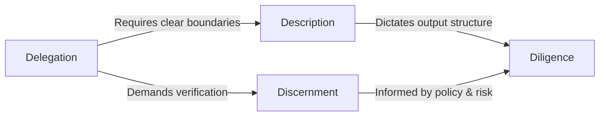

# 4D Framework for AI Fluency

AI fluency extends beyond basic technical literacy or the mechanical knowledge of syntax and model APIs. True fluency is the capacity to systematically integrate Generative AI into cognitive workflows, maximizing output quality while minimizing risks such as hallucination, inefficiency, and technical debt. As LLM capabilities advance, the primary bottleneck shifts from the model's raw intelligence to the user's operational framework.

The 4D Framework provides a structured, repeatable mental model designed to optimize human-AI collaboration. By breaking down AI interactions into four distinct vectors—Delegation, Description, Discernment, and Diligence—this framework helps engineers and knowledge workers move from ad-hoc prompting to predictable, high-signal engineering workflows. It provides a blueprint for maintaining agency, quality, and ethical accountability when building alongside intelligent systems.

## The Four Dimensions

### Delegation

Delegation is the strategic division of labor between human cognition and machine processing. It requires evaluating a task's properties to determine which subcomponents should be executed by humans, automated via deterministic code, or handed off to probabilistic AI models.

- **Why It Matters**: Misalignment in delegation leads to two primary failure modes: over-reliance and under-utilization.
	- Assigning complex, low-margin-for-error reasoning entirely to an LLM without guardrails introduces systemic defects.
	- Conversely, using highly capable frontier models for tasks easily handled by standard regex or deterministic scripts wastes compute and introduces unnecessary latency and cost.
	- Proper delegation maximizes workflow throughput by ensuring both human and machine operate within their optimal cognitive domains.
- **How It Appears in Practice:** Practitioners evaluate tasks based on two axes: execution complexity and error tolerance. 
	- **High Complexity, High Error Tolerance (The "Drafting" Zone):** Prime territory for heavy AI delegation. Tasks like architectural brainstorming, writing initial documentation drafts, or exploring alternative API designs. The AI rapidly generates breadth, and humans edit for precision.
	- **High Complexity, Low Error Tolerance (The "Engineering" Zone):** Must remain strictly human-led. Tasks like writing core cryptographic modules, finalizing database schema migrations, or resolving deep system bugs. AI is relegated to a localized, supportive role (e.g., inline code completion) rather than structural generation.
	- **Low Complexity, Low Error Tolerance (The "Deterministic" Zone):** Should be delegated to traditional code, not generative AI. Tasks like regex parsing, exact data formatting, or arithmetic calculations. Using a probabilistic LLM here introduces unnecessary risk, latency, and cost when a standard Python script provides 100% reliability.
	- **Low Complexity, High Error Tolerance (The "Automation" Zone):** Ideal for end-to-end AI automation. Tasks like categorizing user feedback, summarizing internal meeting notes, or tagging bug reports. Because a minor hallucination carries little risk, the AI can run largely unsupervised in the background.
 - **Practical Example**:  When refactoring a legacy codebase, a software engineer breaks the task into subcomponents:
	- **Human:** Maps system architecture dependencies and defines the target state.
	- **AI:** Generates standard boilerplate code, converts syntax across versions, and writes initial unit test suites based on defined schemas.
- **Common Mistakes & Failure Modes**
	- **The "Black Box" Handoff:** Delegating a highly complex problem end-to-end to an LLM without breaking it down into modular, verifiable steps.
	- **Reverse Delegation:** Spending hours debugging an AI's malformed output for a task that a human engineer could have written deterministically in fifteen minutes.
-  **Concrete Heuristics & Questions**
	- _Does this task require absolute deterministic accuracy, or does it benefit from probabilistic variation?_
	- _If the AI output is 80% correct, does the time saved on the initial generation exceed the time required for human review and debugging?_
	- _Heuristic:_ Delegate the generation of breadth; retain human ownership over the architecture of depth.

### Description

Description is the precise articulation of boundaries, execution steps, context, and formatting constraints to an AI system. It translates human intent into unambiguous instructions that optimize the model's latent processing capabilities.

- **Why It Matters**: LLMs do not possess ambient context or intuitive understanding; they operate entirely on token probabilities influenced by the prompt payload.
	- Vague or ambiguous descriptions force the model to fill context gaps with statistical averages, resulting in generic, irrelevant, or hallucinated outputs.
	- High-fidelity description minimizes iteration cycles by constraining the model's solution space to exactly what the task requires.
- **How It Appears in Practice:** Description manifests as structural prompt engineering and context assembly.
	- This involves using system instructions, defining explicit input-output schemas (e.g., JSON Schema), providing few-shot examples, specifying the role or perspective the model must adopt, and establishing negative constraints (what _not_ to do).
- **Practical Example**: Instead of asking an AI to "write an API documentation file," a technical writer provides:
	- A structured markdown schema.
	- An example of an existing high-quality documentation file.
	- The raw source code of the endpoints.
	- Explicit constraints: _"Output strictly in Markdown. Do not include introductory conversational filler. Document all status codes explicitly. Use the imperative mood for endpoint descriptions."_
- **Common Mistakes & Failure Modes**
	- **Conversational Drift:** Treating the AI as a human colleague by using polite but ambiguous prose instead of clear, declarative pseudo-code or structured instructions.
	- **Context Smuggling:** Assuming the model remembers implicit details from previous threads or unstated project requirements, leading to structurally misaligned outputs.
- **Concrete Heuristics & Questions**
	- _Could a junior engineer who knows nothing about my project successfully execute this task using only the instructions I provided to the AI?_
	- _Have I explicitly defined the structure, constraints, and evaluation criteria for the output?_
	- _Heuristic:_ Define what the output must _exclude_ with the same precision used to define what it must include._

### Discernment

Discernment is the systematic validation and critical evaluation of AI-generated outputs. It treats all machine assets as unverified hypotheses requiring empirical testing, logical verification, and domain alignment before integration into production systems.

- **Why It Matters**: Because generative models operate on token prediction rather than objective truth, they naturally produce plausible-sounding errors (hallucinations).
	- Without rigorous discernment, flawed code, inaccurate facts, or biased reasoning can easily slip into production pipelines, creating silent failures that are incredibly costly to diagnose down the line.
- **How It Appears in Practice:** In engineering, discernment looks like automated testing, static analysis, and code reviews of all AI-generated contributions.
	- In knowledge work, it involves cross-referencing claims against source material, checking logical consistency between premises and conclusions, and looking for subtle omissions or generic advice that lacks depth.
- **Practical Example**: An analyst uses an LLM to synthesize a market research report.
	- Instead of accepting the summary at face value, the analyst cross-checks every cited statistic against the original PDF sources.
	- They verify that the calculations match the raw financial tables.
	- They flag sections where the model used ambiguous phrasing to gloss over missing data points.
- **Common Mistakes & Failure Modes**
	- **Automation Bias:** The psychological tendency to trust machine-generated outputs blindly, assuming that because an LLM generated the text or code rapidly, it must be correct.
	- **Superficial Review:** Skimming an AI output for syntax or grammar compliance while missing deep semantic errors or architectural flaws beneath the surface.
- **Concrete Heuristics & Questions**
	- _How would I independently verify the accuracy of this output if I knew for a fact it contained a subtle error?_
	- _Is this output genuinely insightful, or is it just a statistically plausible arrangement of words that sounds authoritative?_
	- _Heuristic:_ Never merge AI-generated code or publish AI-generated content that you do not fully understand well enough to debug or defend yourself.

### Diligence

Diligence is the commitment to responsible, ethical, and sustainable AI utilization. It governs long-term engineering and operational choices, ensuring transparency, data security, compliance, intellectual property protection, and accountability.

- **Why It Matters**: Ad-hoc AI use can easily expose sensitive data, infringe on intellectual property copyrights, or introduce unstable system dependencies.
	- Diligence ensures that using AI tools doesn't inadvertently introduce regulatory liabilities, security vulnerabilities, or operational debt that damages organizational integrity.
- **How It Appears in Practice:** Diligence requires strict adherence to data-governance policies.
	- This means verifying that source data fed into prompts doesn't violate PII (Personally Identifiable Information) or corporate confidentiality rules.
	- It also involves tracking down the open-source licensing constraints of code models, maintaining clear documentation of AI usage in a project's lineage, and evaluating the long-term maintainability of AI-generated architectures.
- **Practical Example**: Before paste-copying proprietary financial data into a public web-based LLM interface to generate a chart, an engineer:
	- Strips out all identifying client names, accounts, and internal metrics.
	- Alternatively, routes the data through an enterprise-compliant, zero-data-retention API endpoint specified by their security team.
- **Common Mistakes & Failure Modes**
	- **Data Leakage:** Pasting protected intellectual property, internal source code, or private user data into consumer-grade AI tools that use inputs for model retraining.
	- **Dependency Bloat:** Using AI to rapidly generate vast libraries of unneeded code or documentation, leaving a legacy footprint that team members will struggle to maintain over time.
- **Concrete Heuristics & Questions**
	- _Does my use of this data or model comply with our organization's security policy and the licensing terms of the source material?_
	- _Am I creating a technical debt liability that my team will have to support when this specific model is deprecated?_
	- _Heuristic:_ Treat every piece of data entered into an external AI interface as if it were being published to a public forum.

## Interactions Between the Dimensions

The four dimensions do not operate in isolation; they function as an interconnected system where failure in one domain degrades the performance of the others.

### Reinforcement Loops

- **Description drives Discernment:** The more explicit and structured your _Description_ is (e.g., providing an exact evaluation checklist within the prompt), the simpler and more effective your _Discernment_ phase becomes. You can systematically check the output against the explicitly stated criteria.
- **Diligence shapes Delegation:** Strong _Diligence_ parameters set clear guardrails for _Delegation_. For instance, knowing that your project contains highly regulated data immediately prevents you from delegating certain parsing tasks to external third-party models, forcing you to use local or fine-tuned open-weights alternatives instead.

### Tradeoffs and Tensions

- **Speed vs. Discernment:** High-velocity workflows often conflict with deep discernment. If you delegate at a high volume to speed things up, you create a review bottleneck during discernment. Finding the right balance means adjusting the scale of what you delegate to match your actual capacity for thorough review.
- **Description Overhead vs. Autonomous Delegation:** Providing exhaustive, flawless descriptions can sometimes take just as long as doing the task yourself. True fluency requires recognizing when to spend time writing rigorous instructions versus when to delegate smaller, iterative tasks using simpler, conversational prompts.
