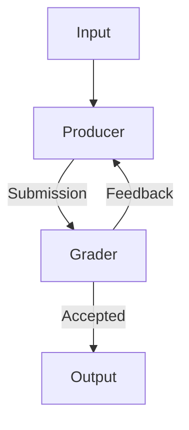
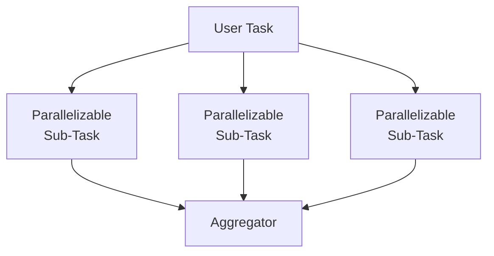
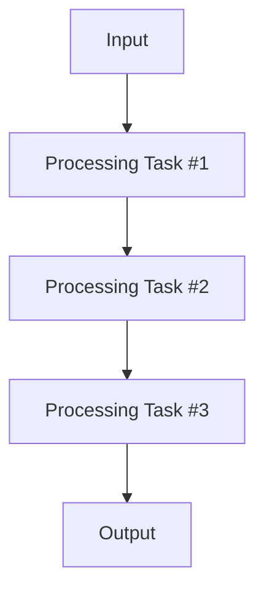
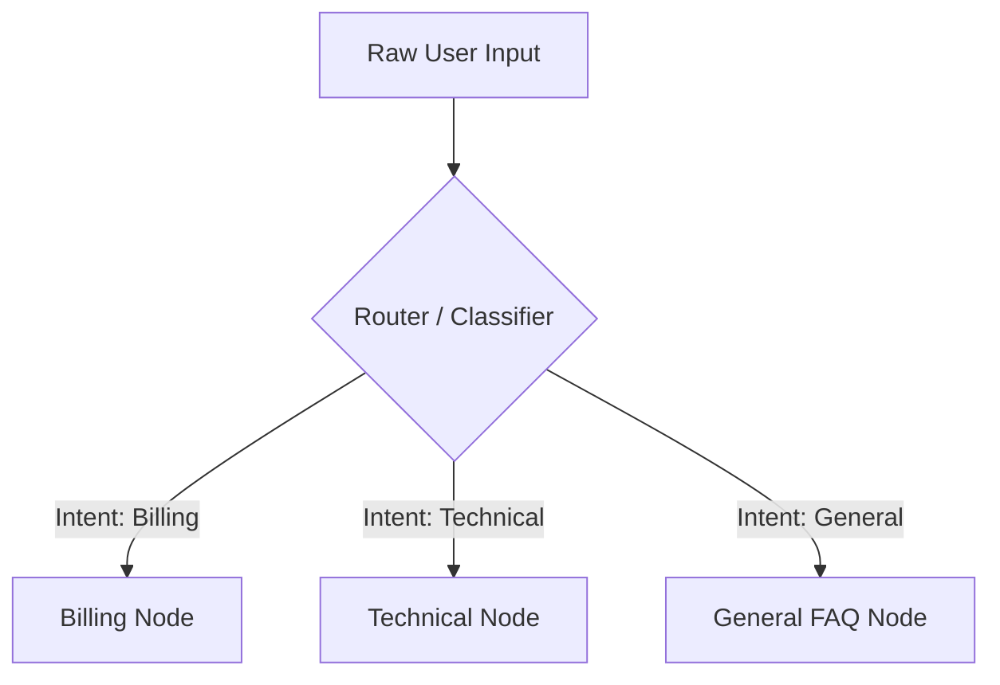
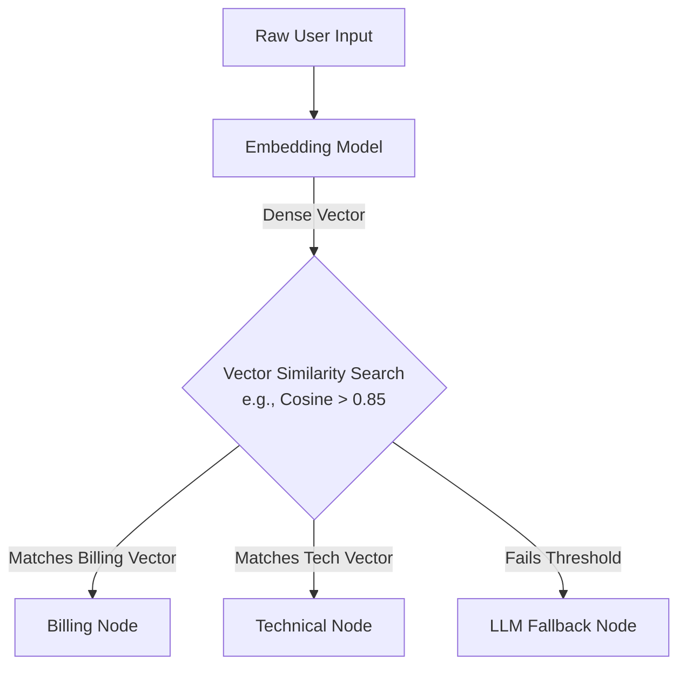
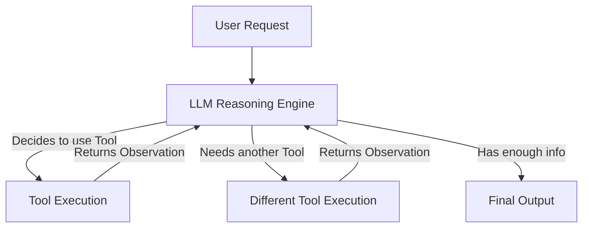

# Agents and Workflows

In Generative AI architecture, orchestrating how a language model interacts with your application generally falls into two distinct paradigms: Workflows and Agents. The decision between the two fundamentally dictates the predictability, flexibility, and reliability of your system.

## The Two Paradigms

### Workflows (Deterministic Orchestration)

Workflows are a predefined, hardcoded series of LLM calls designed to solve a specific, known problem. You use a workflow when you can map out the exact sequence of steps required to complete a task ahead of time.

Think of workflows as a mechanism for breaking a massive, complex objective into much smaller, isolated sub-tasks. Because each step focuses on a single, tightly constrained area, the model can execute its instructions with extreme precision.

### Agents (Autonomous Execution)

In Generative AI architecture, orchestrating how a language model interacts with your application generally falls into two distinct paradigms: workflows and agents. The decision between the two fundamentally dictates the predictability, flexibility, and reliability of your system.

- Workflows are a predefined, hardcoded series of LLM calls designed to solve a specific, known problem.
	- You use a workflow when you can map out the exact sequence of steps required to complete a task ahead of time.
	- Think of workflows as a mechanism for breaking a massive, complex objective into much smaller, isolated sub-tasks.
	- Because each step focuses on a single, tightly constrained area, the model can execute its instructions with extreme precision.
- With an agentic architecture, the LLM is given a high-level objective and a set of basic tools, and is expected to dynamically formulate its own execution plan.
	- Unlike workflows, you do not know exactly what inputs the system will receive or what execution path is optimal.
	- Agents are highly adaptive. They can creatively figure out how to handle a wide variety of novel challenges by combining tools in unexpected ways, or even pausing to ask the user for clarifying input when they lack necessary information.

Your primary goal as an AI engineer is to solve problems reliably. End-users do not care if your backend is powered by a complex, autonomous agent—they simply want a product that works consistently without failing.

> **The Golden Rule:** Always default to implementing **Workflows**.

Workflows provide the absolute reliability and predictability that production-grade applications demand. You should only escalate to an **Agent** architecture when the application's requirements are so varied, unpredictable, or open-ended that hardcoding a sequence of steps is impossible.
## Workflow Patterns

The goal of identifying different workflows is to establish a set of repeatable engineering recipes for implementing AI features. These patterns have proven successful across the industry for building reliable production systems, making them essential to understand and apply to your own architecture.

## The Evaluator-Optimizer Pattern

This workflow is a classic example of the [evaluator-optimizer pattern](Prompt%20Evaluation.md). It relies on internal iteration to guarantee output quality before returning a final result to the user. Here is how it works:

* **Producer**: Takes the initial input and generates a draft output (e.g., an LLM writing a Python script to generate a 3D rendering).
* **Grader**: Evaluates that generated output against strict, predefined criteria (acting as an automated judge).
* **Feedback loop**: If the grader rejects the output, it sends specific, targeted feedback back to the producer so it can attempt a fix.
* **Iteration**: This cycle repeats until the grader accepts the output (or a maximum retry threshold is reached).

## Parallelization Workflows

The parallelization pattern works by breaking a complex task into independent, concurrent operations. The workflow follows a strict sequence:

- **Split the task:** Break down a massive or multifaceted problem into focused, specialized sub-tasks.
- **Execute concurrently:** Run all sub-tasks in parallel simultaneously to minimize total processing latency.
- **Aggregate the results:** Combine the independent, specialized analyses into a single, cohesive final output.

The parallelized sub-tasks do not need to be identical; each can utilize a completely unique system prompt, toolset, or evaluation criteria optimized for its specific domain.

> [!EXAMPLE] Automated Code Review
> 
> Imagine you are building an automated code assistant to review incoming Pull Requests. Your first instinct might be to write one massive prompt that instructs the AI to look for security bugs, performance bottlenecks, and style compliance all at once.
> 
> However, asking a single model instance to catch a subtle SQL injection vulnerability while simultaneously counting spaces for indentation spreads the model's attention too thin. Because the scope of the request is so massive, the AI suffers from attention dilution and drops specific instructions, leading to inconsistent reviews where critical bugs slip through the cracks.
> 
> Instead, you can split the code review into three specialized, parallel tracks:
> 
> - **The Security Worker:** This prompt includes dedicated criteria focusing exclusively on the OWASP Top 10, credential leaks, and data sanitization. It ignores formatting entirely.
>     
> - **The Performance Worker:** Running at the same time, this prompt evaluates the code strictly for memory leaks, inefficient loops, and database bottlenecks like N+1 queries.
>     
> - **The Style Worker:** This independent prompt audits the code purely for naming conventions, modularity, readability, and documentation compliance.
>     
> 
> Once all three specialized evaluations complete, you feed their isolated findings into a final **Aggregator Node**. The aggregator prompt takes the security flags, performance notes, and style critiques, deduplicates any overlapping feedback, and compiles a single, cohesive, developer-friendly markdown report.
> 
> By separating these domains into isolated tasks, you ensure each expert prompt does one thing exceptionally well, yielding a drastically more reliable and thorough code review tool.

### Engineering Benefits

- **Focused Attention:** The LLM can concentrate on one specific aspect of the task at a time rather than trying to balance multiple competing considerations simultaneously. This dramatically reduces cognitive load and prevents the model from missing subtle errors.
- **Isolated Optimization:** You can test, version, and optimize the prompts for each sub-task independently. If your security analysis is missing edge cases, you can tune that specific prompt or switch it to a more capable model without affecting the performance or style workers.
- **Horizontal Scalability**: Expanding the workflow is straightforward. If you decide to add a "Business Logic / Ticket Alignment" check to your pipeline (to verify if the PR actually satisfies the acceptance criteria of the linked Jira ticket), you simply spin up a fourth parallel request without needing to rewrite or test your existing security or performance prompts.
- **Improved Reliability:** By dividing a monolithic task into micro-tasks, you get highly consistent, predictable, and deterministic results from your LLM calls.

### When to Use This Pattern

This pattern is ideal when a complex decision or generation task can be cleanly separated into independent evaluations. Look for situations where you are asking an AI to consider multiple distinct criteria, audit different domains of expertise, or compare several options simultaneously.

The primary architectural requirement is that **each sub-task must be able to operate independently** without needing information or context from the other parallel tracks to complete its job.

## Chaining Workflows

While parallelization handles independent tasks simultaneously, **Chaining** is designed for dependent tasks. A chaining workflow executes a strict sequence of LLM calls where the output of one step becomes the direct input (or context) for the next step.

Instead of asking the model to perform a massive, multi-step logical leap in a single prompt, you force it to pause, output its intermediate work, and pass the baton to the next prompt in the pipeline.

> [!EXAMPLE] Legacy Code Modernization
> Imagine you are tasked with migrating a massive, 2,000-line legacy SQL Stored Procedure into a modern Python REST API. If you pass the entire SQL file to an LLM and prompt, _"Rewrite this as a Python microservice,"_ the model will attempt a literal line-by-line translation, resulting in terrible, unidiomatic Python that fails to capture the actual business intent.
> 
> Instead, you chain the workload across three strictly dependent nodes:
> 
> - **Node 1 (The Deconstructor):** The first prompt receives the raw SQL. Its only job is to untangle the spaghetti code and output a plain-English, step-by-step logical blueprint of the underlying business rules (e.g., _"Step 1: Check user balance. Step 2: If balance > 0, apply discount..."_).
>     
> - **Node 2 (The Architect):** The pipeline takes that plain-English blueprint and feeds it to a second prompt. This prompt ignores SQL entirely. Its job is to read the business rules and design a modern **OpenAPI JSON specification** (defining the endpoints, request payloads, and response schemas) needed to support those rules.
>     
> - **Node 3 (The Implementer):** The pipeline takes the OpenAPI JSON and passes it to the final prompt. This prompt reads the JSON spec and writes the clean, idiomatic Python FastAPI boilerplate code to execute those endpoints.

### Engineering Benefits

- **Stateful Observability:** Because the task is broken into discrete API calls, you can log the exact output at every step. If the final Python code is wrong, you can check Node 1's blueprint to see if the LLM misunderstood the original SQL, or check Node 2 to see if it designed a bad API schema. You instantly know _where_ the logic failed.
- **Graceful Halting (Human-in-the-Loop):** You can pause the pipeline between nodes. For instance, you can have Node 2 output the proposed API schema to a human lead engineer for approval before paying the compute cost for Node 3 to generate all the actual code.
- **Preventing Attention Dilution:** By isolating the steps, the LLM doing the Python coding (Node 3) never even sees the messy, distracting legacy SQL. It only sees clean API specs, dramatically reducing hallucination.
- **Model Routing:** You can use different models for different steps in the chain. You might use your most advanced, reasoning-heavy model (like Claude 3.5 Sonnet or GPT-4o) for the complex SQL deconstruction in Node 1, but route Node 3 (simple Python boilerplate generation) to a faster, cheaper model to save costs.

### When to Use This Pattern

Use chaining when a task requires a **chronological dependency**—meaning Step B logically cannot begin until Step A is fully completed. It is the ideal architectural choice when:

- **Requirements are highly complex:** You are dealing with multifaceted problems that have numerous, compounding requirements that overwhelm a single pass.
- **Attention is dropping:** The LLM consistently ignores specific constraints, formatting rules, or edge cases when they are packed into a single, massive prompt.
- **Intermediate validation is required:** You need your software to programmatically process, sanitize, or validate the outputs between steps (or involve a human-in-the-loop) before paying the compute cost to continue.
- **Focus must be preserved:** You want to keep each interaction tight, manageable, and strictly constrained to a single domain of reasoning.

## Routing Workflows

A routing workflow acts as an intelligent traffic director. Instead of forcing a single, massive prompt to understand and execute every possible user intent, an initial classification step analyzes the input and dispatches it to a specialized downstream prompt, model, or toolset.

> [!EXAMPLE] Customer Support Triage
> 
> Imagine you are building an AI customer service agent for a SaaS product. If you try to build a single "God Prompt" that contains all the rules for processing refunds, troubleshooting API errors, and answering general pricing questions, the prompt becomes bloated. The model will inevitably mix up contexts, perhaps offering a refund when the user just wanted to debug a code snippet.
> 
> Instead, you build a Routing workflow:
> 
> - **The Router (Node 1):** The user submits a message. This input is sent to a fast, cheap classification prompt whose _only_ job is to analyze the text and output a single JSON key: `billing`, `technical`, or `general`.
>     
> - **The Billing Track:** If routed here, the input is passed to a specialized prompt that has explicit access to the Stripe API and strict instructions on refund policies. It knows nothing about code.
>     
> - **The Technical Track:** If routed here, the input is passed to a different prompt designed to act as a Senior Developer, armed with tools to search the API documentation vector database.
>     

### Engineering Benefits

- **Context Window Optimization:** By routing the request, you only load the exact instructions, API tools, and RAG data needed for that specific intent. This drastically reduces token usage and prevents the attention mechanism from getting confused by irrelevant rules.
- **Cost and Latency Arbitrage:** The Router step is a simple classification task, meaning it can be handled by a lightning-fast, highly inexpensive model (like Llama 3 8B or GPT-4o-mini). You only pay the compute cost of a heavy, frontier model if the router dispatches the task to the "Technical" track.
- **Isolated Optimization (Separation of Concerns):** If your bot starts hallucinating refund policies, you only have to edit the prompt for the "Billing" node. Because the tracks are isolated, you run zero risk of accidentally breaking your "Technical" node's behavior.
- **Fallback Safety:** If the router cannot confidently determine the user's intent, it can route the request to a deterministic "Human Handoff" function rather than attempting to guess.

### When to Use This Pattern

Use routing when your application has a wide, open-ended entry point (like a chatbox) but the actual execution paths are strictly categorized. Reach for this architecture when:

- **Inputs fall into distinct categories:** The user could be asking for completely different types of actions that share no overlapping logic.
- **Tooling requirements vary:** Different tasks require completely different external APIs, databases, or context documents.
- **You hit the "God Prompt" wall:** Your current single prompt is growing too large, and adding rules for a new feature is causing the model to forget older rules.
### The Semantic Router

Using an LLM to classify intent is flexible, but it is slow and costs token generation fees. If your categories are well-defined, you can replace the LLM router with a deterministic **Semantic Router** using the exact same embedding models you use for your RAG database.

**How it works:**

1. **Pre-computation:** You create a list of "canonical utterances" for each route. For the Billing route, you might list: _"How do I cancel?"_, _"Where is my invoice?"_, and _"Refund my credit card."_ You generate embeddings for these phrases and store them in memory.
2. **Runtime Execution:** When a user submits a query, you pass it through a fast embedding model (like `text-embedding-3-small` or a local model) to get a single vector.
3. **Deterministic Math:** You calculate the Cosine Similarity between the user's vector and your canonical route vectors. If the similarity score crosses a strict, hardcoded threshold (e.g., $> 0.85$), the system programmatically routes the request to that node.

#### Engineering Benefits

- **Near-Zero Latency:** Generating an embedding and calculating cosine similarity takes milliseconds. Using an LLM to read and classify a prompt can take seconds.
- **Near-Zero Cost:** Embedding models cost fractions of a penny per million tokens. If you run the embedding model locally, the routing step is completely free.
- **Absolute Determinism:** LLMs are probabilistic; they might classify the exact same prompt differently on a Tuesday than they do on a Wednesday. Math is absolute. A vector distance of $0.88$ will always route to the same place, making your application highly predictable.
- **Graceful Fallbacks:** If the user types gibberish or a completely novel request, the cosine similarity will fail to hit your threshold. You can catch this mathematically and route it to an "LLM Fallback Classifier" or a human operator, saving compute.
#### When to Use This Pattern

Semantic routing is the gold standard for high-traffic entry points. You should implement this when:

- You have high query volume and need to aggressively slash API costs.
- The application requires sub-second routing responses to feel snappy to the user.
- Your downstream nodes represent distinct, easily definable concepts (like "Billing" vs. "Technical Support") where the semantic boundaries are clear.

## Agents (Autonomous Execution)

In every workflow we have discussed so far (Chaining, Routing, Parallelization), the control flow is dictated by traditional code. Your Python or Node.js backend decides what happens next.

In an **Agentic** architecture, you surrender control of the routing and the loops directly to the LLM. The model acts as the "brain," analyzing the user's request, reviewing its available tools, and dynamically deciding which tools to call, in what order, and how many times to repeat the process until it solves the problem.

### The Core Engine: The ReAct Loop

Agents typically operate on a cognitive framework called **ReAct** (Reason + Act). Instead of generating a final answer immediately, the LLM is prompted to enter an internal monologue and execution cycle:

1. **Thought:** The model analyzes the current state and decides what it needs to do next. *(e.g., "The user wants to know the revenue of our largest client. First, I need to find out who the largest client is.")*
2. **Action:** The model outputs a structured request to call a specific tool with specific arguments. *(e.g., Calls `query_database(query="SELECT top_client FROM sales")`)*
3. **Observation:** Your backend executes the tool and feeds the raw result back into the model's context window. *(e.g., "Result: Acme Corp")*
4. **Loop:** The model evaluates the observation. If it needs more data, it loops back to step 1. If it has everything it needs, it breaks the loop and generates the final response to the user.

> [!EXAMPLE] The Autonomous Data Analyst
> 
> A user asks: *"Graph our Q3 user growth against server costs, and email it to the engineering team."*
> Hardcoding a workflow for this exact combination of tasks is nearly impossible, but an Agent handles it dynamically:
> * **Loop 1:** The agent calls `query_sql` to get Q3 user growth.
> * **Loop 2:** The agent realizes the SQL query failed due to a syntax error. It rewrites the query and tries `query_sql` again. It gets the user data.
> * **Loop 3:** The agent calls `fetch_aws_billing` to get the server costs.
> * **Loop 4:** The agent calls `execute_python` to run a matplotlib script using the data from Loops 2 and 3, saving the output as `chart.png`.
> * **Loop 5:** The agent calls `send_email`, attaching the chart.
> * **Final Output:** The agent tells the user, "I have compiled the data, generated the graph, and emailed the team."
> 
> 

### Engineering Guardrails

Because agents are non-deterministic and control their own loops, they introduce massive systemic risks. Without strict engineering guardrails, an agent will easily spiral into infinite loops, burning through API credits or destroying data.

To run agents in production, you must implement the following safeguards:

* **Max Iteration Limits:** Never let a `while` loop run indefinitely. Hardcode a limit (e.g., `MAX_STEPS = 5`). If the agent hasn't solved the problem in 5 loops, force it to stop and return an error to the user.
* **Idempotent / Read-Only Tools:** By default, give agents "read-only" access to databases and APIs. If an agent hallucinates, you want it to fail a `SELECT` statement, not execute a `DROP TABLE`.
* **Human-in-the-Loop (HITL) for Destructive Actions:** If the agent needs to perform an action that alters state (e.g., sending an email, refunding a user, deleting a file), the system must pause the loop and present the intended action to a human for confirmation before the backend actually executes the code.
* **Strict Tool Schemas:** Define your tools using rigid JSON schemas or OpenAPI specs. The less ambiguity there is in how a tool is used, the less likely the agent is to hallucinate parameters.

### When to Use Agents

Agents represent the absolute cutting edge of current AI engineering, but they are expensive, slow, and hard to test. You should only use an Agent when:

* **The task requires open-ended research:** The model needs to search the web, read a result, click a link, and read another result before answering.
* **The path to success is unpredictable:** The required sequence of tools changes drastically depending on what the previous tool returns.
* **Self-correction is necessary:** You are dealing with messy APIs or fragile code generation where you *want* the model to fail, see the error log, and try again autonomously.