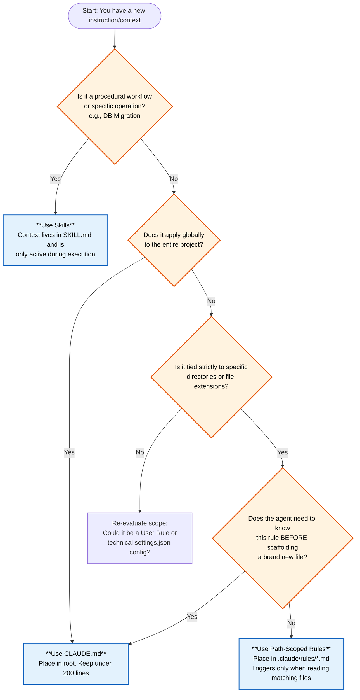

# Persistent Context

Claude Code uses persistent context to carry project knowledge, coding conventions, and personal preferences across sessions. The goal is to reduce repetitive prompting while keeping the agent aligned with the repository and the developer.

## Memory Scopes and Hierarchy

Claude Code evaluates memory sources in a strict priority order. When two instructions conflict, the higher-priority source wins.

### Priority Stack

1. **The Prompt:** The immediate request you just typed.
2. **Active Skills:** Context injected by triggered skill workflows.
3. **Managed Policy:** Organization-wide settings managed by IT or DevOps.
4. **Project Rules:** Modular, topic-specific instructions scoped to files or directories.
5. **Project Memory:** The main shared memory file stored in the repository.
6. **Project Settings:** Tool permissions, MCP server connections, ignore rules, and related configuration.
7. **Local Project Memory:** Personal, uncommitted overrides for one repository.
8. **User-Level Rules:** Personal rules applied across all projects on the machine.
9. **User Memory:** Global personal preferences shared across repositories.
10. **Auto Memory:** Automatically generated notes and learnings captured by Claude.

## `CLAUDE.md` vs `settings.json`

It helps to separate agent instructions from engine configuration.

| **Aspect** | **`settings.json`** | **`CLAUDE.md`** |
| ---------- | ------------------- | --------------- |
| **Format** | JSON | Markdown |
| **Primary use** | Tooling and runtime configuration | Coding style, architecture, and workflow instructions |
| **Visibility** | Hidden configuration file | Visible project file in the repository root |
| **Best for** | Always-on technical behavior | Onboarding, conventions, and build or test commands |

## Managing `CLAUDE.md` and Rules

`CLAUDE.md` is the main steering file for project behavior. Keep it focused. Anthropic recommends staying under 200 lines.

### Path-Scoped Rules

To keep `CLAUDE.md` lean, move narrow or file-specific guidance into scoped rules. One important limitation applies:

- Path-scoped rules only activate after Claude reads a matching file.
- Path-scoped rules do not activate merely because Claude is creating a new file in that path.

## Auto Memory

Claude writes Auto Memory to capture learnings discovered over time. These files live outside the project tree.

- **Purpose:** Store useful discoveries such as working build commands, debugging findings, and recurring user corrections.

## Dynamic Context Loading via Hooks

Hooks such as `PreToolUse` and `UserPromptSubmit` can modify or enrich the active context before Claude takes action. This allows context loading to be automated instead of relying only on static files.

## Troubleshooting Memory

If Claude appears to ignore instructions:

- Run `/memory` to inspect which memory files are currently loaded.
- Keep `CLAUDE.md` under 200 lines.
- Check for conflicting rules across different memory scopes.
- Ensure Claude has already read a matching file if a path-scoped rule should apply.

## Deciding Between CLAUDE.md, Rules, and Skills

Think of the context hierarchy like an engineering team's knowledge base. You must distribute instructions efficiently to prevent overflowing the AI's context window. Choose your injection method based on the scope, domain, and duration of the task.

**When should you use `CLAUDE.md`?**
Use this file for global, project-wide instructions that the agent must know at all times. It acts as the team handbook, is visible in the root of the project, and is best suited for onboarding, architecture overviews, and baseline coding styles. Keep this file under 200 lines. If it grows too large, the model may suffer from the "lost in the middle" phenomenon and ignore key constraints.

**Is the context tied to a specific directory or file type?**
If yes, use Path-Scoped Rules (`.claude/rules/*.md`). Use these for modular, topic-specific instructions. For example, if you have validation constraints that apply strictly to your backend API routes, configure a rule file with `paths:` YAML frontmatter to target those specific directories. Keep in mind a crucial caveat: these rules are triggered only when Claude reads a matching file, not when it creates one. If a rigid constraint must be known before scaffolding a brand new file, place it in `CLAUDE.md` instead.

**Is this a procedural workflow?**
If the context is only relevant during a specific operation—like executing a multi-step database migration or diagnosing a staging deployment—use Skills. When a skill is triggered, its specific context via `SKILL.md` is injected directly into the active priority stack. This context remains active only for the duration of the skill execution. Rely on skills to keep your baseline memory clean while providing deep, task-specific instructions exactly when the agent needs them.