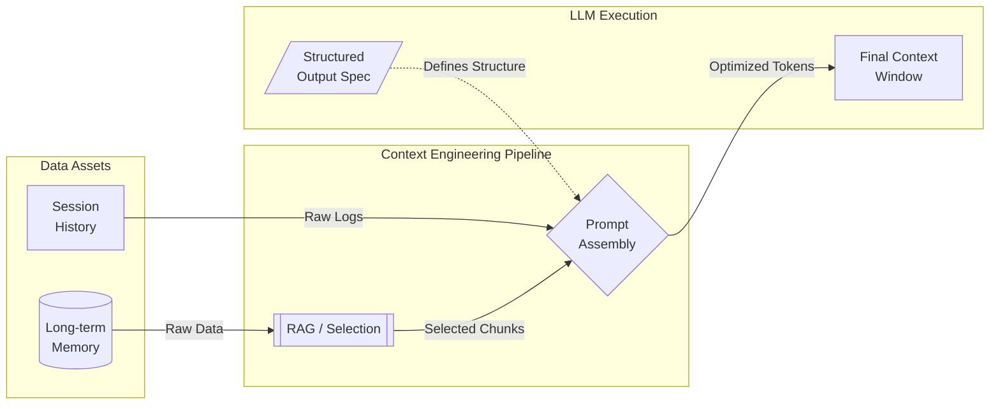
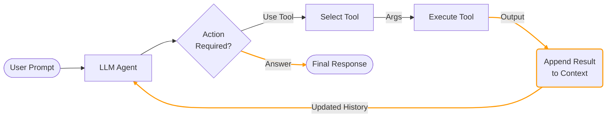
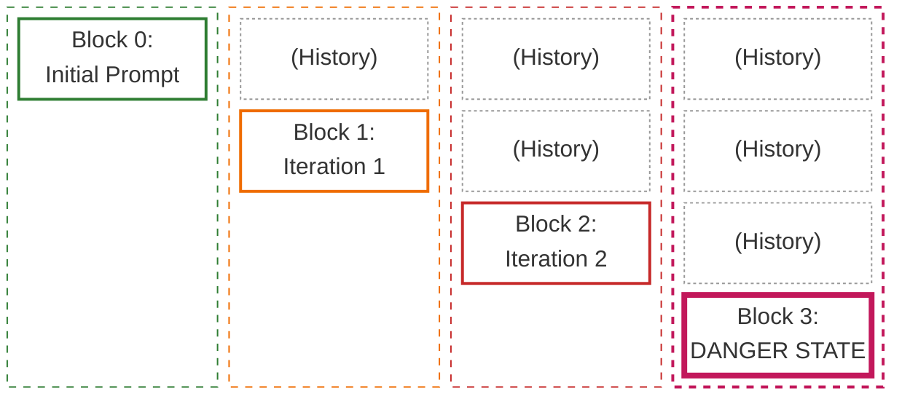

# Context Engineering

Context serves as the "short-term memory" of a Large Language Model (LLM). It encompasses all the information—text, instructions, and data—provided within a single session that the model uses to generate a relevant response.

* The Constraint: Every LLM has a Context Window, a finite capacity for how much information it can process at once. If this limit is exceeded, the model may "forget" the earliest parts of the conversation.

Context Engineering is the strategic practice of organizing, optimizing, and curating the input provided to an LLM. The goal is to maximize the accuracy and relevance of the output while maintaining efficiency within the model's technical limits.




## The Growing Need for Context Engineering

Context Engineering is becoming increasingly critical as the variety of context sources expands daily. Modern LLMs must now synthesize information from diverse inputs, including application state, user interaction history, and dynamic data sources.

A prime example of this complexity is a Tool-Calling Agent. In this scenario, the "context" is not static; it grows iteratively as the agent executes code or retrieves data, requiring the model to manage a feedback loop of inputs and outputs.



With every iteration, an LLM agent accumulates reasoning steps, tool outputs, and error logs.



This creates a "Compounding Context" effect: the input size grows linearly (or exponentially) with every turn, leading to higher latency and potential failure.

This accumulation introduces opportunities to critical risks:

- **Context Poisoning (Logic Corruption):** A single piece of incorrect information (e.g., a hallucinated tool output) enters the history and derails all subsequent reasoning. The model treats this error as a fact.
- **Context Confusion (Dilution):** As unnecessary noise accumulates, the signal-to-noise ratio drops. The model loses track of the original instruction ("Lost in the Middle" phenomenon), leading to vague or irrelevant responses.
- **Context Clash (Inconsistency):** New information contradicts earlier data in the same session. The model struggles to reconcile these conflicts, often resulting in incoherent or oscillating behavior.

## Context Engineering Strategies

The common strategies are grouped into four categories: write, select, compress, and isolate.

### Write context

Writing context means saving it outside the context window to help an agent perform a task.

#### Scratchpads

A **scratchpad** is an external working memory layer used to store information outside an LLM's primary context window. Think of it as a "sticky note" for the model—a place to offload cognitive load so the prompt remains lean and focused.

**Why Scratchpads are Essential**

Since models have a "bounded context" (a physical limit on how much text they can process at once), scratchpads solve three critical issues:

- **Prevents State Bloat:** Stops the prompt from becoming a "junk drawer" of history, which can lead to the model losing track of instructions.
- **Ensures Persistence:** Allows information to survive across multiple steps or turns in a workflow.
- **Enables Selective Retrieval:** Data is only injected back into the prompt when it is actually needed for the current task.

**Anatomy of a Scratchpad**

Instead of everything living in the conversation history, a scratchpad stores specific, high-value data points:

- **Execution Plans:** The step-by-step roadmap and the status of the current objective.
- **Intermediate Artifacts:** Drafts, code snippets, or raw reasoning chains that aren't yet ready for a final response.
- **Extracted Facts:** High-density data like names, dates, or technical specifications pulled from long-form inputs.
- **Task Progress:** A log of what has been successfully completed, what failed, and what requires a retry.

**Lifecycle and Scope**

Scratchpads are generally categorized by how long they "live":

- **Task-Scoped:** These are ephemeral and cleared as soon as a specific workflow (like a single document summary) is finished.
- **Session-Scoped:** These persist for the duration of a user session or a runtime process, maintaining continuity during a long conversation.
- **Long-Term (Durable):** These are designed to persist across days or weeks, often using external databases to "remember" a user's preferences or past work.

**Implementation Strategies**

1.  **External Storage (Tool-Augmented)**: The model uses function calling to write to or read from a persistent source.

    - **Methods:** Writing to JSON/Markdown files, updating a SQL/NoSQL database, or upserting into vector stores (RAG).
    - **Pros:** Highly durable, can survive system restarts, and supports massive datasets.
    - **Cons:** Introduces latency via I/O and requires the model to know *how* and *when* to retrieve the data.

2.  **In-Memory Runtime State**: The state is managed by the application code and appended to the system prompt or passed as a variable.

    - **Methods:** Storing a JSON object in the application's RAM during the session.
    - **Pros:** Extremely fast access with no external dependencies or API overhead.
    - **Cons:** Volatile (lost if the app crashes) and still consumes context window space when injected.
    
    ```json
     {
         "agent_state": {
             "plan": "Migrate database to PostgreSQL",
             "completed_steps": ["Backup current DB", "Provision new instance"],
             "critical_facts": {"port": 5432, "schema": "v3_final"}
         }
     }
    ```

#### Memories

While a scratchpad is for the "here and now," **Memories** represent the long-term, durable storage that allows an AI to evolve from a stateless tool into a personalized collaborator.

Memories bridge the gap between individual sessions, ensuring that the model doesn't "forget" who you are or what you’ve achieved once the current window is closed.

**Why Memories are Essential**

Without a long-term memory layer, every interaction with an AI starts from zero. Memories solve the "Goldfish Effect":

- **Deep Personalization:** The model learns your coding style, communication preferences, and specific constraints over weeks or months.
- **Knowledge Accumulation:** It retains the outcomes of past experiments or decisions, preventing you from repeating the same mistakes.
- **Relationship Continuity:** It tracks the "story" of a project across hundreds of different chat sessions.

**Anatomy of a Memory**

Unlike the operational data in a scratchpad, memories are typically categorized by their utility:

- **User Preferences:** High-level settings like "Always use Python for data tasks" or "Keep explanations brief and technical."
- **Episodic Memories:** Records of specific past events or milestones, such as "On Oct 12, we decided to use PostgreSQL instead of MongoDB."
- **Semantic Knowledge:** A custom library of facts the model has learned about your specific business, codebase, or hobby.
- **Relational Context:** Understanding how different entities (people, projects, or servers) interact within your specific ecosystem.

**Lifecycle and Scope**

Memories are built to last, generally following a **Durable** lifecycle:

- **Cross-Session:** Data persists indefinitely unless explicitly deleted or updated.
- **Global vs. User-Specific:** Memories can be tied to a single user profile or shared across an entire organization as a "collective brain."
- **Decaying Importance:** Advanced systems use "forgetting algorithms" where rarely accessed memories fade, while frequently used ones are "consolidated" (weighted more heavily).

**Implementation Strategies**

1.	**Vector Databases (RAG)**: This is the industry standard for long-term AI memory.
    - **Methods:** Using tools like Pinecone, Weaviate, or Milvus to store "embeddings" (mathematical representations) of past conversations.
    - **Pros:** Can store millions of memories; extremely efficient at finding "relevant" info based on current context.
    - **Cons:** Requires a retrieval step that can occasionally pull in irrelevant "fuzzy" matches.

2.	**Knowledge Graphs**: A more structured approach that maps relationships between concepts.
    
    - **Methods:** Using Neo4j or similar graph databases to store "Triples" (e.g., *User* -> *Works On* -> *Project X*).
    - **Pros:** Excellent for complex reasoning and maintaining factual integrity.
    - **Cons:** Difficult to build and maintain automatically from raw text.
    
3.	**Profile-Based Metadata**: Simple key-value pairs stored in a traditional database.

    ```json
     {
         "user_profile": {
             "id": "dev_01",
             "expertise": ["Rust", "Kubernetes"],
             "tone_preference": "concise",
             "past_milestones": [
                 "Migration to AWS completed Jan 2025",
                 "Deprecated legacy Ruby API"
             ]
         }
     }
    ```

    - **Pros:** Reliable and easy to edit or audit.
    - **Cons:** Limited in scale; can't capture the "nuance" of long conversations.

