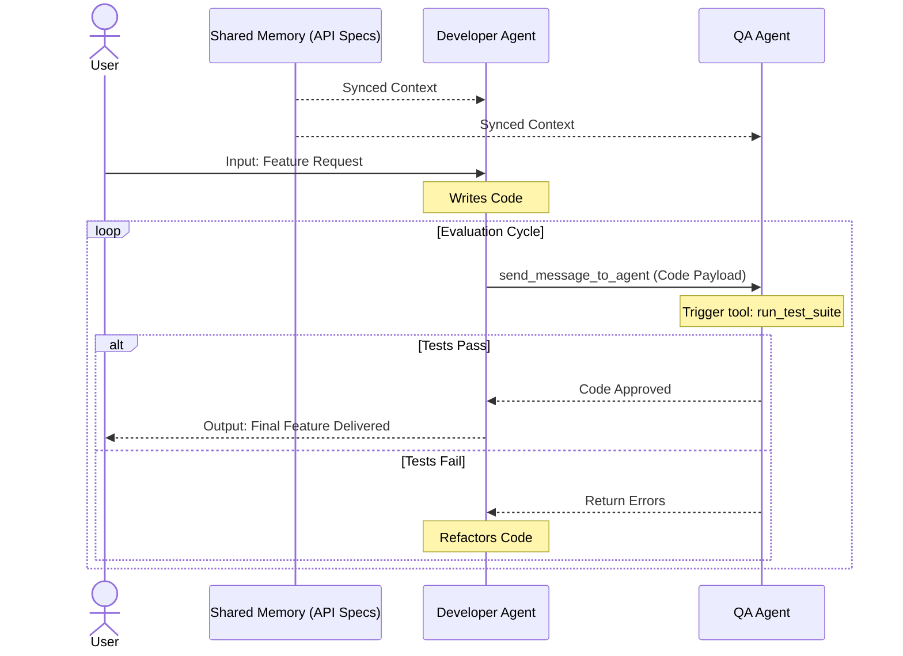

# Agentic Memory Systems

Large Language Models (LLMs) are exceptionally powerful reasoning engines, but fundamentally, they are stateless. They do not carry durable memory across API calls unless the surrounding application architecture explicitly stores and reloads that state. Agentic memory systems solve this limitation by bridging the LLM's finite context window with external databases, retrieval tools, and dynamic update mechanisms.

> [!note] Design Boundary
>
> Use [**Context Engineering**](Context%20Engineering.md#Context%20Engineering) when the main problem is prompt composition, token budgeting, compression, retrieval selection, or context isolation.
>
> Use **Agentic Memory Systems** when the main problem is how an agent stores, updates, retrieves, and coordinates memory beyond the context window.

## The Purpose of Agentic Memory

The context window represents the model's active working set. It is finite, computationally expensive, and highly vulnerable to "context drift" as tool outputs, summaries, and intermediate reasoning steps accumulate during a run.

Building a durable memory architecture solves three primary engineering problems:

* **Cross-Session Continuity:** Enables the agent to remember user preferences, ongoing projects, and prior architectural decisions long after the immediate chat history has been cleared.
* **Selective Recall:** Allows the system to retrieve only the specific, relevant data fragments needed for a given task, rather than wastefully pinning the entire system history into the prompt.
* **Stateful Behavior:** Transforms the agent from a stateless request handler into a dynamic entity that can continuously update and refine its internal knowledge base over time.

*(Note: For techniques on prompt assembly, compression, and context budgeting, refer to your notes on [Context Engineering](Context%20Engineering.md).)*

## The Operating System Mental Model

**Agentic memory behaves like application-level virtual memory for a stateless model.** The model's context window is the scarce execution workspace, while the surrounding agent runtime acts as the memory manager that decides what stays resident, what gets evicted, and what must be fetched back from slower storage.

The useful comparison is not raw RAM alone, but the full virtual-memory stack from [Memory Management](../../Operating%20Systems/03%20Memory%20Management.md): RAM pressure, page tables, page faults, swapping, locality, and isolation.

* **Context Window as RAM / Resident Set:** The active prompt is the only memory directly visible during inference. Like physical RAM, it is fast, scarce, and expensive. Anything needed for immediate reasoning must be resident before the model can use it.
* **Core Memory as Pinned Pages:** Stable user preferences, active goals, and critical constraints behave like pinned pages that should not be casually evicted. They consume precious context space, so the system must keep them compact and high-signal.
* **Recall and Archival Memory as Swap / Disk-Backed Storage:** Prior conversations, documents, and long-term facts live outside the active prompt. They are cheaper to store, but accessing them requires an explicit retrieval operation before they can influence the next generation.
* **Retrieval as a Page Fault:** When the model notices that required information is missing from the active context, it should trigger a search tool. The runtime then loads the relevant fragment back into the prompt, similar to an OS handling a page fault by fetching swapped-out data from disk.
* **Indexes as Page Tables and TLB-Like Caches:** Vector indexes, metadata filters, and memory IDs map a semantic need to stored records. Frequently reused memories can be cached or pinned to avoid repeated searches, just as a TLB avoids repeated page-table walks. The analogy is imperfect because semantic retrieval is probabilistic rather than a deterministic address translation.
* **Summarization as Eviction:** When the context window fills up, the system should evict low-value details into summaries or durable records instead of letting the prompt grow until it drifts. The hard part is preserving information that will matter later without keeping every token resident.
* **Memory Scopes as Isolation Boundaries:** User-specific memory, project memory, organization memory, and shared agent memory should be separated deliberately. This mirrors the way processes get isolated virtual address spaces while still allowing controlled sharing when the OS maps the same physical pages into multiple processes.
* **Locality as Retrieval Quality:** Temporal locality means recently used facts are likely to be needed again soon. Spatial locality means related facts should be stored, summarized, or retrieved together. Good memory design exploits both: keep hot working state near the model and group related durable records so one retrieval brings back coherent context.

> **Architectural Application:** This OS analogy is the core intuition driving advanced memory frameworks like **MemGPT** and **Letta**. In these systems, the model is no longer simply generating text. It is participating in a virtual, multi-layered working set across different memory tiers.

## Durable Memory Boundary

Durable memories persist beyond the current execution, allowing an agent to evolve from a stateless reasoning engine into a personalized, continuous collaborator.

> [!note] **Architectural Distinction**
> 
> [Scratchpads](Context%20Engineering.md#Scratchpads) represent temporary, session-scoped working state used for immediate context engineering. Durable memory begins when state must survive beyond the current task and become searchable, editable, and reusable across future interactions.

### Why Durable Memories Matter

Implementing a persistent storage layer unlocks several advanced agentic capabilities:

- **Deep Personalization:** The model learns user preferences, operational constraints, and communication styles over time, reducing the need for repetitive prompting.
- **Knowledge Accumulation:** The system retains the results of prior experiments, decisions, and corrections, preventing the agent from repeating past mistakes.
- **Relationship Continuity:** The agent preserves the narrative arc of a project across many separate sessions, creating the illusion of uninterrupted collaboration.

### Memory Tiers

Agentic memory architectures generally separate storage into distinct operational tiers based on access latency and token cost. This fundamentally divides what lives _inside_ the active context window from what lives _outside_ it.

- **Tier 1: Core Memory (The Pinned State)**
    - **The Concept:** The small, highly curated block of memory that remains permanently pinned inside the LLM's active context window.
    - **What it Stores:** High-value user facts, the agent's persona instructions, active task state, and global system rules.
    - **Access Pattern:** It is always visible to the model on every single inference pass.
    - **The Constraint:** Because it lives directly in the prompt, it is strictly size-limited by both the model's maximum context window and token economics. To prevent saturation, the agent must be granted tools to actively prune, edit, and compress this block, continuously deciding what is critical enough to keep "in RAM."
- **Tier 2: Recall Memory (The Conversation Log)**
    - **The Concept:** A chronological database storing prior conversation history and episodic events that have been evicted from the active prompt.
    - **What it Stores:** Historical user prompts, past tool outputs, and the agent's previous responses.
    - **Access Pattern:** As a session grows, older messages are pushed out of the context window to save tokens. Instead of being permanently lost, the agent can use semantic search tools to query these prior interactions and "rehydrate" relevant conversational fragments back into the active context when needed.        
    - **Architectural Pattern:** A common optimization is to keep a continuously updated, dense summary of the session pinned in Core Memory, while the full, verbatim historical messages are relegated to Recall Memory.
- **Tier 3: Archival Memory (Cold Storage)**
    - **The Concept:** The massive, long-term external data store for dense information that does not warrant permanent context residency.
    - **What it Stores:** Document corpora, enterprise knowledge bases, dense code repositories, and vast arrays of specific user facts.
    - **Access Pattern:** Completely invisible to the model by default. The agent must explicitly invoke search tools (e.g., SQL queries, vector database lookups) to fetch data from this tier.
    - **Architectural Pattern:** This is the natural home for Agentic RAG (Retrieval-Augmented Generation) patterns. It operates exactly like a traditional hard drive in the operating system mental model—limitless in size, but requiring explicit read/write operations to access.
### Lifecycle and Scope

To prevent unbounded database growth and context window saturation, durable memory must be actively managed by the system:

- **Cross-Session Persistence:** Data must be written to external storage (database, file system, or cloud) and explicitly reloaded into the context window when a new session begins.
- **Access Scoping:** Memory can be heavily siloed. A memory block may belong exclusively to one user, be tied to a specific agent, or serve as a shared organizational-level context accessible by an entire multi-agent swarm.
- **Decaying Importance:** Advanced memory systems implement "memory decay"—a scoring function that reduces a stale memory's retrieval priority based on the time since its creation or its last access. This prevents outdated facts from dominating search results.
## Frameworks in Practice: MemGPT and Letta

To implement advanced memory architectures, developers frequently rely on established patterns and frameworks that treat the LLM as an active memory manager rather than a passive text generator.

## MemGPT: The Architectural Paradigm

MemGPT originally introduced the conceptual paradigm of treating the LLM as an operating system responsible for managing its own memory pressure.
### Core Mechanisms

#### Proactive Self-Editing Memory

- **The Limitation:** Standard LLM applications rely on fixed system instructions or static, read-only personalization data injected at runtime.
- **The Solution:** MemGPT agents are equipped to proactively update their own long-term, persistent memory.
- **In Practice:** If a user corrects a factual assumption (e.g., clarifying their name is Charles instead of Sarah), the agent autonomously invokes a dedicated memory-editing tool to permanently overwrite that specific data point within its Core Memory.
#### Continuous Inner Thoughts

- **The Tool-Only Paradigm:** MemGPT architectures use a strict action-based paradigm. The agent is designed to _always_ take action via tools. Even the simple act of replying to the user requires the agent to explicitly invoke a `send_message` tool.
- **The Monologue Exception:** The only scenario where the model generates text without triggering an external tool is when it produces its "inner thoughts."
- **The Purpose:** This continuous internal reasoning scratchpad (or inner monologue) allows the agent to safely plan its next move, evaluate the current context, and decide which action to take before actually executing it.
#### Tiered Memory Architecture

- **The Limitation:** LLMs have a finite context window, making it impossible to hold entire project histories, massive knowledge bases, or infinite conversations in active memory without running out of tokens or causing the model to hallucinate.
- **The Solution:** MemGPT structures data into distinct operational tiers (Core, Recall, and Archival) mimicking an operating system's RAM and hard drive.
- **In Practice:** Critical state and persona instructions (Core) are kept pinned to the prompt, while massive document corpora (Archival) or raw conversation logs (Recall) reside on "disk" to be paged in only when strictly needed.
#### Explicit Out-of-Context Retrieval

- **The Limitation:** Traditional RAG (Retrieval-Augmented Generation) systems often forcefully inject retrieved documents into the prompt on every single user turn, which can lead to context bloat and confuse the model with irrelevant data.
- **The Solution:** MemGPT shifts the responsibility of retrieval to the agent itself, forcing it to actively execute search queries to pull data from its Archival or Recall storage layers.
- **In Practice:** If the agent realizes it lacks the necessary context to answer a question, it pauses, uses a retrieval tool to fetch targeted information from "disk," reads the result into its active context, and _then_ formulates a response.
#### Recursive Summarization

- **The Limitation:** Even with tiered memory, a continuous, long-running conversation will inevitably exceed the maximum token limit of the context window. Simply dropping the oldest messages causes the agent to suffer from sudden amnesia.
- **The Solution:** MemGPT employs a background process that automatically compresses older conversation history into dense summaries before evicting the raw logs.
- **In Practice:** As the context window approaches its token limit, the system "folds" the oldest messages into a highly compact summary block. This ensures the overarching narrative and critical context are preserved in the active prompt, even when the verbatim text is discarded to Recall memory.
#### Heartbeats for Looping

- **The Limitation:** In standard architectures, an agent typically executes one action and then halts, waiting for the user to provide the next prompt. This makes it difficult for the agent to autonomously chain multiple operations together to solve complex, multi-step problems.
- **The Solution:** MemGPT employs "heartbeats"—a scheduling mechanism that allows the agent to explicitly request a follow-up execution from the system to create a continuous loop.
- **In Practice:** Whenever the agent calls a tool, it can attach a special `request_heartbeat` argument. This triggers the system to immediately wake the agent back up. This allows the agent to, for example, quietly edit its long-term memory in step one and immediately formulate a response to the user in step two, all without stalling or requiring further user input.

#### Context Compilation

- **The Limitation:** Standard LLM instances are stateless. If the application crashes or the service restarts, the active session is lost. Furthermore, raw database tables containing tools, memories, and message logs cannot be fed directly into an LLM.
- **The Solution:** The system uses a dynamic process called "context compilation" to instantly transform durable database state into a valid, highly structured LLM prompt right before execution.
- **In Practice:** All agent data resides safely in a persistent database, ensuring complete state recovery across system restarts. When an execution is triggered, the framework compiles this raw data into a strictly ordered context window featuring three distinct sections: the system prompt (base behavioral rules), the pinned core memory, and the rolling chat history.

### Letta

While MemGPT established the academic concept, **Letta** serves as the practical engineering framework for building and deploying these persistent agents. It transitions the OS-inspired memory model from a research paper into a continuously running production service, exposing clean APIs, customizable tool arrays, and database-backed durable state.

#### Memory Blocks and Default Tools

- **The Architecture:** In Letta, Core Memory is implemented as a collection of explicitly managed "memory blocks."    
- **Block Attributes:** Each block is defined by a specific label (e.g., "human" or "persona"), a strict character limit dictating its maximum footprint in the context window, and its current string value. Because they are synced to a database and assigned unique IDs, a single block can technically be shared to synchronize memory across multiple distinct agents.
- **Context Rendering:** At inference time, the Letta system renders these blocks into the context window using a specific prompt template. The template strictly displays the block label, the current character count against the allowed budget, and the actual value.
- **Default Tooling:** Out-of-the-box tools like `core_memory_replace` and `core_memory_append` permit the agent to dynamically modify these blocks.
#### Building Custom Memory Structures

- **The Limitation:** Standard text blocks (like "human" and "persona") are excellent for general chat, but are not always sufficient for complex, highly structured workflows.
- **The Solution:** Developers can transcend default personas by building entirely custom memory architectures using "Stateful Tools." These are Python functions that accept a special `agent_state` argument directly from the framework. Because Letta automatically injects this state, the argument is hidden from the LLM's provided JSON schema.
- **In Practice (The Task Queue Pattern):** To build a structured task-execution agent, the developer initializes a custom `tasks` memory block containing a JSON-stringified empty list. They disable the default memory tools (`include_base_tools=False`) and provide two new stateful tools:
    - `task_queue_push`: Accesses the Letta client internally, parses the `tasks` block, appends a new task, and saves the modified block back to the agent's state.
    - `task_queue_pop`: Retrieves the first task from the list, updates the block with the remaining tasks, and returns the popped task to the active context.
- **Execution:** When a user commands the agent to "start calling me Charles" and "tell me a haiku about my name," the agent sequentially pushes both instructions into the custom queue, recognizes it has pending tasks, sequentially pops them to execute the actions, and finally clears the queue while delivering the requested haiku.
#### Multi-Agent Collaboration

As architectures scale from single-prompt scripts to complex, persistent systems, managing how multiple autonomous models interact becomes a critical engineering challenge. Frameworks like Letta address this by treating agents as discrete, decoupled microservices. Rather than existing in a single monolithic script, these agents run independently and require deliberate architectural planning to share state, pass execution control, and align on shared objectives.

To coordinate these decoupled services, developers typically rely on one of three distinct orchestration paradigms: shared memory, direct tool-based communication, or shared group threads.

#### 1. Shared Memory Blocks (Passive Synchronization)

- **The Architecture:** Agents operating independently can maintain tightly synchronized knowledge without direct communication by attaching to the exact same database memory block ID.
- **In Practice (The Shared System Architecture):** Imagine a system with two agents: a Frontend Developer Agent and a Backend Developer Agent. Both are attached to a shared "API Specifications" memory block. If the Backend Agent updates a REST endpoint and executes a `core_memory_replace` command, the underlying database block is rewritten. Because the Frontend Agent pulls from this identical ID, it instantly possesses the new routing URL on its next execution without any explicit data handoff or messaging between the two models.

#### 2. Cross-Agent Communication via Tools (Active P2P)

- **The Architecture:** Instead of a shared group chat, agents use specialized communication tools to establish direct, peer-to-peer connections. This creates a rigid, deterministic pipeline where data payloads are explicitly routed to specific agent IDs.    
- **The Handoff Mechanism (Blocking Calls):** To prevent chaotic, infinite feedback loops between autonomous models, the framework enforces strict execution boundaries using `tool_rules`. When Agent A needs Agent B's help, it invokes a built-in tool (e.g., `send_message_to_agent_and_wait_for_reply`). The system immediately suspends Agent A's execution loop and transfers computational control to Agent B. Agent A remains "asleep" until Agent B finishes its task and returns a definitive response.
- **The Advantage:** This approach provides strict, engineering-grade control over the order of operations and data flow, making it ideal for formal, sequential workflows where steps cannot be skipped or done out of order.
- **In Practice (The Code Review Pipeline):** A user requests a new feature. The **Developer Agent** writes the Python code, but instead of returning it to the user, it targets the **QA Agent's** unique ID using the messaging tool. The Developer Agent goes to sleep. The QA Agent wakes up, interprets the payload, runs a `test_suite` tool, and returns the error logs. The framework wakes the Developer Agent back up, injecting those error logs into its prompt so it can refactor the code.

_This workflow visually tracks how independent agent services collaborate. The shared database ensures their foundational knowledge aligns, while precise tools govern their peer-to-peer data handoffs._

#### 3. Multi-Agent Groups (Shared Thread Abstraction)

- **The Architecture:** Instead of wiring agents together with explicit, point-to-point messaging tools, developers bundle multiple agents into a single "group chat." All participating agents read from and write to the exact same continuous message thread.
- **Turn-Taking (`round_robin`):** To prevent agents from talking over each other or hallucinating simultaneous responses, the framework employs a `round_robin` scheduling strategy. The system acts as a moderator, sequentially passing the "microphone" to each agent in a fixed, looping order. When it is an agent's turn, it evaluates the shared thread and decides whether to execute a tool, contribute a message, or simply pass the turn.
- **The Advantage:** It completely eliminates the need for complex routing logic. Because every agent natively sees the entire conversation history, they coordinate organically through shared context rather than rigid, hardcoded data handoffs.
- **In Practice (The Research Pod):** A user asks the group for a market report. The system begins the `round_robin` cycle. The **Data Researcher** takes its turn first, pulling raw data and posting it to the thread. The system then passes the turn to the **Financial Analyst**, who reads the new data, generates a forecast, and posts it. Next, the system prompts the **Editor**, who synthesizes the thread into a final summary. If an agent is prompted but its specific expertise isn't needed yet, it simply yields its turn until the cycle repeats.