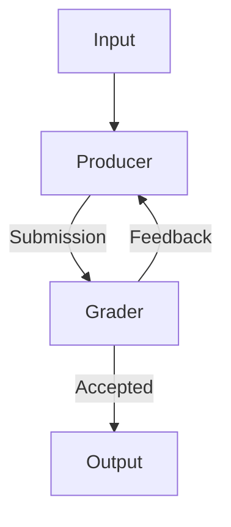
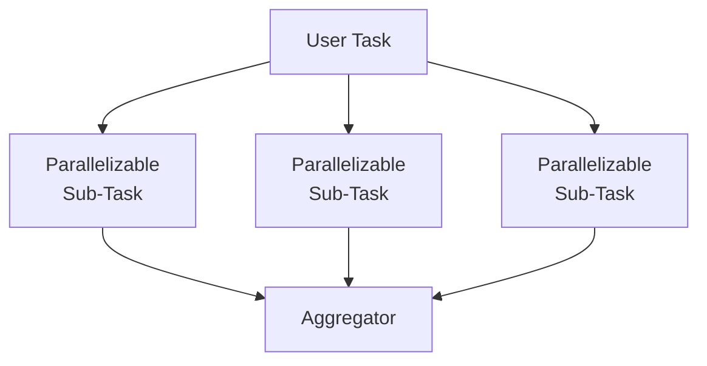
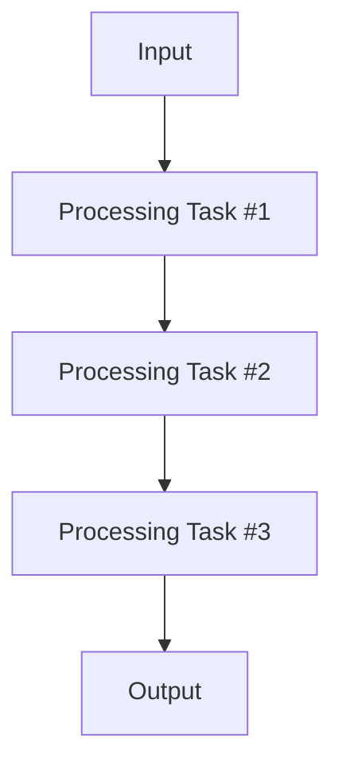
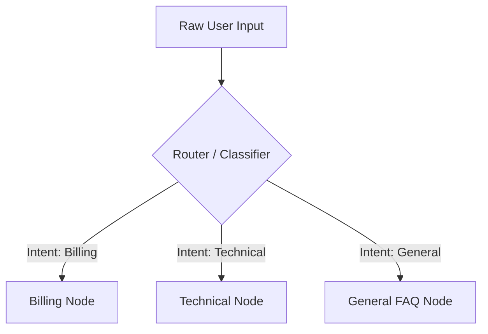
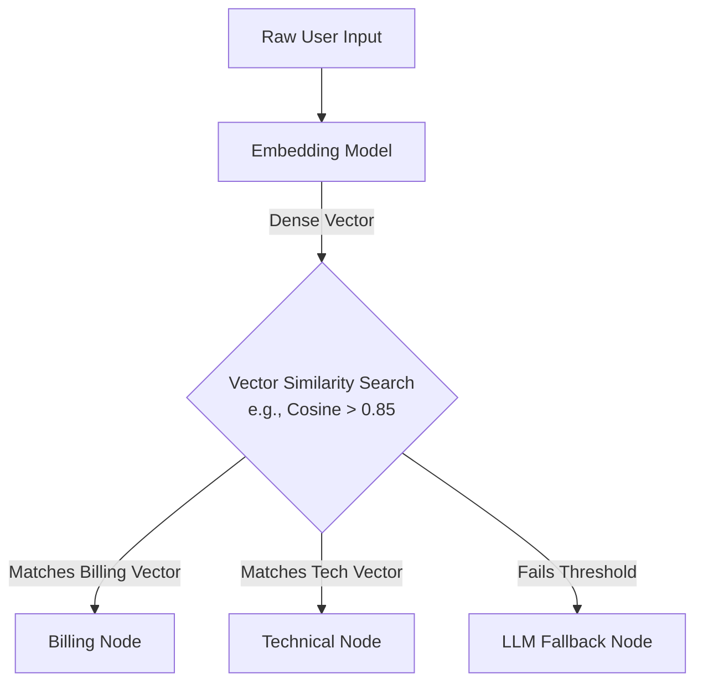
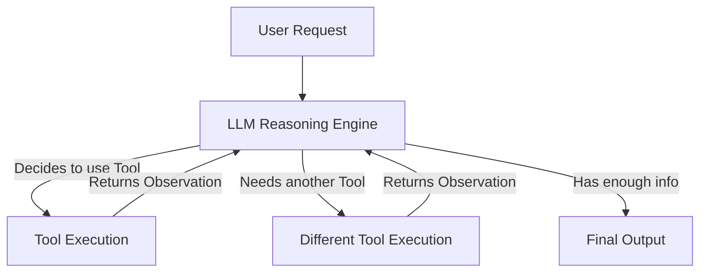
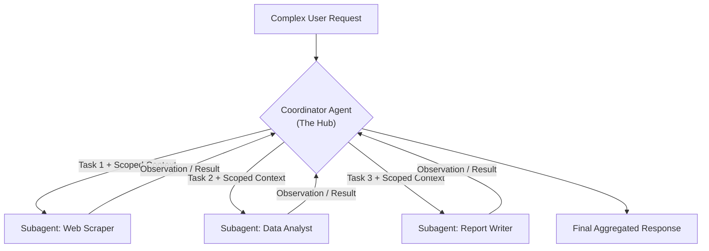
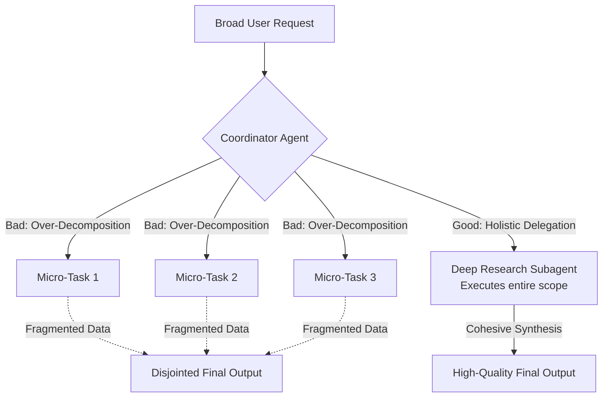
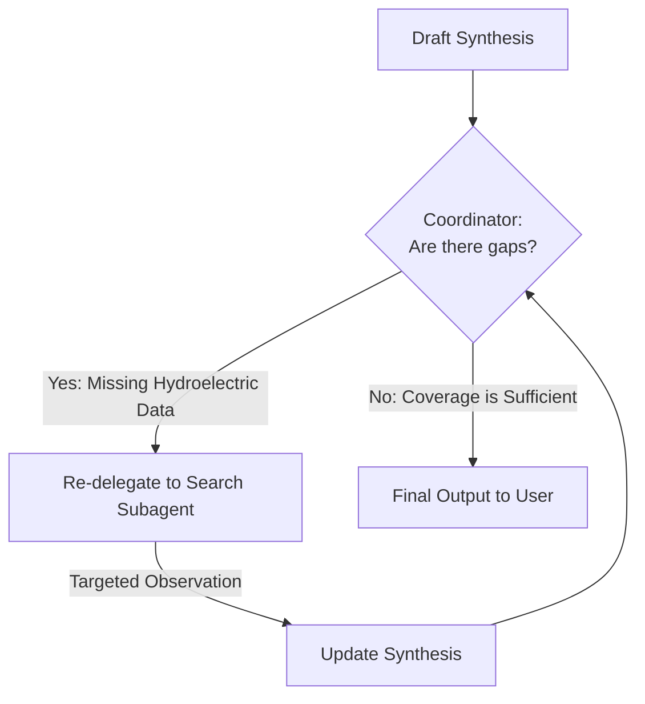
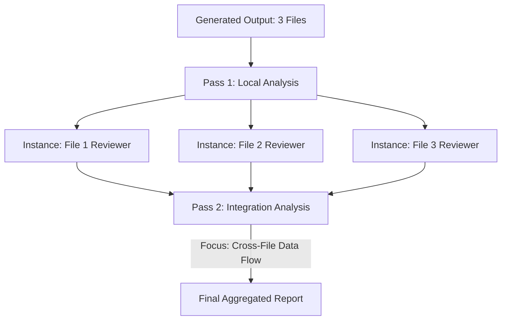

# Agents and Workflows


In Generative AI architecture, orchestrating how a language model interacts with your application generally falls into two distinct paradigms: Workflows and Agents. The decision between the two fundamentally dictates the predictability, flexibility, and reliability of your system.

## The Two Paradigms

### Workflows (Deterministic Orchestration)

Workflows are a predefined, hardcoded series of LLM calls designed to solve a specific, known problem. You use a workflow when you can map out the exact sequence of steps required to complete a task ahead of time.

Think of workflows as a mechanism for breaking a massive, complex objective into much smaller, isolated sub-tasks. Because each step focuses on a single, tightly constrained area, the model can execute its instructions with extreme precision.

### Agents (Autonomous Execution)

In Generative AI architecture, orchestrating how a language model interacts with your application generally falls into two distinct paradigms: workflows and agents. The decision between the two fundamentally dictates the predictability, flexibility, and reliability of your system.

- Workflows are a predefined, hardcoded series of LLM calls designed to solve a specific, known problem.
	- You use a workflow when you can map out the exact sequence of steps required to complete a task ahead of time.
	- Think of workflows as a mechanism for breaking a massive, complex objective into much smaller, isolated sub-tasks.
	- Because each step focuses on a single, tightly constrained area, the model can execute its instructions with extreme precision.
- With an agentic architecture, the LLM is given a high-level objective and a set of basic tools, and is expected to dynamically formulate its own execution plan.
	- Unlike workflows, you do not know exactly what inputs the system will receive or what execution path is optimal.
	- Agents are highly adaptive. They can creatively figure out how to handle a wide variety of novel challenges by combining tools in unexpected ways, or even pausing to ask the user for clarifying input when they lack necessary information.

Your primary goal as an AI engineer is to solve problems reliably. End-users do not care if your backend is powered by a complex, autonomous agent—they simply want a product that works consistently without failing.

> **The Golden Rule:** Always default to implementing **Workflows**.

Workflows provide the absolute reliability and predictability that production-grade applications demand. You should only escalate to an **Agent** architecture when the application's requirements are so varied, unpredictable, or open-ended that hardcoding a sequence of steps is impossible.
## Workflow Patterns

The goal of identifying different workflows is to establish a set of repeatable engineering recipes for implementing AI features. These patterns have proven successful across the industry for building reliable production systems, making them essential to understand and apply to your own architecture.

## The Evaluator-Optimizer Pattern

This workflow is a classic example of the [evaluator-optimizer pattern](Prompt%20Evaluation.md). It relies on internal iteration to guarantee output quality before returning a final result to the user. Here is how it works:



* **Producer**: Takes the initial input and generates a draft output (e.g., an LLM writing a Python script to generate a 3D rendering).
* **Grader**: Evaluates that generated output against strict, predefined criteria (acting as an automated judge).
* **Feedback loop**: If the grader rejects the output, it sends specific, targeted feedback back to the producer so it can attempt a fix.
* **Iteration**: This cycle repeats until the grader accepts the output (or a maximum retry threshold is reached).

## Parallelization Workflows



The parallelization pattern works by breaking a complex task into independent, concurrent operations. The workflow follows a strict sequence:

- **Split the task:** Break down a massive or multifaceted problem into focused, specialized sub-tasks.
- **Execute concurrently:** Run all sub-tasks in parallel simultaneously to minimize total processing latency.
- **Aggregate the results:** Combine the independent, specialized analyses into a single, cohesive final output.

The parallelized sub-tasks do not need to be identical; each can utilize a completely unique system prompt, toolset, or evaluation criteria optimized for its specific domain.

> [!EXAMPLE] Automated Code Review
> 
> Imagine you are building an automated code assistant to review incoming Pull Requests. Your first instinct might be to write one massive prompt that instructs the AI to look for security bugs, performance bottlenecks, and style compliance all at once.
> 
> However, asking a single model instance to catch a subtle SQL injection vulnerability while simultaneously counting spaces for indentation spreads the model's attention too thin. Because the scope of the request is so massive, the AI suffers from attention dilution and drops specific instructions, leading to inconsistent reviews where critical bugs slip through the cracks.
> 
> Instead, you can split the code review into three specialized, parallel tracks:
> 
> - **The Security Worker:** This prompt includes dedicated criteria focusing exclusively on the OWASP Top 10, credential leaks, and data sanitization. It ignores formatting entirely.
>     
> - **The Performance Worker:** Running at the same time, this prompt evaluates the code strictly for memory leaks, inefficient loops, and database bottlenecks like N+1 queries.
>     
> - **The Style Worker:** This independent prompt audits the code purely for naming conventions, modularity, readability, and documentation compliance.
>     
> 
> Once all three specialized evaluations complete, you feed their isolated findings into a final **Aggregator Node**. The aggregator prompt takes the security flags, performance notes, and style critiques, deduplicates any overlapping feedback, and compiles a single, cohesive, developer-friendly markdown report.
> 
> By separating these domains into isolated tasks, you ensure each expert prompt does one thing exceptionally well, yielding a drastically more reliable and thorough code review tool.

### Engineering Benefits

- **Focused Attention:** The LLM can concentrate on one specific aspect of the task at a time rather than trying to balance multiple competing considerations simultaneously. This dramatically reduces cognitive load and prevents the model from missing subtle errors.
- **Isolated Optimization:** You can test, version, and optimize the prompts for each sub-task independently. If your security analysis is missing edge cases, you can tune that specific prompt or switch it to a more capable model without affecting the performance or style workers.
- **Horizontal Scalability**: Expanding the workflow is straightforward. If you decide to add a "Business Logic / Ticket Alignment" check to your pipeline (to verify if the PR actually satisfies the acceptance criteria of the linked Jira ticket), you simply spin up a fourth parallel request without needing to rewrite or test your existing security or performance prompts.
- **Improved Reliability:** By dividing a monolithic task into micro-tasks, you get highly consistent, predictable, and deterministic results from your LLM calls.

### When to Use This Pattern

This pattern is ideal when a complex decision or generation task can be cleanly separated into independent evaluations. Look for situations where you are asking an AI to consider multiple distinct criteria, audit different domains of expertise, or compare several options simultaneously.

The primary architectural requirement is that **each sub-task must be able to operate independently** without needing information or context from the other parallel tracks to complete its job.
- **Separate tasks by their final output artifact, not just their logical domain.** Parallelization is perfect when each track produces its own distinct evaluation (e.g., three different risk reports). However, if these distinct criteria all require modifying the exact same file or code template, this pattern isn't suitable.


## Chaining Workflows




While parallelization handles independent tasks simultaneously, **Chaining** is designed for dependent tasks. A chaining workflow executes a strict sequence of LLM calls where the output of one step becomes the direct input (or context) for the next step.

Instead of asking the model to perform a massive, multi-step logical leap in a single prompt, you force it to pause, output its intermediate work, and pass the baton to the next prompt in the pipeline.

> [!EXAMPLE] Legacy Code Modernization
> Imagine you are tasked with migrating a massive, 2,000-line legacy SQL Stored Procedure into a modern Python REST API. If you pass the entire SQL file to an LLM and prompt, _"Rewrite this as a Python microservice,"_ the model will attempt a literal line-by-line translation, resulting in terrible, unidiomatic Python that fails to capture the actual business intent.
> 
> Instead, you chain the workload across three strictly dependent nodes:
> 
> - **Node 1 (The Deconstructor):** The first prompt receives the raw SQL. Its only job is to untangle the spaghetti code and output a plain-English, step-by-step logical blueprint of the underlying business rules (e.g., _"Step 1: Check user balance. Step 2: If balance > 0, apply discount..."_).
>     
> - **Node 2 (The Architect):** The pipeline takes that plain-English blueprint and feeds it to a second prompt. This prompt ignores SQL entirely. Its job is to read the business rules and design a modern **OpenAPI JSON specification** (defining the endpoints, request payloads, and response schemas) needed to support those rules.
>     
> - **Node 3 (The Implementer):** The pipeline takes the OpenAPI JSON and passes it to the final prompt. This prompt reads the JSON spec and writes the clean, idiomatic Python FastAPI boilerplate code to execute those endpoints.

### Engineering Benefits

- **Stateful Observability:** Because the task is broken into discrete API calls, you can log the exact output at every step. If the final Python code is wrong, you can check Node 1's blueprint to see if the LLM misunderstood the original SQL, or check Node 2 to see if it designed a bad API schema. You instantly know _where_ the logic failed.
- **Graceful Halting (Human-in-the-Loop):** You can pause the pipeline between nodes. For instance, you can have Node 2 output the proposed API schema to a human lead engineer for approval before paying the compute cost for Node 3 to generate all the actual code.
- **Preventing Attention Dilution:** By isolating the steps, the LLM doing the Python coding (Node 3) never even sees the messy, distracting legacy SQL. It only sees clean API specs, dramatically reducing hallucination.
- **Model Routing:** You can use different models for different steps in the chain. You might use your most advanced, reasoning-heavy model (like Claude 3.5 Sonnet or GPT-4o) for the complex SQL deconstruction in Node 1, but route Node 3 (simple Python boilerplate generation) to a faster, cheaper model to save costs.

### When to Use This Pattern

Use chaining when a task requires a **chronological dependency**—meaning Step B logically cannot begin until Step A is fully completed. It is the ideal architectural choice when:

- **Requirements are highly complex:** You are dealing with multifaceted problems that have numerous, compounding requirements that overwhelm a single pass.
- **Attention is dropping:** The LLM consistently ignores specific constraints, formatting rules, or edge cases when they are packed into a single, massive prompt.
- **Intermediate validation is required:** You need your software to programmatically process, sanitize, or validate the outputs between steps (or involve a human-in-the-loop) before paying the compute cost to continue.
- **Focus must be preserved:** You want to keep each interaction tight, manageable, and strictly constrained to a single domain of reasoning.

## Routing Workflows



A routing workflow acts as an intelligent traffic director. Instead of forcing a single, massive prompt to understand and execute every possible user intent, an initial classification step analyzes the input and dispatches it to a specialized downstream prompt, model, or toolset.

> [!EXAMPLE] Customer Support Triage
> 
> Imagine you are building an AI customer service agent for a SaaS product. If you try to build a single "God Prompt" that contains all the rules for processing refunds, troubleshooting API errors, and answering general pricing questions, the prompt becomes bloated. The model will inevitably mix up contexts, perhaps offering a refund when the user just wanted to debug a code snippet.
> 
> Instead, you build a Routing workflow:
> 
> - **The Router (Node 1):** The user submits a message. This input is sent to a fast, cheap classification prompt whose _only_ job is to analyze the text and output a single JSON key: `billing`, `technical`, or `general`.
>     
> - **The Billing Track:** If routed here, the input is passed to a specialized prompt that has explicit access to the Stripe API and strict instructions on refund policies. It knows nothing about code.
>     
> - **The Technical Track:** If routed here, the input is passed to a different prompt designed to act as a Senior Developer, armed with tools to search the API documentation vector database.
>     

### Engineering Benefits

- **Context Window Optimization:** By routing the request, you only load the exact instructions, API tools, and RAG data needed for that specific intent. This drastically reduces token usage and prevents the attention mechanism from getting confused by irrelevant rules.
- **Cost and Latency Arbitrage:** The Router step is a simple classification task, meaning it can be handled by a lightning-fast, highly inexpensive model (like Llama 3 8B or GPT-4o-mini). You only pay the compute cost of a heavy, frontier model if the router dispatches the task to the "Technical" track.
- **Isolated Optimization (Separation of Concerns):** If your bot starts hallucinating refund policies, you only have to edit the prompt for the "Billing" node. Because the tracks are isolated, you run zero risk of accidentally breaking your "Technical" node's behavior.
- **Fallback Safety:** If the router cannot confidently determine the user's intent, it can route the request to a deterministic "Human Handoff" function rather than attempting to guess.

### When to Use This Pattern

Use routing when your application has a wide, open-ended entry point (like a chatbox) but the actual execution paths are strictly categorized. Reach for this architecture when:

- **Inputs fall into distinct categories:** The user could be asking for completely different types of actions that share no overlapping logic.
- **Tooling requirements vary:** Different tasks require completely different external APIs, databases, or context documents.
- **You hit the "God Prompt" wall:** Your current single prompt is growing too large, and adding rules for a new feature is causing the model to forget older rules.
### The Semantic Router

Using an LLM to classify intent is flexible, but it is slow and costs token generation fees. If your categories are well-defined, you can replace the LLM router with a deterministic **Semantic Router** using the exact same embedding models you use for your RAG database.



**How it works:**

1. **Pre-computation:** You create a list of "canonical utterances" for each route. For the Billing route, you might list: _"How do I cancel?"_, _"Where is my invoice?"_, and _"Refund my credit card."_ You generate embeddings for these phrases and store them in memory.
2. **Runtime Execution:** When a user submits a query, you pass it through a fast embedding model (like `text-embedding-3-small` or a local model) to get a single vector.
3. **Deterministic Math:** You calculate the Cosine Similarity between the user's vector and your canonical route vectors. If the similarity score crosses a strict, hardcoded threshold (e.g., $> 0.85$), the system programmatically routes the request to that node.

#### Engineering Benefits

- **Near-Zero Latency:** Generating an embedding and calculating cosine similarity takes milliseconds. Using an LLM to read and classify a prompt can take seconds.
- **Near-Zero Cost:** Embedding models cost fractions of a penny per million tokens. If you run the embedding model locally, the routing step is completely free.
- **Absolute Determinism:** LLMs are probabilistic; they might classify the exact same prompt differently on a Tuesday than they do on a Wednesday. Math is absolute. A vector distance of $0.88$ will always route to the same place, making your application highly predictable.
- **Graceful Fallbacks:** If the user types gibberish or a completely novel request, the cosine similarity will fail to hit your threshold. You can catch this mathematically and route it to an "LLM Fallback Classifier" or a human operator, saving compute.
#### When to Use This Pattern

Semantic routing is the gold standard for high-traffic entry points. You should implement this when:

- You have high query volume and need to aggressively slash API costs.
- The application requires sub-second routing responses to feel snappy to the user.
- Your downstream nodes represent distinct, easily definable concepts (like "Billing" vs. "Technical Support") where the semantic boundaries are clear.

## Agents (Autonomous Execution)



In every workflow we have discussed so far (Chaining, Routing, Parallelization), the control flow is dictated by traditional code. Your Python or Node.js backend decides what happens next.

In an **Agentic** architecture, you surrender control of the routing and the loops directly to the LLM. The model acts as the "brain," analyzing the user's request, reviewing its available tools, and dynamically deciding which tools to call, in what order, and how many times to repeat the process until it solves the problem.

### The Core Engine: The ReAct Loop

Agents typically operate on a cognitive framework called **ReAct** (Reason + Act). Instead of generating a final answer immediately, the LLM is prompted to enter an internal monologue and execution cycle:

1. **Thought:** The model analyzes the current state and decides what it needs to do next. *(e.g., "The user wants to know the revenue of our largest client. First, I need to find out who the largest client is.")*
2. **Action:** The model outputs a structured request to call a specific tool with specific arguments. *(e.g., Calls `query_database(query="SELECT top_client FROM sales")`)*
3. **Observation:** Your backend executes the tool and feeds the raw result back into the model's context window. *(e.g., "Result: Acme Corp")*
4. **Loop:** The model evaluates the observation. If it needs more data, it loops back to step 1. If it has everything it needs, it breaks the loop and generates the final response to the user.

> [!EXAMPLE] The Autonomous Data Analyst
> 
> A user asks: *"Graph our Q3 user growth against server costs, and email it to the engineering team."*
> Hardcoding a workflow for this exact combination of tasks is nearly impossible, but an Agent handles it dynamically:
> * **Loop 1:** The agent calls `query_sql` to get Q3 user growth.
> * **Loop 2:** The agent realizes the SQL query failed due to a syntax error. It rewrites the query and tries `query_sql` again. It gets the user data.
> * **Loop 3:** The agent calls `fetch_aws_billing` to get the server costs.
> * **Loop 4:** The agent calls `execute_python` to run a matplotlib script using the data from Loops 2 and 3, saving the output as `chart.png`.
> * **Loop 5:** The agent calls `send_email`, attaching the chart.
> * **Final Output:** The agent tells the user, "I have compiled the data, generated the graph, and emailed the team."
> 
> 

### Engineering Guardrails

Because agents are non-deterministic and control their own loops, they introduce massive systemic risks. Without strict engineering guardrails, an agent will easily spiral into infinite loops, burning through API credits or destroying data.

To run agents in production, you must implement the following safeguards:

* **Max Iteration Limits:** Never let a `while` loop run indefinitely. Hardcode a limit (e.g., `MAX_STEPS = 5`). If the agent hasn't solved the problem in 5 loops, force it to stop and return an error to the user.
* **Idempotent / Read-Only Tools:** By default, give agents "read-only" access to databases and APIs. If an agent hallucinates, you want it to fail a `SELECT` statement, not execute a `DROP TABLE`.
* **Human-in-the-Loop (HITL) for Destructive Actions:** If the agent needs to perform an action that alters state (e.g., sending an email, refunding a user, deleting a file), the system must pause the loop and present the intended action to a human for confirmation before the backend actually executes the code.
* **Strict Tool Schemas:** Define your tools using rigid JSON schemas or OpenAPI specs. The less ambiguity there is in how a tool is used, the less likely the agent is to hallucinate parameters.

### Human-in-the-Loop (HITL) and Escalation Patterns

While autonomous agents are highly capable, production-grade systems require a robust **Human-in-the-Loop (HITL)** architecture to safely handle ambiguity, policy gaps, and frustrated users. Effective escalation is not about catching errors after they happen; it is about engineering the agent to recognize the strict boundaries of its own authority.

#### Defining Strict Escalation Triggers

Do not leave escalation decisions to the model's generic judgment. You must explicitly define escalation triggers in your system prompt using concrete, few-shot examples to demonstrate exactly when to resolve autonomously versus when to hand off.

- **Explicit Human Requests:** If a customer explicitly demands to speak to a human agent, the system must honor the request immediately and halt all autonomous investigation.
- **The Frustration Nuance:** If a customer expresses frustration or uses aggressive language, but the core issue is straightforward and well within the agent's tools, the agent should acknowledge the frustration and offer the resolution first. It should only escalate if the customer _reiterates_ the demand for a human.
- **Policy Gaps and Exceptions:** Agents must escalate when a customer's request is not explicitly covered by the provided context. For example, if the system instructions detail "own-site price adjustments," but the user requests a "competitor price match," the agent must escalate rather than improvising or guessing a policy exception.
- **Execution Stagnation:** The agent must be programmed to escalate if it cannot make meaningful progress (e.g., failing a tool call three times in a row).

#### Resolving Ambiguity (The "Multiple Matches" Rule)

When an agent queries a system (e.g., searching for an order by a common name) and the tool returns multiple matches, the agent crosses an ambiguity threshold.

- **The Anti-Pattern (Heuristic Guessing):** The model attempts to resolve the ambiguity autonomously by guessing the correct record based on heuristics (e.g., selecting the account with the most recent login). In production, this causes catastrophic cross-account data contamination.
- **The Engineering Standard:** The system prompt must explicitly instruct the agent that upon receiving multiple matches, it must pause the execution loop and ask the user for a clarifying, unique identifier (like an order number or the last four digits of a phone number) to break the tie.

#### Architectural Anti-Patterns to Avoid

Engineers frequently attempt to automate routing and escalation using unreliable proxies. You must strictly avoid these two patterns:

- **Sentiment-Based Escalation:** Triggering an escalation simply because the text reads as "angry" is a flawed architecture. Sentiment does not correlate with complexity; a furious user might simply need a routine password reset, which the agent can handle perfectly.
- **Self-Reported Confidence Scores:** Do not ask the LLM to self-evaluate its confidence to trigger an escalation (e.g., _"If your confidence is below 70%, escalate"_). LLMs are mathematically prone to overconfidence when hallucinating, making self-reported scores a completely unreliable proxy for actual case complexity.

### When to Use Agents

Agents represent the absolute cutting edge of current AI engineering, but they are expensive, slow, and hard to test. You should only use an Agent when:

* **The task requires open-ended research:** The model needs to search the web, read a result, click a link, and read another result before answering.
* **The path to success is unpredictable:** The required sequence of tools changes drastically depending on what the previous tool returns.
* **Self-correction is necessary:** You are dealing with messy APIs or fragile code generation where you *want* the model to fail, see the error log, and try again autonomously.

## Multi-Agent Orchestration: The Coordinator-Subagent Pattern

When scaling Agentic Workflows to handle highly complex, multi-step user requests, relying on a simple, static router is no longer sufficient. Advanced systems utilize a **Coordinator-Subagent Pattern**, which replaces the deterministic routing node with a highly capable "Coordinator" agent that actively manages a fleet of specialized worker subagents.

This architecture operates on a strict **Hub-and-Spoke** model. Subagents never communicate with each other directly; all data, instructions, and error handling must flow through the central Coordinator.



### The Role of the Coordinator

The Coordinator acts as the brain of the operation. It does not execute the actual work (like querying a database or writing a script); instead, its sole purpose is project management. Its primary responsibilities include:

- **Task Decomposition:** Breaking a massive, ambiguous user prompt down into a chronological sequence of smaller, actionable objectives.
- **Intelligent Delegation:** Evaluating the complexity of each sub-task and dynamically deciding which specific subagent to invoke. If a query is simple, the Coordinator might bypass the subagents entirely and answer directly to save compute.
- **Error Handling:** If a subagent enters an infinite loop, returns an error, or hallucinates, the Coordinator catches the failure. It can choose to re-prompt the failing subagent with corrective feedback or assign the task to a different tool track.
- **Result Aggregation:** Taking the disparate JSON payloads, code snippets, and text blocks returned by the various subagents and synthesizing them into a single, cohesive response for the user.

### Engineering Principle: Context Isolation

A critical engineering tenet of this pattern is that **subagents operate with strictly isolated context.**

When the Coordinator delegates a task, the subagent does _not_ automatically inherit the Coordinator's overarching conversation history, the original user prompt, or the outputs of previous subagents.

- **The Benefit:** This intentional isolation forces the LLM's attention mechanism to remain laser-focused on its specific sub-task. It prevents "context bloating," saves massive amounts of token costs, and ensures a Data Analyst subagent doesn't get confused by the unrelated raw HTML that the Web Scraper subagent pulled three steps ago.
- **The Requirement:** Because of this isolation, the Coordinator must be explicitly prompted to extract, summarize, and inject the exact parameters the subagent needs to succeed.
### The Risk of Over-Decomposition

In a Hub-and-Spoke architecture, the Coordinator is designed to break down tasks. However, this introduces a critical systemic vulnerability: **Over-Decomposition** (also known as the "Micro-Management Failure").

This occurs when the Coordinator takes a broad, conceptually unified request and shatters it into too many disconnected micro-tasks, distributing them across highly isolated subagents. Because subagents do not inherit the "big picture" context, they return fragmented, narrow data points. When the Coordinator attempts to stitch these pieces back together, the final output lacks overarching narrative cohesion or holistic insight.

> [!EXAMPLE] The Macroeconomic Research Failure
> 
> **The User Prompt:** _"Write a comprehensive analysis of the macroeconomic impact of renewable energy subsidies on emerging markets."_
> 
> **The Micro-Management Failure (Over-Decomposition):**
> The Coordinator splits the task into five tiny tickets. It sends Task 1 (Find solar data) to the Data Agent, Task 2 (Find wind data) to the Web Scraper, and Task 3 (Define GDP metrics) to the Dictionary Agent. It receives five isolated, disconnected facts. The final essay feels disjointed and shallow because no single subagent was allowed to actually _think_ about how solar data and GDP correlate.
> 
> **The Holistic Delegation (The Solution):**
> 
> The Coordinator is engineered to recognize that this is a "Big Picture" request requiring continuous reasoning. Instead of splitting it up, the Coordinator creates a single, massive task (an "Epic" rather than a "Ticket") and delegates the entire assignment to one highly capable **Deep Research Subagent**. That specific subagent runs its own internal [ReAct loop](#The%20Core%20Engine%20The%20ReAct%20Loop)—searching, reading, and holding the entire context in its own memory—until it can return a complete, cohesive analysis to the Coordinator.

#### Engineering the Solution

To prevent over-decomposition, you cannot simply let the Coordinator guess task sizes. You must explicitly engineer your Coordinator's system prompt to evaluate the **conceptual density** of a request before delegating it.

Add strict routing heuristics to the Coordinator's instructions, such as:

- _If a task requires fetching discrete, unrelated data points (e.g., "Get the weather in London and the stock price of Apple"), decompose it into isolated sub-tasks._
- _If a task requires continuous reasoning, deep narrative synthesis, or understanding complex relationships (e.g., "Analyze a market trend"), DO NOT decompose it. Delegate the entire conceptual block to a single, capable subagent to preserve context._




### Advanced Coordinator Capabilities

To maximize the reliability and efficiency of a Coordinator-Subagent architecture, the central Coordinator must be programmed with advanced project management behaviors. Relying on a static, sequential execution of all available subagents defeats the purpose of an autonomous system.

Implement the following four strategies to build a production-grade orchestration layer.

#### Dynamic Subagent Selection

A naive coordinator executes tasks by running the user's query through the entire available pipeline (e.g., always triggering the Researcher, then the Analyst, then the Writer). This wastes compute and increases latency.

A mature Coordinator is engineered to analyze the query requirements upfront and **dynamically select** only the necessary subagents.

- **The Mechanism:** The Coordinator is provided with a registry of available subagents, complete with descriptions of their capabilities. It evaluates the prompt and builds a custom execution path on the fly.
- **Example:** If a user asks, _"Format this raw JSON into a Markdown table,"_ the Coordinator recognizes that no research or data analysis is required. It dynamically bypasses the Scraper and Analyst subagents entirely, routing the data directly to the Formatting Subagent.

#### Scoped Research Partitioning

When a Coordinator does need to invoke multiple research subagents in parallel, it risks burning tokens on duplicate work. Left unguided, two subagents might run the exact same web searches.

To solve this, the Coordinator must enforce **Scoped Partitioning**.

- **The Mechanism:** The Coordinator explicitly divides the research landscape and assigns strict, non-overlapping boundaries to each subagent.
- **Example:** When researching a competitor, the Coordinator assigns Subagent A exclusively to "Financial Filings (SEC/10-K)" and Subagent B exclusively to "Social Media Sentiment." By partitioning the source types or subtopics, the Coordinator ensures maximum coverage with zero duplication of effort.

#### Iterative Refinement Loops

Even with perfect partitioning, the initial data returned by subagents may be incomplete. Instead of blindly passing a flawed synthesis to the user, the Coordinator should utilize an internal Evaluator-Optimizer loop.

- **The Mechanism:** After aggregating the subagent observations, the Coordinator evaluates the draft response against the user's original request. If it detects gaps or contradictions, it does not fail; instead, it pauses, formulates a highly targeted micro-query, and re-delegates it to a specific subagent to fetch the missing context.



#### Centralized Coordination (The Hub-and-Spoke Mandate)

In a multi-agent system, engineers are often tempted to let subagents communicate directly with one another (e.g., the Scraper passing data directly to the Writer). You must explicitly prevent this. **All communication must route through the Coordinator.**

- **Observability:** By forcing all traffic through the central Hub, you create a single, linear trace of the execution. If the system fails, you have one central log showing exactly what the Coordinator asked for and what the subagent returned.
- **Consistent Error Handling:** If the Scraper fails to find a website, it shouldn't crash the Writer. It returns the error to the Coordinator, which can gracefully decide to either skip that data point or try a different source.
- **Controlled Information Flow:** Centralization prevents "context window blowout." The Coordinator acts as an information firewall, sanitizing and summarizing the Scraper's output before passing it to the Writer, ensuring downstream agents only receive the exact tokens they need.

####  rovenance and Multi-Source Synthesis

When a Coordinator agent aggregates data from multiple specialized subagents (e.g., combining web search results with internal RAG data), the synthesis process introduces a high risk of data corruption. If not strictly engineered, the LLM will flatten nuances, lose citations, and arbitrarily resolve contradictions.

To build a trustworthy synthesis pipeline, you must enforce strict provenance and formatting rules across your agent fleet.

##### 1. Structured Claim-Source Mappings

The fundamental law of LLM summarization is that **compression destroys attribution**. If a subagent discovers a fact and passes it to the Coordinator as a plain text summary, the claim-source mapping is permanently lost. The Coordinator cannot verify the fact or cite it for the user.

- **The Implementation:** Never allow subagents to return unstructured prose. Require all research and extraction subagents to return data using a rigid JSON schema that enforces **claim-source mapping**.
  
```json
{
  "findings":[
    {
      "claim":"The database migration reduced latency by 40%.",
      "source_document":"Q3_Engineering_Review.pdf",
      "exact_excerpt":"Post-migration telemetry shows a 40% drop in P90 latency...",
      "relevance_score":9
    }
  ]
}
```
*   **The Benefit:** By separating the claim from its origin, the downstream Coordinator and Synthesis agents are forced to preserve the citation, allowing the final output to maintain verifiable provenance.

##### 2. Handling Conflicting Data and Contested Findings
When multiple subagents query different credible sources, they will inevitably return conflicting statistics (e.g., Subagent A finds a 45% market share; Subagent B finds 40%). A naive synthesis agent will often arbitrarily select one value or mathematically average them, effectively hallucinating a new, incorrect fact.

*   **Explicit Annotation:** Subagents must be instructed to never "smooth over" conflicting data. They must pass both values to the Coordinator, explicitly annotated with their source attribution. 
*   **Structural Separation:** The Coordinator's system prompt must be engineered to handle uncertainty structurally. Instead of blending the data, the Coordinator should output a report featuring explicit markdown sections that distinguish between **"Well-Established Findings"** (where all sources agree) and **"Contested Data"** (where sources diverge), preserving the original methodological context of both claims.

##### 3. Temporal Anchoring
Many perceived "conflicting statistics" are not actual contradictions; they are simply temporal discrepancies. 

*   **The Implementation:** You must require subagents to extract and include **publication or data collection dates** as a mandatory field in their structured outputs.
*   **The Benefit:** When the Coordinator evaluates the aggregated JSON, the temporal metadata allows it to make intelligent reconciliation decisions—such as recognizing that a 2025 financial report supersedes a 2023 report, rather than flagging them as a contradiction.

##### 4. Context-Aware Rendering Formats
When aggregating diverse data streams—such as financial metrics, news articles, and API specifications—synthesis agents have a bad habit of converting everything into a uniform wall of text.

*   **The Implementation:** Engineer your final synthesis prompt to apply specific rendering rules based on the content type. Instruct the model: *"Render financial or statistical comparisons exclusively as Markdown tables. Render narrative news as standard prose. Render technical configurations or requirements as bulleted lists."* 
*   **The Benefit:** This preserves the readability and analytical utility of the data, ensuring the human user can quickly scan the complex, multi-source report.

### Managing Shared Context in Parallel Agent Workflows

When a complex task is decomposed into parallel sub-tasks (like the `RiskAnalyzer` and `StockRecommender` working simultaneously), multiple agents frequently require access to the exact same foundational data. The decision of *where* and *when* to fetch this data fundamentally impacts the reliability and performance of your system.

#### The Anti-Pattern: Decentralized Data Fetching

This pattern occurs when you allow each parallel subagent to independently query the database or API for the shared context during its own execution loop.

**Why this is an architectural risk:**

- **Data Inconsistency (The Race Condition):** If the underlying data changes between the exact milliseconds that Agent A and Agent B perform their fetches, the agents will operate on different versions of reality. This introduces the risk of data inconsistency. The final aggregated output will likely contain contradictions.
- **Latency and Resource Waste:** Querying the exact same data multiple times is redundant and inefficient. It forces your system to pay the network latency and compute "toll" twice, unnecessarily increasing database load.
- **Violation of Agent Isolation:** By forcing the subagents to fetch the data, you must equip them with the database-querying tools and credentials. This bloats the subagent's prompt and responsibilities, violating the principle of single responsibility.

#### The Best Practice: Orchestrator-Led State Injection

Also known as "Fetch Once, Inject Many," this pattern relies on the orchestration layer (the Coordinator) to gather all necessary shared context *before* spinning up the parallel worker agents.

Fetching the data once at the orchestration layer and injecting it into parallel agents is the most efficient and reliable pattern.

**Why this is the engineering standard:**

- **Snapshot Consistency:** By pulling the data once at the orchestrator level, you guarantee that every downstream agent receives the exact same, frozen snapshot of the data. It ensures both agents work from an identical snapshot, which is essential for consistent multi-step task execution.
- **Maximized Efficiency:** You eliminate redundant API calls and database hits. The data is fetched once and efficiently passed in memory to the subagents.
- **Dumb Pipes, Smart Endpoints (Decoupling):** The subagents do not need to know *how* to query the database. They simply receive the data passively in their system prompts. This keeps the subagents strictly focused on their specific analytical tasks, requiring fewer tools and reducing the risk of hallucinated tool calls.

### Architectural Anti-Pattern: Premature Transformation

In a Hub-and-Spoke architecture, a common engineering mistake is forcing the Coordinator to pre-process, summarize, or translate raw data before handing it off to a subagent. This is known as **Premature Transformation**, and it introduces severe fragility into your multi-agent system.

This anti-pattern manifests in three critical system failures:

1. **Data Loss**: Any time an LLM translates or summarizes data, it permanently destroys fidelity. Because the orchestrator does not execute the final specialized task, it cannot accurately judge which subtle details are relevant.
	- _The Failure:_ If a Coordinator summarizes a 10-page contract into a 1-page JSON outline, and the downstream Legal Analyzer subagent needs a specific indemnity clause from page 7 to answer the user's prompt, the system fails. The critical data was filtered out before the expert agent ever saw it.
2. **Tight Coupling**: A core rule of scalable software architecture is that components should have exactly one job. A Coordinator’s job is routing and project management.
	- _The Failure:_ If you force the Coordinator to extract data into a specific JSON schema for a `ReturnProcessor` subagent, the Coordinator suddenly needs to understand the internal business logic of returns. If the return policy changes and the system now needs to evaluate "store location," you have to update the prompts for _both_ the subagent and the Coordinator. Your components are now tangled together, destroying the isolation benefits of a multi-agent system.
3. **Latency and Compute Waste**: By transforming the data in the middle of the pipeline, you end up paying the computational "toll" twice.
	- _The Failure:_ You burn token generation costs and time for the Coordinator to read a large file and write a summary, and then you burn more tokens and time for the subagent to read and process that generated summary.
#### The Solution: "Dumb Pipes, Smart Endpoints"

To avoid premature transformation, AI architects rely on the classic networking concept of **dumb pipes, smart endpoints**.

The transport layer (the Coordinator) should act like a dumb pipe. It evaluates the request, attaches routing metadata (e.g., assigning the task to the Legal Analyzer), and passes the heavy payload (the raw image, the full 10-page document, the complete chat history) _exactly_ as it was received.

All of the "smarts"—the parsing, extracting, summarizing, and analyzing—must happen at the endpoints (the specialized subagents) where the domain-specific context actually lives.
## Multi-Instance and Multi-Pass Review Architectures

A common architectural anti-pattern in generative AI is the "Self-Review Loop"—asking an LLM to generate a complex artifact (like a script or an essay) and then, in the exact same session or prompt, asking it to review its own work for errors.

Because the model retains its original reasoning context from the generation phase, it suffers from a form of algorithmic confirmation bias. It is highly unlikely to question its own structural decisions or catch subtle logic flaws because it is evaluating the output using the exact same flawed cognitive pathway that generated it.

To achieve production-grade quality control, you must decouple generation from evaluation using **Multi-Instance** and **Multi-Pass** architectures.

### Multi-Instance Review

To effectively catch subtle issues, you must instantiate a completely **independent LLM session** to act as the reviewer.

- **The Mechanism:** The Generator model creates the output. Your backend takes that final output text and passes it to a brand-new, isolated LLM instance (the Reviewer).    
- **The Benefit:** The Reviewer model operates with zero prior reasoning context. It did not experience the Generator's internal monologue, struggles, or compromises. It evaluates the artifact purely on its objective merits against the system prompt, making it vastly more effective at spotting hallucinations, security vulnerabilities, or logic gaps.

#### Multi-Pass Review

When evaluating massive payloads, such as a multi-file Pull Request or a 50-page document, feeding the entire payload into a single review prompt triggers severe attention dilution. The model will inevitably miss localized errors while trying to understand the global context, and vice versa.

To solve this, implement a **Multi-Pass Review Pipeline**:

1. **Per-File Analysis**: Spawn parallel, independent instances to review each file or section in complete isolation. Their only job is to look for localized issues—syntax errors, variable naming, or spelling mistakes—without worrying about how the files connect.
  2. **Cross-File Analysis**: After the local passes complete, spawn a separate Integration Reviewer. You feed it the entire payload, but its system prompt explicitly instructs it to ignore syntax and formatting entirely. Its sole focus is analyzing cross-file data flows, structural consistency, and global architectural integrity.



### Verification Passes and Calibrated Routing

Even independent reviewers can hallucinate critiques. To build a reliable automated pipeline, you should implement verification passes where the model explicitly self-reports its confidence.

- **The Mechanism:** Force the Reviewer model to output its findings in a strict JSON schema that includes a `confidence_score` (e.g., 1-10) and a `requires_human_verification` boolean alongside every flagged issue.
- **The Benefit:** This enables **Calibrated Review Routing**. If the model flags a missing semicolon with a confidence of 10, your backend can automatically trigger a coding agent to fix it. If the model flags a complex race condition but self-reports a confidence of 4, the system halts and routes that specific finding to a human senior engineer for validation.