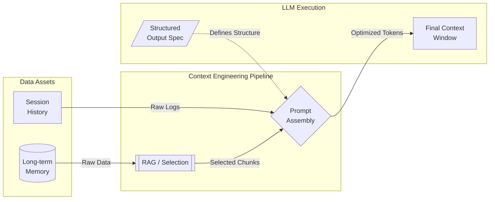
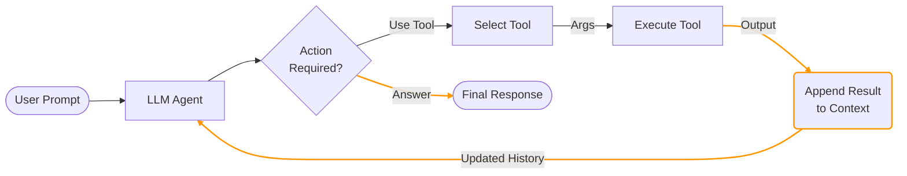
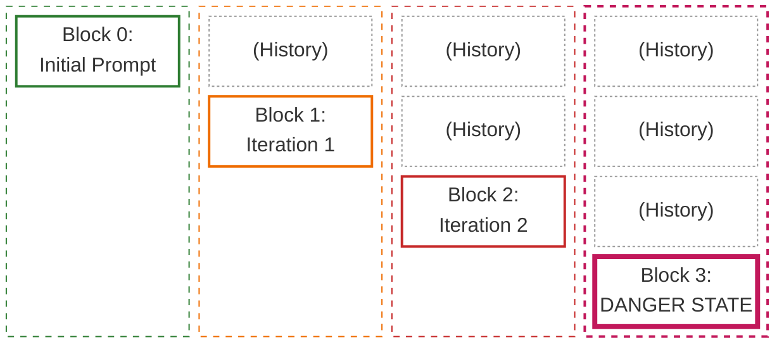

# Context Engineering

Context serves as the "short-term memory" of a Large Language Model (LLM). It encompasses all the information—text, instructions, and data—provided within a single session that the model uses to generate a relevant response.

* The Constraint: Every LLM has a Context Window, a finite capacity for how much information it can process at once. If this limit is exceeded, the model may "forget" the earliest parts of the conversation.

Context Engineering is the strategic practice of organizing, optimizing, and curating the input provided to an LLM. The goal is to maximize the accuracy and relevance of the output while maintaining efficiency within the model's technical limits.




## The Growing Need for Context Engineering

Context Engineering is becoming increasingly critical as the variety of context sources expands daily. Modern LLMs must now synthesize information from diverse inputs, including application state, user interaction history, and dynamic data sources.

A prime example of this complexity is a Tool-Calling Agent. In this scenario, the "context" is not static; it grows iteratively as the agent executes code or retrieves data, requiring the model to manage a feedback loop of inputs and outputs.



With every iteration, an LLM agent accumulates reasoning steps, tool outputs, and error logs.



This creates a "Compounding Context" effect: the input size grows linearly (or exponentially) with every turn, leading to higher latency and potential failure.

This accumulation introduces opportunities to critical risks:

- **Context Poisoning (Logic Corruption):** A single piece of incorrect information (e.g., a hallucinated tool output) enters the history and derails all subsequent reasoning. The model treats this error as a fact.
- **Context Confusion (Dilution):** As unnecessary noise accumulates, the signal-to-noise ratio drops. The model loses track of the original instruction ("Lost in the Middle" phenomenon), leading to vague or irrelevant responses.
- **Context Clash (Inconsistency):** New information contradicts earlier data in the same session. The model struggles to reconcile these conflicts, often resulting in incoherent or oscillating behavior.
- **Tool Output Bloat:** Tool results accumulate in context and consume tokens disproportionately to their relevance. For example, returning a raw database payload with 40+ fields per order lookup—when only 5 fields are relevant to the task—drastically accelerates context exhaustion.
- **Progressive Summarization Risks:** While summarizing old messages saves tokens, it is highly destructive to factual accuracy. Condensing numerical values, percentages, dates, and customer-stated expectations into vague summaries strips the agent of the exact data it needs to execute tasks.
- **Conversational Coherence Loss:** Despite the risks of bloat, you must balance compression with continuity. Failing to pass complete conversation history in subsequent API requests strips the agent of conversational coherence, making the AI feel forgetful or disjointed to the user.
- Many mathematical problems, see [Context Window Constraints](LLM%20Processing%20Pipeline.md#Context%20Window%20Constraints)

> [!info]
> In context engineering, tokens matter primarily as a **capacity and budgeting constraint**: the context window is measured in tokens, and both latency and cost scale with token volume.
>
> For the mechanics of how raw text is split into model-specific tokens, see [LLM Processing Pipeline](LLM%20Processing%20Pipeline.md#1.%20Tokenization), which covers tokenization itself, why token boundaries vary by model, and why code or structured text often consumes disproportionately more tokens.

## Context Window

The context window is the specific limit of tokens an AI model can process and "remember" at any given time to make its next prediction. It functions as the model's active working memory, encompassing both the information you provide and the response the model generates.

- **The Moving Horizon:** AI memory operates as a sliding window where reaching the token limit forces the model to drop the oldest messages to make room for new ones, leading to "forgetfulness" regarding earlier instructions.
- **The Capacity Spectrum:** Model limits vary significantly by architecture, ranging from the 4,000-token baseline of early GPT-3.5 models to the massive 128,000-token capacity of GPT-4 Turbo and the 1 million-plus token range of Gemini Pro.
- **The Lost-in-the-Middle Effect:** AI models naturally prioritize information at the beginning and end of a prompt, meaning critical instructions buried in the middle of a long request are frequently ignored. See [why](LLM%20Processing%20Pipeline.md#The%20"Lost-in-the-Middle"%20Effect).
	- _Mitigation strategy:_ Always place key findings and executive summaries at the very beginning of aggregated inputs. Organize detailed tool results with explicit, markdown-formatted section headers below the summary to mitigate position effects.
- **The Input-Output Balance:** The context window must accommodate both your prompt and the expected response; if your input consumes nearly the entire window, the model will return an error because it lacks the "buffer" required to generate text.
- **The Token Tax:** Since generative AI services charge based on token volume for both input and output, large context windows provide power but require a cost-benefit analysis as projects scale.
- **The Clean Slate:** Maintaining short, specific conversations is the most effective way to manage context, as starting a new chat session ensures the model isn't distracted by irrelevant or outdated data from previous turns.
- **The Summary Anchor:** For long-running interactions, periodically asking the AI to summarize the key points of the discussion "refreshes" the context, bringing essential information from the beginning of the chat into the model's immediate focus.
- **The Tokenizer Check:** Before sending massive blocks of code or text, use a tokenizer tool to verify the count and ensure you have left several hundred tokens of "headroom" for the model’s response to prevent delivery failures.

## Context Engineering Strategies

The common strategies are grouped into four categories: write, select, compress, and isolate.

### Write context

Writing context means saving it outside the context window to help an agent perform a task.

#### Scratchpads

A **scratchpad** is an external working memory layer used to store information outside an LLM's primary context window. Think of it as a "sticky note" for the model—a place to offload cognitive load so the prompt remains lean and focused.

**Why Scratchpads are Essential**

Since models have a "bounded context" (a physical limit on how much text they can process at once), scratchpads solve three critical issues:

- **Prevents State Bloat:** Stops the prompt from becoming a "junk drawer" of history, which can lead to the model losing track of instructions.
- **Ensures Persistence:** Allows information to survive across multiple steps or turns in a workflow.
- **Enables Selective Retrieval:** Data is only injected back into the prompt when it is actually needed for the current task.

**Anatomy of a Scratchpad**

Instead of everything living in the conversation history, a scratchpad stores specific, high-value data points:

- **Execution Plans:** The step-by-step roadmap and the status of the current objective.
- **Intermediate Artifacts:** Drafts, code snippets, or raw reasoning chains that aren't yet ready for a final response.
- **Extracted Facts:** High-density data like names, dates, or technical specifications pulled from long-form inputs.
- **Task Progress:** A log of what has been successfully completed, what failed, and what requires a retry.

**Lifecycle and Scope**

Scratchpads are generally categorized by how long they "live":

- **Task-Scoped:** These are ephemeral and cleared as soon as a specific workflow (like a single document summary) is finished.
- **Session-Scoped:** These persist for the duration of a user session or a runtime process, maintaining continuity during a long conversation.
- **Long-Term (Durable):** These are designed to persist across days or weeks, often using external databases to "remember" a user's preferences or past work.

**Implementation Strategies**

1.  **External Storage (Tool-Augmented)**: The model uses function calling to write to or read from a persistent source.

    - **Methods:** Writing to JSON/Markdown files, updating a SQL/NoSQL database, or upserting into vector stores (RAG).
    - **Pros:** Highly durable, can survive system restarts, and supports massive datasets.
    - **Cons:** Introduces latency via I/O and requires the model to know *how* and *when* to retrieve the data.

2.  **In-Memory Runtime State**: The state is managed by the application code and appended to the system prompt or passed as a variable.

    - **Methods:** Storing a JSON object in the application's RAM during the session.
    - **Pros:** Extremely fast access with no external dependencies or API overhead.
    - **Cons:** Volatile (lost if the app crashes) and still consumes context window space when injected.
    
    ```json
     {
         "agent_state": {
             "plan": "Migrate database to PostgreSQL",
             "completed_steps": ["Backup current DB", "Provision new instance"],
             "critical_facts": {"port": 5432, "schema": "v3_final"}
         }
     }
    ```

#### Memories

While a scratchpad is for the "here and now," **Memories** represent the long-term, durable storage that allows an AI to evolve from a stateless tool into a personalized collaborator.

Memories bridge the gap between individual sessions, ensuring that the model doesn't "forget" who you are or what you’ve achieved once the current window is closed.

**Why Memories are Essential**

Without a long-term memory layer, every interaction with an AI starts from zero. Memories solve the "Goldfish Effect":

- **Deep Personalization:** The model learns your coding style, communication preferences, and specific constraints over weeks or months.
- **Knowledge Accumulation:** It retains the outcomes of past experiments or decisions, preventing you from repeating the same mistakes.
- **Relationship Continuity:** It tracks the "story" of a project across hundreds of different chat sessions.

**Anatomy of a Memory**

Unlike the operational data in a scratchpad, memories are typically categorized by their utility:

- **User Preferences:** High-level settings like "Always use Python for data tasks" or "Keep explanations brief and technical."
- **Episodic Memories:** Records of specific past events or milestones, such as "On Oct 12, we decided to use PostgreSQL instead of MongoDB."
- **Semantic Knowledge:** A custom library of facts the model has learned about your specific business, codebase, or hobby.
- **Relational Context:** Understanding how different entities (people, projects, or servers) interact within your specific ecosystem.

**Lifecycle and Scope**

Memories are built to last, generally following a **Durable** lifecycle:

- **Cross-Session:** Data persists indefinitely unless explicitly deleted or updated.
- **Global vs. User-Specific:** Memories can be tied to a single user profile or shared across an entire organization as a "collective brain."
- **Decaying Importance:** Advanced systems use "forgetting algorithms" where rarely accessed memories fade, while frequently used ones are "consolidated" (weighted more heavily).

**Implementation Strategies**

1.	**Vector Databases (RAG)**: This is the industry standard for long-term AI memory.
    - **Methods:** Using tools like Pinecone, Weaviate, or Milvus to store "embeddings" (mathematical representations) of past conversations.
    - **Pros:** Can store millions of memories; extremely efficient at finding "relevant" info based on current context.
    - **Cons:** Requires a retrieval step that can occasionally pull in irrelevant "fuzzy" matches.

2.	**Knowledge Graphs**: A more structured approach that maps relationships between concepts.
    
    - **Methods:** Using Neo4j or similar graph databases to store "Triples" (e.g., *User* -> *Works On* -> *Project X*).
    - **Pros:** Excellent for complex reasoning and maintaining factual integrity.
    - **Cons:** Difficult to build and maintain automatically from raw text.
    
3.	**Profile-Based Metadata**: Simple key-value pairs stored in a traditional database.

    ```json
     {
         "user_profile": {
             "id": "dev_01",
             "expertise": ["Rust", "Kubernetes"],
             "tone_preference": "concise",
             "past_milestones": [
                 "Migration to AWS completed Jan 2025",
                 "Deprecated legacy Ruby API"
             ]
         }
     }
    ```

    - **Pros:** Reliable and easy to edit or audit.
    - **Cons:** Limited in scale; can't capture the "nuance" of long conversations.


### Compress context

Compressing context means aggressively filtering, summarizing, and structuring data before it enters the LLM's prompt. The goal is to maximize the signal-to-noise ratio—saving token costs and reducing latency—but compression must be engineered delicately to avoid destroying critical information.

#### The Risks of Naïve Compression

When a context window begins to fill up, the easiest backend fix is to automatically summarize older messages in the conversation array. However, this introduces two major architectural risks:

- **Progressive Summarization Risks:** Standard LLM summarization is highly destructive to factual accuracy. Condensing older messages routinely strips out hard data—numerical values, percentages, dates, and explicit customer-stated expectations are reduced to vague prose. (e.g., _"The user has an issue with a recent order"_ instead of _"Order #12345 placed on Oct 12 for $45.99"_).
- **Conversational Coherence Loss:** If you compress too aggressively or drop the history entirely to save tokens, the AI loses the conversational thread. The agent will repeat questions it has already asked or forget the user's initial constraints, resulting in a frustrating, disjointed user experience.

#### Engineering Strategies for Safe Compression

To balance strict token efficiency with absolute factual accuracy, you must implement selective compression patterns rather than summarizing the entire prompt globally.

- **Fact Extraction (The "Case Facts" Block):** Do not rely on conversational history to remember critical details. As the conversation progresses, programmatically extract transactional facts (amounts, dates, order numbers, statuses) and place them into a persistent "case facts" block. Include this block at the very top of each prompt, completely outside of the summarization loop. This ensures the model never loses mathematical or identifier data, even as the chat history below it is heavily compressed.
- **Multi-Issue Structured Layers:** If a user is discussing multiple issues simultaneously (e.g., troubleshooting two different servers or returning three distinct orders), extract and persist this structured data into a separate context layer. By rigidly organizing the IDs and statuses outside the conversational text, you can safely summarize the chat history without the model crossing or hallucinating data between the distinct issues.
- **Modify Upstream Agents:** In multi-agent systems where downstream coordinator agents have limited context budgets, do not forward the complete execution logs of subagents. Modify your upstream (worker) agents to return strictly structured data—such as key facts, citations, and relevance scores. Strip out their verbose reasoning chains, `<thought>` blocks, and internal monologues before appending their results to the Coordinator's context.
### Isolate and Format context

Isolating context ensures that when data is passed between agents or tools, the lineage and structure of that data remain intact.

- **Require Subagent Metadata:** Do not allow subagents to return raw text. Require them to include strict metadata (dates, source locations, and methodological context) in their structured outputs. This isolation of metadata guarantees accurate downstream synthesis and prevents the primary coordinator agent from hallucinating the origins of the data.

## Applied Strategy: Managing Context in Large Codebase Exploration

Exploring, refactoring, or auditing a massive codebase represents one of the most hostile environments for an LLM's context window. Code is incredibly token-dense, and grep/search tools routinely return massive, verbose file dumps.

If you attempt to navigate a large repository using a single agent and a rolling chat history, you will quickly encounter severe **Context Degradation**.

### The Threat: Context Degradation and "Typical Patterns"

As an extended exploration session fills the context window with thousands of lines of code, the model's recall degrades. You will notice a specific hallucination pattern: the agent will stop referencing the specific, custom classes it discovered earlier in the session, and instead revert to assuming the codebase follows "typical framework patterns" (e.g., hallucinating a standard standard REST controller that doesn't actually exist in your repository).

To counteract this, you must engineer the exploration workflow using strict isolation, persistence, and summarization techniques.

### 1. Isolation via Subagent Delegation

Never allow your primary Coordinator agent to execute raw file reads or recursive directory searches. The verbose output of discovery tools will instantly obliterate its context window.

Instead, the Coordinator must spawn ephemeral subagents to investigate highly specific questions.

- **The Workflow:** The Coordinator asks, _"Find all test files related to the authentication module,"_ or _"Trace the dependency flow for the `process_refund()` function."_
    
- **The Execution:** The subagent receives this prompt, runs the verbose `grep` or `read_file` tools, navigates the noise within its own isolated context window, and returns _only_ a concise, structured summary of its findings back to the Coordinator.
    
- **The Result:** The Coordinator maintains a high-level understanding of the system architecture without ever touching the raw, token-heavy file contents.
    

### 2. Phase Summarization & Persistent Scratchpad Files

Codebase exploration usually happens in phases (e.g., Phase 1: Map the database schema; Phase 2: Audit the API routes). Do not rely on the chat history to carry the context from Phase 1 into Phase 2.

- **Scratchpad Files:** Force the agents to maintain physical markdown scratchpad files (e.g., `architecture_notes.md` or `dependency_graph.md`) on the local disk. As they discover key findings, they must write to these files.
    
- **Phase Injection:** Before spawning subagents for the next exploration phase, the Coordinator should summarize the key findings from the previous phase and inject that summary—along with the contents of the relevant scratchpad files—directly into the new subagent's initial system prompt. This guarantees the new worker has the exact architectural context it needs, independent of the session history.
    

### 3. Manual Context Pruning (The `/compact` Command)

During extended exploration sessions, even with subagents, the primary session history will eventually bloat with tool schemas, conversational turns, and intermediate reasoning.

- If you are using an advanced CLI or agent framework (like Claude Code), rely on commands like `/compact` to routinely prune the session. This actively strips away the verbose back-and-forth discovery chatter while retaining the core system prompts and the most recent, relevant context blocks.
    

### 4. Structured State Persistence for Crash Recovery

Long-running codebase explorations are prone to network timeouts, API limits, or application crashes. If the session dies, a standard agent loses all its accumulated architectural knowledge.

You must design for crash recovery using **Structured Agent State Exports**:

- **Continuous Export:** Program the Coordinator to periodically export its current state (active goals, completed phases, and a list of paths to its scratchpad files) into a structured JSON manifest (e.g., `.agent_state/manifest.json`) stored in a known local directory.
    
- **Resume Logic:** When the agent runtime is restarted, the Coordinator's very first action should be to check for this manifest. If found, it loads the JSON, injects the state and scratchpad references back into its primary prompt, and seamlessly resumes the exploration exactly where it left off, entirely bypassing the need to rescan the codebase.
## TODO
  
[https://blog.langchain.com/context-engineering-for-agents/](https://blog.langchain.com/context-engineering-for-agents/)
https://www.youtube.com/watch?v=4GiqzUHD5AA
[https://www.anthropic.com/engineering/claude-think-tool?ref=blog.langchain.com](https://www.anthropic.com/engineering/claude-think-tool?ref=blog.langchain.com)
[https://www.dbreunig.com/2025/06/22/how-contexts-fail-and-how-to-fix-them.html?ref=blog.langchain.com](https://www.dbreunig.com/2025/06/22/how-contexts-fail-and-how-to-fix-them.html?ref=blog.langchain.com)
https://www.anthropic.com/engineering/effective-context-engineering-for-ai-agents