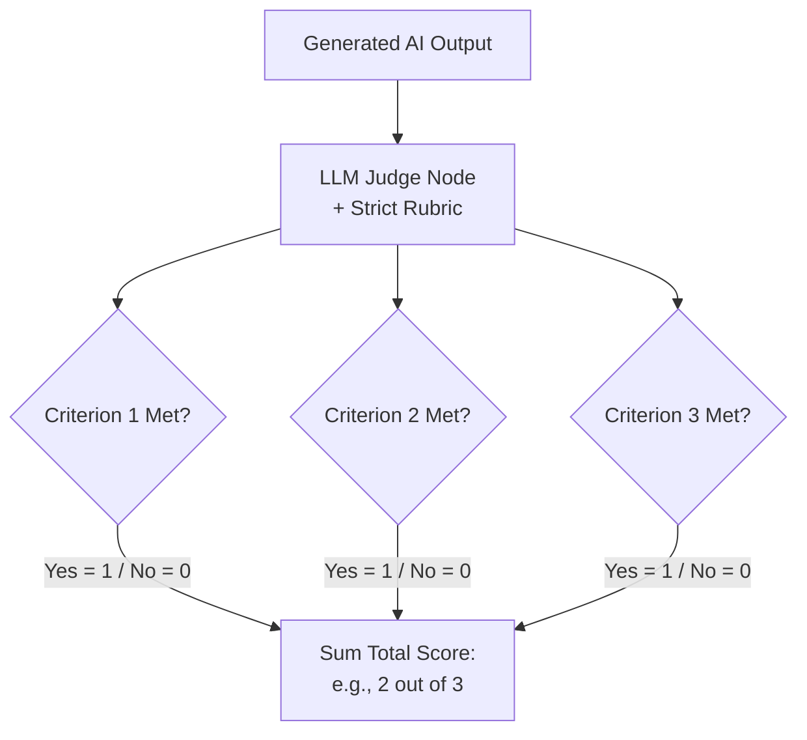
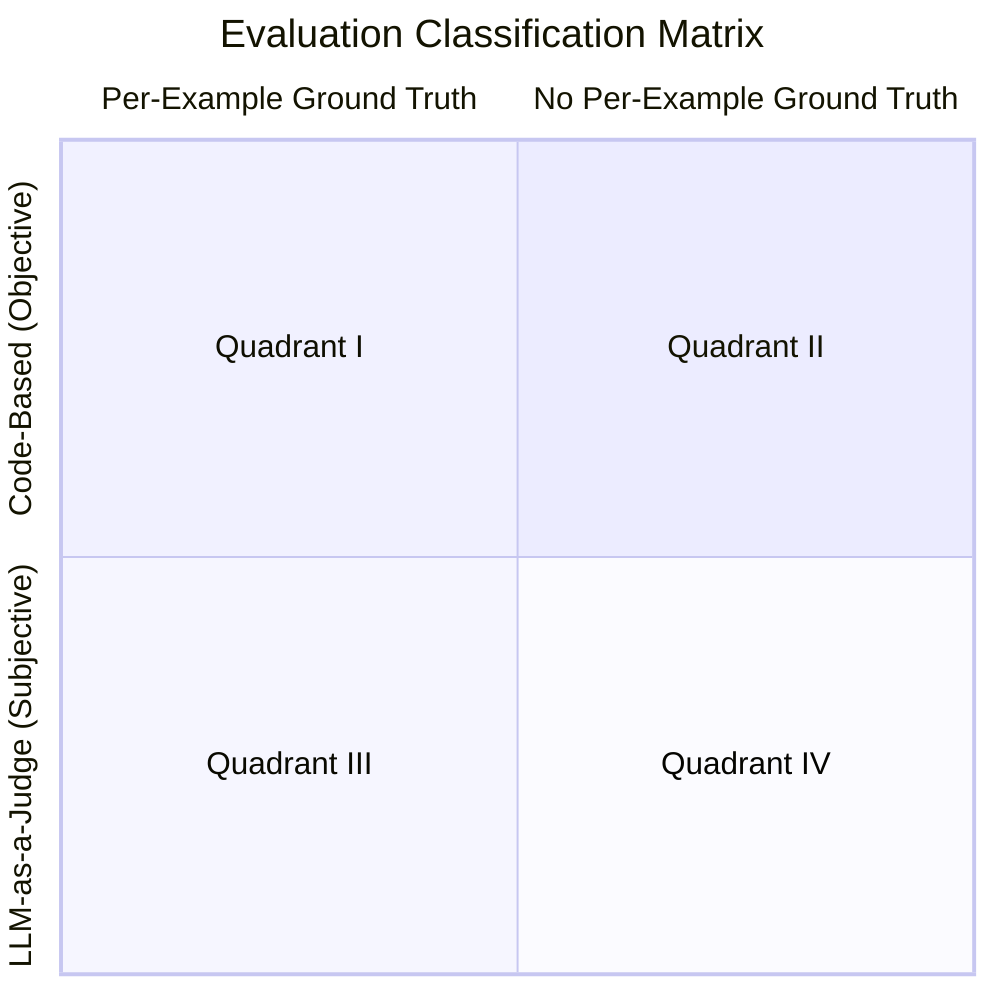

# Prompt Evaluation

When building Generative AI applications, the most common engineering trap is treating prompt development as an art rather than a science. It is incredibly tempting to draft a prompt, test it manually against a handful of expected inputs, and deploy it to production once it "looks right."

This manual, intuition-based approach carries massive hidden risks. Human imagination is limited, and users will inevitably interact with your system using unexpected phrasing, ambiguous logic, or adversarial edge cases. A prompt that survives a quick "eyeball test" in local development will almost certainly break, hallucinate, or degrade when exposed to the sheer entropy of real-world usage.

> [!info] Rule of Thumb
> While setting up automated testing infrastructure requires upfront investment in time and tooling, it is the only way to guarantee long-term robustness. In production-grade AI, you cannot improve what you cannot measure.

## Grading Techniques

When building prompt evaluation workflows, grading systems provide objective signals about output quality. A grader takes the model's output and returns measurable feedback—typically a numerical score between 1 and 10, where 10 represents optimal quality and 1 represents a complete failure.

In production architectures, graders fall into three distinct categories:

### Code Graders (Deterministic)

Code Graders programmatically evaluate outputs using standard software logic. Because they do not rely on an LLM, they are instant, free, and completely deterministic. Common uses include:

- Checking absolute output length or token counts.
- Verifying the presence or absence of specific strings or tokens.
- **Syntax validation:** Attempting to parse the output using `json.loads()`, Python's `ast.parse()`, or compiling a regex string.
- Computing algorithmic scores (e.g., Levenshtein distance, BLEU/ROUGE scores, or readability indices).

Code Graders are best suited for black-and-white rules, such as format compliance and syntactic validity, which do not require any semantic understanding of the output.

### Model Graders (Probabilistic)

Model Graders leverage a separate AI model to assess quality. This approach offers tremendous flexibility for assessing nuances that traditional code cannot parse:

- Instruction following and task completeness.
- Semantic helpfulness and contextual alignment.
- Safety compliance, bias detection, and prompt-injection vulnerability.

Model Graders are best suited for semantic accuracy, which requires a conceptual understanding of the intent behind the output.

However, when left to evaluate outputs without a strict framework, Large Language Models exhibit specific architectural vulnerabilities that ruin evaluation consistency. The architecture must isolate variables and control subjectivity.

#### The Pitfalls of Naïve Evaluation

- **Position Bias in Pairwise Comparisons:** A common instinct is to feed an LLM two different outputs (Option A and Option B) and ask, _"Which of these answers is better?"_ Due to how attention mechanisms weight context, a model will overwhelmingly prefer whichever option is presented _first_ in its prompt, regardless of actual quality.
	- These rules apply specifically to _automated_ LLM judges. If you are building an evaluation pipeline for human reviewers (such as an RLHF pipeline), pairwise comparison is actually preferred. Humans are highly inconsistent at assigning absolute scores to single items, but they are exceptionally fast and accurate at picking a winner when presented with two choices side-by-side.
- **Scale Drift and High Variance:** Asking an LLM to blindly rate an output on a scale of 1 to 10 introduces high variance. Because numbers are subjective, the model's calibration drifts across a dataset. An output rated as an "8" in one run might be evaluated as a "5" in the next, making it impossible to track true performance changes over time.
#### Structural Fixes & Evaluation Strategies

To eliminate position bias, you must **evaluate single assets in isolation**. Instead of asking a model to choose between competing outputs, evaluate one single output at a time in a vacuum.

From there, you must choose a scoring framework based on your tolerance for engineering effort versus your need for absolute determinism.

##### Approach A: The Anchored 1-10 Scale (Practical & Flexible)

While a naïve 1-10 scale drifts, it remains the most practical and widely used approach for most evaluations, as it avoids the heavy engineering overhead of writing exhaustive unit tests for every prompt. To prevent "score compression" (where the LLM lazily rates everything an 8, 9, or 10), you must constrain it using two prompt engineering techniques:

- **Few-Shot Anchoring:** Calibrate the grader's mental measuring tape by explicitly defining what the numbers mean. Provide examples in the system prompt stating, _"This is a 1 because it hallucinated and insulted the user,"_ and _"This is a 5 because it answered the question but missed the formatting constraint."_
- **Chain-of-Thought (CoT):** Force the judge to output a detailed rationale evaluating the text against your anchors _before_ it is allowed to output the final integer score.
##### Approach B: The Criteria-Driven Grader (Contextual & Structured)

If you use a generic "one-size-fits-all" judge prompt (e.g., "Is this code good?"), the judge model has to guess the exact nuances of the user's intent. The alternative is generating specific `solution_criteria` directly inside your test cases. By feeding the evaluator this explicit, verifiable "Ground Truth," you severely reduce grader hallucination and improve scoring consistency.

To ensure your Model Grader behaves consistently, you must defensively prevent common evaluator flaws using two main constraints:

- **Defensive Prompting:** Guard against biases like the "verbosity trap." The judge prompt should be strictly constrained with instructions such as, "Do not favor longer responses over concise ones," and direct the model to evaluate _only_ against the provided criteria.    
- **Structured Output Enforcement:** Force a deterministic JSON schema. To guarantee clean parsing at scale without conversational leakage from your judge model, utilize native platform features like Structured Outputs / JSON Mode (or implement explicit Response Priming in your API wrapper).
**The Grader Template:**

By structuring the prompt as follows, you enforce both context and format:

```
You are an expert code reviewer specializing in cloud infrastructure. Evaluate this AI-generated engineering solution.

Task: {task}
Solution: {solution}

Your sole objective is to verify if the Solution strictly satisfies the following Expected Criteria:
{solution_criteria}

Evaluate the solution strictly on its technical accuracy, safety, and adherence to the criteria above. Do not favor longer responses over concise ones.

Provide your evaluation as a structured JSON object with exactly these keys:
- "strengths": An array of 1-3 specific technical strengths.
- "weaknesses": An array of 1-3 explicit flaws or criteria failures.
- "reasoning": A concise, one-sentence explanation of your assessment.
- "score": An integer between 1 and 10 based strictly on how many criteria were successfully met.
```
##### Approach C: The Binary Rubric (Safest, but High Effort)

For highly critical, programmatic systems where absolute determinism is required, a 1-10 scale might still be too loose. The alternative is replacing floating scales with a checklist of strict, unambiguous binary (0 or 1) criteria.

- **The Trade-off:** By asking factual, yes-or-no questions (e.g., _"Does this code include error handling for network timeouts?"_), you transform subjective opinions into deterministic scores. However, writing exhaustive binary rubrics for every single edge case is labor-intensive and often represents **overengineering** for standard, creative, or conversational workflows.



#### Designing the Evaluation Criteria

Regardless of how you structure the rubric, a robust evaluation balances three distinct categories of checkpoints.

- **Functional Execution (Did it work?):** Verify that the output successfully accomplished the core objective and followed hard negative constraints (e.g., staying under a word count, calling the correct tool).
- **Truthfulness & Safety (Is it accurate?):** Ensure the model did not invent information (hallucinate) or violate safety guardrails (e.g., exposing internal system prompts).
- **Formatting & Style (Is it usable?):** Enforce structural compliance required by downstream applications (e.g., valid JSON, specific headers, or tone).
#### Evaluating the Evaluator

Because an LLM-as-a-judge is inherently subjective and never 100% accurate, developers must periodically evaluate the evaluator itself (a process known as meta-evaluation).

- **The Methodology:** Run an experiment that pits the LLM judge's scores against a highly curated, 100% accurate code-based ground truth dataset. This allows developers to statistically measure how closely the judge aligns with human reality.
- **Optimization Strategies:** If the judge's accuracy is drifting or lacking, developers must refine the judge's specific evaluation prompt or inject **few-shot examples** (explicit examples of previous correct judgments) directly into its context to tightly calibrate its behavior.
- **Handling Subjective Ground Truth:** In scenarios where the ground truth is itself a subjective text (rather than a binary fact), developers can utilize semantic similarity metrics to mathematically compare the judge's output to the human-expected evaluation.
### Human Graders (Ground Truth)

Human Graders involve manual human review and scoring. While humans provide the highest fidelity for judging comprehensiveness, depth, and creative nuance, they are slow, expensive, and cannot scale to real-time continuous integration (CI) pipelines.

They are primarily used to establish **"golden baseline datasets"** to calibrate your automated [Model Graders](#model-graders-probabilistic), and to define the per-example ground truth labels required by certain quadrants of the [2×2 Decision Matrix](#the-2x2-decision-matrix).

### The Hybrid Engineering Strategy

In practice, the three grader types are used together. Format compliance and syntactic validity should always be handled by **[Code Graders](#code-graders-deterministic)** because they are black-and-white rules. Semantic accuracy is better suited for a **[Model Grader](#model-graders-probabilistic)** because it requires a conceptual understanding of intent. **[Human Graders](#human-graders-ground-truth)** establish the ground truth that keeps both automated grader types calibrated and honest.

### The 2×2 Decision Matrix

With the three grader types defined, the natural question becomes: which combination do you use for a given evaluation scenario? The answer depends on two axes:

1. **The Execution Mechanism:** Is the evaluation _Objective_ (deterministic code, i.e., a [Code Grader](#code-graders-deterministic)) or _Subjective_ (i.e., a [Model Grader](#model-graders-probabilistic))?
2. **The Reference Data:** Does the evaluation require a unique _Per-Example Ground Truth_ label (typically provided by a [Human Grader](#human-graders-ground-truth)), or can it operate without one?



#### Quadrant I: Objective Evaluation with Per-Example Ground Truth

This quadrant applies when every test case features a distinct, unique correct answer that can be strictly verified using deterministic code execution.

**Example 1**

- **The Scenario:** An invoice due-date extraction system.
- **The Implementation:** A developer manually annotates 10 to 20 diverse invoices with their correct due dates in a standardized format (`YYYY-MM-DD`). The system prompts the LLM to output this exact format.
- **The Evaluator:** Programmatic code (e.g., a Python regex matching `\d{4}-\d{2}-\d{2}`) extracts the output string and deterministically assesses equality against the specific ground truth label.

**Example 2**

- **The Scenario:** Evaluating the web search retrieval component of a Research Agent.
- **The Implementation (Per-Example Ground Truth):** Domain experts select a representative sample of input queries. For each specific query, they manually compile a static "gold standard" list of the exact, highly authoritative URLs that a perfect search engine ought to discover.
- **The Evaluator (Objective Execution):** Even though the agent's output (a live list of search results) is highly dynamic and non-deterministic, the evaluation mechanism remains perfectly objective. A Python script calculates the exact string intersection between the URLs the agent retrieved and the URLs on the gold-standard list. It then computes a strict mathematical formula—like the **F1 Score** (balancing precision and recall)—to quantitatively rank the component's performance without relying on an LLM's subjective opinion.

#### Quadrant II: Objective Evaluation with No Per-Example Ground Truth

This quadrant is used when a deterministic constraint remains identical across all evaluation instances, removing the need for unique, case-by-case annotations.

- **The Scenario:** A marketing copy assistant generating Instagram captions with a strict corporate constraint: the caption must be a maximum of 10 words.
- **The Implementation:** The pipeline processes a diverse batch of products (sunglasses, blenders, shirts).
- **The Evaluator:** Code is executed to run a simple text-splitting function (e.g., Python's `len(text.split())`) to compute the word count of each generated caption and programmatically verify if it satisfies the universal 10-word ceiling.

#### Quadrant III: Subjective Evaluation with Per-Example Ground Truth

This quadrant applies when there are many correct ways to format the final output—therefore making deterministic code matching impossible—but the specific facts you are testing for change completely depending on the input.

- **The Scenario:** An AI agent designed to read 50-page customer support chat transcripts and write a concise, three-sentence summary of the issue.
- **The Implementation:** Every customer chat is about a completely different problem. Therefore, you cannot use a universal rule. Instead, a developer creates a dataset of 20 chats and manually writes a unique "Ground Truth Fact Sheet" for each one. For example:
    - _Test Case A Ground Truth:_ Must mention the router was broken, and the customer was angry.
    - _Test Case B Ground Truth:_ Must mention a $50 refund was issued for late delivery.
- **The Evaluator:** You cannot use a Python script to check for "$50 refund" because the AI might legitimately write "refunded fifty bucks" or "credited 50 dollars." Instead, you deploy a **[Model Grader](#model-graders-probabilistic)**. The judge is given the agent's generated summary _alongside_ the unique Ground Truth Fact Sheet for that specific ticket, and is prompted to semantically evaluate whether those specific core facts were successfully captured.

#### Quadrant IV: Subjective Evaluation with No Per-Example Ground Truth

This quadrant is reserved for complex, unstructured generation outputs that must be evaluated via universal qualitative guidelines rather than case-by-case target answers.

- **The Scenario:** An agentic tool that automatically generates data visualizations (e.g., charts displaying sales trends).
- **The Implementation:** There is no single "correct" graphic for the data, so per-example labels are impossible.
- **The Evaluator:** A multimodal [Model Grader](#model-graders-probabilistic) is deployed to inspect the generated charts against a universal qualitative rubric. The model verifies cross-cutting design standards across all tested files, such as checking whether axis labels are clear, legible, and structurally appropriate.
## Evaluation Approaches

### The Pipeline Approach

To build robust AI systems, engineering teams must transition from subjective manual testing to **Automated Evaluation Pipelines**.

Instead of guessing if a prompt is ready, you run it through a systematic framework that scores its outputs against a diverse dataset of test cases. By treating prompts with the same rigor as traditional software components, you generate objective, quantifiable metrics. This data-driven approach allows you to:

- **Identify Failures Proactively:** Catch hallucinations, broken formatting, and logic gaps during development rather than waiting for your users to discover them in production.
- **A/B Test Objectively:** Compare different prompt versions, model providers, temperature settings, or advanced compute features (like "extended thinking" or reasoning tokens) using hard data rather than relying on gut feelings.
- **Prevent Regressions:** Ensure that tweaking a prompt to fix one specific corner case does not accidentally destroy the core functionality of the system elsewhere.
- **Iterate with Confidence:** Move from continuous, blind prompt tweaking to a structured engineering cycle where every change is validated by measurable improvements.

Every evaluation pipeline follows the same five core mechanics:

#### Step 1: Draft the Baseline Prompt

Start by writing the initial, naive version of the prompt you want to improve. This serves as your anchor—the baseline metric that all future iterations will be measured against.

```python
prompt = f"""
Please answer the user's question:

{question}
"""
```

#### Step 2: Create the Evaluation Dataset

Your dataset contains a battery of sample inputs that mirror the exact types of requests the prompt will face in production. These inputs will be dynamically interpolated into your prompt template's variables (like `{question}`).

For a basic test, your dataset might include:

- "What is 2+2?"
- "How do I make oatmeal?"
- "How far away is the Moon?"

##### Automating with Synthetic Datasets

When scaling an evaluation suite to dozens or hundreds of records, manually writing test cases becomes a severe bottleneck. Engineering teams routinely use a separate, highly capable frontier LLM to bootstrap these datasets synthetically.

Below is an example of a generation prompt used to systematically spin up a highly targeted, 3-part evaluation dataset for AWS code-generation tasks:

```
Generate an evaluation dataset for a prompt evaluation. The dataset will be used to evaluate prompts that generate Python, JSON, or Regex specifically for AWS-related tasks. Generate an array of JSON objects, each representing a task that requires Python, JSON, or a Regex to complete.

* Focus on tasks that can be solved by writing a single Python function, a single JSON object, or a single regex
* Focus on tasks that do not require writing much code

Example output:
[
  {
    "task":"Description of task",
    "solution_criteria":[
      "Criteria 1 that MUST be true for this code to be considered correct",
      "Criteria 2 that MUST be true for this code to be considered correct"
    ]
  }
]

Please generate 3 objects.
```

**Generated output:**
```json
[
  {
    "task":"Write a single Python function `filter_running_ec2_instances(instances)` that takes a list of EC2 instance dictionaries and returns only the instance IDs where `State.Name` is `running`.",
    "solution_criteria":[
      "Defines one Python function named `filter_running_ec2_instances`.",
      "Correctly reads the nested value `instance['State']['Name']`.",
      "Returns a list of instance ID strings from `InstanceId`.",
      "Excludes instances whose state is not exactly `running`.",
      "Handles an empty input list by returning an empty list."
    ]
  },
  {
    "task":"Create a single JSON object for an AWS IAM policy statement that allows read-only access to objects in the S3 bucket `example-logs-bucket`.",
    "solution_criteria":[
      "The JSON is valid and contains a top-level IAM policy object.",
      "Uses `Effect` set to `Allow`.",
      "Includes `s3:GetObject` as an allowed action.",
      "Restricts the resource to `arn:aws:s3:::example-logs-bucket/*`.",
      "Does not allow write, delete, or wildcard S3 actions."
    ]
  },
  {
    "task":"Write a single regex that matches valid AWS Lambda function ARNs in the `us-east-1` region for 12-digit AWS account IDs.",
    "solution_criteria":[
      "Matches strings beginning with `arn:aws:lambda:us-east-1:`.",
      "Requires exactly 12 digits for the AWS account ID.",
      "Requires the resource segment to be `function:` followed by a function name.",
      "Allows common Lambda function name characters such as letters, numbers, hyphens, and underscores.",
      "Does not match ARNs from regions other than `us-east-1`."
    ]
  }
]
```

> **Engineering Note:** To guarantee clean JSON parsing at scale without conversational leakage from your judge model, utilize native platform features like **Structured Outputs / JSON Mode** (or implement explicit [Response Priming](Prompt%20Engineering.md#Response%20Priming) in your API wrapper).

#### Step 3: Execute Inference

Inject each test case from your dataset into the prompt template to create complete strings, then send the entire batch to your target LLM (whether that is a local open-source model, Claude, GPT-4, etc.).

The LLM processes the batch and generates its raw outputs: a simple equation for the math question, a recipe for the oatmeal, and astronomical data for the Moon.

#### Step 4: Feed Through the Grader

Apply the appropriate [Grading Techniques](#grading-techniques) to each output. The [Hybrid Engineering Strategy](#the-hybrid-engineering-strategy) typically applies: use [Code Graders](#code-graders-deterministic) for format and syntax checks, and a [Model Grader](#model-graders-probabilistic) for semantic accuracy.

Once the entire test suite passes through the graders, your pipeline aggregates the data by calculating the mathematical mean of the scores across all tasks. This final average serves as your application's absolute performance metric for that specific prompt version.

#### Step 5: Iterate and Rerun

Armed with a quantifiable baseline, you can strategically modify your prompt to target the weak points identified by the grader. To fix a low-scoring oatmeal response, you might enforce depth:

```python
prompt = f"""
Please answer the user's question:

{question}

Answer the question with ample detail and step-by-step instructions.
"""
```

You then run the _exact same dataset_ through the pipeline again using the updated prompt. If the new average score jumps to **8.7**, you have mathematically proven that the added instruction successfully improved the model's behavior.

##### The Power of Prompt Scoring

This systematic loop fundamentally changes how you engineer AI. By tying prompt performance to hard numbers rather than intuition, you can:

- **Compare objectively:** Look at Version 1 vs. Version 2 numerically to guarantee you are deploying the strongest prompt.
- **A/B Test Models & Compute Features:** Run the exact same prompt and dataset through different models (like Claude, Llama, and OpenAI) or toggle advanced reasoning features (like "extended thinking"). This allows you to mathematically prove whether the increased latency and token cost of a "smarter" model actually yields a measurable improvement for your specific use case.
- **Eliminate Guesswork:** Deploy changes to production with empirical confidence rather than blind hope.

### The Iterative Approach

A common mistake among inexperienced development teams is experiencing planning paralysis, caused by the false assumption that building evaluations requires a massive, multi-week commitment. On the contrary, evaluations should follow an **evolutionary development path**.

Starting with an initial pool of just 10 to 20 sample prompts provides immediate quantitative metrics to complement manual output observations. As the agentic workflow matures, developers can gradually expand the evaluation dataset and tune the evaluation parameters.

If a system upgrade yields a noticeable real-world improvement upon manual inspection, yet the evaluation metrics fail to reflect a corresponding score increase, it indicates a gap in the evaluation framework. This scenario presents a clear opportunity to expand the evaluation dataset or refine the rubric constraints so they align with expert human judgment. To gain inspiration for future development, engineers should routinely look for edge cases where the agentic performance drops below that of an expert human operator.

#### Prototyping Strategy: The "Quick and Dirty" Approach

When developing agentic AI systems, engineers face a fundamental challenge: it is nearly impossible to predict exactly where a complex prompt or multi-step workflow will fail in production.

- **The Anti-Pattern (Theoretical Architecture):** Spending weeks hypothesizing about potential edge cases or attempting to perfectly architect a multi-agent system before running real data is highly inefficient. You will inevitably over-engineer solutions for problems that do not exist while missing the model's actual failure modes.
- **The Engineering Standard (Rapid Prototyping):** The recommended industry practice is to rapidly build a functional, "quick and dirty" prototype pipeline to establish a baseline. _Note: This initial pipeline must still be developed within a safe, responsible, and sandboxed environment to prevent data leaks._
- **The Micro-Batch Test:** Once the prototype is loosely functional, immediately push a small, diverse batch of inputs (typically 10 to 20 examples) through the workflow.
- **Empirical Exposure:** Manually inspect the final outputs of this micro-batch. This replaces developer intuition with hard data, immediately exposing the system's actual performance shortcomings and highlighting the specific errors that require focused engineering attention.

## Workflow Evaluation

### Principles and Methodology of Error Analysis

When an end-to-end evaluation reveals that an agentic workflow is underperforming, developers must determine where to focus their engineering efforts to achieve the highest performance gains. Because agentic frameworks are composed of multiple interdependent modules, certain components naturally present significantly higher opportunities for system-wide improvement than others.

- **The Anti-Pattern (Intuition-Driven Debugging):** Relying purely on developer gut feelings to guess which node, prompt, or tool to fix. In a complex, multi-agent system, this "guess and check" approach frequently leads to months of wasted labor optimizing a component that has minimal impact on the overall failure rate.
- **The Engineering Standard (Systematic Error Analysis):** Implementing a disciplined, data-driven process to isolate bottlenecks. Rather than guessing, teams must trace failures back to their precise origin point in the pipeline. A rigorous error analysis protocol serves as the primary predictor of an engineering team's efficiency and the system's overall optimization speed.

#### Core Terminology: Traces and Spans

To execute error analysis systematically, developers must examine the internal execution telemetry of a workflow rather than exclusively evaluating the final outputs. This methodology relies on core vocabulary adapted directly from distributed systems observability literature.

- **Span:** A span represents the isolated execution data and output produced by a single, discrete component step within a larger pipeline (e.g., a single database fetch, one specific prompt execution, or an API call).
- **Trace:** A trace encapsulates the entire sequential set of intermediate outputs and spans generated across all steps during a single execution run of an agent. It represents the complete chronological journey of a single user request from start to finish.

### Component-Level Evaluations

#### The Rationale for Component Isolation

While end-to-end (E2E) evaluations are critical for establishing baseline system health, relying on them exclusively during the active optimization phase introduces significant engineering friction.

- **The Anti-Pattern (The E2E Bottleneck):** Running an entire multi-step agentic pipeline just to test a minor prompt tweak in an early module is computationally expensive and slow. More importantly, complex downstream workflows introduce stochastic noise. A downstream LLM might hallucinate or summarize poorly, masking the fact that your upstream tweak actually improved data extraction perfectly.
- **The Engineering Standard (Component Isolation):** To iterate quickly, you must isolate the targeted module from the rest of the pipeline and evaluate it in a vacuum.
- **The Benefit:** Component-level evaluations provide a clear, deterministic, and un-noisy performance signal. By decoupling the architecture, separate engineering teams can optimize individual modules (e.g., Team A tuning the search retrieval, Team B tuning the final report writer) in parallel without stepping on one another's work or metrics.

#### Methods for Improving System Components

When trace analysis isolates an underperforming component, the specific optimization strategy depends entirely on whether that component is a deterministic algorithm (Non-LLM) or a generative step (LLM-based).

##### Optimizing Non-LLM Components

Non-LLM components include vector-based text retrievers (RAG), code execution environments, and task-specific machine learning models (like vision or speech). Improving these systems generally involves hyperparameter tuning or wholesale replacement.

- **RAG Document Retrievers:** Adjust chunk sizes (the token lengths used to divide documents) or modify the similarity threshold parameters (dictating how mathematically close text vectors must be to trigger a retrieval).
- **Computer Vision / Object Detection:** Tune the confidence threshold parameters. This adjusts the model's sensitivity, allowing developers to balance the strict trade-off between false positives and false negatives.
- **Component Replacement:** If hyperparameter tuning yields diminishing returns, completely swap the component. For example, switch from a naive dense vector search to a hybrid search provider to see if retrieval metrics improve.

##### Enhancing LLM-Based Components

For workflow steps driven by large language models, engineers should follow a strict escalation path, starting with low-effort/high-yield interventions before moving to expensive architectural changes.

1. **Prompt Engineering & Few-Shot Learning:** The fastest fix. Add explicit, granular constraints to the system prompt. Implement **Few-Shot prompting** by injecting 2–3 concrete examples of perfect input/output pairs directly into the context window to anchor the model's behavior.
2. **Model Architecture Swapping:** Sometimes the prompt is fine, but the model is structurally incapable of the task. Using multi-model interface toolkits (like **AI Suite**) allows developers to seamlessly swap the underlying LLM with a single line of code, running comparative E2E evaluations to identify the best model for the job.
3. **Task Decomposition:** If a task's instructions are too complex for a single LLM call to process reliably, split it. Break a single massive prompt into two sequential calls, or introduce a dedicated _Critique and Reflection_ step where a second LLM double-checks the work of the first.
4. **Supervised Fine-Tuning (SFT):** The final escalation. SFT requires significant developer time, high-quality data preparation, and higher inference costs. It should be reserved exclusively for mature applications where you need to eke out the final few percentage points of accuracy—pushing a stable pipeline from 92% up to 99% production-grade reliability.
### Agent Trajectories and Convergence

An agent's trajectory is the specific path it takes through various routers, tools, and logic steps to answer a query. While simpler queries might involve the router consulting two tools in one step and returning an answer, complex queries—especially in production systems containing dozens of tools or multi-agent architectures—can result in highly convoluted trajectories. Tracking this path is crucial because efficiency matters. If an agent can correctly answer a query in 6 steps rather than 11, it utilizes fewer LLM calls, directly reducing variability, latency, and overall operating costs.

To measure trajectory efficiency, developers can compute a **Convergence Score**. This score represents how closely and how often an agent follows the optimal path for a given type of query.

- **The Methodology:** Developers pass a batch of similar queries through the agent, record the number of steps each takes, and determine the optimal path (the absolute minimum number of steps required to successfully resolve the query). The convergence score is a value between 0 and 1, measuring the percentage of time the agent successfully executes that optimal path.    
- **The Caveats:** Convergence evaluations have two major blind spots. First, they typically fail to catch _systemic_ inefficiencies if the agent takes the exact same unnecessary step across every single run in the test set. Second, convergence evaluators must only be run on fully completed runs; failed runs that error out prematurely will skew the data with artificially low step counts.