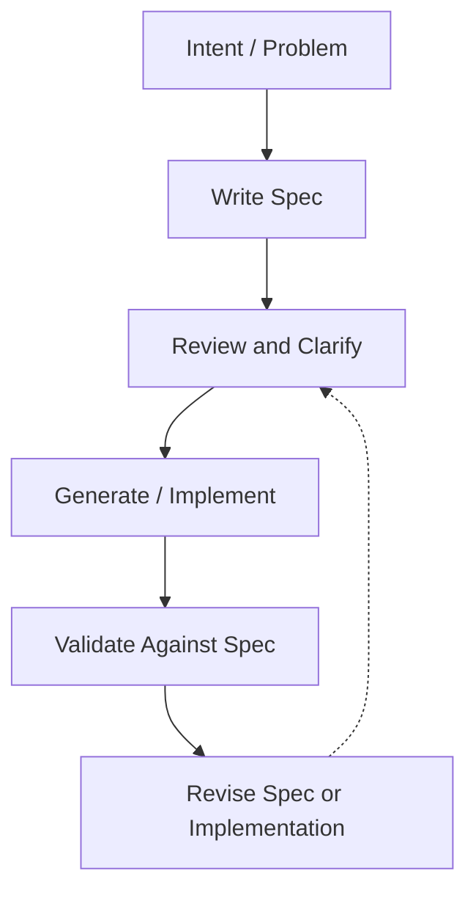
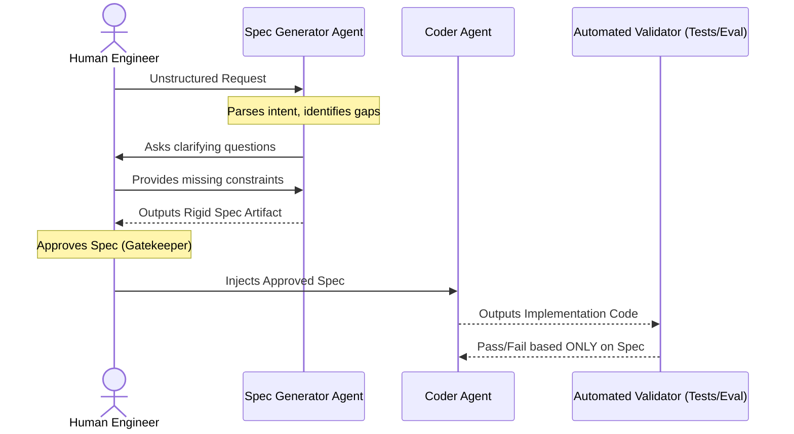

# Spec-Driven Development

Spec-Driven Development (SDD) is an engineering approach where the primary artifact is the **specification**, and implementation follows from that spec rather than preceding it.

The core idea is simple: reduce ambiguity early, make expectations explicit, and force the system to be built against a stable contract instead of loosely inferred intent.

While SDD has roots in traditional software architecture, it has become fundamentally essential in AI-assisted engineering workflows. When dealing with autonomous agents and Large Language Models, vague instructions often produce plausible but completely misaligned output. A precise spec acts as a rigid boundary, narrowing the model's solution space and making both generation and human review significantly more reliable.

- **The Shift in Engineering Leverage:** In traditional development, writing the code was the primary bottleneck, so methodologies optimized for code production. In AI-assisted workflows, code generation is fast and cheap; the new bottleneck is verifying intent. SDD shifts the engineer's effort away from syntax and toward the highest-leverage activity: defining exactly what the system should do.
- **Combating "Plausible Misalignment":** LLMs are inherently designed to interpolate and please the user. If given an underspecified prompt, the model will silently fill in the missing architectural gaps with its own assumptions. This results in code that compiles and looks correct, but violates hidden business logic. SDD strips the LLM of its ability to make unauthorized assumptions.
- **The Spec as a Multi-Party Contract:** In an AI-driven architecture, the specification serves as a binding contract. The human uses it to catch edge cases early, the orchestration framework uses it to generate strict JSON schemas and tool definitions, and the agent uses it as the absolute boundary for generating the final implementation.

## Where SDD Fits Best

Spec-Driven Development is a rigorous framework. Because writing a strong specification requires upfront cognitive effort, applying it universally can bottleneck development. It is highly situational and best treated as a tool for managing complexity, risk, and alignment.

**When to Apply SDD:**

- **Ambiguity is Expensive:** SDD is essential when a hallucinated or misaligned response will waste significant time, compute, or money. If an LLM going down the wrong architectural rabbit hole takes hours for a human to debug, spending twenty minutes defining a spec upfront is a massive net win.
- **Multi-Agent Coordination:** When multiple humans or autonomous agents must interact with the exact same artifact. A strict spec acts as the universal translator and shared source of truth across a multi-step pipeline.
- **Strict Structural Requirements:** When correctness depends on preserving exact data structures rather than just capturing general intent (e.g., generating a strict JSON payload, complying with an external API contract, or writing database migrations).
- **Automated Downstream Pipelines:** When the model's output will feed directly into another automated step without human intervention (such as an automated test runner, an eval framework, or a deployment script).
- **High-Stakes Review:** When the quality of the review matters just as much as the speed of generation. A spec gives human reviewers a deterministic checklist to grade the AI's output against, rather than relying on subjective intuition.

**When SDD is Overkill:**

- **Trivial One-Off Requests:** Writing a spec for a simple bash script, a regex string, or a boilerplate function takes longer than simply asking the model to generate it and testing it once.
- **Exploratory Brainstorming:** When you are relying on the LLM's latent knowledge to generate ideas, architectural options, or outlines. In these phases, rigid constraints stifle the exact creative divergence you are looking for.
- **Low-Risk Drafts:** When building rapid prototypes or zero-drafts where precision is unimportant and the goal is simply to get something working on the screen quickly.
## What Counts as a Spec

A spec is any artifact that constrains implementation strongly enough to reduce guesswork. The more precise and machine-readable the artifact, the more reliably it can guide downstream AI implementation.

Rather than relying purely on open-ended prose, effective specs usually take the form of rigid, verifiable structures. Common examples can be broken down into three main categories:

- **Data and Interface Contracts:**
    - **Schemas:** (e.g., JSON Schema, Pydantic models) Define the exact shape, types, and required fields of the data the model must parse or return.
    - **API Contracts:** (e.g., OpenAPI definitions) Dictate the endpoints, request payloads, and acceptable response codes.
    - **Interface Definitions:** (e.g., TypeScript interfaces, GraphQL types) Map out the explicit boundaries and communication protocols between system components.
- **Behavioral Constraints:**
    - **Structured Requirements:** Bulleted, highly specific rules governing business logic, system behavior, and constraints.
    - **Examples (Few-Shot Data):** Explicit pairings of valid inputs and their exact expected outputs, establishing a clear, mimicable pattern for the LLM.
- **Validation Artifacts:**
    - **Test Cases:** Executable assertions (like unit tests) that can programmatically prove the model's output matches the intended design.
	    - **TDD (Unit Tests):** Provides the low-level implementation spec. By writing the test suite first, the LLM is given a zero-ambiguity, pass/fail target for code generation.
		- **BDD (Behavioral Tests):** Provides the high-level feature spec. Frameworks utilizing structured natural language (like Gherkin's `Given / When / Then`) act as a perfect bridge—easily written by human stakeholders, highly legible to LLMs, and natively executable by a test runner.
    - **Acceptance Criteria:** A strict, binary checklist defining the exact conditions under which a feature is considered complete.
    - **Evaluation Rubrics:** Distinct scoring guidelines used (often by another LLM or an "eval" framework) to grade the quality, latency, or security of the generated output.

## Typical Flow

The Spec-Driven Development lifecycle is fundamentally iterative. However, unlike traditional workflows where iteration happens primarily during the coding phase, SDD shifts the heaviest iteration to the specification phase.



In an AI-assisted engineering environment, this sequence typically unfolds as follows:

1. **Define the Intent (Human):** State the overarching problem, desired feature, or business goal in plain natural language.
2. **Draft the Specification (Human or AI):** Convert the vague intent into a rigid, structured artifact. This might involve generating a JSON schema, writing a suite of unit tests (TDD), or defining strict acceptance criteria.
3. **Review and Clarify (Human):** Inspect the spec for ambiguity, missing constraints, unhandled edge cases, or contradictory logic. _Crucial mindset shift: You must fix assumptions here, before any implementation begins._
4. **Generate Implementation (AI/Agent):** Feed the locked, reviewed specification to the Large Language Model or agentic pipeline to generate the underlying code, data structure, or configuration.
5. **Validate Output (Automated):** Programmatically evaluate the AI's generated implementation deterministically against the spec (e.g., executing the test suite, running a schema validator).
6. **Iterative Revision (Hybrid):** If the validation fails, trace the error to its root cause.
    - If the model simply hallucinated or ignored instructions, revise the implementation prompt.
    - **Spec-First Remediation:** If validation exposes an ambiguity, an unhandled edge case, or a loophole exploited by the model, **do not manually hack the generated code**. Instead, the engineer must resolve the root cause by updating the specification to explicitly define the missing constraint. The tightened artifact is then passed back to the LLM so the implementation can be cleanly regenerated or refactored.

## Living Specs vs. Static Specs

A specification does not need to be completely frozen from the start to be useful. In real-world engineering—especially AI-assisted workflows—the spec is rarely a one-time planning document. Instead, it must function as a **living artifact**.

### The Lifecycle of a Living Spec

In practice, a spec typically evolves through four distinct stages:

1. **Initial Intent:** A broad, natural language problem statement or user story.
2. **Clarification:** A refinement phase (often assisted by an LLM) that translates vague intent into explicit constraints, schemas, and test cases.
3. **Implementation-Ready:** A tight, unambiguous artifact used to drive the actual AI code generation.
4. **Continuous Maintenance:** A living document that evolves as business behavior, system interfaces, or underlying requirements inevitably change.

### The Two Paradigms

Understanding when to freeze a spec and when to let it evolve is critical for system design:

- **Static Specs:** Fixed, point-in-time snapshots. These are essential for highly stable contracts, security audits, and tightly governed external APIs where downstream consumers rely on immutability.
- **Living Specs:** Dynamic artifacts that are continuously updated as the implementation phase reveals missing edge cases, broken assumptions, or new technical constraints.

> **The Golden Rule of SDD:** The mandate is not "never change the spec." The mandate is "change the spec deliberately, and always keep the spec and the implementation tightly synchronized."

## What a Strong Spec Usually Includes

To function as a reliable contract for an AI agent, a specification must eliminate guesswork across all dimensions of the implementation. A robust spec typically explicitly defines the following five categories:

### Functional Requirements

These define exactly what the system must accomplish.

* **Core Capabilities:** The specific tasks the system must perform.
* **I/O Boundaries:** The exact inputs the system accepts and the precise outputs it returns.
* **Invariants:** The absolute rules, business logic, or system states that must hold true at all times during execution.
### Structural Requirements

These define the explicit shape of the data and the boundaries of communication.

* **Data Models:** Rigid schemas, field definitions, and data format constraints.
* **Contracts:** Interfaces, network protocols, or external API contracts that dictate how the generated component interacts with the rest of the system.

### Behavioral Requirements

These define how the system must react dynamically, especially when things go wrong.

* **Expected Flows:** The standard execution sequence (the "happy path").
* **Edge Cases:** Explicit instructions on how to handle unusual, partial, or ambiguous inputs.
* **Failure Handling:** How the system must manage invalid states, exceptions, and graceful degradation.
### Quality Requirements

These define the non-functional constraints that govern the execution and lifecycle of the code.

* **Performance:** Strict latency constraints and memory bounds.
* **Robustness:** Security constraints, vulnerability checks, and reliability expectations.
* **Code Standards:** Readability, maintainability, or specific stylistic rules the LLM is expected to follow.
### Evaluation Criteria

These define the deterministic, verifiable definition of success.

* **Validation Mechanics:** Exactly how correctness will be programmatically checked (e.g., specific test suites, linting, human review checkpoints).
* **Failure Conditions:** The explicit boundaries of what counts as a failed generation.
* **Permitted Trade-offs:** Explicit guidance on what the model is allowed to sacrifice if necessary (e.g., prioritizing execution speed over memory efficiency).
## Tooling Integration

A specification is only a strong contract if it can be verified. If a human has to manually read an LLM's output to check if it matches the spec, the automation loop is broken. To make Spec-Driven Development work at scale, the spec must be enforced programmatically by industry-standard tooling.

By translating natural-language constraints into executable tools, you turn subjective review into a deterministic pass/fail gate.

### Schema and Data Enforcers

These tools define the exact shape of the data the LLM must generate. They are universally supported by modern LLM APIs (via "Structured Outputs" or "Tool Calling") and will instantly throw errors if the model hallucinates a field or returns the wrong data type.

- **Python:** Pydantic
- **TypeScript / JavaScript:** Zod, Joi
- **Language Agnostic:** JSON Schema
### Interface and Contract Enforcers

When generating code that interacts with other systems, the spec should take the form of a strict communication protocol. You feed the contract to the agent, and the agent must generate compliant endpoints or payloads.

- **REST APIs:** OpenAPI (Swagger) specifications
- **Microservices:** gRPC / Protocol Buffers (Protobuf)
- **GraphQL:** GraphQL Type Definitions
### Behavioral and Logic Enforcers

While schemas prove the data is the right shape, testing frameworks prove the generated code actually performs the correct business logic.

- **Unit/Integration Testing:** Pytest (Python), Jest (TS/JS), JUnit (Java). The agent writes code until the test suite passes green.
- **Behavioral Testing (BDD):** Cucumber. Because it uses plain English (Gherkin syntax), it is the ultimate bridge: stakeholders can read it, LLMs can easily parse it, and the test runner can execute it.
- **Static Analysis:** Linters (Ruff, ESLint) and strict type checkers (MyPy, TypeScript strict mode) enforce non-functional requirements like code style and memory safety without human intervention.
## Common Failure Modes

- **The Spec Is Actually Just a Wish:** A vague request, such as asking to simply "Build a scalable auth system," is not a usable spec. A usable spec requires stronger direction, including explicit interfaces, token lifecycle rules, failure cases, performance bounds, and acceptance criteria.
- **Hidden Requirements Stay Hidden:** If the reviewer or stakeholder is carrying critical assumptions mentally, the model cannot obey them consistently. All critical constraints must be explicitly written down.
- **The Spec Is Too Abstract to Validate:** If nobody can programmatically or operationally check whether the generated output matches the spec, the workflow degrades back into subjective, manual review.
- **The Spec and the Output Format Drift Apart:** A strong spec can still fail if the implementation step allows unconstrained output formats. Utilizing schema-driven output and deterministic validation reduces this risk.
- **The Spec Stops Evolving but the System Does Not:** A spec that is never updated eventually becomes historical commentary instead of an active engineering artifact. This is especially dangerous in agentic or iterative coding loops, where implementation can drift quickly. If the system behavior changes, the spec, the validation logic, or the implementation must also change to keep the pipeline aligned.
## The Spec Generator Agent

One highly effective pattern in AI-assisted workflows is utilizing an LLM strictly as a **Spec Generator** (or Spec Writer), cleanly separating the planning phase from the implementation phase.

In this architecture, the model is strictly sandboxed and forbidden from writing any implementation code. Instead, its sole responsibility is to translate human intent into a rigid, machine-readable contract that downstream systems can execute.

### The Persona: The Pessimistic Architect

When prompting a general-purpose LLM to write code, its default behavior is usually eager and agreeable—it wants to start typing immediately, even if the instructions are flawed.

To build a successful Spec Generator Agent, you must invert this behavior via its system prompt. The agent should be framed as a "Pessimistic Architect." It should be instructed to:

- Assume the user's initial request is incomplete or flawed.
- Actively look for logical loopholes, missing data structures, and unhandled edge cases.
- Refuse to generate the final spec artifact until all ambiguities are resolved.
  
### Two Modes of Operation

Depending on your workflow, a Spec Generator usually operates in one of two distinct modes:

**1. The Interviewer (Interactive Mode)**
- **How it works:** The agent operates in a conversational loop with the human engineer.
- **The Flow:** The human provides a rough idea ("I need a rate limiter"). The agent responds with a targeted list of technical questions ("What is the storage backend? Redis? In-memory?", "What happens when the limit is breached? Drop or queue?", "What is the time window?").
- **The Output:** Once the human answers the questions, the agent compiles the agreed-upon constraints into the final spec artifact.

**2. The Translator (One-Shot Mode)**
- **How it works:** The agent operates as a strict pipeline step without human back-and-forth.
- **The Flow:** The human dumps a messy, unstructured stream-of-consciousness document, existing meeting notes, or raw API payloads into the prompt. The agent's job is purely parsing and structuring.
- **The Output:** It extracts the implicit constraints and outputs a perfectly formatted specification (e.g., an OpenAPI schema or a markdown document matching your [Practical Note Template](https://www.google.com/search?q=%23practical-note-template)).

### The Orchestration Pipeline

By isolating the Spec Generator, you create a highly controlled, deterministic pipeline. This is what the handoff looks like in practice:



### Why Separation Matters

This separation of concerns drastically improves system reliability because it prevents a single model from attempting to plan architecture and write syntax in the same unconstrained, single-pass generation.

**Key Benefits:**

- **Clearer Boundaries:** Establishes a distinct line between capturing human intent and generating code.
- **Pre-Implementation Review:** Allows the human engineer to review, tweak, and approve the plan _before_ any compute is spent on implementation.
- **Artifact Reusability:** The identical spec can be reused across multiple different agents, tools, or even programming languages. If you want to rewrite a Python backend in Go, you simply pass the exact same spec to a different Coder Agent.
- **Reduced Hallucinations:** Lowers the risk of the model's hidden assumptions leaking directly into the final codebase, as the Coder Agent is instructed to _only_ obey the spec, not its own intuition.


### Practical Note Template

Theory is only useful if it translates into execution. When drafting a specification for an AI agent, using a standardized, predictable format ensures that neither you nor the model misses critical constraints.

#### Template Breakdown

|**Section**|**Required Elements**|**Purpose in AI Workflows**|
|---|---|---|
|**Goal**|The specific problem being solved and the identity of the consumer.|Establishes the "North Star" context so the LLM understands the underlying _why_ behind the task.|
|**Inputs**|The source data, operating assumptions, and system constraints.|Defines the exact starting state. It tells the agent what tools, data, and context it is allowed to use.|
|**Required Output**|The output format, schemas or interfaces, and concrete examples.|Eliminates output formatting drift. Providing few-shot examples here is the highest-leverage way to get reliable structures.|
|**Rules**|Explicit business logic, structural invariants, and forbidden behaviors.|Acts as the negative constraints. LLMs need to be told explicitly what they are _not_ allowed to do.|
|**Edge Cases**|Instructions for invalid input, partial input, and ambiguous cases.|Forces the model to write robust error handling rather than assuming the "happy path" will always occur.|
|**Validation**|Deterministic checks, LLM grader criteria, and human review checkpoints.|Defines exactly how the system (or human) will prove that the generated implementation is correct.|
#### Raw Markdown Scaffold

```markdown
### Goal
- 
- 

### Inputs
- 
- 
- 

### Required Output
- 
- 
- 

### Rules
- 
- 
- 

### Edge Cases
- 
- 
- 

### Validation
- 
- 
- 
```