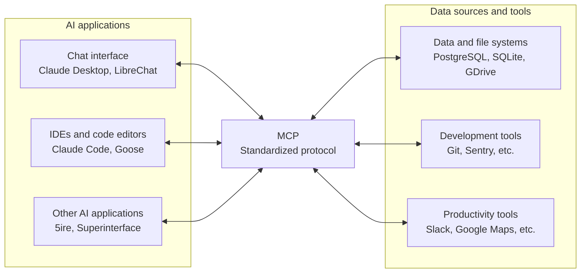

# Model Context Protocol Overview

MCP (Model Context Protocol) is an open-source standard for connecting AI applications to external systems.

* Using MCP, AI applications like Claude or ChatGPT can connect to data sources (e.g. local files, databases), tools (e.g. search engines, calculators), and workflows (e.g. specialized prompts), enabling them to access key information and perform tasks.
* Think of MCP like a USB-C port for AI applications. Just as USB-C provides a standardized way to connect electronic devices, MCP provides a standardized way to connect AI applications to external systems.

## The Problem MCP Solves

Without a standard protocol, every model needs a custom, hard-coded integration for every tool. If there are $M$ models (Claude, Gemini, GPT-4, etc.) and $N$ tools (Google Drive, Slack, GitHub, local databases), $M \times N$ integrations are needed.

* This solution is also very brittle because it has, at least, $M \times N + M + N$ reasons to change.

Another problem is interface clarity: if any tool interface description is vague or missing, it will make the agent guess, and that can cause a model to hallucinate, jeopardizing its reliability. For example, if it asks for a `date` but does not specify the format (`DD-MM-YYYY` vs `MM-DD-YYYY`), the model could mistake `1 of February` for `2 of January`.

Finally, as all tools have ad-hoc interfaces, it is not possible to create a dynamic tool list. Instead, each tool has to be exposed to the agent individually.