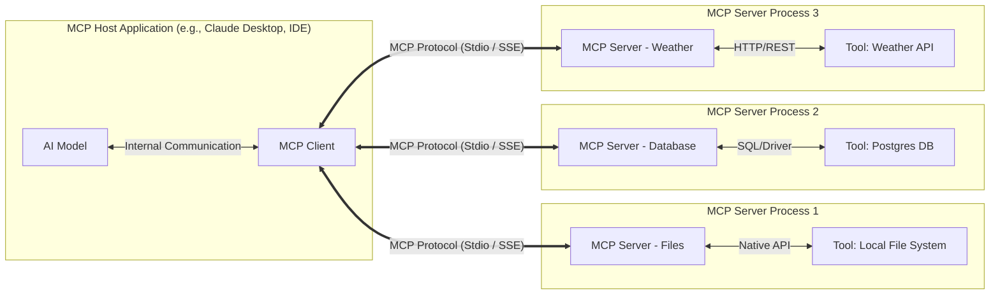

# Model Context Protocol (MCP) Architecture



The Model Context Protocol (MCP) architecture is divided into three core operational components:

- **MCP Host:** The application where the AI model actually lives or runs, such as Claude Desktop or an IDE.
- **MCP Client:** The connector inside the host that speaks the MCP protocol.
- **MCP Server:** A lightweight program that sits in front of a tool, such as Google Drive or a database, and translates its capabilities into the standard MCP format.

## The Transport Layer

The transport layer's sole job is to establish a bidirectional communication channel between the client and the server. It natively handles:

- **Connection Lifecycle:** Starting the connection, maintaining it, and closing it cleanly.
- **Message Framing:** Ensuring messages are delineated correctly so the receiver knows where one message ends and the next begins.
- **Payload Delivery:** Carrying **JSON-RPC 2.0** messages, including Requests, Responses, and Notifications.

### Supported Transport Types

MCP currently specifies two primary standard transport mechanisms. Each serves a completely different deployment architecture.

#### 1. Stdio (Standard Input/Output)

This is the most common transport for local integrations.

- **How it works:** The MCP client spawns the MCP server as a subprocess running on the same machine.
- **Communication:** The client writes JSON-RPC messages to the server's `stdin`. The server writes responses to its `stdout`. `stderr` is usually reserved for logs so it does not corrupt the data stream.
- **Use Case:** Connecting to local files, local databases, or scripts running on the same machine.
- **Engineering Pros:** Fast, secure because no network ports are exposed, and requires no networking setup.

#### 2. SSE (Server-Sent Events) over HTTP

This is the standard transport for remote or distributed integrations.

- **How it works:** The MCP server runs as a web service, for example in Docker or on a cloud server.
- **Communication:** The server pushes JSON-RPC messages down to the client using a persistent [SSE](#2.%20SSE%20(Server-Sent%20Events)%20over%20HTTP) connection. The client uses standard HTTP POST requests to send messages up to the server.
	- **The Downstream (Server $\to$ Client):** The client opens **one single, long-lived HTTP connection**. The server keeps this connection open indefinitely and streams JSON-RPC responses and notifications down to the client as events occur.
	- **The Upstream (Client $\to$ Server):** Whenever the client needs to talk to the server (e.g., sending an `initialize` request or commanding a tool to run), it fires off a **standard, ephemeral HTTP POST request**. The server processes it, and typically pushes the ultimate result back down the persistent SSE channel.
- **Use Case:** Enterprise deployments, cloud-hosted agents, or mixed-environment setups such as WSL vs. Windows.
- **Engineering Pros:** Works over standard web infrastructure, is firewall-friendly, and is mostly stateless.

> [!NOTE] Why SSE Instead of WebSockets?
> 
> While WebSockets provide a true full-duplex, persistent connection, they introduce significant networking complexity. MCP relies on SSE for three primary engineering reasons:
> 
> - **Firewall and Proxy Friendliness:** WebSockets require an HTTP protocol upgrade (`Connection: Upgrade`) that many corporate firewalls, enterprise proxies, and legacy load balancers aggressively block or drop. SSE is just standard HTTP. It passes effortlessly through port 80/443 without triggering network security alarms.
> - **Infrastructure Simplicity:** Scaling WebSockets requires specialized load-balancing configurations (like sticky sessions) because the connection is heavily stateful. Standard HTTP POST requests and SSE streams are much easier to route, inspect, and scale using standard cloud infrastructure (like AWS API Gateway, Nginx, or Cloudflare).
> - **HTTP/2 Multiplexing:** In the past, opening multiple discrete HTTP connections was slow and computationally expensive. However, modern HTTP/2 natively multiplexes multiple requests over a single underlying TCP connection. This means the latency penalty for making frequent POST requests alongside an SSE stream is practically zero.

### The Message Format (JSON-RPC 2.0)

Regardless of whether the transport is Stdio or SSE, the data flowing through it is strictly formatted as **JSON-RPC 2.0**.

- **Requests:** `{"jsonrpc": "2.0", "method": "tools/list", "id": 1}`.
- **Responses:** `{"jsonrpc": "2.0", "result": {...}, "id": 1}`.
- **Notifications:** `{"jsonrpc": "2.0", "method": "notifications/message"}`.

## Capability Discovery

Capability discovery happens once, at the absolute beginning of the connection. It operates as a strict two-way handshake where both the client and server negotiate their boundaries before any actual work is permitted.

## Steps
### 1. The Client Speaks First

The client initiates the connection by sending an `initialize` request. This payload dictates the rules of the environment and tells the server exactly what the host application is capable of supporting.

```json
{
  "method": "initialize",
  "params": {
    "protocolVersion": "2024-11-05",
    "capabilities": {
      "roots": { "listChanged": true },
      "sampling": {}
    },
    "clientInfo": { "name": "Claude Desktop", "version": "1.0.0" }
  }
}
```

**Payload Breakdown:**

- **`method`**: The JSON-RPC command triggering the handshake.
- **`protocolVersion`**: The specific version of the MCP protocol the client expects to use.
- **`capabilities`**: The strict list of features the host application natively supports.
    - Declaring `"sampling": {}` means the client allows the server to loop back and request AI generations.
    - Declaring `"roots": { "listChanged": true }` means the client can dynamically notify the server if the user changes their allowed workspace folders mid-session.
- **`clientInfo`**: Diagnostic metadata identifying the host application (useful for server-side logging and conditional logic).
#### 2. The Server Responds

Upon receiving the client's payload, the server evaluates the requested constraints and replies with its own `initialize` result, confirming the features it brings to the table.

```json
{
  "protocolVersion": "2024-11-05",
  "capabilities": {
    "logging": {},
    "resources": { "subscribe": true },
    "tools": { "listChanged": true }
  },
  "serverInfo": { "name": "weather-server", "version": "1.0.0" }
}
```

**Payload Breakdown:**

- **`protocolVersion`**: The server echoes the protocol version it agrees to use for the remainder of the session.
- **`capabilities`**: The strict list of services the backend is offering.
    - Declaring `"tools"` means it provides callable functions for the AI.
    - Declaring `"listChanged": true` means the server reserves the right to add or remove tools dynamically during the session without dropping the connection.
    - Declaring `"resources": { "subscribe": true }` indicates the server can push real-time event updates to the client (like a file being modified).
- **`serverInfo`**: Diagnostic metadata identifying the specific backend server implementation.
### Why Discovery Is Critical

Without this step, the system would be brittle. Capability discovery solves three major architectural problems:

- **Version Compatibility:** A server can avoid offering unsupported features to older clients.
- **Feature Flagging:** A server can disable features when it detects a restricted environment.
- **Dynamic Updates:** If the server declares `"tools": { "listChanged": true }`, the client knows the tool list may change during the session.

This modular design guarantees progressive enhancement:

- **Basic Clients:** Can still use the server, but may only see simple text tools.
- **Advanced Clients:** Can use features like sampling or resource subscriptions.