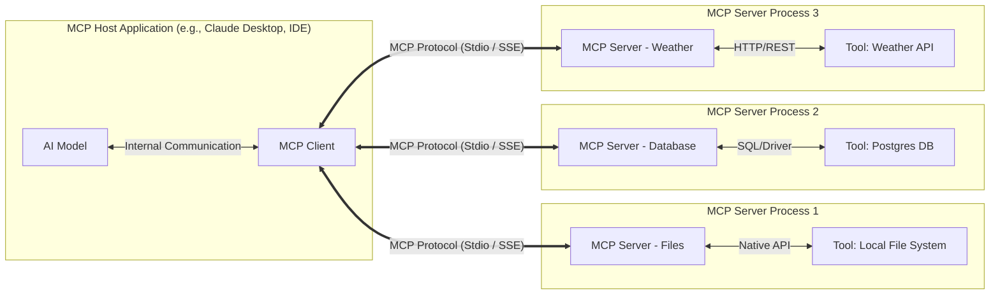
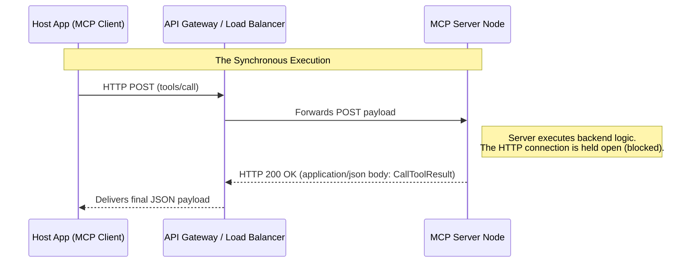

# Model Context Protocol (MCP) Architecture



The Model Context Protocol (MCP) architecture is divided into three core operational components:

- **MCP Host:** The application where the AI model actually lives or runs, such as Claude Desktop or an IDE.
- **MCP Client:** The connector inside the host that speaks the MCP protocol.
- **MCP Server:** A lightweight program that sits in front of a tool, such as Google Drive or a database, and translates its capabilities into the standard MCP format.

## The Transport Layer

The transport layer's sole job is to establish a bidirectional communication channel between the client and the server. It natively handles:

- **Connection Lifecycle:** Starting the connection, maintaining it, and closing it cleanly.
- **Message Framing:** Ensuring messages are delineated correctly so the receiver knows where one message ends and the next begins.
- **Payload Delivery:** Carrying **JSON-RPC 2.0** messages, including Requests, Responses, and Notifications.

### Supported Transport Types

MCP currently specifies two primary standard transport mechanisms. Each serves a completely different deployment architecture.

#### 1. Stdio (Standard Input/Output)

This is the most common transport for local integrations.

- **How it works:** The MCP client spawns the MCP server as a subprocess running on the same machine.
- **Communication:** The client writes JSON-RPC messages to the server's `stdin`. The server writes responses to its `stdout`. `stderr` is usually reserved for logs so it does not corrupt the data stream.
- **Use Case:** Connecting to local files, local databases, or scripts running on the same machine.
- **Engineering Pros:** Fast, secure because no network ports are exposed, and requires no networking setup.

#### 2. SSE (Server-Sent Events) over HTTP

This is the standard transport for remote or distributed integrations.

- **How it works:** The MCP server runs as a web service, for example in Docker or on a cloud server.
- **Communication:** The server pushes JSON-RPC messages down to the client using a persistent [SSE](#2.%20SSE%20(Server-Sent%20Events)%20over%20HTTP) connection. The client uses standard HTTP POST requests to send messages up to the server.
	- **The Downstream (Server $\to$ Client):** The client opens **one single, long-lived HTTP connection**. The server keeps this connection open indefinitely and streams JSON-RPC responses and notifications down to the client as events occur.
	- **The Upstream (Client $\to$ Server):** Whenever the client needs to talk to the server (e.g., sending an `initialize` request or commanding a tool to run), it fires off a **standard, ephemeral HTTP POST request**. The server processes it, and typically pushes the ultimate result back down the persistent SSE channel.
- **Use Case:** Enterprise deployments, cloud-hosted agents, or mixed-environment setups such as WSL vs. Windows.
- **Engineering Pros:** Works over standard web infrastructure, is firewall-friendly, and is mostly stateless.

> [!NOTE] Why SSE Instead of WebSockets?
> 
> While WebSockets provide a true full-duplex, persistent connection, they introduce significant networking complexity. MCP relies on SSE for three primary engineering reasons:
> 
> - **Firewall and Proxy Friendliness:** WebSockets require an HTTP protocol upgrade (`Connection: Upgrade`) that many corporate firewalls, enterprise proxies, and legacy load balancers aggressively block or drop. SSE is just standard HTTP. It passes effortlessly through port 80/443 without triggering network security alarms.
> - **Infrastructure Simplicity:** Scaling WebSockets requires specialized load-balancing configurations (like sticky sessions) because the connection is heavily stateful. Standard HTTP POST requests and SSE streams are much easier to route, inspect, and scale using standard cloud infrastructure (like AWS API Gateway, Nginx, or Cloudflare).
> - **HTTP/2 Multiplexing:** In the past, opening multiple discrete HTTP connections was slow and computationally expensive. However, modern HTTP/2 natively multiplexes multiple requests over a single underlying TCP connection. This means the latency penalty for making frequent POST requests alongside an SSE stream is practically zero.

### The Message Format (JSON-RPC 2.0)

Regardless of whether the transport is Stdio or SSE, the data flowing through it is strictly formatted as **JSON-RPC 2.0**.

- **Requests:** `{"jsonrpc": "2.0", "method": "tools/list", "id": 1}`.
- **Responses:** `{"jsonrpc": "2.0", "result": {...}, "id": 1}`.
- **Notifications:** `{"jsonrpc": "2.0", "method": "notifications/message"}`.

## Capability Discovery

Capability discovery happens once, at the absolute beginning of the connection. It operates as a strict two-way handshake where both the client and server negotiate their boundaries before any actual work is permitted.

## Steps
### 1. The Client Speaks First

The client initiates the connection by sending an `initialize` request. This payload dictates the rules of the environment and tells the server exactly what the host application is capable of supporting.

```json
{
  "method": "initialize",
  "params": {
    "protocolVersion": "2024-11-05",
    "capabilities": {
      "roots": { "listChanged": true },
      "sampling": {}
    },
    "clientInfo": { "name": "Claude Desktop", "version": "1.0.0" }
  }
}
```

**Payload Breakdown:**

- **`method`**: The JSON-RPC command triggering the handshake.
- **`protocolVersion`**: The specific version of the MCP protocol the client expects to use.
- **`capabilities`**: The strict list of features the host application natively supports.
    - Declaring `"sampling": {}` means the client allows the server to loop back and request AI generations.
    - Declaring `"roots": { "listChanged": true }` means the client can dynamically notify the server if the user changes their allowed workspace folders mid-session.
- **`clientInfo`**: Diagnostic metadata identifying the host application (useful for server-side logging and conditional logic).
#### 2. The Server Responds

Upon receiving the client's payload, the server evaluates the requested constraints and replies with its own `initialize` result, confirming the features it brings to the table.

```json
{
  "protocolVersion": "2024-11-05",
  "capabilities": {
    "logging": {},
    "resources": { "subscribe": true },
    "tools": { "listChanged": true }
  },
  "serverInfo": { "name": "weather-server", "version": "1.0.0" }
}
```

**Payload Breakdown:**

- **`protocolVersion`**: The server echoes the protocol version it agrees to use for the remainder of the session.
- **`capabilities`**: The strict list of services the backend is offering.
    - Declaring `"tools"` means it provides callable functions for the AI.
    - Declaring `"listChanged": true` means the server reserves the right to add or remove tools dynamically during the session without dropping the connection.
    - Declaring `"resources": { "subscribe": true }` indicates the server can push real-time event updates to the client (like a file being modified).
- **`serverInfo`**: Diagnostic metadata identifying the specific backend server implementation.
### Why Discovery Is Critical

Without this step, the system would be brittle. Capability discovery solves three major architectural problems:

- **Version Compatibility:** A server can avoid offering unsupported features to older clients.
- **Feature Flagging:** A server can disable features when it detects a restricted environment.
- **Dynamic Updates:** If the server declares `"tools": { "listChanged": true }`, the client knows the tool list may change during the session.

This modular design guarantees progressive enhancement:

- **Basic Clients:** Can still use the server, but may only see simple text tools.
- **Advanced Clients:** Can use features like sampling or resource subscriptions.

## Stateful vs. Stateless Architecture

The Model Context Protocol was originally designed as a highly interactive, bidirectional bridge between an AI model and a local environment. Consequently, the default specification is deeply **stateful**.

However, as MCP expands from local desktop integrations into cloud-native microservices, maintaining persistent state becomes an operational bottleneck. Engineering teams must make a deliberate architectural choice between Stateful and Stateless deployments based on their scaling requirements and desired feature sets.

### 1. Stateful MCPs

In a stateful deployment, the MCP Server maintains a persistent memory of the client's session.

Over a local deployment, this is handled naturally by the physical `stdin`/`stdout` pipes remaining open. Over a network, it is handled via a persistent Server-Sent Events (SSE) stream paired with the `Mcp-Session-Id` HTTP header.

- **The Core Mechanism:** The server remembers the exact capabilities negotiated during the `initialize` handshake. It holds the active `Roots` (workspaces) in memory, and it tracks which `Resources` the client has subscribed to.
- **What it Enables:** **Bidirectionality.** Because the server knows exactly who the client is and has an open stream to them, it can push out-of-band data at any time. This enables:
    - **Sampling:** Asking the host LLM to summarize internal data.
            - **Elicitation:** Popping up UI forms to ask the human for missing parameters.
    - **Resource Subscriptions:** Pushing `notifications/resources/updated` when a backend file changes.
    - **Progress Tracking:** Streaming real-time execution percentages.
- **The Engineering Drawback:** **Scaling Complexity.** If you deploy a stateful MCP behind a load balancer to serve 10,000 users, you must configure "sticky sessions." If a client establishes an SSE stream with Node A, all subsequent HTTP POSTs with their `Mcp-Session-Id` must be strictly routed back to Node A. If Node A crashes, the session dies, the AI loses its context boundaries, and the handshake must be re-initiated.

### 2. Stateless MCPs

To support massive scale and serverless deployments (like AWS Lambda, Cloudflare Workers, or Google Cloud Run), MCP SDKs introduced "Stateless Mode" (e.g., the `stateless_http` flag).

In this mode, the server deliberately violates the standard MCP session contract. It drops the SSE stream, ignores the `Mcp-Session-Id` header, and treats every incoming JSON-RPC payload as a completely isolated event.

- **The Core Mechanism:** Pure Request-Response. The client sends a standard HTTP POST containing the `tools/call` JSON-RPC body, and the server computes the work and returns the `CallToolResult` directly in the HTTP response body.
- **What it Enables:** **Infinite Horizontal Scaling.** Because no memory is retained between requests, any load balancer can route any request to any available compute node. You pay exactly for to compute used during execution, with zero idle connection overhead.
- **The Engineering Drawback: Loss of Agency.** The server loses all ability to ask for help mid-execution. It cannot use Sampling, it cannot use Elicitation, and it cannot stream Progress Notifications. If a stateless tool encounters a missing variable, it cannot pause to prompt the user; it must return an application-level soft fail (`isError: true`) and rely entirely on the LLM to parse the error text, ask the user for the missing data in the chat, and initiate a completely new tool execution loop.

### Architectural Decision Matrix

When designing an MCP Server, choose your architecture based on the required "Agentic Autonomy" versus "Infrastructure Scale."

|**Feature/Requirement**|**Stateful (Stdio / SSE)**|**Stateless (HTTP POST)**|
|---|---|---|
|**Primary Deployment**|Local Desktop, Docker, Dedicated VMs|AWS Lambda, Edge Runtimes, K8s|
|**Load Balancing**|Hard (Requires Sticky Sessions)|Trivial (Round-Robin routing)|
|**Resource Subscriptions**|Yes (Real-time sync)|No (Client must manually poll)|
|**Sampling & Elicitation**|Yes (Server can trigger LLM/UI)|No (Server is blind to the Host)|
|**Progress Notifications**|Yes (Streams over SSE)|No (Client waits for final JSON)|
|**Best Used For...**|Complex Agentic Workflows, IDE Plugins|Simple Data Lookups, Internal APIs|

> [!hint] The Golden Rule
> If your server acts as a complex agent that needs to negotiate with the user, read their workspace files, or ask their LLM for help, it **must** be Stateful. If your server is simply wrapping an existing REST API (like fetching Jira tickets or pulling GitHub PRs) so the LLM can read it, deploy it as **Stateless** to save massive infrastructure costs.


## Synchronous Responses

By default, the Model Context Protocol is strictly asynchronous and multiplexed. Even when the Host Application triggers a tool via an HTTP POST, the server does not put the result in the HTTP response body. Instead, it returns an empty acknowledgment and eventually pushes the `CallToolResult` down the separate, long-running Server-Sent Events (SSE) stream.

The **`json_response`** flag overrides this core behavior. It forces the MCP Server to abandon asynchronous stream routing for tool calls and instead behave like a traditional, synchronous REST API.

### The Engineering Benefit: Infrastructure Simplicity

While SSE multiplexing is powerful, it is often overkill for simple data-fetching tools (e.g., querying a Jira ticket or checking the weather).

- **Transport Optimization:** By setting `json_response=True` (usually paired with `stateless_http=True`), you strip out the overhead of HTTP/2 stream framing.
- **Legacy Compatibility:** Many older API Gateways, load balancers, and corporate firewalls aggressively drop or mangle SSE streams. A synchronous JSON response ensures the payload traverses any standard HTTP infrastructure without requiring specialized WebSocket or SSE configurations.

### The Execution Flow: The Blocking Pipeline

When this flag is enabled, the transport layer completely blocks while the tool logic executes.



1. **The Client Request**: The Host Application fires a standard HTTP POST containing the JSON-RPC `tools/call` payload.
2. **The Block**: The MCP Server receives the POST, routes it to the correct tool function, and executes the backend logic. Crucially, the server keeps the HTTP connection open and waiting.
3. **The Direct Response**:  Once the tool function completes, the server formats the standard `CallToolResult` and places it directly into the HTTP response body with an `application/json` content type.

```http
HTTP/1.1 200 OK
Content-Type: application/json

{
  "jsonrpc": "2.0",
  "id": 4,
  "result": {
    "content": [
      {
        "type": "text",
        "text": "The weather in London is 15°C and raining."
      }
    ],
    "isError": false
  }
}
```

### Architectural Guardrails & Operational Risks

If you choose to force synchronous JSON responses, you must engineer around two specific infrastructure bottlenecks:

1. The Gateway Timeout Trap: Because the HTTP request is blocked waiting for the tool to finish, you are at the mercy of your infrastructure's timeout limits.
	- For example, AWS API Gateway strictly enforces a 29-second timeout. If your MCP tool is running a heavy SQL query that takes 35 seconds, the API Gateway will sever the connection, returning a 504 Gateway Timeout to the Host Application, and the LLM will completely lose the execution state.
	- **Mitigation:** Only use `json_response=True` for fast, predictable operations. If a tool requires heavy compute, you _must_ use the default asynchronous SSE architecture.
2. **The Loss of Out-of-Band Observability**: Because the HTTP request acts as a single, indivisible pipe, the server loses the ability to multiplex mid-execution data.
	- **The Impact:** You cannot stream `notifications/progress` ticks to update a UI loading bar, nor can you stream granular `notifications/message` logs while the tool is running. The Host Application receives absolutely nothing until the final JSON payload drops.

## The Transport Configuration Matrix

|**stateless_http**|**json_response**|**Architectural Result**|**What You Gain**|**What You Lose**|
|---|---|---|---|---|
|**False**|**False**|**Standard Stateful MCP**_(Persistent SSE Pipe)_|**Maximum Agentic Autonomy.** Full access to the entire protocol suite: Roots, Elicitation, Sampling, Resource Subscriptions, and real-time Progress streaming.|**Horizontal Scalability.** You must configure load balancers for "sticky sessions" and manage persistent memory connections on your backend.|
|**False**|**True**|**The Hybrid Pattern**_(Stateful Context + REST Tools)_|**CQRS-Lite Simplicity.** You maintain active workspace boundaries (Roots) and background alerts, but tool executions become dead-simple, synchronous, REST-like blocking calls for the client.|**Mid-Execution Observability.** Because the tool call blocks for a final JSON payload, you cannot stream UI progress bars or trigger Elicitation forms _during_ that specific tool's execution.|
|**True**|**False**|**Stateless Streaming**_(Chunked HTTP POST)_|**Scalable Observability.** Infinite horizontal scaling (no sticky sessions needed), while still allowing the single, isolated POST response to stream chunked Progress ticks before the final result drops.|**Session Memory.** The server has complete amnesia. Native Roots, Resource Subscriptions, Elicitation, and Sampling are entirely broken.|
|**True**|**True**|**Pure Cloud-Native**_(Strict Serverless REST)_|**Maximum Infrastructure Speed.** Perfectly optimized for AWS Lambda, Edge Runtimes, and strict corporate firewalls. You pay only for exact compute time with zero connection overhead.|**All Bidirectionality.** The server is blind and mute outside of the raw request-response cycle. No context tracking, no progress UI, and no human-in-the-loop collaboration.|