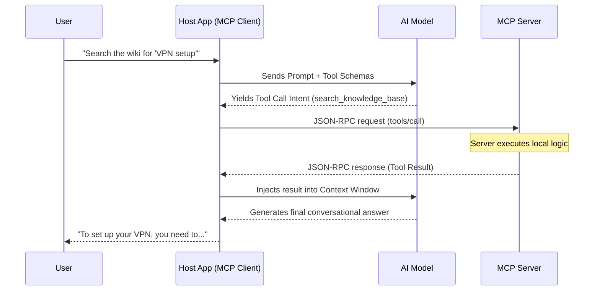
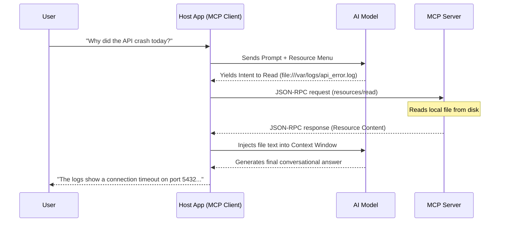

# MCP Core Primitives


These are the primary ways a server provides value to an LLM.

## Tools

Tools are executable functions exposed by the MCP Server that the LLM can trigger. They bridge the gap between static text generation and active execution, allowing the model to perform actions like querying a Postgres database, sending an email, or executing a local Python script.

The **Tool Schema** is the instruction manual that the MCP Server sends to the Client, which ultimately passes it into the LLM's context window. It tells the LLM not just _how_ to call a function, but _when_ and _why_ to call it.

Architecturally, the Tool Schema in MCP adheres strictly to the **JSON Schema Draft 2020-12** standard. It acts as a bidirectional contract: the model guarantees it will generate parameters that match this structural shape, and the server guarantees it will execute the underlying code if the payload is valid.

### The Anatomy of a Tool Schema

A standard tool definition requires three primary components:

- **`name` (The Identifier):** A strictly unique string (e.g., `fetch_weather`). It should be concise, programmatic, and typically formatted in `snake_case`.
- **`description` (The Prompt):** The most critical component of the schema. The LLM treats this string directly as an instruction. A precise description ensures deterministic routing; a vague description causes the model to hallucinate or misuse the tool.
- **`inputSchema` (The Validator):** Defines the exact shape, type, and constraints of the arguments the tool accepts. It supports:
    - **Data Types:** `string`, `number`, `boolean`, `array`, `object`.
    - **Constraints:** `enum`, `minimum`, `maximum`, `pattern`.
    - **Required Fields:** Explicitly defines which arguments must be present and which are optional.
### Example: The Knowledge Base Router

```json
{
  "name": "search_knowledge_base",
  "description": "Searches the internal company wiki for articles. Use this when the user asks about company policies, IT support, or HR benefits.",
  "inputSchema": {
    "type": "object",
    "properties": {
      "query": {
        "type": "string",
        "description": "The specific keywords to search for (e.g., 'vpn setup', 'holiday calendar')."
      },
      "category": {
        "type": "string",
        "enum": ["IT", "HR", "Sales", "General"],
        "description": "Filters results by department. Defaults to 'General' if unspecified."
      },
      "max_results": {
        "type": "integer",
        "description": "The maximum number of articles to return.",
        "default": 5
      }
    },
    "required": ["query"]
  }
}
```

### Engineering Best Practice: Descriptions _Are_ Prompts

When building standard REST APIs, developers often write lazy descriptions (e.g., _"Gets the data"_), relying on human developers to read the documentation. In Agentic and MCP architectures, **the description is the prompt.**

- **The Anti-Pattern (Vague Description):** `"Searches data."`
    - _The Risk:_ The model lacks boundary awareness. It may attempt to use this tool to calculate math, search the public web, or look up live stock prices, resulting in wasted compute and constant failure loops.
- **The Golden Path (Constrained Description):** `"Searches the internal wiki. ONLY use this for questions about company policy. Do NOT use for general web knowledge or math calculations."`
    - _The Benefit:_ The model understands the strict boundaries of the tool. It knows exactly when to trigger it and, more importantly, when to ignore it.

### The Tool Discovery Process

Once the connection is [fully established](02%20Architecture.md#Capability%20Discovery), the client explicitly asks the server for its complete registry of tools. This operates similarly to hitting a `/docs` or `/openapi.json` endpoint in a traditional REST API.

#### The Discovery Flow

**1. The Request (`tools/list`)** The client sends a standard JSON-RPC request asking for the list. If the server contains dozens or hundreds of tools, this request supports pagination via an optional `cursor` string.

```json
{
  "jsonrpc": "2.0",
  "method": "tools/list",
  "id": 2
}
```

**2. The Response (The Schema Array)** The server responds by returning an array of the complete **Tool Schemas** (the exact `name`, `description`, and `inputSchema` structures we defined above). The host application parses this array and injects it into the LLM's system prompt.

```json
{
  "jsonrpc": "2.0",
  "id": 2,
  "result":
    "tools": [
      {
        "name": "search_knowledge_base",
        "description": "Searches the internal company wiki...",
        "inputSchema": { ... }
      },
      {
        "name": "create_ticket",
        "description": "Generates a new Jira ticket...",
        "inputSchema": { ... }
      }
    ]
  }
}
```

#### Dynamic Re-Fetching

As established in the [Capability Discovery](02%20Architecture.md#Capability%20Discovery) phase, the server's available tools are not always static. If a user authenticates a new integration mid-session, the server might suddenly gain the ability to call the GitHub API.

If the server negotiated the `"tools": { "listChanged": true }` capability during the initial handshake, it handles this gracefully:

1. The server pushes a lightweight `notifications/tools/list_changed` message down the transport stream.
2. The client intercepts this notification.
3. The client autonomously fires off a brand new `tools/list` request to refresh its internal state and seamlessly updates the LLM's tool menu without requiring a process restart.

### The Tool Calling Process

While the LLM is the "brain" that decides _when_ to use a tool, it cannot execute code itself. The actual execution relies on a strict orchestration loop between the AI Model, the Host Application (the MCP Client), and the MCP Server.



#### Step-by-Step Breakdown

**1. The Intent Generation**

Based on the system prompt and the loaded Tool Schemas, the LLM determines that it cannot answer the user's question directly. Instead of generating conversational text, it outputs a structured intent to invoke a specific tool, providing the necessary arguments.

**2. The Client Interception & Request**

The Host Application intercepts the LLM's intent, translates it into the standard MCP JSON-RPC format, and routes it to the appropriate MCP Server via Stdio or SSE.

```json
{
  "jsonrpc": "2.0",
  "method": "tools/call",
  "id": 3,
  "params": {
    "name": "search_knowledge_base",
    "arguments": {
      "query": "VPN setup",
      "category": "IT"
    }
  }
}
```

**3. Server Execution & Response**

The MCP Server receives the payload, validates that the `arguments` match the strict JSON schema it provided earlier, and executes the underlying code (e.g., making an HTTP request to the actual Confluence/Jira wiki).

It then wraps the output into a standardized MCP Tool Result payload and sends it back to the client. Crucially, MCP allows tools to return mixed content, meaning a single tool call can return plain text alongside binary data (like an image chart).

```json
{
  "jsonrpc": "2.0",
  "id": 3,
  "result": {
    "content": [
      {
        "type": "text",
        "text": "1. Download the Cisco AnyConnect client.\n2. Enter the gateway: vpn.company.com.\n3. Authenticate with Okta."
      }
    ]
  }
}
```

**4. The Final Synthesis**

The Host Application appends this raw result to the conversation history and passes control back to the LLM. The model reads the execution output, synthesizes the information, and generates the final, human-readable response for the user.
## Resources (The Read-Only Data Layer)

Resources represent the read-only data layer that an MCP Server makes available to the host application and, ultimately, the LLM. Resources allow the model to natively browse and consume contextual information, such as local log files, database schemas, or internal API documentation.

### Resource Routing (The URI Structure)

Resource exposure follows a strict URI-based routing pattern. The server dictates exactly how data can be accessed:

- **Direct Resources:** Absolute paths pointing to specific, static items (e.g., `file:///var/logs/app.log`).
- **Resource Templates:** Dynamic, parameterized routing paths (e.g., `postgres://{database}/{table}/schema`).
- **Discovery (`resources/list`):** An endpoint the server provides so the host application can fetch the menu of available data before the LLM attempts a read operation.

> [!EXAMPLE] Exposing a Database Schema
> 
> By exposing schemas as resources, the LLM can understand the exact shape of your data _before_ it tries to write a SQL query using a tool.
>  
> ```json
> {
>   "uri": "db://main/users/schema",
>   "name": "Users Table Schema",
>   "description": "Column names and types for the users table",
>   "mimeType": "application/json"
> }
> ```

### Engineering Guardrails

Exposing raw data to an AI model introduces significant security and performance risks. Production MCP Servers must implement the following constraints:

#### Security & Governance

- **Path Traversal Prevention:** Never blindly accept file paths from the LLM. Implement strict URI validation to prevent directory traversal attacks (e.g., requesting `../../etc/passwd`).
- **The Server is the Gatekeeper:** The MCP Server must validate identity, tokens, or local file permissions _before_ resolving and serving any resource URI.
- **PII Scrubbing:** Sanitize sensitive data (API keys, personally identifiable information, passwords) at the server level before the payload ever reaches the LLM's context window.

#### Performance & Reliability

- **Lazy Loading:** Never send the actual file content during the initial `resources/list` discovery phase. Only transmit the heavy payload when the LLM explicitly triggers a `resources/read` request.
- **Context Window Management:** A single, massive resource can instantly saturate the LLM's context window, causing truncation. Break large files into logical, chunked sub-resources.
- **Mitigating "Lost in the Middle":** Even if a massive document technically fits in the context window, models routinely fail to recall facts buried in the middle. Prevent this by exposing data at highly focused levels (e.g., exposing a single Python class rather than the entire 10,000-line file).
- **Caching:** If a resource requires an expensive backend calculation to generate (like an aggregation report), cache the result or pre-compute it. If the server takes too long to respond, the LLM will time out and hallucinate a failure.
### Resource Discovery

Before the LLM can read anything, the Host Application must ask the MCP Server for its catalog of available data. This operates similarly to Tool Discovery, but strictly returns metadata (names, descriptions, and URIs) while **omitting** the actual file contents to save memory.

#### The Discovery Flow

**1. The Request (`resources/list`)**

The client sends a standard JSON-RPC request asking for the list. Like tools, this supports pagination via a `cursor` if the server is exposing thousands of files.

```json
{
  "jsonrpc": "2.0",
  "method": "resources/list",
  "id": 4
}
```

**2. The Response (The Metadata Array)**

The server responds with an array of the available resources. The Host Application typically parses this and injects the lightweight menu into the LLM's system prompt, letting the model know exactly what URIs exist and what data they contain.

```json
{
  "jsonrpc": "2.0",
  "id": 4,
  "result": {
    "resources": [
      {
        "uri": "file:///var/logs/api_error.log",
        "name": "API Error Logs",
        "mimeType": "text/plain",
        "description": "The tail end of the production error logs."
      }
    ]
  }
}
```

#### Resource Subscriptions

Data is rarely static. If the MCP Server negotiated `"resources": { "subscribe": true }` during the initial capability handshake, the architecture supports a real-time reactive pattern.

The Host Application can send a `resources/subscribe` request for a specific URI. If that log file is modified on the server's disk, the server pushes a `notifications/resources/updated` event down the transport stream. The Host App intercepts this and can autonomously re-fetch the resource to keep the LLM's context perfectly synced with the live backend state.

#### Handling Resource Templates

In massive systems (like a database with thousands of tables), listing every available file during Discovery is impossible. Instead, the server exposes a blueprint.

1. **Template Discovery:** The server exposes a routing blueprint (e.g., `postgres://{database}/{table}/schema`) via `resources/templates/list`.
2. **Parameter Interpolation:** The LLM figures out which parameters it needs (e.g., the `users` table in the `main` DB) and outputs an intent to read a _concrete_ URI: `postgres://main/users/schema`.
3. **The Standard Read Request:** The Host Application sends a standard `resources/read` request using the fully constructed, absolute URI. The server parses the string locally, executes the query, and returns the text payload.
### The Resource Reading Process

Once the LLM decides it actually needs to see the data inside a specific file, it must trigger a targeted read request.



#### Step-by-Step Breakdown

**1. The Intent Generation**

Based on the user's prompt and the previously injected Resource Menu, the LLM determines it needs to read a specific file. It outputs a structured intent to fetch the exact `uri`.

**2. The Client Request**

The Host Application intercepts this intent and fires a targeted `read` request to the MCP Server over the active connection.

```json
{
  "jsonrpc": "2.0",
  "method": "resources/read",
  "id": 5,
  "params": {
    "uri": "file:///var/logs/api_error.log"
  }
}
```

**3. Server Execution & Response (The Payload)**

The server validates the URI path to ensure there are no security violations, reads the underlying file, and returns the full data payload. MCP encapsulates this inside a `contents` array, allowing the server to define whether the payload is raw `text` (for logs and code) or a base64-encoded `blob` (for images and PDFs).

```json
{
  "jsonrpc": "2.0",
  "id": 5,
  "result": {
    "contents": [
      {
        "uri": "file:///var/logs/api_error.log",
        "mimeType": "text/plain",
        "text": "[2026-06-15 10:14:22] ERROR: Connection refused on port 5432..."
      }
    ]
  }
}
```

**4. The Final Synthesis**

The Host Application appends the raw file contents to the conversation history. The LLM reads the logs, finds the relevant error, and synthesizes a human-readable answer for the user.

### Architecture Decisions: Resource Exposure vs. RAG

A defining architectural question when building an MCP Server is whether data should be exposed directly as a browsable **Resource**, or hidden behind a **Tool** that executes a Retrieval-Augmented Generation (RAG) vector search.

**When to use Direct Resource Exposure**

Use this when the model requires a deep, high-fidelity read of a document, and the total size comfortably fits in the context window.

- **Best For:** Source code files, strict JSON/OpenAPI configurations, database schemas, and legal contracts where exact structural layout matters.
- **The Catch:** It is linear and completely unscalable for massive corpora.

**When to use RAG (via an MCP Tool)**

Use this when the model needs to find highly specific, needle-in-a-haystack facts across massive datasets.

- **Best For:** Sprawling company wikis, server logs spanning months, or answering broad Q&A tasks where retrieving three isolated paragraphs is sufficient.
- **The Catch:** Vector retrieval is probabilistic; the search tool might miss the exact snippet the LLM actually needed.

**The Hybrid Approach (Search-Then-Read)**

The most robust production pattern merges both capabilities.

1. **The Tool (`search`):** The LLM triggers a RAG search tool. The tool returns brief summaries, titles, and exact Resource URIs for the top matches.
2. **The Resource (`read`):** The LLM evaluates the summaries and explicitly calls `resources/read` on the single URI that looks the most promising to ingest the full, uncompressed document.

## Prompts

In the MCP architecture, **Prompts** are dynamic, server-defined instruction templates.

Instead of relying on the end-user to manually type long, complex system instructions or copy-paste context, the MCP Server exposes pre-packaged workflows. These prompts bundle specific personas, instructions, and embedded context into a standardized format that the Host Application can instantly inject into the LLM's conversation.

### The Anatomy of a Prompt Schema

Similar to Tools and Resources, Prompts are discovered via a standardized schema:

- **`name` (The Identifier):** A unique string (e.g., `analyze-code`).
    
- **`description` (The UI Hook):** A human-readable summary. Host Applications (like Claude Desktop or IDEs) typically use this string to populate slash-command menus (e.g., typing `/analyze-code` in the UI).
    
- **`arguments` (The Variables):** An optional array of expected variables that the user or Host Application must provide (e.g., `target_language`, `strictness_level`) to customize the output.
    

### The Execution Flow: Discovery and Retrieval

Because Prompts are designed to be interactive UI elements in the Host Application, the execution flow is split into a lightweight discovery phase and a payload compilation phase.

#### Prompt Discovery

Upon initialization, the Host Application asks the server what prompt workflows it supports. The server returns the metadata and expected arguments for each prompt.

> [!note]
> Just like Tools and Resources, if the server negotiates `"prompts": { "listChanged": true }`, it can dynamically update the Host App's slash-command menu mid-session if new workflows become available.

#### Prompt Retrieval

When a user selects a prompt from the UI and provides the required arguments, the Host Application requests the compiled payload from the server.

**The Client Request:**

```json
{
  "jsonrpc": "2.0",
  "id": 2,
  "method": "prompts/get",
  "params": {
    "name": "analyze-code",
    "arguments": {
      "language": "Python"
    }
  }
}
```

**The Server Response (The Message Array):**

Crucially, the server does _not_ just return a single string of text. It returns an array of standard LLM **Messages**. This allows the MCP Server to inject complex, multi-turn contexts (mixing `user`, `assistant`, and `system` roles) directly into the Host Application's state.


```json
{
  "jsonrpc": "2.0",
  "id": 2,
  "result": {
    "description": "Security review for Python code",
    "messages": [
      {
        "role": "user",
        "content": {
          "type": "text",
          "text": "You are a senior security engineer. Please review the following Python code for vulnerabilities and suggest optimizations."
        }
      }
    ]
  }
}
```

### Engineering Benefit: Compound Workflows

The true architectural power of MCP Prompts is that they **shift context-gathering logic to the backend**, completely solving the "blank page" problem for the user.

> [!example] The Git Commit Prompt
> 
> Imagine a Git MCP Server exposing a `suggest-commit` prompt.
> 
> - **The User Experience:** The developer simply types `/suggest-commit` in their IDE chat. They do not highlight code, copy files, or write instructions.
>     
> - **Behind the Scenes:** When the Host Application calls `prompts/get`, the MCP Server autonomously runs `git diff` on the local machine.
>     
> - **The Server Payload:** The server takes the raw diff output, wraps it in an instruction ("You are an expert developer. Read this diff and write a conventional commit message: \n\n `[DIFF DATA]`"), and sends the fully compiled `user` message back to the Host Application.
>     
> - **The Result:** The Host Application injects the massive, highly-contextualized message into the LLM seamlessly. The Prompt acts as an invisible bridge between local data and the model.
>     
