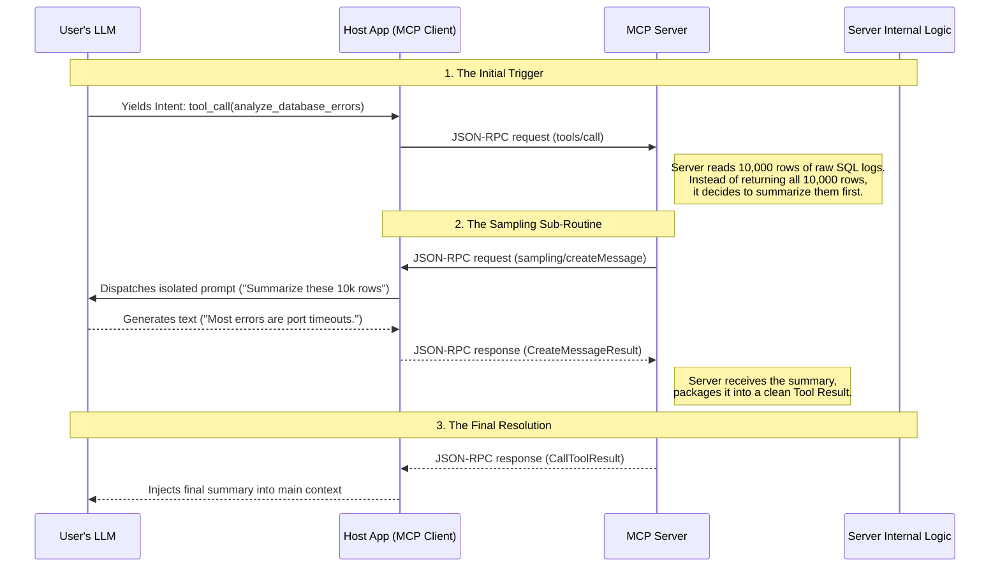
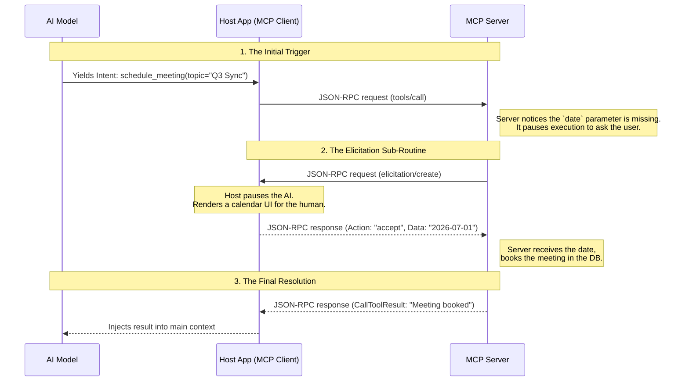
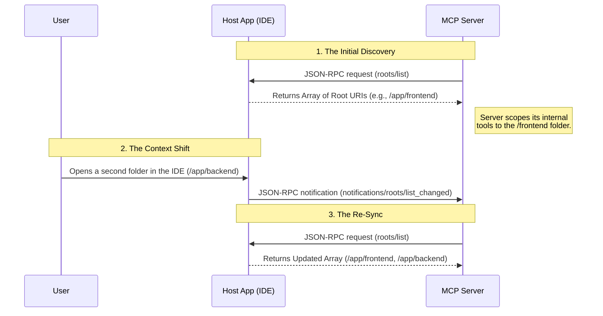

# MCP Advanced Primitives

As MCP evolved, newer primitives were added to move beyond simple request-response loops and support more agentic behavior.
## Sampling

In standard MCP architecture, the control flow is entirely client-driven: the Host Application asks the LLM a question, and the LLM decides to trigger a tool on the server.

**Sampling** flips this architecture upside down. It allows the _MCP Server_ to reach back up to the _Host Application_ and request that the client's LLM generate text or reasoning on the server's behalf.

### The Engineering Benefit

Traditionally, if a backend database server wanted to use AI to summarize a massive error log before returning it to the user, the server would need its own hardcoded Anthropic or OpenAI API key.

Sampling solves this by routing the generation request through the Host Application. This provides two massive architectural benefits:

1. **Zero-Config Backends:** The MCP Server does not need to manage API keys, billing, or network egress to an AI provider. It simply piggybacks on the user's existing authenticated session in the Host App (like Claude Desktop).
2. **Context Isolation:** The server can use the LLM to process intermediate, backend-only tasks (like evaluating a complex SQL query result) without cluttering the user's visible chat history.

### The Anatomy of a Sampling Request

When the server wants the LLM to generate text, it sends a standardized payload that closely mirrors standard AI API request schemas.

- **`messages`:** An array of the conversation turns (e.g., `user` and `assistant` roles) that the server wants the model to evaluate.
- **`maxTokens`:** A strict upper limit on how much text the model is allowed to generate, preventing runaway compute costs.
- **`systemPrompt`:** (Optional) A specific persona or instruction set for this isolated generation task.
- **`modelPreferences`:** (Optional) Hints to the Host Application about what kind of model the server needs (e.g., requesting `intelligencePriority` for complex logic or `speedPriority` for fast summarization).
### The Execution Flow: Negotiation and Generation

Because sampling consumes the user's compute resources (API credits or local GPU compute), it requires a strict handshake and an inverted JSON-RPC flow.

#### Capability Negotiation

The MCP Server is physically barred from accessing the LLM unless the Host Application explicitly opted-in during the initial `initialize` handshake.

If the Host's payload included `"capabilities": { "sampling": {} }`, the server is cleared to make requests.

#### The Execution Loop



#### Step-by-Step Breakdown: The Nested Execution Flow

Sampling rarely happens in a vacuum. It is almost always triggered as a sub-routine _while_ the server is already processing a primary request from the user's LLM.

**1. The Initial Trigger (The Context)**

The user's primary LLM yields an intent to call a tool (e.g., `analyze_database_errors`). The Host Application sends the standard `tools/call` JSON-RPC request to the server. The server reads the database and retrieves 10,000 rows of raw logs. The backend code realizes that returning this massive payload would crash the LLM's context window, so it decides to trigger a sampling request to summarize it first.

**2. The Server Request (`sampling/createMessage`)**

The MCP Server temporarily pauses its tool execution and fires a request _up_ the transport layer to the Host Application.

```json
{
  "jsonrpc": "2.0",
  "method": "sampling/createMessage",
  "id": 8,
  "params": {
    "systemPrompt": "You are a database analyzer. Summarize the following log dump into 3 bullet points.",
    "messages": [
      {
        "role": "user",
        "content": {
          "type": "text",
          "text": "[RAW 10,000 ROW DB DUMP...]"
        }
      }
    ],
    "maxTokens": 500
  }
}
```

**3. Client Execution & Response**

The Host Application receives the request. To protect the user's privacy, it does _not_ append this prompt to the user's visible chat UI. Instead, it dispatches the payload to the AI provider (e.g., Claude 3.5 Sonnet) in a completely sterile, isolated context.

Once the AI generates the summary, the Host Application wraps the text and sends it back down to the MCP Server as a JSON-RPC result.

```json
{
  "jsonrpc": "2.0",
  "id": 8,
  "result": {
    "role": "assistant",
    "content": {
      "type": "text",
      "text": "1. 80% of errors are Port 5432 timeouts.\n2. The failures spike at midnight.\n3. The users table is locked."
    },
    "model": "claude-3-5-sonnet-20241022",
    "stopReason": "endTurn"
  }
}
```

**4. The Final Resolution**

The MCP Server receives the AI-generated summary. It packages this highly compressed, clean text into a standard `CallToolResult` and sends it back to the Host Application to fulfill the original `tools/call` request from Step 1. The primary LLM reads the summary and continues its conversation with the user.
```json
{
  "jsonrpc": "2.0",
  "id": 1, 
  "result": {
    "content": [
      {
        "type": "text",
        "text": "1. 80% of errors are Port 5432 timeouts.\n2. The failures spike at midnight.\n3. The users table is locked."
      }
    ],
    "isError": false
  }
}
```

> [!note]
> The `"id": 1` here must perfectly match the `id` of the original `tools/call` request that the Host Application sent in Step 1, ensuring the transport layer knows exactly which request this result belongs to
### Engineering Guardrails

Because Sampling allows an external backend to autonomously burn tokens, it introduces massive security and cost risks. Host Applications must enforce strict boundaries:

- **Human-in-the-Loop (HITL):** Just like sensitive tool calls, robust Host Applications will intercept a `sampling/createMessage` request and display a UI prompt to the user: _"The connected Database Server wants to use your AI model to generate text. Allow?"_
- **Rate Limiting & Token Caps:** The Host Application should enforce strict ceilings on `maxTokens` and rate-limit how many sampling requests a server can make per minute to prevent infinite loops from draining API balances.
- **Context Firewalls:** The Host Application must _never_ include the user's primary conversation history in the sampling request. The server's generation request must be processed in a completely sterile, isolated context window so the server cannot secretly extract the user's past chat logs.
### When to Use Sampling

Sampling is a critical architectural pattern for public, open-source, or multi-tenant MCP deployments. It solves two massive infrastructural bottlenecks:

- **Distributed Economics (Bring Your Own Compute):** If you deploy a publicly accessible MCP Server, you cannot afford to let external users execute unlimited AI generations at your expense. Sampling enforces a distributed compute model. Because the generation request is routed back up the transport layer, the Host Application pays the token cost (via the user's local API keys or subscription), completely protecting your backend from financial drain.
- **Zero-Config Infrastructure:** Architecturally, Sampling decouples the AI orchestration layer from the data layer. It completely removes the complexity of managing LLM API keys, handling rate limits, or maintaining network egress to AI providers within your server codebase. You simply piggyback on the Host Application, which already maintains a robust, fully authenticated connection to the AI model.

## Elicitation

In traditional LLM workflows, if the model calls a tool but forgets a required parameter (e.g., asking to book a flight without providing a date), the server has only two options: guess the date, or return an error causing a frustrating retry loop.

**Elicitation** solves this by formalizing a Human-in-the-Loop (HITL) capability. It allows the _MCP Server_ to pause its execution and actively prompt the _human user_ for missing variables, clarifications, or explicit confirmations through the Host Application's UI.

### The Engineering Benefit: Human-Like Collaboration

Elicitation transforms an AI workflow from a rigid API call into a collaborative dialogue.

- **Progressive Input Gathering:** Instead of requiring an LLM to hallucinate massive, complex JSON payloads upfront, tools can be designed to accept minimal context and dynamically ask the user for the rest (e.g., _"What is your team's budget for this campaign?"_).
- **Action Confirmation:** If a model attempts a destructive operation (`delete_workspace`), the server can use Elicitation to force the user to click an "Are you sure?" confirmation before the backend actually runs the drop command.

### The Two Modes of Elicitation

Because user input ranges from simple dates to highly sensitive API keys, the MCP protocol enforces two strict security modes for Elicitation:

#### 1. Form Mode (In-Band Data Collection)

The server sends a strict JSON Schema representing the missing data. The Host Application uses this schema to instantly render a native UI form (with dropdowns, text fields, and checkboxes) for the user to fill out. The data is then routed back to the server through the active transport layer.

- **The Rule:** Form Mode must _never_ be used to request sensitive information such as passwords, auth tokens, or payment credentials.
- **The Motive** Because Form Mode is an _in-band_ process, the user's input is serialized into plain-text JSON and piped directly through the Host Application and the transport layer. This introduces massive security vulnerabilities:
    - **Log Leakage:** Host Applications (like IDEs or chat clients) routinely log JSON-RPC payloads for debugging. Passwords submitted via Form Mode would be written to local text files.
    - **Intermediary Compromise:** The Host Application acts as a "Man-in-the-Middle." If the host client is compromised, the plain-text credentials are exposed.
    - **Compliance Failures:** Payment data (PCI-DSS) and OAuth tokens require secure, isolated channels. By forcing sensitive flows to use **URL Mode** (out-of-band), the architecture ensures credentials are sent directly to the authenticating authority (e.g., Stripe or GitHub) over an isolated TLS browser connection, completely bypassing the AI client's memory, logs, and transport pipes.

#### 2. URL Mode (Out-of-Band Sensitive Flows)

The server provides an external URL. The Host Application presents a button prompting the user to open their web browser.

- **The Rule:** This mode is strictly used for OAuth logins, API key generation, or Stripe checkouts. The sensitive credentials are handled entirely by the external browser session, ensuring they never pass through the MCP Client or touch the LLM's context window.

### The Execution Flow: Nested Interactive Routing

Much like Sampling, Elicitation does not happen randomly. According to the MCP specification (SEP-2260), it must operate as a **nested sub-routine**, triggered strictly _while_ the server is already processing a client-initiated request (like a `tools/call`).




#### Step-by-Step Breakdown

**1. The Server Request (`elicitation/create`)**

The server pauses its tool logic and fires a request up to the client, specifying the `mode` and providing a standard JSON Schema for what it needs.

```json
{
  "jsonrpc": "2.0",
  "method": "elicitation/create",
  "id": 9,
  "params": {
    "mode": "form",
    "message": "When would you like to schedule the Q3 Sync?",
    "requestedSchema": {
      "type": "object",
      "properties": {
        "meeting_date": {
          "type": "string",
          "format": "date",
          "description": "The target date (YYYY-MM-DD)"
        }
      },
      "required": ["meeting_date"]
    }
  }
}
```

**2. The Client Response (The Action Payload)**

The Host Application renders a date-picker UI. The user interacts with it, and the client sends the result back to the server. The response must include an explicit `action` state.

```json
{
  "jsonrpc": "2.0",
  "id": 9,
  "result": {
    "action": "accept",
    "content": {
      "meeting_date": "2026-07-01"
    }
  }
}
```

**The Three Valid Actions:**

- **`accept`:** The user filled out the form and clicked Submit. The payload includes the populated `content` object.
- **`decline`:** The user clicked "Reject" or "No". The server must handle this gracefully (e.g., returning an `isError: true` tool result to the LLM explaining the user denied the request).
- **`cancel`:** The user dismissed the popup or pressed Escape without making a choice.
### Engineering Guardrails & Security

Because Elicitation introduces asynchronous human delays and user-generated data into backend execution loops, production servers must implement the following safeguards:

- **Input Validation is Bidirectional:** Even though the client _should_ use the JSON schema to validate the form before submitting, the MCP Server **must** re-validate the incoming `content` payload locally. Never blindly trust data coming from the transport layer.
- **Timeout Handling:** Humans are slow. If a server pauses a `tools/call` to wait for an Elicitation response, it must ensure its backend logic (like database transactions or API sessions) does not time out while waiting for the user to click submit.
- **Clear Attribution:** Host Applications must explicitly indicate _which_ server is asking for information (e.g., _"The GitHub Integration Server is requesting your target deployment branch"_), especially in environments where multiple MCP servers are running simultaneously.

## Roots

In the standard MCP architecture, data usually flows from the Server to the Host Application (e.g., the server exposes Tools and Resources to the client). **Roots** reverse this flow.

Roots are a mechanism for the _Host Application_ to expose its local context to the _MCP Server_. Specifically, they define the precise filesystem boundaries or active workspaces that the user currently has open, informing the server where it is allowed to operate.

### The Engineering Benefit

Roots solve a fundamental problem in local AI workflows: **Dynamic Context Awareness**.

- **Zero-Config File Operations:** If you write a generic "Git MCP Server," it needs to know _which_ repository to run `git status` on. Instead of forcing the user to hardcode directory paths in a config file, the server dynamically asks the Host Application (like an IDE) for the active Roots (e.g., `file:///Users/dev/my-project`).
- **Security & Sandboxing:** Roots establish a clear "contract of scope." The Host Application explicitly tells the server: _"You are only allowed to reason about and act upon files within these specific boundaries."_

### The Anatomy of a Root

A Root is defined by a simple JSON schema sent from the client to the server:

- **`uri`:** The absolute path to the root boundary (usually a `file:///` schema, though custom URI schemes are supported for virtual filesystems).
- **`name`:** (Optional) A human-readable identifier for the workspace, such as `"Frontend Repository"` or `"Backend Microservice"`.

### The Execution Flow: Discovery and Reactivity

Because users constantly open, close, and switch projects, Roots must be treated as a highly dynamic, reactive state.
#### 1. Capability Negotiation

The MCP Server is not allowed to ask for Roots unless the Host Application explicitly declared support for them during the initial `initialize` handshake.

```json
{
  "capabilities": {
    "roots": {
      "listChanged": true
    }
  }
}
```

>[!note]
>The `listChanged: true` flag is critical—it tells the server that the host will proactively notify it if the user switches workspaces

#### 2. The Execution Loop



#### Step-by-Step Breakdown

**1. The Server Requests the Boundaries (`roots/list`)**

Usually immediately after the connection initializes, the MCP Server reaches out to the client to understand its environment.

```json
{
  "jsonrpc": "2.0",
  "method": "roots/list",
  "id": 1
}
```

**2. The Client Response**

The Host Application returns the active workspaces.
```json
{
  "jsonrpc": "2.0",
  "id": 1,
  "result": {
    "roots": [
      {
        "uri": "file:///Users/dev/frontend-repo",
        "name": "Frontend"
      }
    ]
  }
}
```

**3. Reactive Context Shifting (`notifications/roots/list_changed`)**

If the user closes a folder or opens a new one in their Host UI, the Host Application fires a one-way notification to the Server. Because it is a notification, there is no payload—it simply acts as a webhook telling the Server: _"Your environment just changed; you need to call `roots/list` again to sync your state."_

### Engineering Guardrails & Security

While Roots establish a "contract of scope," **the MCP Server must physically enforce that contract.**

- **Path Traversal Mitigation:** If the client defines a root at `file:///app/workspace`, and the LLM attempts to call a server tool like `read_file(path="../../etc/passwd")`, the server's backend logic **must** resolve the path, check if it falls within the current Roots, and throw a hard error if it violates the boundary.
- **Graceful Degradation:** If a server relies heavily on filesystem access (like a Linter Server) but the Host Application returns an empty array for `roots/list` (meaning no workspace is open), the server should gracefully disable its filesystem tools and return clear, descriptive errors if the LLM attempts to use them.
- **Virtual URIs:** Do not assume all Roots are local disks. A Host Application might provide a Root like `github://owner/repo`. The server must validate that it actually understands the URI scheme before attempting to apply filesystem operations to it.