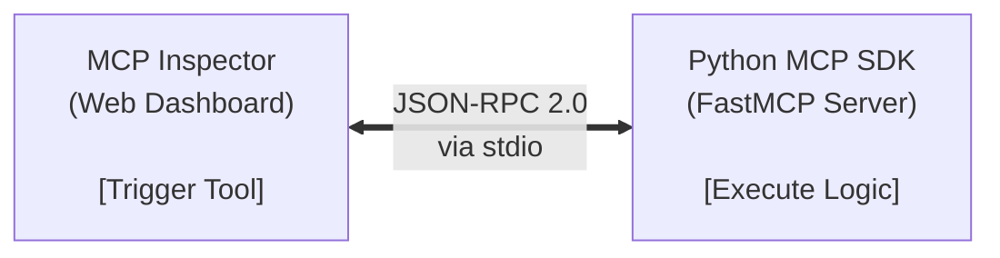

# MCP Development Tools    
## Python SDK Framework

The Python MCP SDK utilizes a high-level, decorator-driven subsystem known as **FastMCP** to abstracts the underlying serialization protocol. It enforces static type validation and automated JSON schema generation by mapping Python 3.10+ type annotations and Pydantic models directly to protocol-compliant schemas.

### Operational Primitives

The code snippet below illustrates initialization and decoration patterns for exposing capabilities to an MCP client.

```python
from mcp.server.fastmcp import FastMCP

# Instantiate the server instance
mcp = FastMCP("DataService")

@mcp.tool()
def fetch_system_metric(metric_name: str) -> float:
    """Fetch real-time host telemetry metrics."""
    # Logic for telemetry retrieval
    return 42.0

@mcp.resource("system://metrics/{metric_name}")
def get_metric_stream(metric_name: str) -> str:
    """Provide historical context for a specific system metric."""
    return f"Historical logs for {metric_name}"
```

### Transport Layer Architecture

Communication occurs via two decoupled transport channels managed natively by the SDK runtime:

1. **Standard I/O (stdio):** The MCP server operates as a standard subprocess under the control of the client application. JSON-RPC 2.0 messages are multiplexed across standard input (`stdin`) and standard output (`stdout`).
2. **Streamable HTTP (SSE):** The server exposes an HTTP endpoint utilizing Server-Sent Events (SSE) for downstream server-to-client notifications, alongside an uplink endpoint for client-to-server command routing.

## Threat Modeling & Security Constraints

Integrating an LLM with arbitrary local system tools introduces an elevated execution risk matrix. Analyze system exposure via the following structural threat vectors:

### Is this execution context sufficiently isolated?

Tools executing arbitrary code or shell utilities must be constrained to containerized runtimes or strictly sandboxed directories. Granting an MCP server access to unchrooted file paths allows indirect injection attacks if the LLM processes untrusted user data.

### Is input sanitation handled at the boundaries?

Do not trust the output of an LLM as deterministic parameters. An attacking user can use prompt injection to force the model to pass destructive payloads (e.g., `; rm -rf /` or SQL injections) into the arguments of an exposed SDK tool function. Enforce strict Pydantic parsing at the tool boundary.

### Is the principal of least privilege maintained?

The MCP server process must run under a user account with highly circumscribed file system, network, and system call capabilities. If the server interacts with an external relational database, the database user profile should restrict write privileges unless explicitly demanded by the system design requirements.

## Isolated Testing via MCP Inspector

The Model Context Protocol Inspector is a specialized diagnostic suite decoupled from the inference loop of an LLM. It serves to isolate server-side errors from non-deterministic model behaviors during development cycles.



### Execution Diagnostics Protocol

Execute the following sequential operations to perform diagnostic verification on a target MCP Python file:

1. **Initialize Development Environment:** Leverage the `uv` package manager to download binaries, link the runtime dependencies, and start the target server process in developer mode:  `uv run mcp dev server.py`
2.  **Establish Diagnostic Link:** The command instantiates an ephemeral web interface (typically bound to a local network port) and auto-negotiates a communication channel over `stdio`.
3.  **Perform Capabilities Discovery:** Inspect the generated UI to audit the automated schema conversion. Verify that parameters, documentation string definitions, and variable typings match structural requirements.
4.  **Execute Payload Verification:** Manually populate parameters inside the web dashboard to fire test inputs. Analyze the structured JSON response frame to ensure exact schema compliance and determine boundary limits without invoking actual model tokens.