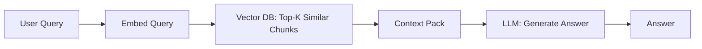
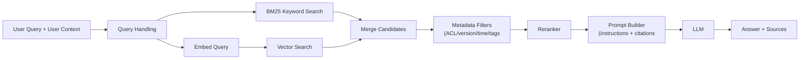
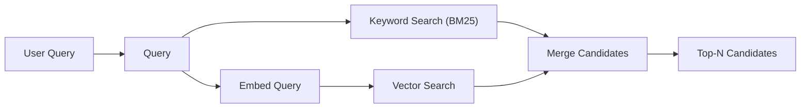
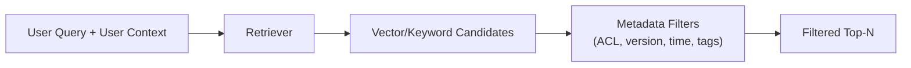
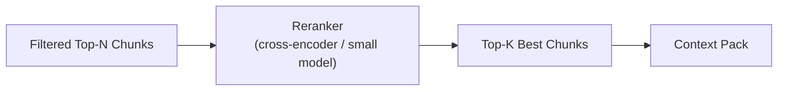
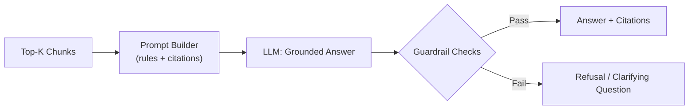
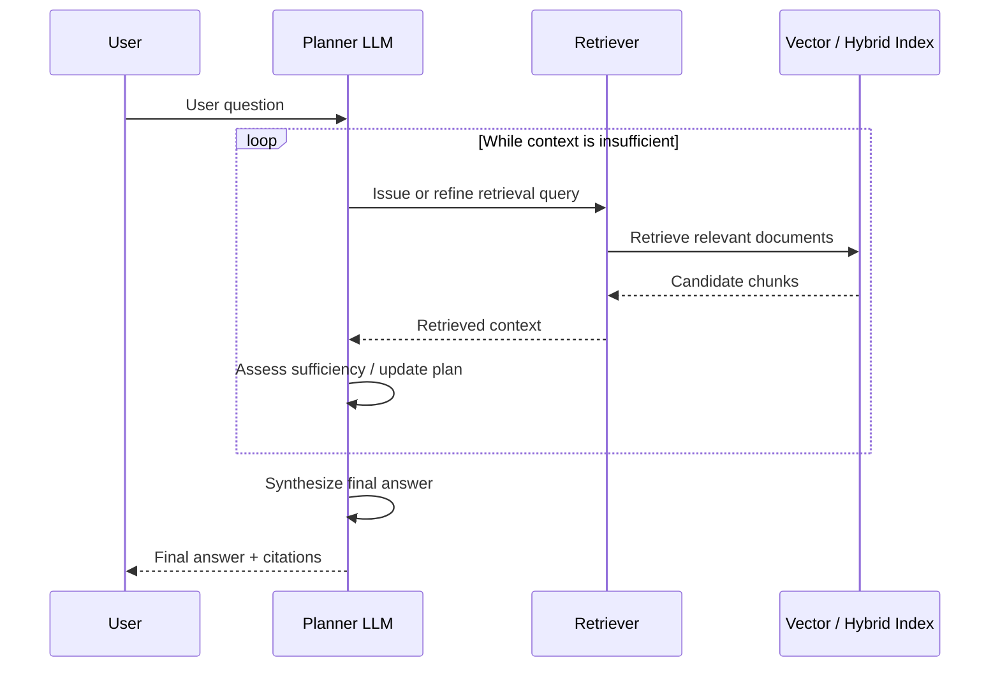

# RAG Fundamentals

* RAG stands for **R**etrieval-**A**ugmented **G**eneration
* RAG is an approach that combines large language models (LLMs) with external data sources.
* It enhances The models responses by retrieving relevante information from a database or search system and using that data to generate more accurate and contextually relevant outputs.
* It breaks the information into chunks, and store them as vectors, that are used in order to search relevant informations.

## Core Concepts

* **External knowledge integration**: Combining language models with external data sources for more informed responses.
* **Dynamic information retrieval**: Automatically fetching relevant data form databases or web soruces during interaction.
* **Contextual reponse generation**: Using retrieved data to craft more accurate and context-aware answers.

## Principles

* **Grounding LLM outputs in factual information**: Ensuring that generated responses are based on reliable and up-to-date external data.
* **Enhacing model knowledge without retraining**: Using retrieval machanisms to improve model performance without the need for extensive retraining on new datasets.

## Comparison: Traditional LLMs vs RAG

| **Aspect**                       | **Traditional LLMs**                                         | **RAG (Retrieval-Augmented Generation)**                     |
| -------------------------------- | ------------------------------------------------------------ | ------------------------------------------------------------ |
| **Knowledge source**             | Encodes knowledge implicitly in model parameters learned during training. | Combines model parameters with retrieved external documents provided at inference time. |
| **Knowledge freshness**          | Knowledge is fixed at training time; updating requires retraining or fine-tuning. | Knowledge can be refreshed by updating external data sources without retraining the base model. |
| **Updatability cost**            | High for frequent updates due to retraining and deployment cycles. | Lower for content updates, but requires maintaining ingestion, embedding, and retrieval pipelines. |
| **Factual accuracy**             | Can be accurate within its training distribution, but may hallucinate or rely on outdated information. | Can improve accuracy when relevant, high-quality documents are retrieved; may still hallucinate or misuse retrieved content. |
| **Reliability**                  | Output consistency depends on prompt design and model behavior. | Adds dependency on retriever quality; failures in retrieval directly affect answer quality. |
| **Transparency / observability** | Limited visibility into why a specific answer was produced.  | Improved observability by exposing retrieved documents, but model reasoning remains opaque. |
| **System complexity**            | Simpler architecture and operational footprint.              | More complex system involving vector stores, retrievers, ranking, and monitoring. |
| **Latency & cost**               | Lower latency and inference cost per request.                | Higher latency and cost due to retrieval and larger prompt context. |
| **Best use cases**               | General reasoning, creative tasks, stable knowledge domains. | Knowledge-intensive tasks, enterprise QA, document-grounded responses, rapidly changing information. |

## When to Use RAG

Use Retrieval-Augmented Generation when **external knowledge is essential at inference time** and grounding matters more than pure reasoning.

### The task is document-centric

- Answers require reading or synthesizing multiple documents
- Examples:
  - internal knowledge bases
  - policies, manuals, reports
  - research or market intelligence

### Knowledge changes frequently

- Retraining the model for every update is impractical
- You need:
  - fast updates
  - versioned or time-scoped knowledge

### Grounding and traceability are required

- Users need to see:
  - sources
  - citations
  - supporting excerpts
- Common in:
  - enterprise QA
  - compliance
  - customer support

### Hallucinations are unacceptable

- Incorrect answers have real costs
- RAG provides constraints by limiting generation to retrieved context (when designed correctly)

### You want domain adaptation without fine-tuning

- RAG can specialize a general LLM to:
  - company data
  - domain-specific language
    without modifying the base model.

## When Not to Use RAG

Avoid RAG when **retrieval adds complexity without improving outcomes**.

### The task is reasoning- or creativity-driven

- Examples:
  - brainstorming
  - code generation
  - creative writing
  - math or logic problems
- The model’s internal knowledge is sufficient.

### The output is predictive or statistical

- Examples:
  - recommendations
  - ranking
  - clustering
  - forecasting
- These are better solved with:
  - classical ML
  - embeddings + models
  - hybrid ML + LLM systems

### The data is already structured

- If information is in:
  - databases
  - dashboards
  - metrics tables

RAG often adds unnecessary indirection.

### Low latency or low cost is critical

- RAG increases:
  - inference latency
  - token usage
  - operational complexity
- Not ideal for:
  - real-time systems
  - high-QPS workloads without caching

### You cannot guarantee data quality

- Poor documents lead to:
  - confident but incorrect answers
  - misleading citations
- “Garbage in, grounded garbage out.”

## RAG Use Cases

Retrieval-Augmented Generation is best applied to **knowledge-intensive tasks** where correctness, grounding, and traceability matter more than raw creativity or prediction.

### 1. Enterprise Knowledge Assistants

**Description**
 LLMs answer questions using internal documentation such as policies, procedures, manuals, and FAQs.

**Why RAG fits**

- Knowledge is dispersed across many documents
- Answers must be grounded in official sources
- Content changes over time

**Typical benefits**

- Reduced hallucinations
- Source-backed answers
- Faster onboarding and support

**Key considerations**

- Document curation and versioning are critical
- Retrieval quality directly impacts trust

### 2. Customer Support & Internal Helpdesks

**Description**
 Chatbots and agent-assist tools that retrieve product documentation, troubleshooting guides, or past tickets.

**Why RAG fits**

- High need for factual correctness
- Answers must reflect current product state
- Traceability helps agents validate responses

**Typical benefits**

- Consistent answers
- Faster resolution times
- Reduced cognitive load for support teams

**Key considerations**

- Guardrails needed to avoid overconfident answers
- Fallback behavior when retrieval fails

### 3. Market & Competitive Intelligence

**Description**
 Synthesis of insights from reports, filings, news articles, and analyst notes.

**Why RAG fits**

- Requires reading and comparing many documents
- Evidence-based answers are expected
- Information evolves frequently

**Typical benefits**

- Grounded summaries
- Faster analysis cycles
- Reduced manual research effort

**Key considerations**

- Bias and source diversity must be managed
- Conflicting documents require careful prompting

### 4. Document Analysis & Summarization

**Description**
 Summarizing, comparing, or extracting insights from long or multiple documents.

**Why RAG fits**

- Context windows alone are insufficient
- Retrieval enables selective focus on relevant sections

**Typical benefits**

- Scalable document processing
- More targeted summaries
- Better handling of large corpora

**Key considerations**

- Chunking strategy strongly affects quality
- Summaries are only as good as retrieved content

### 5. Content Creation with Source Grounding

**Description**
 Generating articles, reports, or internal content grounded in approved references.

**Why RAG fits**

- Factual accuracy and traceability matter
- Writers need source-backed drafts

**Typical benefits**

- Reduced factual errors
- Clear attribution
- Faster drafting workflows

**Key considerations**

- Human review remains essential
- RAG improves correctness, not writing quality

### 6. Compliance, Legal, and Policy Assistance

**Description**
 Answering questions about regulations, contracts, or internal policies.

**Why RAG fits**

- Answers must be sourced and auditable
- Content is sensitive and high-risk

**Typical benefits**

- Reduced misinterpretation
- Improved transparency
- Easier audits and reviews

**Key considerations**

- Strict access control required
- Clear disclaimers and confidence thresholds needed

## Architecture of RAG

Retrieval-Augmented Generation (RAG) is a system design pattern that combines document retrieval with a large language model to produce grounded responses. In practice, RAG is not a single architecture but a set of **incremental building blocks**, each addressing specific failure modes such as poor retrieval, stale knowledge, or overconfident generation.

RAG systems typically evolve from a simple retrieval + generation loop into more robust architectures by adding filtering, ranking, and guardrails as requirements for accuracy, traceability, and reliability increase.

### 1) Naive RAG (baseline)

Naive RAG represents the simplest form of retrieval-augmented generation. In this architecture, a user query is transformed into a representation suitable for similarity search, relevant document fragments are retrieved from a vector-based index, and those fragments are provided to a language model to generate a response. Retrieval and generation are strictly sequential, with a single retrieval step and no additional filtering, ranking, or control mechanisms.

This baseline illustrates the core idea behind RAG—augmenting a language model with external context—while deliberately omitting production-level concerns such as access control, relevance validation, or fallback behavior. As a result, it serves as a useful conceptual starting point, but is typically insufficient for reliable real-world applications.

Where

- **Vector search**: finds chunks similar in meaning to the query.
- **LLM**: synthesizes an answer from retrieved text (but may hallucinate if context is poor).

**Why people start here**

- Fast to prototype
- Low engineering overhead
- Good enough for demos and small corpora

**Where it breaks**

- Retrieval can return “semantically similar but wrong” chunks
- The LLM may confidently answer even if context is weak
- No control over stale docs, permissions, or relevance

### 2) Hybrid RAG (production standard)

This is the most common “real” architecture. You still do vector search, but you add **keyword retrieval**, **filters**, **reranking**, and **guardrails** so the system is reliable and debuggable.

#### 2.1 Add keyword search (BM25) + hybrid retrieval

Hybrid retrieval combines semantic vector search with traditional keyword-based search (such as BM25). The system retrieves candidate documents from both methods and merges the results into a single candidate set for downstream processing.

**Why:** vector search is great for paraphrases; keyword search is great for exact terms (SKUs, error codes, policy names). Hybrid improves *recall*.

#### 2.2 Add metadata filters (ACL, time, product, language)

Metadata filtering restricts retrieved documents based on structured attributes such as access permissions, document version, timestamps, product identifiers, or language. These filters are applied after retrieval (or during retrieval, if supported) to ensure only valid and relevant documents are considered.

Metadata Filters are hard constraints that prevent “correct but forbidden” or “outdated” context.

**Why:** you often must ensure results are:

- permitted for the user (access control)
- in the right version/time window
- relevant to the product/region/language

#### 2.3 Add reranking (precision booster)

Reranking is a secondary relevance evaluation step that reorders retrieved documents using a more precise scoring model, typically applied to a small candidate set. The goal is to select the most relevant chunks to include in the final context passed to the language model.

**Why:** retrieval gives you a candidate set; reranking sorts them using a stronger relevance model (cross-encoder or small LLM). This improves *precision*—the top few chunks are more likely to be truly useful.

#### 2.4 Add guardrails (refuse, cite, constrain)

Guardrails are explicit rules and checks applied during or after generation to control model behavior. They enforce constraints such as answering only from retrieved context, requiring citations, or refusing to answer when evidence is insufficient.

Common guardrails:

- “Answer **only** from provided context”
- “If evidence is insufficient: say **I don’t know** / ask a clarifying question”
- Cite chunk IDs or links
- Minimum relevance threshold (don’t answer if retrieval quality is low)

**Why:** production systems need predictable behavior. Guardrails reduce overconfident answers and make failures observable.

### 3) Agentic / Multi-step RAG

**What it is**
Agentic, or multi-step, RAG is an extension of the standard RAG pattern in which the language model does not retrieve information only once. Instead, the LLM takes on the role of a **planner**, iteratively issuing retrieval requests, refining queries based on intermediate results, and accumulating context before producing a final answer. Retrieval and generation are interleaved, allowing the system to decompose complex questions into smaller steps and gather evidence across multiple passes. The sequence below illustrates this interaction between the user, the planning LLM, and the retrieval layer.

**When it helps**

- Multi-part questions (compare policies, extract multiple facts)
- Queries that require decomposition (“first find X, then use X to find Y”)
- Large, messy corpora where one retrieval pass is rarely enough

**Why it’s riskier**

- More latency and cost (multiple retrieval calls)
- More ways to fail (bad plan, looping, tool misuse)
- Harder to test and monitor

### Choosing among the three

- **Naive RAG**: prototyping, low-risk domains, small corpora.
- **Hybrid RAG**: default choice for production (best balance of quality/control).
- **Agentic RAG**: only when you truly need multi-step document work and you can tolerate added complexity.

## Techniques Commonly Used in RAG Systems to Reduce Hallucinations

* **Query Reformulation (Dynamic Querying)**: RAG pipelines often rewrite, expand, or decompose user queries to improve retrieval recall and relevance (e.g., multi-query retrieval, semantic expansion).

* **Document Retrieval (Grounding)**: External documents are retrieved from a knowledge source (vector DB, search index) and injected into the prompt, grounding generation in retrieved evidence rather than model priors.

* **Multi-Document Consistency Checks (Contextual Validation)**: Some RAG systems retrieve and compare multiple documents, using reranking or agreement heuristics to reduce reliance on a single potentially incorrect source. This behavior is optional and must be explicitly implemented.
* **Post-Generation Verification (Post-Processing Checks)**: Advanced pipelines apply verification steps after generation (e.g., citation validation, fact-checking models, answer critics) to detect and correct inaccuracies before returning a response.
