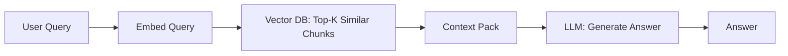
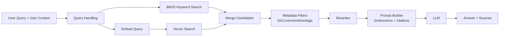
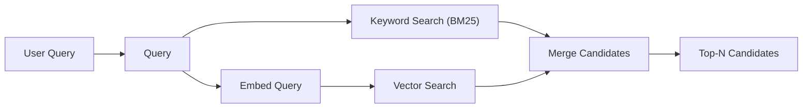
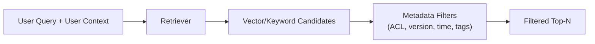
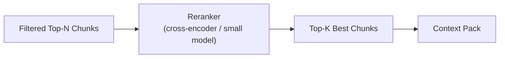
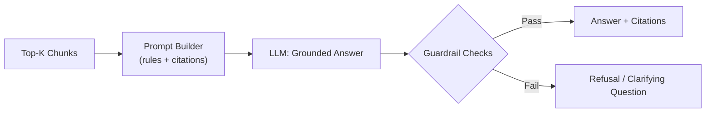
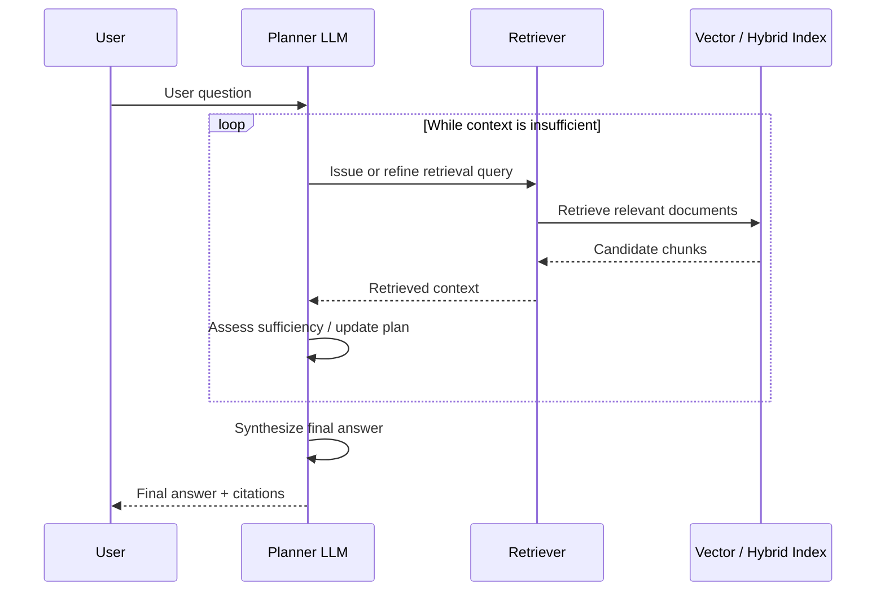

# RAG Fundamentals

* RAG stands for **R**etrieval-**A**ugmented **G**eneration
* RAG is an approach that combines large language models (LLMs) with external data sources.
* It enhances The models responses by retrieving relevante information from a database or search system and using that data to generate more accurate and contextually relevant outputs.
* It breaks the information into chunks, and store them as vectors, that are used in order to search relevant informations.

## Core Concepts

* **External knowledge integration**: Combining language models with external data sources for more informed responses.
* **Dynamic information retrieval**: Automatically fetching relevant data form databases or web soruces during interaction.
* **Contextual reponse generation**: Using retrieved data to craft more accurate and context-aware answers.

## Principles

* **Grounding LLM outputs in factual information**: Ensuring that generated responses are based on reliable and up-to-date external data.
* **Enhacing model knowledge without retraining**: Using retrieval machanisms to improve model performance without the need for extensive retraining on new datasets.

## Comparison: Traditional LLMs vs RAG

| **Aspect**                       | **Traditional LLMs**                                         | **RAG (Retrieval-Augmented Generation)**                     |
| -------------------------------- | ------------------------------------------------------------ | ------------------------------------------------------------ |
| **Knowledge source**             | Encodes knowledge implicitly in model parameters learned during training. | Combines model parameters with retrieved external documents provided at inference time. |
| **Knowledge freshness**          | Knowledge is fixed at training time; updating requires retraining or fine-tuning. | Knowledge can be refreshed by updating external data sources without retraining the base model. |
| **Updatability cost**            | High for frequent updates due to retraining and deployment cycles. | Lower for content updates, but requires maintaining ingestion, embedding, and retrieval pipelines. |
| **Factual accuracy**             | Can be accurate within its training distribution, but may hallucinate or rely on outdated information. | Can improve accuracy when relevant, high-quality documents are retrieved; may still hallucinate or misuse retrieved content. |
| **Reliability**                  | Output consistency depends on prompt design and model behavior. | Adds dependency on retriever quality; failures in retrieval directly affect answer quality. |
| **Transparency / observability** | Limited visibility into why a specific answer was produced.  | Improved observability by exposing retrieved documents, but model reasoning remains opaque. |
| **System complexity**            | Simpler architecture and operational footprint.              | More complex system involving vector stores, retrievers, ranking, and monitoring. |
| **Latency & cost**               | Lower latency and inference cost per request.                | Higher latency and cost due to retrieval and larger prompt context. |
| **Best use cases**               | General reasoning, creative tasks, stable knowledge domains. | Knowledge-intensive tasks, enterprise QA, document-grounded responses, rapidly changing information. |

## When to Use RAG

Use Retrieval-Augmented Generation when **external knowledge is essential at inference time** and grounding matters more than pure reasoning.

### The task is document-centric

- Answers require reading or synthesizing multiple documents
- Examples:
  - internal knowledge bases
  - policies, manuals, reports
  - research or market intelligence

### Knowledge changes frequently

- Retraining the model for every update is impractical
- You need:
  - fast updates
  - versioned or time-scoped knowledge

### Grounding and traceability are required

- Users need to see:
  - sources
  - citations
  - supporting excerpts
- Common in:
  - enterprise QA
  - compliance
  - customer support

### Hallucinations are unacceptable

- Incorrect answers have real costs
- RAG provides constraints by limiting generation to retrieved context (when designed correctly)

### You want domain adaptation without fine-tuning

- RAG can specialize a general LLM to:
  - company data
  - domain-specific language
    without modifying the base model.

## When Not to Use RAG

Avoid RAG when **retrieval adds complexity without improving outcomes**.

### The task is reasoning- or creativity-driven

- Examples:
  - brainstorming
  - code generation
  - creative writing
  - math or logic problems
- The model’s internal knowledge is sufficient.

### The output is predictive or statistical

- Examples:
  - recommendations
  - ranking
  - clustering
  - forecasting
- These are better solved with:
  - classical ML
  - embeddings + models
  - hybrid ML + LLM systems

### The data is already structured

- If information is in:
  - databases
  - dashboards
  - metrics tables

RAG often adds unnecessary indirection.

### Low latency or low cost is critical

- RAG increases:
  - inference latency
  - token usage
  - operational complexity
- Not ideal for:
  - real-time systems
  - high-QPS workloads without caching

### You cannot guarantee data quality

- Poor documents lead to:
  - confident but incorrect answers
  - misleading citations
- “Garbage in, grounded garbage out.”

## RAG Use Cases

Retrieval-Augmented Generation is best applied to **knowledge-intensive tasks** where correctness, grounding, and traceability matter more than raw creativity or prediction.

### 1. Enterprise Knowledge Assistants

**Description**
 LLMs answer questions using internal documentation such as policies, procedures, manuals, and FAQs.

**Why RAG fits**

- Knowledge is dispersed across many documents
- Answers must be grounded in official sources
- Content changes over time

**Typical benefits**

- Reduced hallucinations
- Source-backed answers
- Faster onboarding and support

**Key considerations**

- Document curation and versioning are critical
- Retrieval quality directly impacts trust

### 2. Customer Support & Internal Helpdesks

**Description**
 Chatbots and agent-assist tools that retrieve product documentation, troubleshooting guides, or past tickets.

**Why RAG fits**

- High need for factual correctness
- Answers must reflect current product state
- Traceability helps agents validate responses

**Typical benefits**

- Consistent answers
- Faster resolution times
- Reduced cognitive load for support teams

**Key considerations**

- Guardrails needed to avoid overconfident answers
- Fallback behavior when retrieval fails

### 3. Market & Competitive Intelligence

**Description**
 Synthesis of insights from reports, filings, news articles, and analyst notes.

**Why RAG fits**

- Requires reading and comparing many documents
- Evidence-based answers are expected
- Information evolves frequently

**Typical benefits**

- Grounded summaries
- Faster analysis cycles
- Reduced manual research effort

**Key considerations**

- Bias and source diversity must be managed
- Conflicting documents require careful prompting

### 4. Document Analysis & Summarization

**Description**
 Summarizing, comparing, or extracting insights from long or multiple documents.

**Why RAG fits**

- Context windows alone are insufficient
- Retrieval enables selective focus on relevant sections

**Typical benefits**

- Scalable document processing
- More targeted summaries
- Better handling of large corpora

**Key considerations**

- Chunking strategy strongly affects quality
- Summaries are only as good as retrieved content

### 5. Content Creation with Source Grounding

**Description**
 Generating articles, reports, or internal content grounded in approved references.

**Why RAG fits**

- Factual accuracy and traceability matter
- Writers need source-backed drafts

**Typical benefits**

- Reduced factual errors
- Clear attribution
- Faster drafting workflows

**Key considerations**

- Human review remains essential
- RAG improves correctness, not writing quality

### 6. Compliance, Legal, and Policy Assistance

**Description**
 Answering questions about regulations, contracts, or internal policies.

**Why RAG fits**

- Answers must be sourced and auditable
- Content is sensitive and high-risk

**Typical benefits**

- Reduced misinterpretation
- Improved transparency
- Easier audits and reviews

**Key considerations**

- Strict access control required
- Clear disclaimers and confidence thresholds needed

## Evaluating RAG: The Standard Metrics

To evaluate a RAG system effectively, we separate the **Retrieval** performance from the **Generation** performance. This allows you to identify if the system is failing because it can't find the data or because it can't process it.

### Retrieval Metrics

These measure how well your vector database and embedding model perform.

- **Recall:** The fraction of relevant documents successfully retrieved out of all relevant documents available in the corpus.
  - *Goal:* High Recall (don't miss the answer).
- **Precision:** The fraction of retrieved documents that are actually relevant to the query.
  - *Goal:* High Precision (don't retrieve "noise").
- **MRR (Mean Reciprocal Rank):** Measures *where* the first relevant document appears in the results list.
  - *Calculation:* If the first right answer is at rank 3, the score is 1/3.
- **Hit Rate (or Recall@K):** The percentage of queries for which the correct answer appears anywhere in the top *K* results.

### **Generation Metrics (The LLM Step)**

These measure the quality of the answer produced by the LLM based on the retrieved context.

- **Faithfulness (or Groundedness):** Measures if the answer is derived *strictly* from the retrieved context. It detects hallucinations.
- **Answer Relevance:** Measures how well the answer addresses the original query. An answer can be "faithful" to the context but totally irrelevant to what the user asked.
- **Context Precision:** Evaluates whether the retrieved context contains the actual information needed to answer the query.
- **Context Recall:** Measures if the retrieved context covers all aspects of the answer required by the "ground truth" (the known correct answer).

## Architecture of RAG

Retrieval-Augmented Generation (RAG) is a system design pattern that combines document retrieval with a large language model to produce grounded responses. In practice, RAG is not a single architecture but a set of **incremental building blocks**, each addressing specific failure modes such as poor retrieval, stale knowledge, or overconfident generation.

RAG systems typically evolve from a simple retrieval + generation loop into more robust architectures by adding filtering, ranking, and guardrails as requirements for accuracy, traceability, and reliability increase.

### 1) Naive RAG (baseline)

Naive RAG represents the simplest form of retrieval-augmented generation. In this architecture, a user query is transformed into a representation suitable for similarity search, relevant document fragments are retrieved from a vector-based index, and those fragments are provided to a language model to generate a response. Retrieval and generation are strictly sequential, with a single retrieval step and no additional filtering, ranking, or control mechanisms.

This baseline illustrates the core idea behind RAG—augmenting a language model with external context—while deliberately omitting production-level concerns such as access control, relevance validation, or fallback behavior. As a result, it serves as a useful conceptual starting point, but is typically insufficient for reliable real-world applications.

Where

- **Vector search**: finds chunks similar in meaning to the query.
- **LLM**: synthesizes an answer from retrieved text (but may hallucinate if context is poor).

**Why people start here**

- Fast to prototype
- Low engineering overhead
- Good enough for demos and small corpora

**Where it breaks**

- Retrieval can return “semantically similar but wrong” chunks
- The LLM may confidently answer even if context is weak
- No control over stale docs, permissions, or relevance

### 2) Hybrid RAG (production standard)

This is the most common “real” architecture. You still do vector search, but you add **keyword retrieval**, **filters**, **reranking**, and **guardrails** so the system is reliable and debuggable.

#### 2.1 Add keyword search (BM25) + hybrid retrieval

Hybrid retrieval combines semantic vector search with traditional keyword-based search (such as BM25). The system retrieves candidate documents from both methods and merges the results into a single candidate set for downstream processing.

**Why:** vector search is great for paraphrases; keyword search is great for exact terms (SKUs, error codes, policy names). Hybrid improves *recall*.

**Technical Impact**

* **Recall Increases:** Hybrid retrieval captures the "long tail" of queries that dense vector embeddings miss, particularly exact matches. It combines the semantic understanding of vectors with the lexical specificity of keywords.
  - Fixes the "lexical gap" where the embedding model fails to associate a specific term (e.g., a unique error code `0x884`) with its concept.
    - Example: Searching for specific part numbers (SKUs), acronyms, or proper nouns (project names) that the vector model treats as noise.

* **Precision Increases:** By layering keyword matching over semantic search, the system filters out results that are "conceptually similar" but "factually distinct."

  - Reduces "semantic drift" (e.g., asking for "Python 3.8 features" and getting "Python 2.7" results because they are semantically close).

  - Eliminates false positives from domain-specific jargon where subtle wording differences change the meaning entirely.

  - Improves ranking robustness via Reciprocal Rank Fusion (RRF), pushing documents that appear in both search methods to the top.

* **Token Usage Varies:** The raw number of tokens sent to the LLM depends on the `top_k` setting, but the *information density* per token improves significantly.
  - *However:*
    - If result deduplication is poor, the system may retrieve the same document via both methods, wasting context window space on redundant text.
    - Implementing a Re-ranker (often paired with hybrid retrieval) adds a token computation step before the final prompt generation.

* **Latency Increases:** Executing a hybrid strategy inherently requires more computational resources and time, as the system must run and coordinate two distinct retrieval processes for every single query.
  - Requires performing a term-based lookup on the sparse index (inverted index) while simultaneously executing a nearest neighbor search on the dense vector index.
  - Adds a mandatory post-retrieval processing step to normalize differing score scales and merge the result lists (e.g., via Reciprocal Rank Fusion), which delays the final output.
  - Increases memory bandwidth pressure and I/O operations by necessitating access to two disparate index structures, potentially slowing down performance during high-concurrency bursts.

#### 2.2 Add metadata filters (ACL, time, product, language)

Metadata filtering restricts retrieved documents based on structured attributes such as access permissions, document version, timestamps, product identifiers, or language. These filters are applied after retrieval (or during retrieval, if supported) to ensure only valid and relevant documents are considered.

Metadata Filters are hard constraints that prevent “correct but forbidden” or “outdated” context.

**Why:** you often must ensure results are:

- permitted for the user (access control)
  - "ACL" stands for "Access Control List"

- in the right version/time window
- relevant to the product/region/language

**Technical Impact**

* **Recall Decreases:** Applying filters acts as a hard constraint, reducing the initial candidate pool before vector similarity search occurs. If relevant documents lack the correct metadata tags, they are excluded immediately.
  - However, if the corpus is diverse and filters successfully eliminate large, irrelevant partitions, the *effective recall* within the desired context actually improves.
    - Example: In a massive multilingual knowledge base, filtering strictly for "English" ensures no relevant English documents are buried behind high-similarity non-English matches.

* **Precision Increases:** By narrowing the search space to a specific subset, the retriever is forced to select from content that is already contextually validated.
  - Drastically reduces cross-domain noise (e.g., preventing HR documents from appearing in Engineering queries).
  - Eliminates "false positives" from similar concepts in different languages or regions.
  - Ensures results are strictly bound to the correct product SKU, software version, or time period.
* **Token Usage Varies:** Generally, filtering leads to a more focused context window, often reducing wasted tokens on irrelevant chunks.
  - *However, nuances exist:*
    - **Compensation Risk:** If filters are too aggressive and return too few results, systems often dynamically increase `top_k` to fill the context window, potentially utilizing *more* tokens than a standard search.
    - **Fragmentation Overhead:** Heavy filtering can lead to retrieving many small, fragmented chunks rather than cohesive documents, increasing the ratio of metadata-to-content tokens in the final prompt.
* **Latency Decreases:** Pre-filtering the vector index significantly shrinks the number of vectors that must be scanned or scored during the similarity search.
  - This reduction propagates downstream, lowering the computational load for re-ranking models.
  - It accelerates prompt construction by removing the need for post-retrieval filtering logic in the application layer.

#### 2.3 Add reranking

Reranking is a secondary relevance evaluation step that reorders retrieved documents using a more precise scoring model, typically applied to a small candidate set. The goal is to select the most relevant chunks to include in the final context passed to the language model.

**Why:** retrieval gives you a candidate set; reranking sorts them using a stronger relevance model (cross-encoder or small LLM). This improves *precision*—the top few chunks are more likely to be truly useful.

**Technical Impact**

- **Recall Increases (Indirectly):** Reranking allows the initial retrieval stage to cast a much wider net (increasing the initial `top_k`) without polluting the final context. This ensures that relevant documents, which might have low vector similarity scores due to embedding limitations, are still captured for evaluation.
  - Mitigates the "lossy" nature of bi-encoder compression, where fine-grained details are lost in the vector representation.
    - Example: Retrieving 100 candidates to ensure a crucial but low-ranking document (e.g., rank #85) is included, which the reranker then promotes to the top.
- **Precision Increases Significantly:** A cross-encoder reranker processes the query and document simultaneously, allowing it to understand deep semantic relationships and nuances that vector search misses.
  - Effectively filters out "distractors"—documents that contain correct keywords but irrelevant context.
  - Orders documents by true relevance, placing the best answers at the start of the context window to combat the "lost in the middle" phenomenon.
  - Enables a hard relevance threshold cutoff, discarding low-confidence chunks entirely before they reach the generation model.
- **Token Usage Decreases:** The system allows for a highly curated, smaller set of documents to be sent to the LLM, reducing the size of the final prompt.
  - *However:*
    - The reranking model itself consumes tokens during the scoring process (Query + Document pairs), creating a separate cost center.
    - If the initial retrieval set is too large (e.g., re-ranking 500 documents), the computational cost of the reranker may outweigh the savings from a smaller final prompt.
- **Latency Increases:** Reranking is computationally intensive because cross-encoders must run full inference on every single query-document pair, unlike the fast dot-product operations of vector search.
  - Introduces a blocking synchronous step that scales linearly with the number of documents being reranked.
  - Can act as a pipeline bottleneck if the reranker model is too large (e.g., using a BERT-large based reranker).
  - Requires careful optimization of the "candidate set size" vs. "inference speed" trade-off to prevent user-perceptible delays.

#### 2.4 Add guardrails (refuse, cite, constrain)

Guardrails are explicit rules and checks applied during or after generation to control model behavior. They enforce constraints such as answering only from retrieved context, requiring citations, or refusing to answer when evidence is insufficient.

Common guardrails:

- “Answer **only** from provided context”
- “If evidence is insufficient: say **I don’t know** / ask a clarifying question”
- Cite chunk IDs or links
- Minimum relevance threshold (don’t answer if retrieval quality is low)

**Why:** production systems need predictable behavior. Guardrails reduce overconfident answers and make failures observable.

**Technical Impact**

- **Recall Decreases:** Enforcing a "Minimum Relevance Threshold" acts as a hard filter after retrieval. If the retrieved chunks do not meet the confidence score, they are discarded, and the system refuses to answer.
  - This lowers "System Recall" (the percentage of queries the system attempts to answer) to prioritize reliability.
    - Example: If the best matching document has a similarity score of only 0.65 (where the cutoff is 0.75), the system returns "I don't know" instead of attempting a best-guess answer.
- **Precision Increases:** Guardrails are the primary mechanism for enforcing **Grounding**. They force the model to suppress its internal parametric memory and rely solely on the retrieved context.
  - Eliminates "hallucinations" by explicitly allowing the model to default to a negative constraint ("I cannot find the answer in the provided text").
  - Citations create an audit trail, ensuring that every claim in the generated text is backed by a specific chunk ID.
  - Prevents "knowledge leakage" where the model might answer a private query using public knowledge it learned during training.
- **Token Usage Increases:** Robust guardrails require elaborate System Prompts (instructions) to define the behavioral rules, citation formats, and refusal criteria.
  - *However:*
    - **Output Overhead:** Citations increase the length of the generated answer (e.g., appending `[Source 1, Page 2]` to sentences).
    - **Savings on Refusal:** Conversely, a concise refusal ("I don't know") consumes significantly fewer tokens than a long, rambling hallucination.
- **Latency Increases:** Adhering to strict constraints increases the cognitive load on the model during generation, as it must constantly check its output against the context.
  - If guardrails are implemented as a separate validation step (e.g., "Self-Correction" or an "Answer Relevance Check" pass), the latency effectively doubles because a second LLM call is required.
  - Parsing and formatting strict citations or structured outputs (like JSON) requires more inference time than free-form text generation.

### 3) Agentic / Multi-step RAG

**What it is**
Agentic, or multi-step, RAG is an extension of the standard RAG pattern in which the language model does not retrieve information only once. Instead, the LLM takes on the role of a **planner**, iteratively issuing retrieval requests, refining queries based on intermediate results, and accumulating context before producing a final answer. Retrieval and generation are interleaved, allowing the system to decompose complex questions into smaller steps and gather evidence across multiple passes. The sequence below illustrates this interaction between the user, the planning LLM, and the retrieval layer.

**When it helps**

- Multi-part questions (compare policies, extract multiple facts)
- Queries that require decomposition (“first find X, then use X to find Y”)
- Large, messy corpora where one retrieval pass is rarely enough

**Why it’s riskier**

- More latency and cost (multiple retrieval calls)
- More ways to fail (bad plan, looping, tool misuse)
- Harder to test and monitor

**Technical Impact**

* **Recall Increases (Drastically):** The system shifts from "one-shot" retrieval to an iterative discovery process. If the initial search fails, the agent re-writes the query or breaks a complex problem into sub-tasks to find missing pieces.

  - Solves "Multi-hop" reasoning gaps where the answer requires connecting two distant facts (e.g., *Fact A* is in Document X, *Fact B* is in Document Y).

  - Dynamically expands the search scope, effectively creating a "self-healing" retrieval pipeline that persists until sufficient evidence is found.

* **Precision Increases:** Agents act as an intelligent filter between the retrieval and the final answer, capable of self-correction and verification.

  - Enables "Reflection" loops where the model evaluates its own retrieved context: *"Does this actually answer the user's question?"* If not, it discards the noise and retries.

  - Reduces hallucination by enforcing a "Tool Use" step (e.g., Calculator, SQL) for precise tasks rather than relying on the LLM's probabilistic next-token prediction.

* **Token Usage Explodes:** Unlike standard RAG which is linear (Input $\rightarrow$ Retrieval $\rightarrow$ Generation), agentic workflows are often circular or tree-like.

  - **Chain-of-Thought Overhead:** The "internal monologue" (reasoning steps, planning, and tool selection) consumes massive amounts of output tokens before the final answer is even generated.

  - **Context Accumulation:** Every step in the multi-turn loop (Query A $\rightarrow$ Result A $\rightarrow$ Query B $\rightarrow$ Result B) is often appended to the context, leading to quadratic token growth in long reasoning chains.

* **Latency Increases Significantly:** This is the primary trade-off. The system moves from synchronous, sub-second latency to asynchronous, multi-second (or minute-long) execution.

  - **Serial Dependencies:** Steps are often sequential; the agent cannot formulate *Query B* until it has read and processed the results of *Query A*.

  - **Inference Bottlenecks:** Requires multiple full LLM inference calls just to *plan* the retrieval strategy, adding purely computational latency before any database is even touched.

### Choosing among the three

- **Naive RAG**: prototyping, low-risk domains, small corpora.
- **Hybrid RAG**: default choice for production (best balance of quality/control).
- **Agentic RAG**: only when you truly need multi-step document work and you can tolerate added complexity.

## Techniques Commonly Used in RAG Systems to Reduce Hallucinations

* **Query Reformulation (Dynamic Querying)**: RAG pipelines often rewrite, expand, or decompose user queries to improve retrieval recall and relevance (e.g., multi-query retrieval, semantic expansion).

* **Document Retrieval (Grounding)**: External documents are retrieved from a knowledge source (vector DB, search index) and injected into the prompt, grounding generation in retrieved evidence rather than model priors.

* **Multi-Document Consistency Checks (Contextual Validation)**: Some RAG systems retrieve and compare multiple documents, using reranking or agreement heuristics to reduce reliance on a single potentially incorrect source. This behavior is optional and must be explicitly implemented.
* **Post-Generation Verification (Post-Processing Checks)**: Advanced pipelines apply verification steps after generation (e.g., citation validation, fact-checking models, answer critics) to detect and correct inaccuracies before returning a response.
