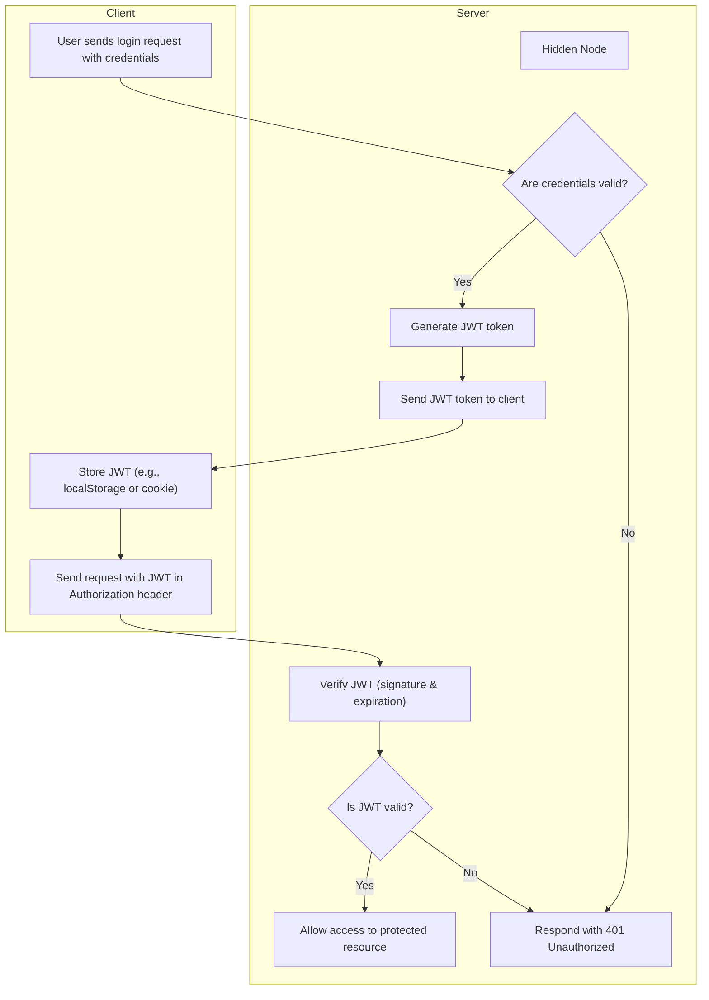

# JWT

* Stands for JSON Web Token
* Contains the data the servers needs in order to authenticate the user

## Anatomy

A JWT token is

```scss
Base64UrlEncode(header) + "." + Base64UrlEncode(payload) + "." + Base64UrlEncode(signature)
```

Where:

* **Header**: type of token (JWT) and signing algorithm

  ```json
  {
    "alg": "HS256",
    "typ": "JWT"
  }
  ```

* **Payload**: Data on the user
  ```json
  {
    "sub": "1234567890",
    "name": "John Doe",
    "admin": true,
    "iat": 1516239022
  }
  ```
  
  * **registered claims**: Some optional fields are defined directly in the JWT RFC specification (RFC 7519), like:
  
    * `iss` (issuer) Identifies who created and signed the token. It helps verify the token came from a trusted source.
    * `sub` (subject) Identifies the subject of the token — usually a user ID or username. It tells *who* the token is about.
    * `aud` (audience) Specifies the intended recipient(s) of the token. The app or service using the token should check this.
    * `exp` (expiration time) Defines when the token will expire. After this time, it should no longer be accepted.
    * `iat` (issued at) Indicates when the token was created. Useful for determining token age.
    * `nbf`  (not before) Sets a time before which the token is not valid. The token becomes valid only after this time.
  
  * **public claims**: There are a organization called IANA that keep a [public list](https://www.iana.org/assignments/jwt/jwt.xhtml#claims) of “reserved” claim names for things that are meant to have a universal, well-known meaning—across any system, company, or product.
  
    * It helps everyone define those public claims in the same way.
    * everyone can suggest new public claims
    * Some examples are:
      * `name`: "Full name"
      * `given_name`: "Given name(s) or first name(s)"
      * `email`: "Preferred e-mail address"
      * `email_verified`: "True if the e-mail address has been verified; otherwise false"
  
  * **private claims**: not standard
  
    * Be careful to don't collide on public or registred claims.
  
    *  If your JWT is being shared between multiple APIs, is strongly recommend prepend the keys with the domain
  
      ```javascript
      {
        "https://yourdomain.com/isAdmin": true,
        "https://yourcompany.com/userTier": "gold"
      }
      ```
  
      ```json
      {
        "https://billing.mycompany.com/tier": "gold",
        "https://support.mycompany.com/tier": "priority",
        "https://content.mycompany.com/tier": "pro"
      }
      ```
  
      * It is recommended to use `https://` as suffix because many system (as OpenID Connect) uses it to work. Also it helps identify that it is  specific a domain and not a generic or reserved claim.
  
* **Signature**: Used to verify the token wasn’t altered. It's created by encoding the header and payload and signing it using a secret or private key.

  ```scss
  HMACSHA256(
    Base64UrlEncode(header) + "." + Base64UrlEncode(payload),
    secret
  )
  ```


## Workflow

1) User requests a log-in
   * Sends credentials (e.g., username/password)
2) Server checks the credentials
   * If valid, generates a JWT token
   * Sends the JWT back to the client
3) Client stores the token (e.g., in localStorage or cookie)
   * The client starts to send the header `Authorization` with `Bearer <JWT token>` on the following requests
     * The client can also send it on the body or request parameter, put it
4) Server receives the request
   * Extracts and verifies the JWT:
     * Signature
     * Expiration (`exp`)
   * If valid: process request
   * If invalid: respond with 401 Unauthorized



