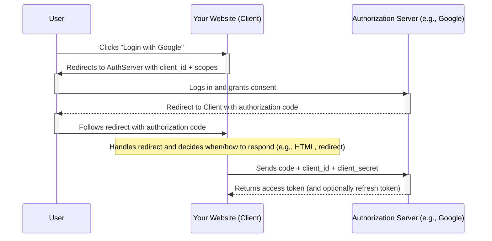

# OAuth 2.0

A protocol for access delegation

OAuth 2.0 allows users to authorize a third-party application (your website) to access their data stored on a trusted provider (like Google, Facebook, or GitHub) without sharing their password.

* Flexible Authorization framework
* Uses different types of tokens
* Describes 5 methods (grants) for acquiring access token
* End user in control of their data (scope)
* Application/Client needs a API key and secret

## Key Concepts:

* **Resource Owner**: The user who owns the data.
* **Client**: Your application or website.
* **Authorization Server**: The trusted provider (e.g. Google).
* **Resource Serve**r: The API that holds the user’s data (often the same as the Authorization Server).
* Client ID and Client Secret: Credentials identifying your application to the provider.

## The Authorization Code Flow (most common):

1. User initiates login on your website (the client).
2. Client redirects the user to the Authorization Server (e.g., Google) with its `client_id` and the requested scopes (permissions).
3. User logs in (if not already) and consents to the requested access.
4. Authorization Server redirects the user back to the client with an authorization code.
5. Client exchanges the authorization code for an access token by sending a request to the Authorization Server (with `client_id`, `client_secret`, and the code).
6. Authorization Server returns an access token (and optionally a refresh token).
7. Client uses the access token to request user data from the Resource Server.
8. Resource Server responds with user data, based on the granted permissions.

## Notes:

* The user never sees the client secret.
* The client should not trust the access token without validation.
* For SPAs or mobile apps, other flows like Implicit Flow or PKCE are used, since they can't safely store the client secret.
* There are many libraries and frameworks that handle the OAuth 2.0 flow for you—especially in popular languages like Node.js and Python—making integration with providers like Google or GitHub much simpler and more secure.
* The authorization code is a [JWT](./JWT.md)
