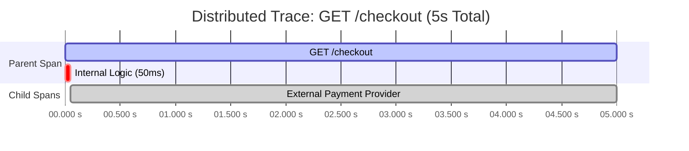

# Observability

Observability is the ability to understand a system's internal state based purely on the external data it generates. Simply knowing a system is failing is no longer enough—you need to know exactly _why_.

Especially in complex distributed cases, where a single user request might travel through dozens of different systems, databases, and queues, finding the exact source of a problem is incredibly difficult.

The Value and Outcomes:
- **End-to-End Tracing:** Provides the deep, structural visibility required to track a request's entire journey when failures or bottlenecks occur.
- **Proactive Stance:** Shifts engineering teams from simply reacting to issues (putting out fires) to having continuous insight.
- **Precision:** Allows teams to pinpoint and resolve the exact root cause of an issue without resorting to guesswork.

## Foundations

### Symptoms vs causes

In backend engineering and site reliability, distinguishing between a symptom and a cause is critical for building a sane alerting strategy. If you mix the two up, you end up with either exhausted engineers suffering from alert fatigue or angry users experiencing broken software while your dashboards look completely green.

#### Symptoms (The "What")

Symptoms are the observable effects of a problem, usually experienced at the boundary of your system or directly by the end user. They are the pain the system is feeling.
- **The Focus:** They tell you _that_ something is broken.
- **The Tools:** Symptoms are what you track with **monitoring** and what you use to trigger your **alerting**. They map closely to your Service Level Indicators (SLIs).

- **Examples:**
    - The API is returning 500 Internal Server Errors for 5% of requests.
    - The P99 latency of the checkout service just spiked from 200ms to 4 seconds.
    - The message queue processing rate has dropped to zero.
  
#### Causes (The "Why")

Causes (or root causes) are the specific, underlying technical failures deep within the architecture that actually produced the symptom. They are the disease itself.
- **The Focus:** They tell you _why_ the system is broken.
- **The Tools:** Causes are what you hunt down using **observability** tools—diving into your traces, querying your logs, and analyzing your continuous profiling data.
- **Examples:**
    - A missing database index is causing a table lock. (Which causes the latency spike).
    - A specific microservice pod ran out of memory and is trapped in a crash loop. (Which causes the 500 errors).
    - A third-party payment gateway changed their rate-limiting rules without warning. (Which halts the message queue).

### Core Concepts

- **Observability:** The ability to interrogate your system and understand its internal state based purely on the data it outputs. It provides the deep, granular context needed to debug unpredictable, novel issues (the "unknown unknowns") in production—allowing you to figure out exactly _why_ something broke without needing to push new code just to gather more clues.
- ***Monitoring:** The continuous, reactive tracking of specific, predefined health metrics and Service Level Objectives (SLOs). It relies on high-level, aggregated data to act as your "check engine" light, answering one straightforward question: _Is the system currently healthy and operating within our expected baselines?_
- **Alerting:** The automated, push-based routing of actionable system state changes to on-call operators (e.g., via PagerDuty). A well-tuned alerting strategy optimizes the signal-to-noise ratio to ensure engineers are only paged for critical, user-facing degradation, preventing alert fatigue.
- **Telemetry:** The standardized payload of data (increasingly handled via OpenTelemetry) continuously emitted by a system. It is the raw pipeline of data ingested by your observability backends, primarily composed of three primitives:
    - **Metrics:** Numeric, aggregated time-series data (counters, gauges, histograms) used to track broad system trends (e.g., p99 latency, heap usage, connection pools). They have a low storage footprint but lack granular context.
    - **Logs:** Immutable, time-stamped, and preferably structured (e.g., JSON) event records. They carry the high-fidelity, high-cardinality payload necessary for deep-dive debugging of specific transactions.
    - **Traces (Distributed Tracing):** Directed acyclic graphs (DAGs) of "spans" that map the execution path of a single request across network boundaries and varying services. They rely on context propagation (Trace IDs) and are essential for identifying latency bottlenecks on the critical path.
- **Instrumentation:** The implementation layer. The integration of SDKs, agents, or bytecode manipulation (e.g., via eBPF) directly into the application code or infrastructure to actually generate and export telemetry data.
- **Profiling (Continuous Profiling):** Sampling the runtime execution state (CPU cycles, memory allocations, thread locks) to generate flame graphs. This allows engineers to identify hardware-level performance bottlenecks down to the exact function or line of code.
- **Exception Tracking:** The automated capture, deduplication, and contextualization of unhandled panics and errors. It provides engineers with the exact stack unwinding, local variables, and environment state present at the exact moment the application crashed.

### Site Reliability Engineering

This SRE (Site Reliability Engineering) framework acts as the ultimate contract between engineering speed and system reliability. It removes the emotion from deployment decisions and replaces it with pure data.

#### SLI (Service Level Indicator): The Measurement

An SLI is a carefully chosen, highly specific metric that measures the actual behavior of your service from the user's perspective. It is the objective reality of your system's performance.

- **The Formula:** SLIs are almost always expressed as a proportion: `(Good Events / Total Events) * 100`.
- **Example:** The percentage of HTTP GET requests to the `/checkout` endpoint that return a 200 OK status code within 300 milliseconds.
- **Focus:** If you use the RED metrics (Rate, Errors, Duration), SLIs typically focus heavily on Errors and Duration (Latency).

#### SLO (Service Level Objective): The Target

An SLO is the target percentage you set for your SLI over a specific period of time (usually a rolling 30-day window). It is the internal goal your engineering team agrees to meet to keep users happy.

- **The Golden Rule:** Your SLO should _never_ be 100%. Aiming for 100% uptime is mathematically impossible in distributed systems, exponentially expensive, and throttles your ability to release new features.
- **Example:** "99.9% of all `/checkout` requests over the last 30 days must be successful and complete under 300ms."
- **Focus:** This is the line in the sand. If your SLI drops below your SLO, your system is officially considered "broken" from a user experience standpoint.

#### Error Budget: The Consequence

If your SLO is 99.9%, that means 0.1% of your requests are _allowed_ to fail. That 0.1% is your **Error Budget**. It is the acceptable level of unreliability your system can tolerate over a given window.

- **The Purpose:** Error budgets are meant to be spent! You spend them on the inherent risks of deploying new releases, running infrastructure migrations, or running chaos engineering experiments.
- **The Mechanism:** This is where the framework gets its teeth. It aligns the Development team (who want to ship features fast) and the Operations team (who want the system to be perfectly stable).
- **The Action:** If you have error budget remaining, you are free to deploy new features rapidly. If a bad release or an outage consumes your entire error budget for the month, deployments freeze. The entire engineering team must stop shipping new features and focus 100% of their effort on stability, bug fixes, and technical debt until the budget recovers.

## Logs

Logs are the ultimate source of truth for exactly _what_ happened at a specific point in time. The goal of a solid logging strategy is to record useful, actionable events from your backend services without overwhelming your storage or burying your engineers in noise.

Here are the core principles for building a robust logging strategy:

- **Structured Logging:** Instead of writing plain-text strings like `"User 123 failed to login from IP 192.168.1.1"`, logs should be emitted in a machine-readable format—almost universally **JSON**. Structured logging transforms that text into key-value pairs (e.g., `{"event": "login_failed", "user_id": 123, "ip": "192.168.1.1"}`). This allows modern log management tools to instantly parse, index, and query your data, so you can easily filter for all failed logins from a specific IP address without writing complex regex scripts.
- **Request IDs and Correlation IDs:** In a distributed system, a single user action might hit five different microservices. To tie those isolated logs together, you inject a unique identifier at the very edge of your architecture (like the API Gateway).
    - **Request ID:** Tracks the lifecycle of a request within a single service.
    - **Correlation ID:** Passed along in the HTTP headers to every subsequent service. When debugging, searching for a specific Correlation ID instantly pulls up every log from every service that participated in that exact transaction.
- **Context-Rich Logs:** A log message by itself is often useless without context. Every structured log should automatically append metadata about the environment and the execution state. This includes the `environment` (prod vs. staging), `service_name`, `version`, `timestamp`, `tenant_id`, and `user_id`. This contextual payload eliminates the need to guess the circumstances surrounding an error.
- **Avoiding Noisy Logs:** Logging is not free; it consumes CPU, network bandwidth, and expensive storage. Furthermore, a noisy log stream makes finding the actual root cause of an issue like finding a needle in a haystack. Avoid logging inside tight `for` loops, logging massive payloads (like raw base64 images), or spamming `INFO` logs for trivial operations. If a log does not help you debug an issue, audit user behavior, or track a business metric, delete it.
- **Sensitive Data Masking:** Logs are often highly accessible to a wide range of employees. It is a critical security mandate to ensure that logs never contain **Personally Identifiable Information (PII)** (like social security numbers or full credit card details) or **Secrets** (like passwords, API keys, or OAuth tokens). Backend systems must use log sanitization libraries to automatically redact or hash these fields before they are written to disk.
- **Log Aggregation:** In modern cloud environments, backend servers (like Kubernetes pods) are ephemeral—they spin up, do their job, and are destroyed. If your logs are only saved to the local file system of a container, they will be lost forever when that container dies. Log aggregation tools (like the ELK stack, Datadog, or Splunk) utilize sidecar agents to constantly forward logs from all your disparate services into a single, centralized, searchable database.

### Syslog Severity Levels

Many backend systems use the shorter application-level set (`debug`, `info`, `warn`, `error`), but transports and protocols often inherit the fuller [RFC 5424](https://www.rfc-editor.org/info/rfc5424/) syslog taxonomy.

Every emitted log should carry a severity level so operators can filter noise during an incident, tune dashboards, and enforce minimum log thresholds at ingestion or transport boundaries.

- **`debug`:** Highly detailed diagnostic output, such as function boundaries, intermediate values, or retry decisions.
- **`info`:** Normal operational progress and expected state transitions.
- **`notice`:** Significant but expected operational events, such as a config reload or a mode change.
- **`warning`:** Unexpected conditions that did not fully fail the operation, but may require follow-up.
- **`error`:** A request, job, or subsystem operation failed.
- **`critical`:** A severe failure is affecting core system functionality.
- **`alert`:** Immediate human intervention is required to prevent or limit major damage.
- **`emergency`:** The system is unusable.

In many application codebases, `warn` is used as a shorter label for `warning`. A simplified set like `debug` / `info` / `warn` / `error` is common in app-level logging libraries, but the operational semantics still map onto the broader syslog model.

When a platform or protocol supports minimum log thresholds, it typically means "emit this level and everything more severe." For example, a threshold of `warning` includes `warning`, `error`, `critical`, `alert`, and `emergency`, while dropping `notice`, `info`, and `debug`.

## Metrics

While logs provide the granular details of individual events, metrics are all about the big picture. They are numerical measurements aggregated over time, designed to be highly efficient to store and lightning-fast to query. Metrics are what power your dashboards, fire your alerts, and tell you if your system is fundamentally healthy.

Here are the core concepts you need to master to build an effective metrics strategy:

### The Core Metric Types

To measure different behaviors, you need to use the right mathematical tool. Telemetry systems generally offer three primary types of metrics:

- **Counters:** A metric that only ever goes up (or resets to zero upon restart). You use counters to track the sheer volume of discrete events.
    - _Examples:_ Total HTTP requests received, total database errors, total background jobs processed.
- **Gauges:** A metric that represents a single numerical value that can go up or down over time. You use gauges for taking "snapshots" of current state.
    - _Examples:_ Current CPU utilization, available RAM, number of active database connections, number of currently active user sessions.
- **Histograms & Percentiles:** Instead of tracking a single number, a histogram samples data points and places them into predefined "buckets" to show the distribution of values. This is crucial for understanding performance because **averages lie**. If 99 requests take 10ms and 1 request takes 5,000ms, the average looks fine, but that one user had a terrible experience.
    - **Percentiles:** We use percentiles (like p50, p90, p99) to read histograms. The **p99 latency** means "99% of requests were faster than this value, and 1% were slower." If your p99 latency is 200ms, your system is performing well for almost everyone.

### The Measurement Frameworks

To avoid tracking random data points, engineers use standardized frameworks to ensure they are measuring the right things.

**RED Metrics (For Services & Applications)**

This framework focuses on the user experience and is used to measure the health of the actual application or microservice:

- **Rate:** The number of requests per second your service is handling.
- **Errors:** The number of those requests that are failing (usually tracking HTTP 5xx codes).
- **Duration:** The time it takes to process those requests (tracked via histograms and percentiles like p99 latency).

**USE Metrics (For Infrastructure & Resources)**

This framework looks at the underlying hardware or infrastructure supporting your application:

- **Utilization:** The average time the resource was busy doing work (e.g., CPU is at 80% utilization).
- **Saturation:** The degree to which the resource has extra work queued up that it cannot service right now (e.g., thread pool exhaustion or disk I/O queue length).
- **Errors:** Count of error events related to the underlying resource (e.g., network interface drops or disk read failures).

### The Danger of High-Cardinality

One of the biggest mistakes in backend metrics is causing a cardinality explosion. A metric is often tagged with labels to make it filterable (e.g., tagging a `http_requests_total` counter with `method="GET"` and `status="200"`).

**Cardinality** refers to the number of unique combinations of those tags.

- **Low Cardinality (Safe):** Tagging by HTTP method (GET, POST, PUT) generates a handful of unique time-series.
- **High Cardinality (Dangerous)**: Tagging a metric with a `user_id` or `session_id`. If you have 10 million users, you just asked your time-series database to track 10 million separate metric streams. This will instantly overwhelm your storage and crash your observability backend. High-cardinality data belongs in **Logs** or **Traces**, not Metrics.

### Dashboards: Making Sense of the Data

Dashboards are the visual representation of your metrics. A good dashboard should answer "Is the system healthy?" within 5 seconds of looking at it. Avoid the temptation to put every single metric on one screen. Build top-level dashboards focusing heavily on RED metrics and business KPIs, and create separate, deeper infrastructure dashboards (focusing on USE metrics) for when you actually need to debug a server issue.

### Examples

- **Requests / Sec:** RED metric (Rate). Measured using a **Counter** (aggregated over time).
- **Number of Failures:** RED metric (Errors). Measured using a **Counter**.
- **Latency:** RED metric (Duration). Measured using a **Histogram** (viewed as a p90 or p99 Percentile).
- **CPU & RAM:** USE metric (Utilization). Measured using a **Gauge**.
- **Number of Users / Sessions:** Business KPI. Measured using a **Gauge** (if tracking currently active) or a **Counter** (if tracking total log-ins over time).
- **Geographic Distribution:** Must be handled carefully! Tagging metrics by `country` is generally safe (low cardinality, ~200 values). Tagging metrics by exact `city` or `zip_code` is highly dangerous (high cardinality) and should be relegated to logs instead.

## Tracing

While metrics tell you that a system is slow, and logs give you the granular details of a specific error, **distributed tracing** is the only tool that tells you exactly _where the time went_. In a modern microservice architecture, a single user click might trigger a cascading chain of network calls across dozens of different services, databases, and third-party APIs. Tracing gives you the map of that entire journey.

Here are the core concepts required to diagnose cross-service latency problems:

### The Anatomy of a Trace

- **Distributed Tracing:** The overarching practice of tracking a single logical request as it moves across physical network boundaries and different backend services.
- **The Trace:** The complete, end-to-end journey of the request. Think of a trace as the entire tree. It represents the total time it took to fulfill the user's action from start to finish.
- **The Span:** The fundamental building block of a trace. A span represents a single, named, and timed logical unit of work within the trace (e.g., executing a database query, or making an HTTP request to an external API). Think of a span as a single branch on the tree.
- **Parent/Child Spans:** Spans are inherently hierarchical. If an API Gateway receives a request (Parent Span) and then makes a call to an Authentication service to verify the user (Child Span), the time spent in the child span is wholly contained within the duration of the parent span.
- **Trace Propagation:** To ensure Service B knows it is part of Service A's trace, you must use trace propagation. This involves injecting a unique identifier (a `Trace ID`) into the HTTP headers of the outgoing request. When Service B receives the request, it extracts that header and attaches the same `Trace ID` to all of its own internal spans, linking everything together in your observability backend.

### Diagnosing Performance Bottlenecks

Tracing transforms debugging from a guessing game into a visual exercise. When looking at a trace waterfall (a Gantt chart of spans), two common anti-patterns instantly stand out:

#### Slow Dependency Detection

If your `GET /checkout` endpoint is taking 5 seconds, a trace will instantly show you that your internal code only took 50ms, but the child span representing the HTTP call to your third-party payment provider took 4.95 seconds. The trace definitively proves the bottleneck is an external dependency, not your database or your code.

#### N+1 Query Detection
  
 The N+1 problem occurs when an application makes one database query to fetch a list of items, and then loops through that list, making an _additional_ query for every single item. In a trace, this looks like a massive staircase of dozens or hundreds of tiny, sequential, 2ms database spans. While each query is fast, executing 100 of them sequentially destroys performance.

```mermaid
gantt
    title Trace: N+1 Problem (Sequential Database Queries)
    dateFormat  X
    axisFormat %s ms

    section Parent Span
    GET /products             :active, p1, 0, 210

    section Database
    SELECT * FROM categories  :crit, c1, 0, 10
    SELECT * FROM products (1):c2, 10, 12
    SELECT * FROM products (2):c3, 12, 14
    SELECT * FROM products (3):c4, 14, 16
    SELECT * FROM products (4):c5, 16, 18
    SELECT * FROM products (5):c6, 18, 20
    SELECT * FROM products (6):c7, 20, 22
    ... (94 more queries)   :milestone, m1, 22, 0
    SELECT * FROM products (100):c100, 208, 210
```

#### Practice: Tracing a Request

```mermaid
gantt
    title Distributed Trace - Checkout Flow
    dateFormat  X
    axisFormat %s

    section API Gateway
    Span 1 - POST /api/checkout (Root) :active, p1, 0, 1250

    section Auth Service
    Span 2 - Verify Token             :done, a1, 0, 50

    section Checkout Service
    Span 3 - Process Cart             :crit, c1, 50, 1250
    
    section Checkout Spans
    Span 4 - Fetch User Profile       :c2, 50, 65
    Span 5 - Stripe Charge            :done, c3, 65, 1165
    Span 6 - INSERT Order             :c4, 1165, 1250
```

- **The Flow:** The request hit the Gateway (Span 1), which called the Auth Service (Span 2). Once Auth succeeded, the Gateway called the Checkout Service (Span 3). The Checkout service then made three sequential calls: checking the cache (Span 4), calling Stripe (Span 5), and saving to the database (Span 6).
- **Identifying the Slowest Span:** While the total request took 1250ms, the primary bottleneck is glaringly obvious. **Span 5 (`Stripe Charge`) took 1100ms.**
- **The Conclusion:** Your internal microservices, cache, and database are actually performing incredibly fast. The cross-service latency problem is entirely due to the slow response time from the external payment gateway dependency.

## Instrumentation

Now that we know what data we need (Logs, Metrics, Traces) and how to use it, we have to actually generate it. This physical act of adding measurement capabilities to your code is called **instrumentation**. If telemetry is the fuel for your observability engine, instrumentation is the oil well pumping it out of the ground.

Here are the core concepts and modern standards for instrumenting backend systems:

### How the Code gets Instrumented

There are two primary ways to generate telemetry, and a mature system relies heavily on a combination of both:

- **Auto-Instrumentation:** This is the "magic" approach. You install an agent or include a specialized library in your application environment, and it automatically hooks into standard frameworks and libraries (like Express.js, Spring Boot, PostgreSQL drivers, or standard HTTP libraries) at runtime.
    - **The Value:** It requires zero changes to your actual business logic. Out of the box, you instantly get RED metrics, database query durations, and distributed trace propagation across standard network boundaries.
- **Manual Instrumentation:** Auto-instrumentation only understands infrastructure; it doesn't understand your business. Manual instrumentation requires developers to explicitly write code to capture custom events or inject business context.
    - **The Value:** This is how you add things like `user_id`, `tenant_id`, or `cart_total` to a span. It allows you to create custom metrics (like "number of failed checkouts due to invalid zip codes") that a generic agent could never figure out on its own.

### OpenTelemetry (OTel) Basics

Historically, instrumentation meant vendor lock-in. If you wanted to use Datadog, you installed the Datadog agent and wrote Datadog-specific code. If you switched to New Relic a year later, you had to rewrite all your instrumentation.

**OpenTelemetry (OTel)** solved this. It is an open-source, vendor-agnostic standard (backed by the Cloud Native Computing Foundation) for generating, collecting, and exporting telemetry data.

Here are the moving parts of the OTel ecosystem:

- **The API & SDKs:** These are the libraries you install directly into your application code. The API is what developers use to write manual instrumentation (e.g., `span.setAttribute()`). The SDK handles the actual heavy lifting of gathering that data, batching it, and preparing to send it out of the application.
- **The Collector:** Instead of every microservice sending data directly to an external vendor, they send it to a local OpenTelemetry Collector. Think of the Collector as a proxy or router for your telemetry. It sits within your infrastructure, receives data from all your services, filters out noise, scrubs sensitive PII, and batches the data.
- **The Exporters:** These are plugins attached to your Collector (or sometimes directly to the SDK). They translate the vendor-neutral OTel data into the specific proprietary format required by your ultimate destination (e.g., translating OTel traces into Jaeger format, or OTel metrics into Prometheus format). If you change observability vendors, you just swap the exporter plugin—your application code never changes.

### Semantic Conventions

In a distributed system, consistency is everything. If Service A tags a database span as `db.system="postgres"` and Service B tags its database span as `database_type="PostgreSQL"`, querying across both services is a nightmare.

OpenTelemetry enforces **Semantic Conventions**. These are strict, standardized naming schemas for common operations (HTTP requests, database calls, messaging queues). By adhering to these conventions, you guarantee that your telemetry is uniform, predictable, and instantly searchable across your entire engineering organization.

### Sampling: Managing the Data Hose

Tracing every single request in a high-traffic system is incredibly expensive. Generating, transmitting, and storing 10,000 traces per second will quickly bankrupt your infrastructure and observability budget. To solve this, we use **Sampling**—the practice of only keeping a representative subset of your traces.

There are two main strategies:

- **Head-Based Sampling:** The decision to trace or not is made at the very _beginning_ of the request (e.g., a coin flip at the API Gateway dictating a 5% sample rate).
    - **Pros**: Very efficient; no CPU or memory is wasted gathering data you will just throw away.
    - **Cons:** You might miss rare errors. If an error only happens 1% of the time, and you only sample 5% of traffic, you will almost never capture a trace of the failure.
- **Tail-Based Sampling:** The decision to keep a trace is made at the _end_ of the request, usually by the OTel Collector. The system records 100% of the traces temporarily in memory, waits to see the final outcome, and then applies rules: "Keep 100% of traces that resulted in an error or took longer than 2 seconds, but only keep 1% of successful, fast requests."
    - **Pros:** You never miss an error or a slow request. It provides perfect visibility into the things that actually matter.
    - **Cons:** It requires a highly robust Collector infrastructure with a lot of RAM, because it has to buffer massive amounts of trace data in memory before making the decision to keep or drop it.

## Alerting

If telemetry is the raw data and observability is the diagnostic capability, alerting is the sharp edge of the spear. It is the mechanism that actively interrupts a human being's day (or sleep) to fix a problem. When done poorly, a bad alerting strategy will cause severe engineer burnout, foster resentment, and ironically lead to longer outages because the team stops paying attention to the noise.

### The Core Philosophy

**Alerting on Symptoms, Not Causes:** As we covered earlier, this is the golden rule. You do not page an engineer because CPU on `Node-5` hit 99% (a cause). You page an engineer because the 99th percentile response time for the checkout service just hit 10 seconds (the symptom). If a backend server dies, but the load balancer seamlessly shifts traffic and the user notices nothing, the alert should simply log a ticket for the morning, not wake someone up at 3:00 AM.

### Modern Trigger Mechanisms

The old way of alerting relied on static thresholds (e.g., "Alert if error rate > 5% for 10 minutes"). The modern, SRE-driven way uses your Service Level Objectives (SLOs) and Error Budgets to drive the math.

- **[SLO](#SLO%20(Service%20Level%20Objective)%20The%20Target)-Based Alerts:** Instead of guessing arbitrary thresholds, you tie your alerts directly to your Error Budget. You ask the system: _"Is the current rate of failure threatening our 30-day reliability goal?"_
- **Burn-Rate Alerts:** This is the most sophisticated way to trigger an alert. It calculates how fast you are consuming your [error budget](#Error%20Budget%20The%20Consequence).
    - If you are burning your budget at a `1x` rate, you will run out of budget exactly at the end of the month. (No alert needed).
    - If a massive outage hits and you are burning your budget at a `100x` rate, your entire monthly budget will be gone in a few hours. This triggers an immediate, critical alert. Burn-rate alerting catches both sudden, catastrophic outages and slow, bleeding errors that static thresholds often miss.

### Triage and Routing

Not every problem is an emergency. A mature system strictly categorizes alerts into different severity levels and routes them accordingly.

- **Severity Levels:** Usually ranked from P1 (Critical) to P4 (Low). A P1 means a core business function is broken for many users. A P4 means a non-critical background task failed and will retry automatically.
- **Paging vs. Non-Paging Alerts:**
    - **Paging (The Pager):** Reserved strictly for high-severity, symptom-based alerts. This triggers tools like PagerDuty to wake an engineer up via phone call or SMS. It mandates immediate, drop-everything human intervention.
    - **Non-Paging (The Queue):** For lower-priority issues or early-warning causes (like a disk reaching 70% capacity). These should _never_ page. Instead, they silently create a Jira ticket or send a message to a low-priority Slack channel to be investigated during normal business hours.

### Operational Readiness

**Runbooks (Playbooks):** An alert is useless if the person receiving it doesn't know what to do. Every single alert in your system must have an attached Runbook—a short, step-by-step document explaining what the alert means, where to look first (with links to specific dashboards or logs), and common mitigation steps. If an alert fires and there is no runbook, the alert should be deleted until one is written.

### The Ultimate Enemy: Alert Fatigue

**Alert Fatigue** is the psychological and physical exhaustion that occurs when engineers are bombarded with frequent, unhelpful, or unactionable alerts.

- **The Danger:** When engineers get woken up five times a week for "High CPU" warnings that resolve themselves in two minutes, they become desensitized. Eventually, a real, catastrophic alert will fire, and they will unconsciously ignore it, assuming it is just more noise.
- **The Cure:** Ruthless pruning. Every on-call shift should end with an alert review. If an alert fired and the responding engineer took zero action other than acknowledging it and going back to sleep, that alert must be immediately tuned, downgraded to non-paging, or deleted entirely.

## Debugging Production Issues

The pager just went off at 2:00 AM. Your SLO-based alert triggered because the p99 latency on the checkout service spiked, and error rates are climbing. This is where the theory ends and practical observability begins.

### Incident Triage & Dashboards

Your immediate goal is not to fix the underlying bug; your goal is to **stop the bleeding** and restore service to the users.

- **High-Level Dashboards First:** Open your primary business dashboard. Look purely at the RED metrics (Rate, Errors, Duration) to assess the blast radius. Is the entire site down, or is it just a specific feature? Is it affecting all users, or just users in a specific region?
- **Establish Roles:** If it is a major incident, establish an Incident Commander (who communicates and coordinates) and Responders (who actually look at the code and data). Do not try to do both simultaneously.

### The #1 Suspect: Correlating Deploys

Before you dive into deep architectural debugging, ask one question: _"What changed?"_ Over 80% of production incidents are caused by a recent configuration change or code deployment. Your dashboards should overlay deployment events as vertical markers on your metric graphs. If your error rate spiked exactly two minutes after the `v2.4.1` release of the cart service, you have found your culprit.
- **The Rollback:** If a recent deployment is the obvious cause, **rollback immediately**. Do not attempt to write a hotfix or "fix forward" while the system is burning. Revert to the last known good state to restore the user experience, and _then_ debug the broken code in a staging environment.

### 3. Hypothesis-Driven Debugging

If a rollback isn't an option (or didn't fix it), you must use your telemetry to form and test hypotheses. Do not just blindly scroll through millions of logs hoping to spot an error.

Follow the funnel from broad to specific:

- **Metrics (The "What"):** You look at your infrastructure dashboards (USE metrics) and notice the database CPU is pegged at 100%. _Hypothesis: A bad query is locking the database._
- **Traces (The "Where"):** You open your tracing tool and filter for requests hitting the database during the incident window. The trace waterfall clearly shows a massive N+1 query problem originating from the `Inventory` service. _Hypothesis refined: The new inventory feature is spamming the database._
- **Logs (The "Why"):** You grab the `Trace ID` from that specific slow request and paste it into your logging tool. Because of correlation IDs, you instantly see the exact application logs generated during that specific transaction. The log explicitly says: `WARN: Cache connection failed, falling back to full table scan.`
- **The Conclusion:** The root cause wasn't the database at all. The Redis cache died, forcing the application to hammer the database, causing the CPU spike.

### Dependency Failures

Remember the [Slow Dependency Detection](#Slow%20Dependency%20Detection) pattern we mapped out in the tracing section? This is exactly where it saves the day during a live incident. If your RED metrics show a massive spike in overall latency, but your USE metrics show your backend servers are practically idle (low CPU, plenty of RAM), your code is not actually struggling—it is just waiting. Instead of blindly restarting your own pods, you can jump straight to your trace waterfall. If you see that familiar pattern of a massive child span hanging on an external boundary, you can instantly shift your focus from debugging internal logic to declaring a third-party outage.

### The Postmortem

The incident is over, the cache is restarted, and users are happy. The final step is the **Blameless Postmortem**.

An incident is an unplanned investment in reliability; a postmortem is how you get your ROI. Within 48 hours, the team should write a document detailing:
- **Timeline:** Exactly what happened and when.
- **Root Cause:** The technical reason it failed (moving past the symptoms).
- **Action Items:** What specific tickets are being created to ensure this _exact_ failure never happens again (e.g., "Add fallback timeout to Redis connection", or "Create alert for cache connection drops").

Crucially, it must be **blameless**. You do not write "John broke the database." You write "The deployment pipeline allowed an unoptimized query to reach production." You fix the system, not the person.
