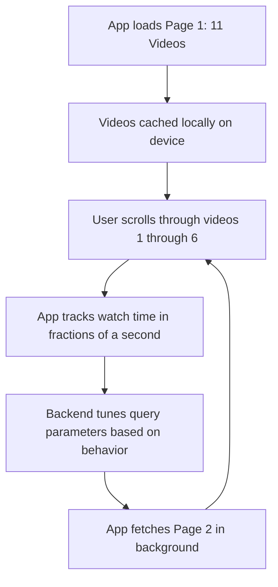

# Miscellaneous

## The Backend Engineering of Infinite Scroll

### Traditional Pagination: Offset and Limit Mechanics

The concept of the infinite scroll originated as a backend solution to optimize database queries and data fetching. During the 1990s and early 2000s, returning all search results at once was an architectural antipattern. A single query could yield tens of thousands or even millions of results, and transferring that volume of data to the client side was highly inefficient. To solve this, developers divided the results into fixed-size pages.

#### The Cost of Page Calculation

To build this interface, the backend needed to know the total number of pages. The system executed a `count` query to find the total number of results, and then divided that number by the desired page size, such as 10 results per page. In SQL terminology, the database fetched the first page using commands like `OFFSET 0` and `LIMIT 10`.

This page-based design introduced significant backend costs. The initial `count` query was highly resource-intensive, as it required the database to scan the entire heap table, clustered table, or index-organized table just to return an accurate number of total pages. Since users rarely navigated beyond the first few pages, the computational effort to calculate and display the total number of pages was largely unnecessary.

#### Performance Limitations of Deep Pagination

The most critical problem involved the backend cost of deep pagination. Browsing became progressively slower as the user moved deeper into the results. To fetch the second page, the offset was increased to `11` to skip the first ten records. When a query requested a much larger offset, such as 10,000 or 20,000, the database could not simply jump to that specific row number. Instead, it was forced to sequentially scan and discard all preceding rows in the result set before fetching the requested limit, resulting in an exceptionally I/O-intensive operation.
### Cursor-Based Pagination and the Scroll Interface

To resolve the inefficiency of the `OFFSET` command, engineers redesigned the interface to force users to look at results in sequence rather than jumping to arbitrary pages.

#### Dropping the Offset

By enforcing sequential browsing, the backend eliminated the need for the expensive `count` query, as the total number of pages no longer mattered to the system or the user. Furthermore, this sequential nature allowed developers to drop the `OFFSET` command entirely.

Assuming the database results were ordered by an identifier, such as a creation date or a primary ID, the backend simply recorded the last ID of the first page. When the application needed the next batch of rows, it fired a new query requesting the results where the ID was strictly greater than the last seen ID. This allowed the database to utilize access paths on indexed fields, instantly locating the starting point without scanning intermediate rows.

#### The Vertical Scroll Interface

The user interface evolved to match this backend optimization. Aza Raskin popularized the interface concept for mobile devices by replacing traditional "next" and "previous" page buttons with vertical swiping. Swiping up requested the next page, while swiping down requested the previous page. This design perfectly complemented the cursor-based database query, allowing the client to continuously fetch the next block of results seamlessly.

### Advanced Predictive Fetching Systems

While cursor-based scrolling was originally designed to navigate a limited set of content—such as a finite list of posts from followed accounts—the engineering architecture was later scaled to support continuous feeds.

#### Background Loading and Local Caching

Modern platforms, such as TikTok, evolved this cursor-based design into a highly optimized, predictive continuous loop. When a client application opens, it immediately fetches an initial page of approximately 11 videos. Because these videos are cached locally on the device, scrolling appears instantaneous and requires no immediate server requests.

By the time the user reaches the sixth or seventh cached video, the application quietly requests the second page in the background. The platform uses the telemetry gathered during the first few videos—such as watch times measured in fractions of a second—to tune the database query parameters for the second batch. This allows the backend to dynamically adjust the payload before the user even finishes the first page. This aggressive background caching mechanism is so robust that if a device loses internet connectivity, the user can often continue scrolling through 15 to 20 cached videos before the feed is exhausted.

This sequence demonstrates the mechanics of predictive caching, which ensures the client never experiences a loading state by maintaining a continuous buffer of highly optimized, cursor-fetched data.
