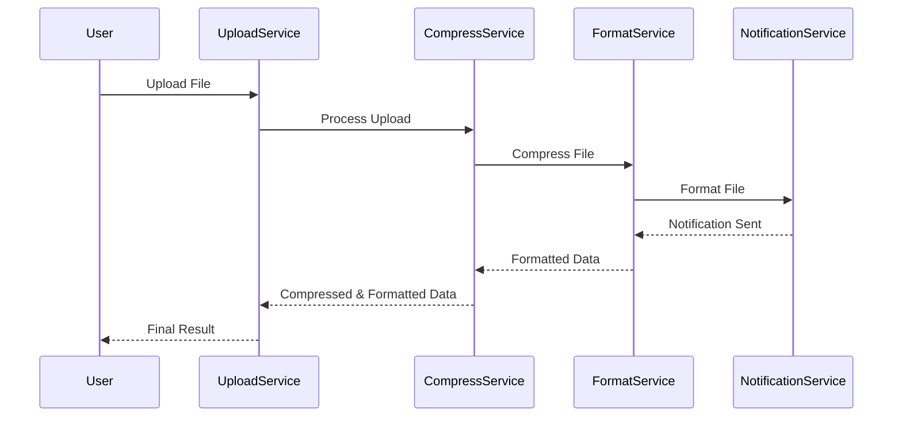
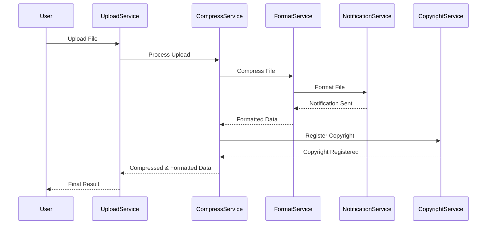
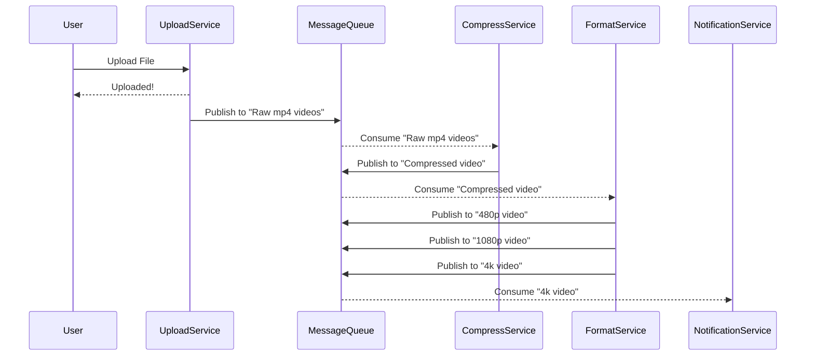

# Publish Subscribe

Publish something to the server; The clients can consume it from the server.

* Publish-Subscribe is designed to solve the problem of multiple services trying to communicate with each other, creating a tangled communication mesh. Given the scenario of $n$ services, without Publish-Subscribe, the number of connections $O(n^2)$ because there are $\frac{n(n-1)}{2} = \Theta(n^2)$ possibilities, whereas with this approach, there would be just $n = \Theta(n)$ connections.
* Request-Response is elegant, simple and scalable; however, it handles multiple receivers poorly and both ends have to be running, leading to connection chaining and circuit breaking.

Request-Reponse:

It is called chaining, and the problem is that each services needs to know the other to participate on the mesh. As it is tightly coupled it is hard to add new services for example:

You can do it a lot more simpler with a message broker:

## Pros and Cons

* Pros
  * Scales well with multiple receivers
  * Great for micro-services
  * Loose Coupling
  * Works while clients not running
* Cons
  * Message delivery issue: the classic "to generals problem": Ho do I do to know if the consumer actually got the message?
    * Normally the message brokers as Kafka and Rabbit MQ have those warrants.
  *  Complexity
  * Network saturation: mainly because polling to the message broker.

