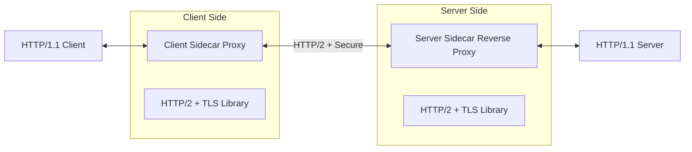
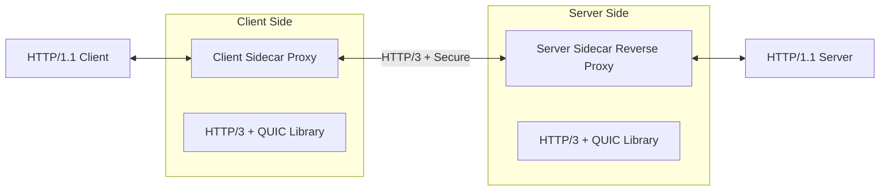

# Sidecar Pattern

## What it solves

A pattern to solve the problem of having multiple communication protocols.

* Each protocol need a translator library in both client and server
* Once you use a library, your application becomes dependent on it
* Application and Library "should" be same language
* Changing the library is hard because require retesting
* Adding features to the library
* Micro-services suffer

## What it is

* Proxy communicate instead
* Proxy has the rich library
* Client has thin library, such as HTTP/1
* Each client must have a sidecar proxy
* It is called sidecar because it usually is laid on the same machine of the main program.

So we can change the protocol "HTTP/2 + TLS" without changing either the client or the server:

## Sidecar examples

* Service Mesh Proxies
  * Likerd, Istio, Envoy
* Sidecar Proxy Container
* Must be Layer 7 Proxy

## Pros and Cons

* Pros
  * Language agnostic (polyglot)
  * Protocol upgrade
  * Security
    * You can change only the proxies when you discover a weak cipher
  * Tracing and Monitoring
    * You can configure one point (the sidecar proxy) to make it reckoning a trace id.
  * Service Discovery
    * All the proxies can use the same service discovery service
  * Caching
* Cons
  * Complexity
  * Latency: client -> server is now client -> proxy 1 -> proxy 2 -> server
