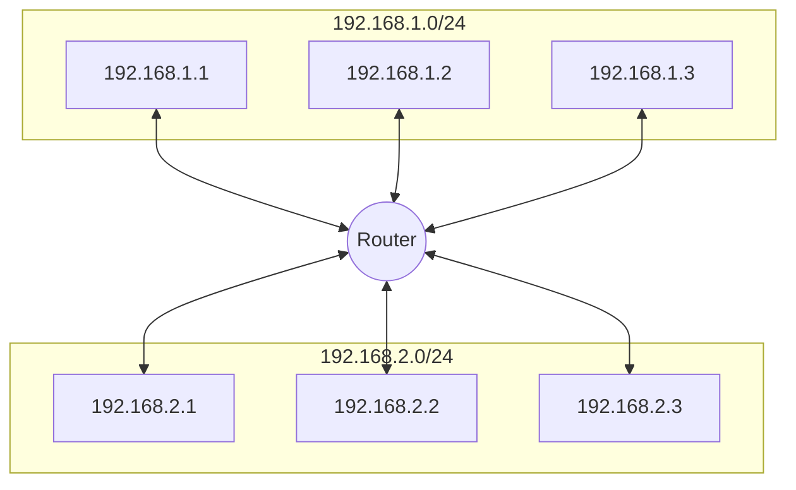

# Internet Protocol

Anything that you do in the Internet will associated with the source IP and the destination IP.

* Here you don't know about ports, HTTP headers, etc.
* The data unit here is **packets**

## Anatomy of the IP

### IP Address

* Layer 3 property
* Can be set automatically or statically
* Network and Host portion
* 4 bytes in IPv4 - 32 bits

### Network vs Host

* `a.b.c.d/x` where `a`, `b,`, `c`, `d` are integers and `x` is the network bits and remains are host
  * for example `192.168.254.0/24`
    * The first 24 bits (3 bytes) are network the rest 8 for host
      * this means we can have $2^{24} = 16777216$ networking ad each network has $2^8=266$ hosts
    * `192.168.254.0/24` is also called a subnet
      * the subnet has a mask `255.255.255.0`
      * Subnet mask is used to determine whether an IP is in the same subnet
        * it is important to the router, because if the true it uses the MAC address; else the router send it to the gateway.

### Default Gateway

Most networks consists of hosts, and one of them is the Default Gateway

* When host A want to talk to B directly if both are in the same subnet.
* Otherwise A sends it to someone who might know, the gateway.
* The Gateway has a IP Address and each host should know its gateway.
  * a gateway is a host of multiple networks.

### Example

* Host `192.168.1.3` wants to talk to `192.168.1.2`
  1) `192.168.1.3` applies subnet mask to itself and the destination IP `192.168.1.2`
     * `255.255.255.0 & 192.168.1.3 = 192.168.1.0`
     * `255.255.255.0 & 192.168.1.2 = 192.168.1.0`
     * Both equals, so they belongs on the same subnets
  2) Both source and destination are on the same subnet, they communicate thought MAC address.
     * The "router" is also a switch, so these communication will use that switch.
       * switches are a Layer 2 devices
* Host `192.168.1.3` wants to talk to `192.168.2.2`
  1) `192.168.1.3` applies subnet mask to itself and the destination IP `192.168.2.2`
     * `255.255.255.0 & 192.168.2.3 = 192.168.1.0`
     * `255.255.255.0 & 192.168.2.2 = 192.168.2.0`
     * They are different
  2) The packet is sent to the default gateway `192.168.1.100` through MAC address, that also is `192.168.2.100`, from where the packed is sent as the first scenario.

### Warnings

This knowledge is critical, because:

* if your application and your database are in different databases, IP packets is going thought the router, that can delay the traffic, or even worse, the router can be congested.

## Anatomy of the IP packet

* The IP Packet has headers and data sections
  * The headers is 20 bytes (can go up to 60 bytes if options are enabled.)
  * Data section can go up to 65536 bytes
    * but it is not common, because anything above the hardwares have the Maximum Transport Unit, that normally is about 5500 bytes, suffers fragmentation
      * Maximum Transport Unit is the maximum size of a data frame (layer 2)
      * The router can send a ICMP message to the receiver saying that there was a error, or fragment it.
      * Fragmentation is:
        * costly
        * dangerous because mischiefs can pretend fragmentations
        * one fragment could fail, and resend just a part is difficult.

The IP packet is basically the source IP address, the data, and the destination IP address. Probably it is everything that you would need as a backend engineer. However, here some more details:

* There is three headers for fragmentation: Identification, Flags (whether the packet should be fragmented or not) and Fragment Offset 
* There is a header for time to live, it is important because the packet can be found in a situation of infinite loop between routes.
  * the time to live is a counter that is decreased by one on each router
  * the router that decreases it to 0 drop it and send back a ICMP message saying that the packet was timeouted.
    * traceroute works in that way: send a very small time to live, and increment it everytime, so it receive a ICMP message from each router in the way.
      * may don't work because some routers turn the ICMP messages off, or some firewall in the way may block it.
      * different ICMP can take differents ways, so the traceroutes isn't always right.
    * some routes turns the ICMP message off
*  There is a header of protocol, that can be used to block decisions (without reading the data).
* There is a header called Explicit Congestion Notification (ECN),  that you from a upper layer (TCP) by the router.
  * congestion causes packets drops.
  * When the route is overwhelmed, it starts to store the packets on buffers, when it is fulled, the incoming packets starts to be drooped.
    * it is a waste because makes the client wait for a long timeout
    * When the router buffer it about to be fulled, it starts to set the ECN to true, and process the packet normally.
      * the receiver will be notified about the congestion by that bit, and will response the client with the same bit, so the client also will be notified.
* Finally, there are one header for source IP address, and another destination IP address
  * you can change the your source IP, but your Internet Provider can block your packets because it. The provider knows you IP because they assigned it.

## ICMP

* Stands for Internet Control Message Protocol
* Lives on layer 3, so it don't uses ports.
* Designed for information messages
  * Host unreachable, port unreachable, fragmentation needed
  * Packet expired (infinite loop in routers)
* Uses IP directly
* PING and traceroute use it
* Doesn't require listeners or ports to be opened

* Some firewalls block ICMP for security reasons
  * bad persons can use ICMP to flood the server in, or to discover opened ports
* Disabling ICMP also can cause real damage with connection establishment
  * TCP black hole: the connection is open by the handshake, you turned the fragmentation off, and the packet is bigger than the Maximum Transport Unit of the router.
    * the router will send you a ICMP saying that you need to fragment, but these message will be block by the firewall
    * so you established a connection, but your data is vanished 
