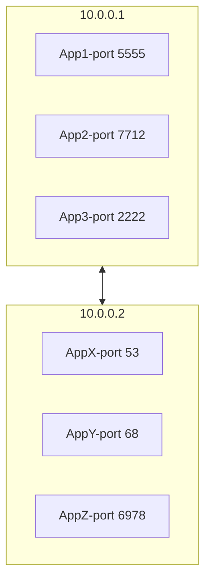
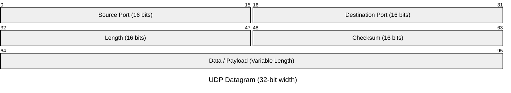

# User Datagram Protocol

The message must fit exactly into a datagram, that must fit exactly into a IP packet.

* It is unlike TCP, that is stream of data without start or end. The kernel carve the data out into many TCP segments.
* UDP is message based: send to the other side, and don't care if it arrives or not.
* TCP is great for reliability, and UDP is for case where reliability isn't that important.

The main traits are:

* Stands for User Datagram Protocol
* Layer 4 protocol
* Ability to address processes in a host using ports
  * so the host can have many applications running and send multiple requests that goes to different applications.
* Simple protocol to send and receive data
* Prior communication not required (double edge sword)
  * don't need establish a connection

* Stateless: no knowledge is stored on the host
* 8 bytes headers Datagram
  * 20 bytes of IP packet header + 8 bytes of UDP headers

## Use cases

* Video streaming
  * you don't care if some of the video frames are dropped
* VPN
  * you can use VPN with TCP, but it is a bad idea because you mostly use TCP, and it will cause TCP-over-TCP Meltdown
    * both the inner and outer TCP layers try to manage reliability and congestion control independently. If a packet is lost, both layers may try to retransmit, leading to delays and inefficiencies.
    * Congestion feedback confusion: Outer TCP sees packet delays and reduces throughput, even though the inner TCP is already handling it. The feedback loops conflict.
  * some VPNs uses the IP directly, by a technique called IP-in-IP or Layer '3 Tunneling'.
    * The VPN Client will put your IP packet inside another IP packet as data and send it to the VPN sever. That will unpack it, and use the IP packet inside.
    * Many NATs and firewalls can't reliably forward Layer 3-only message. These protocols lack TCP/UDP ports, so NAT devices can't track sessions or route return traffic correctly. As a result, messages that rely solely on Layer 3 encapsulation often fail to pass through NAT unless the network is explicitly configured to support them.
  * When use UDP, the VPN must implement the features of TCP by itself, as packet sequencing, retransmissions, replay protection, tls, etc.
* DNS
  * The client sends a DNS resolution request, which includes a query ID. The server responds with another UDP packet containing the result and the same query ID.
    * Since UDP is connectionless and doesn't guarantee order, the client can send multiple requests simultaneously and must use the query ID to match responses to requests.
  * DNS poisoning: someone nasty intercepts those UDP and redirect you to elsewhere.
* WebRTC: will have a entire class about it

## Multiplexing an demultiplexing

* IP target hosts only
* Host run many apps each with different requirements
* Ports now identify the "app" or "process"
  * the traffic between the host and the apps is made by the operational systems.
* Sender multiplexes all its apps into UDP
* Receiver demultiplex UDP datagrams to each apps
  * on the body there is the source port to send the data back



### Example

1) `App1` on `10.0.0.1` sends data to `AppX` on `10.0.0.2`
2) Destination port is `53`
3) `AppX` responds backs to `App1`
4) We need Source Port sow e how to send back data
5) Source port is `5555`

## UDP Datagram



* Datagrams slides into an IP packet as payload
* Port are 16 bit (0 to 65535)
  * $2^{16} = 65536$
  * it is a hard limit for the number of connections
* UDP Header is 8 bytes only (IPv4)
  * Bytes 0–1: Source Port
  * Bytes 2–3: Destination Port
  * Bytes 4–5: Length
  * Bytes 6–7: Checksum

# Pros and Cons

* Pros
  * Simple protocol
    * but in this case, you must deal with the problems the TCP solves, as packets loss.
  * Header size is small so datagrams are small
  * Uses less bandwidth
  * Stateless
  * Consumes less memory
    * no state stores in the server/client
  * Low latency - no handshake, order, retransmission or guaranteed delivery.
* Cons
  * No ackowledgement
  * No guarantee delivery
  * Connection-less - anyone can send data without prior knowledge
  * no flow control
    * someone can flood your server with UDP, and the server have to process those datagrams.
      * someone can request a sheer number of DNS requests, to normal DNS servers, but put as the source the target.
  * no congestion control
  * no ordered packets
  * security - can be easily spoofed
    * it is harder to do it using TCP, because it requires a prior handshake. 

# Demo

## Javascript

```javascript
import dgram from 'dgram'

const socket = dgram.createSocket("udp4");

socket.bind(5500, "127.0.0.1");

socket.on("message", (msg, info) => {
    console.log(`My Server got a datagram ${msg}, from: ${info.address}:${info.port}`)
});
```


On the terminal:

```bash
nc -u 127.0.0.1 5500
```


## C

```c
#include <stdio.h>
#include <stdlib.h>
#include <string.h>
#include <sys/socket.h>
#include <sys/types.h>
#include <netinet/in.h>
#include <arpa/inet.h>

int main(int argc, char **argv) {

    int port = 5501;
    int sockfd;
    struct sockaddr_in myaddr, remoteAddr;
    char buffer[1024];
    socklen_t addr_size;

    sockfd = socket(AF_INET, SOCK_DGRAM, 0);

    memset(&myaddr, '\0', sizeof(myaddr));
    myaddr.sin_family = AF_INET;
    myaddr.sin_port = htons(port);
    myaddr.sin_addr.s_addr = inet_addr("127.0.0.1");

    bind(sockfd, (struct sockaddr *)&myaddr, sizeof(myaddr));
    addr_size = sizeof(remoteAddr);
    recvfrom(sockfd, buffer, 1024, 0, (struct sockaddr*)&remoteAddr, &addr_size);
    printf("got data from %s", buffer);

    return 0;
}
```

* `sockfd` is the socket file descriptor

  * used by the OS when receive a datagram to point all the information in memory.
  * is not created until you actually create a socket
* `buffer` is used to receive messages
* `socket(AF_INET, SOCK_DGRAM, 0);` creates a socket and returns its file descriptor. Each parameter has a specific meaning

  * `AF_INET`: Address Family - IPv4.

    * If you want IPv6, uses`AF_INET6`)
* `SOCK_DGRAM`:  Type of socket - Datagram
  
  * This tells the socket to use UDP
    * If you wanted TCP, you would use `SOCK_STREAM`.
  * `0`: Protocol, where `0` is default protocol for the given type and family.

    * For `AF_INET` + `SOCK_DGRAM`, the default is UDP.
  * For `AF_INET` + `SOCK_STREAM`, the default is TCP.
* `struct sockaddr_in myaddr, remoteAddr;` declares two variables `myaddr` and `remoteAddr`, both of type `sockaddr_in`
* ` socket(AF_INET, SOCK_DGRAM, 0);` 
* `memset(&myaddr, '\0', sizeof(myaddr));` initializes the entire `myaddr` structure by setting all its bytes to zero. Doing it we ensure:

  * All integer fields (like `sin_family`, `sin_port`, `sin_addr.s_addr`) are zeroed.
  * Any padding bytes within the struct are also set to zero.
  * This line is a common best practice when working with low-level networking in C, ensuring the struct is in a known, clean state before setting specific fields.
* `htons(port)` converts the port number from host byte order to network byte order 

  * stands for Host TO Network Short.
  * Different systems use different byte orders internally (some little-endian, some big-endian). Network protocols always use big-endian, so the conversion ensures compatibility.
    * big-endian: most significant byte first (MSB first).
    * little-endian:  least significant byte first (LSB first).
* `inet_addr("127.0.0.1");` converts the string "127.0.0.1" into the hexadecimal IP address `0x7F000001`, so the computer can understand.
* `bind(sockfd, (struct sockaddr *)&myaddr, sizeof(myaddr));`: This line is binding your socket (sockfd) to a specific IP address and port number, so your program can receive data at that address.

  * `bind`: A system call that associates a socket with a local address (IP + port).
    * It prepares the socket to accept incoming data (UDP) or connections (TCP).
  * `(struct sockaddr *)&myaddr`: Since `bind()` expects a pointer to a `struct sockaddr`, we cast the more specific `struct sockaddr_in` to match the expected type. 
* `recvfrom(sockfd, buffer, 1024, 0, (struct sockaddr*)&remoteAddr, &addr_size);` receives the message

  * `recvfrom` eads a message from a socket (like read()), and also tells you who sent it — the sender’s IP and port.
  * `1024` the maximum number of bytes to receive.
  * `0` means “no special options” — just receive normally.
    * Flags for advanced options (e.g. `MSG_PEEK`, `MSG_WAITALL`).
  * `(struct sockaddr *)&remoteAddr`: A pointer to a `struct sockaddr` that will be filled in with the sender’s address (IP + port).
    * remoteAddr is declared as struct sockaddr_in, but recvfrom() expects a generic struct sockaddr *, so we cast it.
  * `addr_size` Points to a variable that initially holds the size of `remoteAddr`.
    * After the call, it will be updated with the actual size of the address returned.


