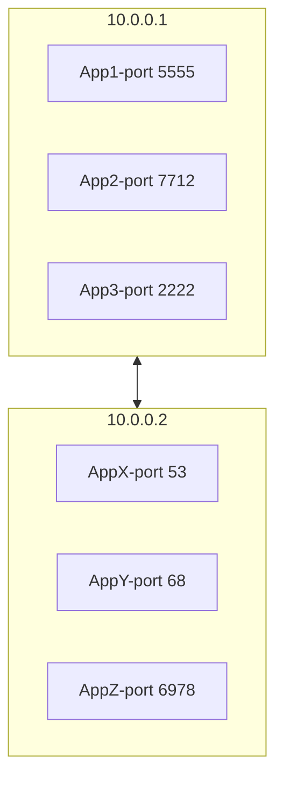
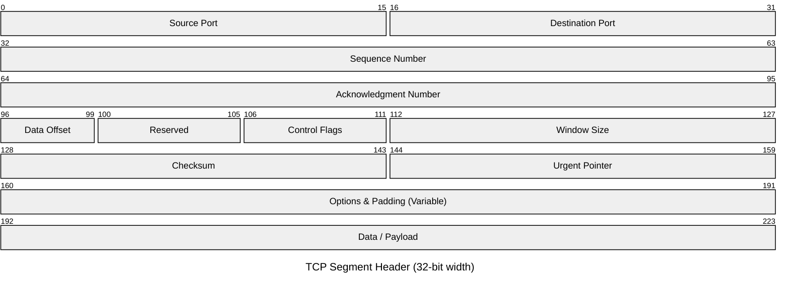

# TCP

* TCP is a stream of bytes, carved out into IP packets
* Stands for Transmission Control Protocol
* Layer 4 protocol
* Ability to address processes in a host using ports
* "Controls" the transmission unlike UDP which is a firehose
* Connection
  * Requires handshake
  * There is knowledge about the other end on each end.
  * Stateful
* 20 bytes headers Segment (can go to 60)

## Use cases

* Reliable communication
* Remote shell
* Database connections
* Web communications
* Any bidirectional communication


## Connection

* connection is a Layer 5 (session)
* connection is an agreement between client and server
  * it is a 3-way TCP handshake
* must create a connection to send data
  * it makes hard for TCP to be spoofed
* connection is identified by 4 properties
  * `SourceIP`-`SourcePort`
  * `DestinationIP`-`DestinationPort`
* connection sometimes is called "socket" or "file descriptor"
* segments are sequenced and ordered
* segments are acknowledged
* lost segments are retransmitted.

### Multiplexing an demultiplexing

* IP target hosts only
* Host run many apps each with different requirements
* Ports now identify the "app" or "process"
  * the traffic between the host and the apps is made by the operational systems.
* Sender multiplexes all its apps into TCP connections
* Receiver demultiplex TCP segments to each apps based on connection pairs



### Simulation

`App1` on `10.0.0.1` want to send data to `AppX` on `10.0.0.2`.

1) So we will make a three way handshake

   1) `App1` sends `SYN` to `AppX` to synchronous sequence numbers
   2) `AppX` sends `SYN/ACK` to synchronous its sequence number
   3) App1` sends `ACK` to `AppX
   4) So one file descriptor is created on each side, with content `10.0.0.1:55555:10.0.0.2:22`

2) They now can send data

   * The happy way is:

     1) `App1` sends data to `Appx`
     1) `App1` encapsulate the data in a segment and send it
     1) `AppX` acknowledges the segment
        * it means that `AppX` sends `ACK` to `App1`

        * it isn't the response, only the acknowledging of the segment arrivement.

   * `App1` can send new segment before `ack` of old segment arrives

     * but they are subject to the congestion control (by the routers) and to flow control (by the `10.0.0.2`)
     * `App2` can acknowledge multiple segments at once, because given a number `X`, `ACKX` will acknowledge the `X`th segment and all their predecessors.
       * for example `ACK3` acknowledges the segments `1`, `2` and `3`

   * When happens a segment loss:

     1) `App1` sends the segment `1`, `2` and `3`
     2) The segment `3` is lost midway, so only `1` and `2` arrives on `AppX`
     3) The `AppX` sends `ACK2`
     4) `APP1` resend the segment `3`
     5) The `AppX` sends `ACK3`

3) When the chat is over, it is time to close the connection

   * It is made by a four way handshake, lets suppose that `APP1` wants to close the connection:
     1. `App1` sends `FIN`
     2. `AppX` sends `ACK`
     3. `AppX` sends `FIN`
     4. `App1` sends `ACK`
   * Spoofing can let third parties shut down the connection in an unpleasant way, but it’s hard to do. 
   * In this case `AppX` can delete the file description, but `App1`have to wait for a time because it have to wait for any old segment that can come.
     * otherwise, is possible to establish a new connection with `AppX` and receive that old segments made a closed connection.

## Anatomy of the TCP segment



* TCP segment Header is 20 bytes and can go up to 60 bytes
* TCP segment slides into an IP packet as "data"
* Port are 16 bit (0 to 65535)
* Sequences, Acknowledgment, flow control and more.

The headers are:

* Bits 0–15: Source Port
* Bits 16–31: Destination Port
* Bits 32–63: Sequence number
  * as the sequence number is always increasing, it can run out. When it happens, the sequence number will circle (be 0 again).
* Bits 63-95: Acnowledgement number  (if ACK is set)
  * The header includes both a Sequence Number and an Acknowledgment Number, so you can send data along with an acknowledgment in the same segment
* Bits 96-100: Data offset
* Bits 101-104: Reserved (000)
* Bit 105-107: Congestion control system (we will talk more about it later)
  * Bit 105: NS
  * Bit 106: CWR
  * Bit 107: ECE
* Bit 108: URG
  * This segment is urgent
* Bit 109: ACK
  * I'm acnowledging a number
* Bit 110: PSH
  * you are pushing data
* Bit 111: RST
  * request the connection reset
* Bit 112: SYN
  * to start the handshake to open a conneciton 
* Bit 113: FIN
  * to start the handshake to close the conneciton 
* Bit 114-127: Windown Size
  * how much I can handle, by default 55KB
* Bit 128-144: Checksum
* Bit 145-159: Urgent pointer (if URG is set)
* Bit 160-480: Options (if data offset > 5. Padded at the end with "0" bits if necessary.) 

### Maximum Segment Size

* Segment Size depends the MTU of the network
* Usually 512 bytes can go up to 1460
* Default MTU in the Internet is 1500 (results in MSS 1460)
* Jumbo frames MTU goes to 9000 or more
* MSS can be larger in jumbo frames cases.


## Demo

```c
#include <stdio.h>
#include <stdlib.h>
#include <string.h>
#include <unistd.h>
#include <arpa/inet.h>

int main(){

  char *ip = "127.0.0.1";
  int port = 5566;

  int server_sock, client_sock;
  struct sockaddr_in server_addr, client_addr;
  socklen_t addr_size;
  char buffer[1024];
  int n;

  server_sock = socket(AF_INET, SOCK_STREAM, 0);
  if (server_sock < 0){
    perror("[-]Socket error");
    exit(1);
  }
  printf("[+]TCP server socket created.\n");

  memset(&server_addr, '\0', sizeof(server_addr));
  server_addr.sin_family = AF_INET;
  server_addr.sin_port = port;
  server_addr.sin_addr.s_addr = inet_addr(ip);

  n = bind(server_sock, (struct sockaddr*)&server_addr, sizeof(server_addr));
  if (n < 0){
    perror("[-]Bind error");
    exit(1);
  }
  printf("[+]Bind to the port number: %d\n", port);

  listen(server_sock, 5);
  printf("Listening...\n");

  while(1){
    addr_size = sizeof(client_addr);
    client_sock = accept(server_sock, (struct sockaddr*)&client_addr, &addr_size);
    printf("[+]Client connected.\n");

    bzero(buffer, 1024);
    recv(client_sock, buffer, sizeof(buffer), 0);
    printf("Client: %s\n", buffer);

    bzero(buffer, 1024);
    strcpy(buffer, "HI, THIS IS SERVER. HAVE A NICE DAY!!!");
    printf("Server: %s\n", buffer);
    send(client_sock, buffer, strlen(buffer), 0);

    close(client_sock);
    printf("[+]Client disconnected.\n\n");

  }

  return 0;
}
```

