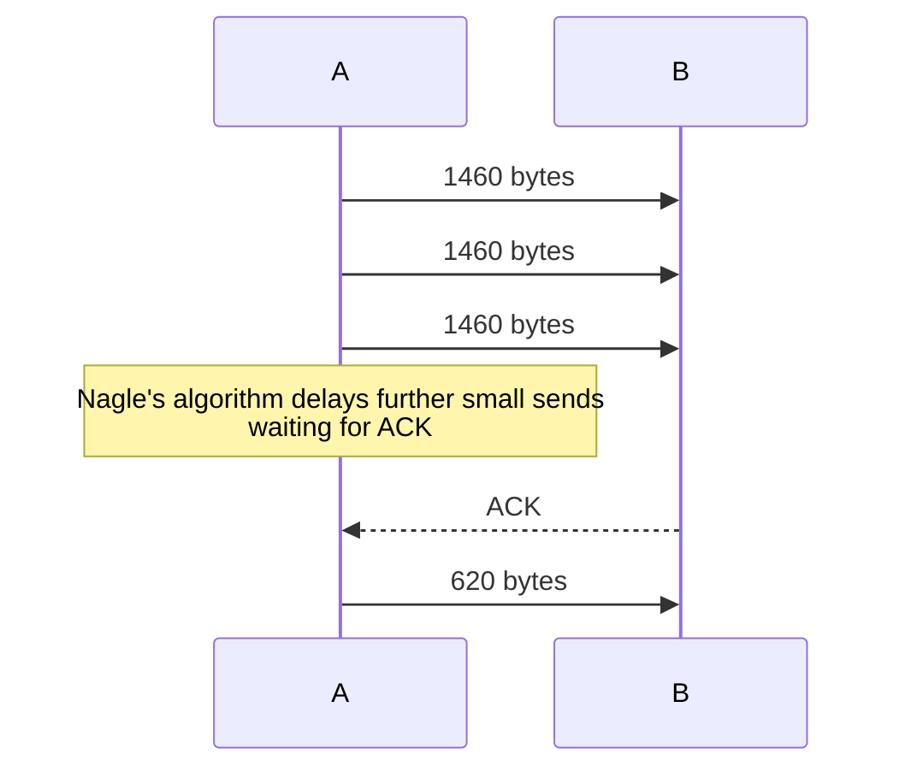

# Nagle's algorithm

* It can cause non-deterministic delays
* In the telnet day sending a single bytes in a segment is a waste
* Combine small segments and send them in a single one
* The client can wait for a full MSS before sending the segment
* No wasted 40 bytes header (IP + TCP) for few bytes of data.

## How it works

* Assume MSS = 1460, A sends 500 bytes
* 500 < 1460 client waits to fill the segment
* A send 1000 bytes, segment fills and send
* If there isn't anything to ACK data will be immediately sent.

## Problems

* Send large data causes delay
* A want to sent 5000 bytes on 1440 MSS
* 3 full segments of 1460 with and one with 620 bytes
* 4th segment is not sent
* 4th not full segment are only sent when an ACK is received

## Disabling Nagle's algorithm

* Most clients disable Nagle's algorithm

* I rather get performance than small banddwidth

* `TCP_NODELAY`

* Curl disabled this back in 2016 by default because TLS handshake was slowed down.

  >  After a few wasted hours hunting down the reason for slowness during a
  > TLS handshake that turned out to be because of `TCP_NODELAY` not being
  > set, I think we have enough motivation to toggle the default for this
  > option. We now enable `TCP_NODELAY` by default and allow applications to
  > switch it off.
  >
  > This also makes `--tcp-nodelay` unnecessary, but `--no-tcp-nodelay` can be
  > used to disable it.
  >
  > Thanks-to: Tim Rühsen
  > Bug: https://curl.haxx.se/mail/lib-2016-06/0143.html
