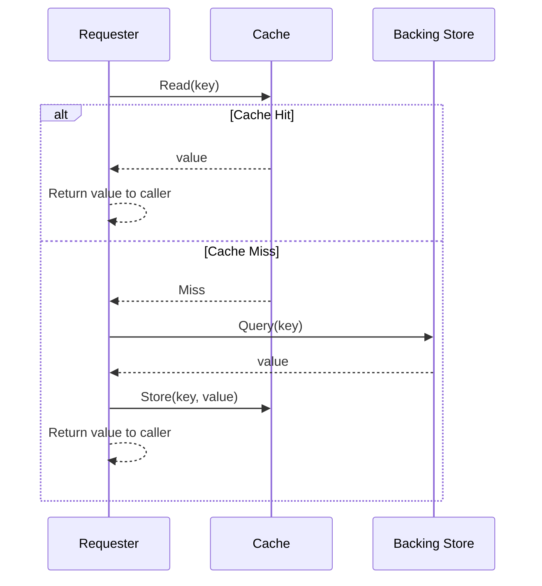
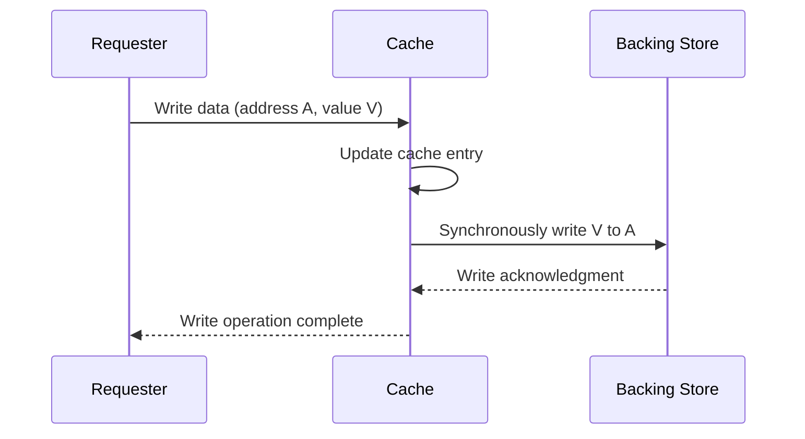
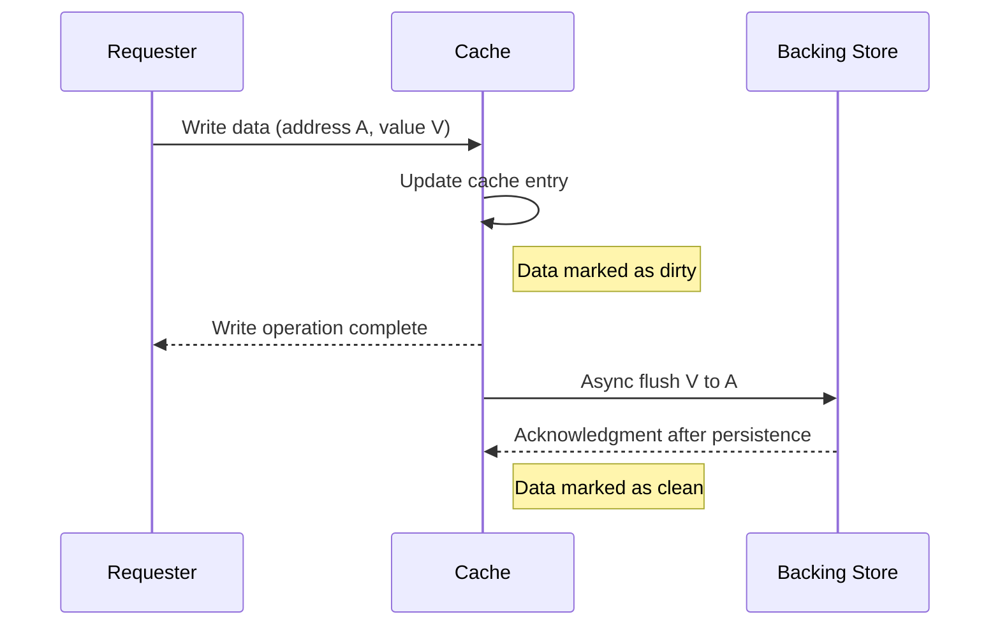
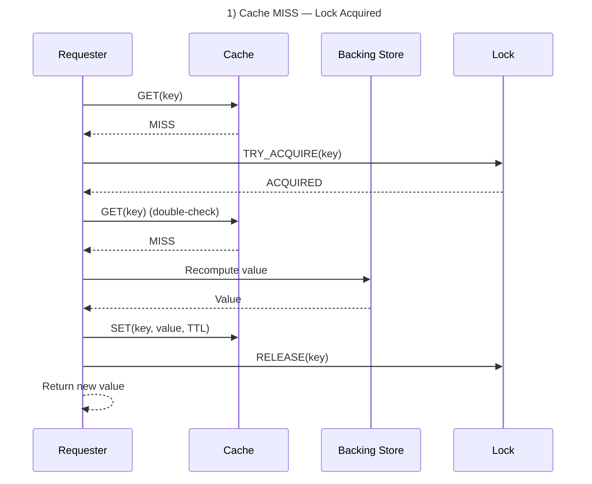
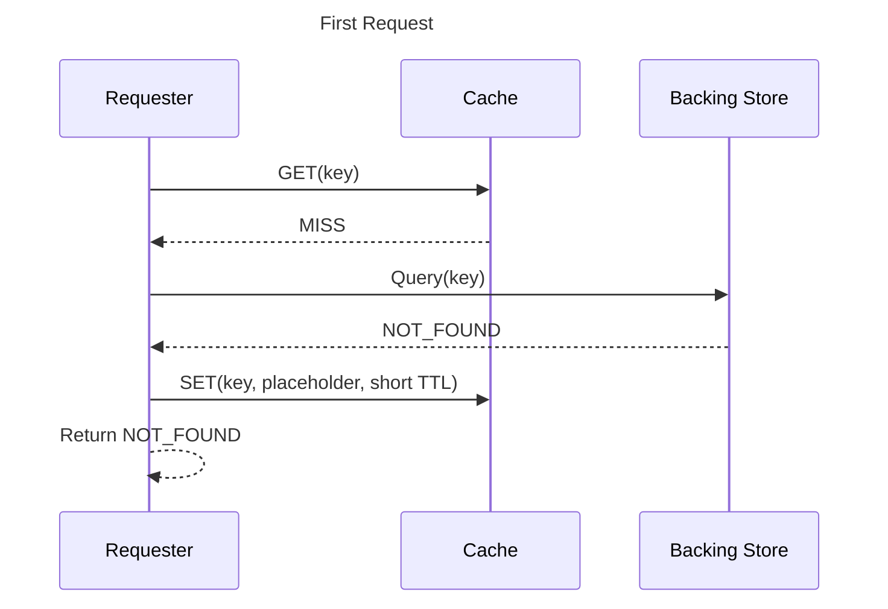
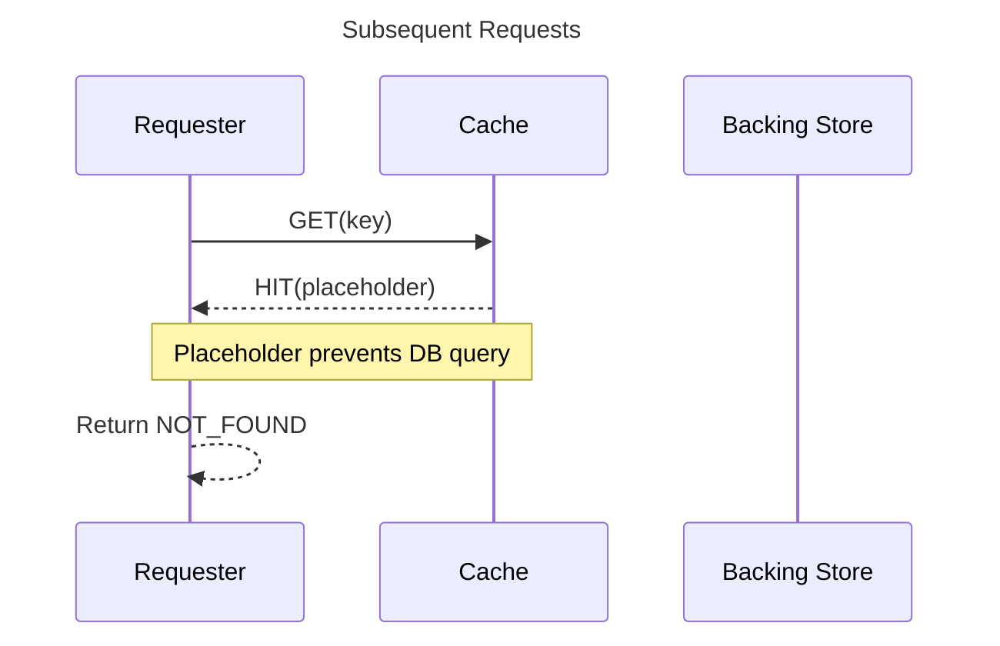

# Caching

It isn’t uncommon for an application to access a slow and costly data source repeatedly, which ends up making the whole system sluggish. A common solution is to introduce a temporary store that can be quickly and cheaply accessed, so the application fetch data from an authoritative data source less frequently. This technique is called caching. 

## Cache Types

### In-memory caching

Store the data in the computer’s RAM.

* useful for applications that require high-speed access to data, such as web servers and databases
* in-memory caching is volatile and the data stored in the RAM may be lost if the system is shut down or restarted.

### Distribuited cache

Distributed caching is a type of caching that involves storing data across multiple servers or nodes in a network.

* useful for applications that require high availability and scalability.
* allows multiple servers to share the workload of storing and retrieving data
  * improve the performance
  * reduce the risk of data loss
* managing a distributed caching system can be complex, and ensuring consistency across multiple nodes can be challenging.

### Client-side caching

Store data on the client’s device, such as a web browser.

* useful for web applications that require frequent access to static resources, such as images and JavaScript files
  * can significantly improve the performance of a web application by reducing the number of requests made to the server
* client-side caching can lead to issues with stale data, as the cached data may not always be up-to-date

## Cache Locality Models

Defines why data is expected to be reused.

### Spacial caching

When the system loads a block of data from disk, it also loads and caches adjacent blocks because nearby data is likely to be accessed soon. 

This relies on **spatial locality**, a property of many workloads where access patterns tend to touch data that is physically close on disk.

Spatial caching works on the idea of taking advantage of proximity: when you fetch one piece of data, you also bring in the nearby pieces because there’s a good chance you’ll need them next. This avoids repeated trips to storage and improves overall performance.

A similar situation happens when assembling furniture. Instead of walking back and forth to pick up each tool separately, you gather all the tools you’re likely to need in a single trip. Even if some aren’t used right away, having them close by saves time and avoids unnecessary effort.

Examples:

- Filesystems prefetching the next few blocks during sequential reads.
- Database storage engines reading multiple pages ahead.
- CPU cache lines bringing in neighboring memory bytes.

### Temporal caching

Temporal caching relies on the principle that recently accessed data is likely to be needed again in the near future. Systems keep this data in faster storage so repeated requests can be served quickly without returning to slower sources.

A practical analogy is keeping a tool you just used within arm’s reach while you continue a task. If you’re tightening several screws, you don’t put the screwdriver away after each one. You keep it close because you know you’ll probably use it again soon.

Examples

* **CPU caches (L1, L2, L3)**: Processors use several layers of cache to store recently accessed instructions and data.
  * They are
    * **L1 cache** is the smallest and fastest, located closest to the CPU cores.
    * **L2 cache** is larger but slightly slower.
    * **L3 cache** is even larger and shared across cores, with higher latency.
  * When the CPU needs data it used recently, it first checks L1, then L2, then L3 before going to main memory. Each cache hit avoids a much slower memory access, reducing the cycles per instruction (CPI).
*  **Operating system page caches**: The OS keeps recently read disk pages in memory so repeated reads can be served without touching the disk.
* **Database buffer pools**: Databases store recently accessed pages in RAM because queries often revisit the same tables, indexes, or frequently used rows.
* **Web caching.**
   Browsers and servers keep recently requested resources so repeat visits load quickly.

## Cache Strategies

### Cache-Aside

In this strategy, the application is responsible for managing the cache.

* When data is requested, the application checks the cache first. If the data is not in the cache, it is retrieved from the backing store and stored in the cache for future use.
* This strategy is simple and flexible, but it requires careful management of the cache to ensure that it remains up-to-date.



Where:

* **Cache hit**: The requested data is found in the cache.
* **Cache miss**: The requested data is not found in the cache and must be fetched from the underlying data store.

### Write-Through

Data is written to both the cache and the database synchronously.

* When data is updated, it is written to the cache and the database simultaneously.
* This ensures that the cache always contains up-to-date data, but it can slow down write operations.

Write-through is a cache write strategy where every write operation is immediately written to both the cache and the backing store



### Write-Behind

Data is written first on cache, and then to the database assynchronously

* This allows write operations to be faster, but it can lead to data inconsistencies if the cache is not properly managed.



### Read-Through

In this strategy, the cache is used as the primary data source.

* When data is requested, the cache is checked first.
* If the data is not in the cache, it is retrieved from the database and stored in the cache for future use.
* This strategy can be useful when the database is slow or when data is frequently read but rarely updated

````mermaid
sequenceDiagram
    participant Requester as Requester
    participant Cache as Cache
    participant BS as Backing Store

    Requester->>Cache: Read(key)

    alt Cache Hit
        Cache-->>Requester: value
    else Cache Miss
        Cache-->>Requester: Miss

        Cache->>BS: Fetch(key)
        BS-->>Cache: value

        Cache->>Cache: Store(key, value)

        Cache-->>Requester: value
    end
````


## Common Caching Pitfalls

### Cache Stampede

Because a caching layer is built to be fast, it usually handles a much heavier load than a backing store. Imagine a scenario where many requesters cache high-demand data in the caching layer. If that data were invalidated all at once, the requesters would flock to the backing store, which could be overwhelmed by the load and crash.

Strategies to prevent stampedes:

#### Locking

Before recomputing a key, the requester try to arquire a lock for that key, so only one requester read from database for that key.



For other requesters, there is many options:

1) Waiting for another requester to complete the computation and fill the cache

   ```mermaid
   sequenceDiagram
       title Cache MISS — Lock Not Acquired (Requester waits in retry loop)
   
       participant Requester as Requester
       participant Cache as Cache
       participant BS as Backing Store
       participant Lock as Lock
   
       Requester->>Cache: GET(key)
       Cache-->>Requester: MISS
   
       Requester->>Lock: TRY_ACQUIRE(key)
       Lock-->>Requester: NOT_ACQUIRED
   
       loop Wait until value is computed by another requester
           Requester-->>Requester: Wait briefly
           Requester->>Cache: GET(key) retry
           Cache-->>Requester: MISS
   
           Note over Requester: Other requester still computing
       end
   
       Requester->>Cache: GET(key) final check
       Cache-->>Requester: HIT(value)
   
       Requester-->>Requester: Return cached value
   ```

   2. The requester returns a not-found response, allowing the client to retry using a back-off strategy.

      ```mermaid
      sequenceDiagram
          title Cache MISS — Lock Not Acquired, upstream retries with back-off
      
          participant Client as Client
          participant Requester as Requester
          participant Cache as Cache
          participant BS as Backing Store
          participant Lock as Lock
      
          Client->>Requester: GET resource
          Requester->>Cache: GET(key)
          Cache-->>Requester: MISS
      
          Requester->>Lock: TRY_ACQUIRE(key)
          Lock-->>Requester: NOT_ACQUIRED
      
          Requester-->>Client: NOT_FOUND / 503 (retryable)
          Note over Client,Requester: Client applies back-off then retries later
      ```

   3. The requester can use the stale version of the value from its local cache.

      ```mermaid
      sequenceDiagram
          title Cache MISS — Lock Not Acquired, requester serves stale local value
      
          participant Client as Client
          participant Requester as Requester
          participant Cache as Cache
          participant LocalCache as Local Cache (stale)
          participant Lock as Lock
      
          Client->>Requester: GET resource
          Requester->>Cache: GET(key)
          Cache-->>Requester: MISS
      
          Requester->>Lock: TRY_ACQUIRE(key)
          Lock-->>Requester: NOT_ACQUIRED
      
          Note over Requester,Lock: Another requester is recomputing the fresh value
      
          Requester->>LocalCache: GET_STALE(key)
          LocalCache-->>Requester: STALE(value)
      
          Requester-->>Client: Return stale value
          Note over Client,Requester: Client receives slightly out-of-date data
      ```

### Probabilistic early expiration

Every time the requester reads the data from the cache, it has a chance to refresh it even before the TTL expires. The likelihood of this occurring increases as the expiration time approaches, statistically smoothing out the load and decreasing the likelihood of refresh spikes.

Classic formula (from Probabilistic Early Expiration papers):

On read, compute:

```
if now - t0 > TTL - beta * log(U)
```

* where:
  * `t0` is the time when value was cached.
  * `TTL` is the full, original time-to-live
  * `U` is a uniform random in (0, 1]
  * `beta` is a tuning parameter.
    * β controls how early the probabilistic refresh window begins.
    * Larger β widens this window and increases the chance of earlier refresh.
    * Smaller β narrows the window and makes early refresh rare.
    * As ballpark choices:
      * TTL / 3 → early and frequent refreshes → strong smoothing
      * TTL / 10 → moderate refreshes → balanced smoothing
      * TTL / 20 → very late refreshes → weak smoothing
* If the condition is true, you treat it as expired (trigger refresh). Otherwise, serve normally.
* Some systems as redis provides *remaining TTL* that can be used on the formula with some tweaks:

  ```
  now - t0 > TTL - beta * log(U)
  (now - t0) - TTL > - beta * log(U)
  remaining TTL < beta * log(U)
  ```

### Cache Penetration

It occurs when non-existent data is repeatedly requested, causing both the cache and the database to be queried unnecessarily and wasting resources

To avoid it, store a placeholder value for non-existent keys.

* Use a short TTL for these placeholders to prevent them from occupying cache space indefinitely. Without this, systems with many lookups for non-existent keys can accumulate large numbers of placeholder entries.



So, on subsequent requests:




### Bloom filter

Space-efficient probabilistic data structure for quickly checking if elements are in the set before query the databases.

* They can conclusively determine that a key does not exist, but they are inconclusive when indicating that a key might exist

How to use it

* When a new record is added to the backing store, its key is inserted into the Bloom filter.
* The requester can then consult the Bloom filter first; if the filter indicates that the key is definitely not present, the requester can skip both the cache and the database lookup, avoiding unnecessary work.
* If the Bloom filter indicates that the key might exist, the requester proceeds normally to check the cache and, if needed, the backing store.

### Cache crash

If cache layer crashes, every single request slam straight to the backing store, overhelming and crashing it.

* It can be worsen when users starts to obsessively refreshing the page.
* The solutions are the same for cache avalanche.

### Cache Avalanche

It can happen in two scenarios:

1) When a massive chunk of keys expires all at once
2) When cache restarts and losse all its data

So a large amount of queires hit the backing store all at once, overhelming and crashing it.

The difference between a cache stampede and a cache avalanche is that a stampede involves many requesters hitting the same key as it expires, while an avalanche occurs when many keys expire simultaneously, overwhelming the backend

To avoid it:

* Circuit breaker on the backing store and redis
* Increase the cache layer availability with redundancy.
* Cache prewarming: the requester proactively populate the cache after a cold start.

## Factors to Consider When Deciding Whether to Cache Data

* **change frequency**: assess how often data updates and whether changes are predictable or bursty
* **time sensitivity**: define how fresh the data must be and the acceptable staleness window
* **security**: determine access controls, encryption needs, and exposure risks in shared environments
* **data size and storage cost**: evaluate whether storing the payload is practical and cost-effective
* **consistency requirements**: identify whether stale reads are acceptable or strong guarantees are needed
* **invalidation strategy**: decide how and when cached entries will be refreshed or removed
* **access patterns**: examine read/write ratios and request predictability to gauge caching effectiveness
* **scalability impact**: estimate how much caching will reduce upstream load and improve throughput
* **locality**: consider whether placing cache closer to consumers meaningfully reduces latency
* **concurrency and failure behavior**: plan for cache stampedes, misses, and cache unavailability
