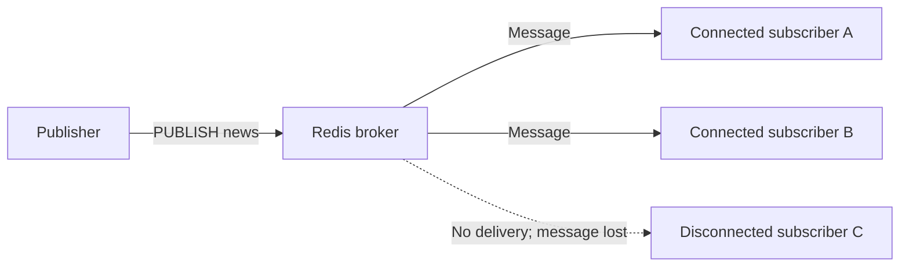

# Publish/Subscribe

Redis Pub/Sub uses Redis as a lightweight message broker between publishers and subscribers. Publishers send messages to named channels, and Redis pushes each message to clients subscribed to the channel. Neither side needs to know the other clients.

- **Channels:** Named topics that route messages; no channel declaration is required before a client publishes or subscribes.
- **Publishers:** Clients use `PUBLISH` to send a payload to a channel.
- **Subscribers:** Clients use `SUBSCRIBE` to receive messages pushed to them while their subscription remains active.

## Delivery model

Pub/Sub is *fire and forget*: Redis does not persist or queue published messages for disconnected clients. A client that is offline when a message is published cannot retrieve that message from Pub/Sub later. Unlike Redis Streams or RabbitMQ, this model provides no message history or acknowledgement mechanism by default.



Typical uses include:

- Real-time notifications, such as chat messages or sports scores.
- Inter-service communication.
- Live configuration updates.

## Publishing and subscribing

### `PUBLISH`

`PUBLISH` sends a message to a channel for immediate delivery to its connected subscribers. If no client is subscribed, the message is discarded; publishing does not require the channel to exist beforehand.

- **Cost:** O(N + M), where N is the number of direct subscribers to the channel and M is the number of subscribed patterns matching that channel.
- **Reply:** An integer reporting the number of clients that received the message.

```sh
redis> PUBLISH internal_logs "backup_started"
(integer) 0

redis> PUBLISH notifications "new_user_signup"
(integer) 1

redis> PUBLISH chat_room_general "hello everyone"
(integer) 42
```

### `SUBSCRIBE`

`SUBSCRIBE` registers a client for one or more specific channels. The connection then receives pushed messages as they arrive and enters subscriber mode, in which it generally accepts only Pub/Sub-related commands such as `SUBSCRIBE`, `UNSUBSCRIBE`, `PING`, and `QUIT`. Subscribing to a channel requires no prior declaration of that channel.

- **Cost:** O(N), where N is the number of channels being subscribed to.
- **Confirmation:** A three-element reply containing `"subscribe"`, the channel name, and the current number of channels the client is subscribed to.
- **Message:** An asynchronous three-element reply containing `"message"`, the channel name, and the payload.

```sh
redis> SUBSCRIBE system_alerts
1) "subscribe"
2) "system_alerts"
3) (integer) 1
1) "message"
2) "system_alerts"
3) "disk_space_low"

redis> SUBSCRIBE news sports
1) "subscribe"
2) "news"
3) (integer) 2
1) "subscribe"
2) "sports"
3) (integer) 3
```

### `UNSUBSCRIBE`

`UNSUBSCRIBE` removes the specified channel subscriptions, or all of the client's channel subscriptions when called without arguments. When the client's subscription count reaches zero, it leaves subscriber mode and returns to standard command mode.

- **Cost:** O(N), where N is the number of channels being unsubscribed from.
- **Reply:** A three-element reply containing `"unsubscribe"`, the channel name, and the remaining subscription count.

```sh
redis> SUBSCRIBE news sports weather
1) "subscribe"
2) "news"
3) (integer) 1
1) "subscribe"
2) "sports"
3) (integer) 2
1) "subscribe"
2) "weather"
3) (integer) 3

redis> UNSUBSCRIBE sports
1) "unsubscribe"
2) "sports"
3) (integer) 2

redis> UNSUBSCRIBE
1) "unsubscribe"
2) "news"
3) (integer) 1
1) "unsubscribe"
2) "weather"
3) (integer) 0
```

## Pattern subscriptions

### `PSUBSCRIBE`

`PSUBSCRIBE` registers a glob-style pattern instead of a specific channel name, allowing a client to receive messages from channels whose names match the pattern without listing them individually. Supported forms include `*` for any character sequence, `?` for one character, and `[abc]` for one character from the bracketed set.

Pattern deliveries are distinct from direct-channel deliveries: they include the matching pattern as well as the channel and payload.

- **Cost:** O(N), where N is the number of patterns being subscribed to.
- **Confirmation:** A three-element reply containing `"psubscribe"`, the pattern, and the client's current pattern-subscription count.
- **Message:** An asynchronous four-element reply containing `"pmessage"`, the matching pattern, the specific channel name, and the payload.

```sh
redis> PSUBSCRIBE news.*
1) "psubscribe"
2) "news.*"
3) (integer) 1
1) "pmessage"
2) "news.*"
3) "news.tech"
4) "redis_version_7_released"

redis> PSUBSCRIBE logs.[ew]*
1) "psubscribe"
2) "logs.[ew]*"
3) (integer) 2
1) "pmessage"
2) "logs.[ew]*"
3) "logs.error"
4) "connection_timeout"
```

### `PUNSUBSCRIBE`

`PUNSUBSCRIBE` removes specific subscribed patterns, or all of the client's pattern subscriptions when called without arguments. If no channel or pattern subscriptions remain, the client leaves subscriber mode.

- **Cost:** O(N + M), where N is the number of patterns being unsubscribed from and M is the total number of patterns subscribed by the client.
- **Reply:** A three-element reply containing `"punsubscribe"`, the pattern, and the remaining subscription count.

```sh
redis> PSUBSCRIBE news.* logs.?
1) "psubscribe"
2) "news.*"
3) (integer) 1
1) "psubscribe"
2) "logs.?"
3) (integer) 2

redis> PUNSUBSCRIBE news.*
1) "punsubscribe"
2) "news.*"
3) (integer) 1
```

## Inspecting Pub/Sub state

### `PUBSUB CHANNELS`

`PUBSUB CHANNELS [pattern]` lists active channel names, optionally filtered by a glob-style pattern such as `sys.*`. An active channel has at least one connected direct subscriber; pattern subscriptions do not make a channel appear in this list. The client issuing the command is not included in the calculation.

- **Cost:** O(N), where N is the number of active channels.
- **Reply:** An array of active channel names.

```sh
redis> PUBSUB CHANNELS
1) "notifications"
2) "events:login"

redis> PUBSUB CHANNELS events:*
1) "events:login"
```

### `PUBSUB NUMSUB`

`PUBSUB NUMSUB [channel ...]` reports the number of direct `SUBSCRIBE` clients for each requested channel. Pattern subscriptions are excluded, and a channel without listeners has a count of `0`. The command requires one or more channel names.

- **Cost:** O(N), where N is the number of requested channels.
- **Reply:** Alternating channel names and subscriber counts.

```sh
redis> PUBSUB NUMSUB notifications nonexistent_channel
1) "notifications"
2) (integer) 5
3) "nonexistent_channel"
4) (integer) 0
```

### `PUBSUB NUMPAT`

`PUBSUB NUMPAT` reports the server-wide number of unique active subscribed patterns without listing their names.

- **Cost:** O(1).
- **Reply:** An integer pattern-subscription count.

```sh
redis> PUBSUB NUMPAT
(integer) 2
```

## Publisher and subscriber interaction

A subscriber first registers for `events`. Its connection remains in listening mode, so subsequent message replies arrive asynchronously:

```sh
redis[1]> SUBSCRIBE events
1) "subscribe"
2) "events"
3) (integer) 1
1) "message"
2) "events"
3) "system_start"
1) "message"
2) "events"
3) "user_login"
```

A second client publishes the two messages. Each integer reply reports one recipient, corresponding to the connected subscriber:

```sh
redis[2]> PUBLISH events "system_start"
(integer) 1

redis[2]> PUBLISH events "user_login"
(integer) 1
```
