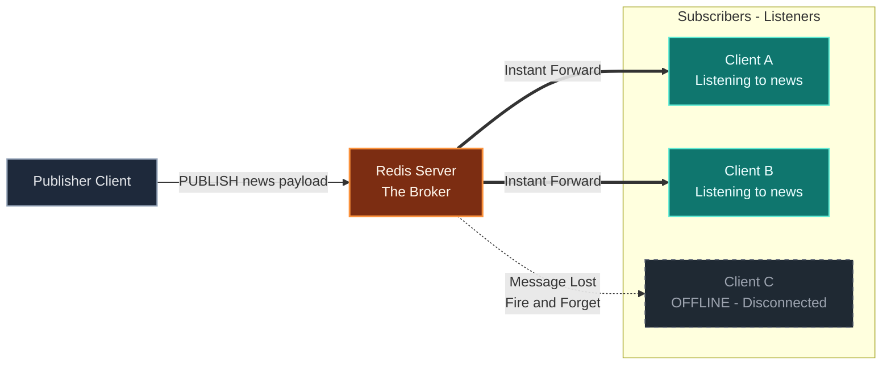

# Publish/Subscribe

Redis functions as a lightweight **Message Broker** that decouples message senders from receivers. It implements the Publish/Subscribe messaging paradigm.



**Mechanism**

- **Channels:** Messages are routed via named channels (topics).
- **PUBLISH:** Clients push messages to a specific channel.
- **SUBSCRIBE:** Clients listen to a channel to receive messages instantly.

**Delivery Model: "Fire and Forget"**

- This is the defining characteristic of Redis Pub/Sub.
- Messages are **not persisted**.
- If a subscriber is not connected at the exact moment a message is published, that message is **lost forever** to that client.
- *Contrast:* Unlike `Redis Streams` or `RabbitMQ`, there is no history or acknowledgement mechanism by default.

## **Use Cases**

- Real-time notifications (chat, sports scores).
- Inter-service communication (microservices).
- Live config updates.

## Commands

### Broadcasting Messages with `PUBLISH`

- **Function:** specific channel, triggering an immediate broadcast to all listening clients.
- **Behavior:**
  - Operates on a **Fire-and-Forget** model: messages are delivered to connected subscribers but are not persisted or queued.
  - If no clients are currently subscribed to the channel, the message is discarded.
  - Channels are **implicit**; they are created automatically when a message is published or a client subscribes.
- **Performance:** **O(N+M)**, where *N* is the number of direct subscribers to the channel and *M* is the number of patterns (via `PSUBSCRIBE`) matching the channel.
- **Return Value:** (Integer) The number of clients that received the message.

Plaintext

```
redis> PUBLISH internal_logs "backup_started"
(integer) 0

redis> PUBLISH notifications "new_user_signup"
(integer) 1

redis> PUBLISH chat_room_general "hello everyone"
(integer) 42
```

### Subscribing to Channels with `SUBSCRIBE`

- **Function:** Subscribes the client to one or more specific channels to receive messages.
- **Behavior:**
  - Switches the client into **Subscriber Mode**. Once subscribed, the client can generally only issue Pub/Sub related commands (e.g., `SUBSCRIBE`, `UNSUBSCRIBE`, `PING`, `QUIT`).
  - The connection becomes "push" based; Redis actively sends messages to the client as they arrive on the channel.
  - Channels are **implicit**; subscribing to a non-existent channel creates a listening state for it immediately.
- **Performance:** **O(N)**, where *N* is the number of channels to subscribe to.
- **Return Value:**
  - **Immediate:** A confirmation array containing the string `"subscribe"`, the channel name, and the current number of channels the client is subscribed to.
  - **Async:** A three-element array for every published message containing `"message"`, the channel name, and the message payload.

Plaintext

```
redis> SUBSCRIBE system_alerts
1) "subscribe"
2) "system_alerts"
3) (integer) 1

1) "message"
2) "system_alerts"
3) "disk_space_low"

redis> SUBSCRIBE news sports
1) "subscribe"
2) "news"
3) (integer) 2
1) "subscribe"
2) "sports"
3) (integer) 3
```

### Stopping Subscriptions with `UNSUBSCRIBE`

* **Function:** Unsubscribes the client from specific channels or all channels if no argument is provided.
* **Behavior:**
* If specific channels are provided, the client stops listening to those channels.
* If **no arguments** are provided, the client unsubscribes from **all** currently subscribed channels.
* If the number of subscriptions drops to zero, the client exits **Subscriber Mode** and returns to standard command mode.


* **Performance:** **O(N)**, where *N* is the number of channels to unsubscribe from.
* **Return Value:** An array containing the string `"unsubscribe"`, the channel name, and the remaining number of subscriptions.

```text
redis> SUBSCRIBE news sports weather
1) "subscribe"
2) "news"
3) (integer) 1
1) "subscribe"
2) "sports"
3) (integer) 2
1) "subscribe"
2) "weather"
3) (integer) 3

redis> UNSUBSCRIBE sports
1) "unsubscribe"
2) "sports"
3) (integer) 2

redis> UNSUBSCRIBE
1) "unsubscribe"
2) "news"
3) (integer) 1
1) "unsubscribe"
2) "weather"
3) (integer) 0

```

### Pattern-Matching Subscriptions with `PSUBSCRIBE`

* **Function:** Subscribes the client to all channels that match a specific glob-style pattern.
* **Behavior:**
* Allows clients to listen to multiple channels without knowing their exact names in advance.
* Supports standard glob patterns:
* `*` matches any sequence of characters.
* `?` matches exactly one character.
* `[abc]` matches any character inside the brackets.


* Messages received via pattern subscription are distinct from standard messages; they include the pattern that matched.


* **Performance:** **O(N)**, where *N* is the number of patterns to subscribe to.
* **Return Value:**
* **Immediate:** An array containing the string `"psubscribe"`, the pattern name, and the current number of pattern subscriptions.
* **Async:** A four-element array for every matched message containing `"pmessage"`, the original pattern, the specific channel name, and the message payload.

```text
redis> PSUBSCRIBE news.*
1) "psubscribe"
2) "news.*"
3) (integer) 1

1) "pmessage"
2) "news.*"
3) "news.tech"
4) "redis_version_7_released"

redis> PSUBSCRIBE logs.[error|warn]
1) "psubscribe"
2) "logs.[error|warn]"
3) (integer) 2

1) "pmessage"
2) "logs.[error|warn]"
3) "logs.error"
4) "connection_timeout"
```

### Introspecting Pub/Sub State with `PUBSUB`

#### Listing Active Channels with `PUBSUB CHANNELS`

- **Function:** Lists the currently active channels (channels with one or more subscribers).
- **Behavior:**
  - "Active" is defined as having at least one connected subscriber.
  - Does not include clients subscribed via patterns (`PSUBSCRIBE`).
  - Does not include the client sending the command in the calculation.
- **Options/Arguments:**
  - `[pattern]` (Optional): A glob-style pattern to filter the channel names (e.g., `sys.*`). If omitted, lists all active channels.
- **Performance:** **O(N)**, where *N* is the number of active channels.
- **Return Value:** An array list of active channel names.

Plaintext

```
redis> PUBSUB CHANNELS
1) "notifications"
2) "events:login"

redis> PUBSUB CHANNELS events:*
1) "events:login"
```

#### Counting Subscribers with `PUBSUB NUMSUB`

- **Function:** Returns the number of subscribers for the specified channels.
- **Behavior:**
  - Counts only direct subscribers (via `SUBSCRIBE`).
  - Does not include pattern subscriptions.
  - Returns `0` for channels with no listeners.
- **Options/Arguments:**
  - `[channel ...]` (Required): One or more specific channel names to query.
- **Performance:** **O(N)**, where *N* is the number of requested channels.
- **Return Value:** An array containing alternating channel names and their subscriber counts.

Plaintext

```
redis> PUBSUB NUMSUB notifications nonexistent_channel
1) "notifications"
2) (integer) 5
3) "nonexistent_channel"
4) (integer) 0
```

#### Counting Pattern Subscriptions with `PUBSUB NUMPAT`

- **Function:** Returns the total number of unique patterns currently subscribed to on the server.
- **Behavior:**
  - This provides a global count of all active `PSUBSCRIBE` patterns across all clients.
  - It does not list the actual patterns, only the count.
- **Performance:** **O(1)**.
- **Return Value:** An integer representing the total count of pattern subscriptions.

Plaintext

```
redis> PUBSUB NUMPAT
(integer) 2
```

### Unsubscribing from Patterns with `PUNSUBSCRIBE`

- **Function:** Unsubscribes the client from specific glob-style patterns previously subscribed to via `PSUBSCRIBE`.
- **Behavior:**
  - If specific patterns are provided, the client stops listening to those matches.
  - If **no arguments** are provided, the client unsubscribes from **all** currently subscribed patterns.
  - If the client has no remaining channel or pattern subscriptions, it exits **Subscriber Mode**.
- **Performance:** **O(N+M)**, where *N* is the number of patterns to unsubscribe from and *M* is the number of total patterns subscribed by the client.
- **Return Value:** An array containing the string `"punsubscribe"`, the pattern name, and the remaining number of subscriptions.

Plaintext

```
redis> PSUBSCRIBE news.* logs.?
1) "psubscribe"
2) "news.*"
3) (integer) 1
1) "psubscribe"
2) "logs.?"
3) (integer) 2

redis> PUNSUBSCRIBE news.*
1) "punsubscribe"
2) "news.*"
3) (integer) 1
```

## Demostration

**Console 1: The Subscriber**

First, the client subscribes to the channel. Note that once the `SUBSCRIBE` command is issued, this client enters a listening state. The subsequent outputs appear asynchronously as they are sent by the publisher.

```
redis[1]> SUBSCRIBE events
1) "subscribe"
2) "events"
3) (integer) 1

1) "message"
2) "events"
3) "system_start"

1) "message"
2) "events"
3) "user_login"
```

**Console 2: The Publisher**

In a separate terminal, the publisher sends messages to the `events` channel. The integer output `(integer) 1` confirms that one client (Console 1) successfully received the message.

```
redis[2]> PUBLISH events "system_start"
(integer) 1

redis[2]> PUBLISH events "user_login"
(integer) 1
```

