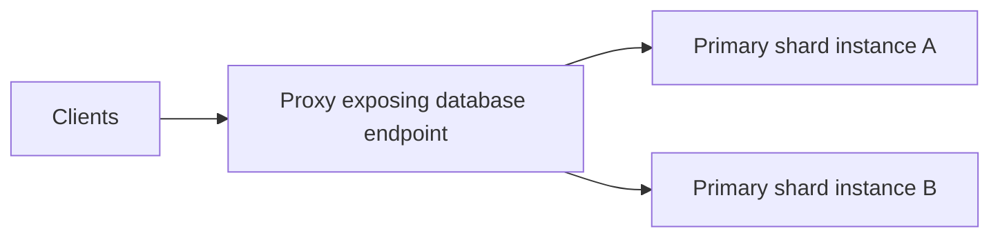

# Distributed Redis

Distributed Redis spreads a dataset and its requests across Redis processes instead of requiring one process to hold and serve everything. Ordinary [command execution on the main thread](Internals.md#Thread%20topology) makes a single process a unit of execution capacity; distributing independent key partitions lets multiple processes use additional CPU cores and memory. Sharding introduces routing and coordination costs rather than turning one command into parallel work across all servers. [Redis Software database clustering](https://redis.io/docs/latest/operate/rs/databases/durability-ha/clustering/).

Two mechanisms solve different problems:

- **Sharding:** Divides the keyspace into partitions, each served by a primary. It distributes data and command work rather than copying the entire dataset everywhere.
- **Replication:** Copies a primary's data to replicas. A replica supplies a replacement after failure; it is not another independent partition of the keyspace.

A distributed deployment therefore needs both a way to locate the partition containing a key and a way to replace unavailable primaries. Redis Open Source Cluster is a built-in clustering mode; Redis Software is a commercial product with a different clustering architecture.

## Redis Open Source Cluster

Redis Open Source Cluster is the built-in clustering mode of Redis Open Source, not a separate product. Multiple Redis servers cooperate to partition a dataset and provide failover when replicas are configured. [Redis Cluster overview](https://redis.io/docs/latest/operate/oss_and_stack/management/scaling/).

### Partitioning and key locality

Redis Open Source Cluster divides the keyspace into **16,384 hash slots**. CRC16 hashing maps a key to a slot; each primary owns a subset of slots. Adding a server does not itself redistribute existing keys: slots and their keys must move to change the distribution. [Redis Cluster scaling](https://redis.io/docs/latest/operate/oss_and_stack/management/scaling/).

- **Hash tags:** A hash tag is a portion of a key name that Redis hashes instead of the entire key to determine its slot.
    - Redis uses the text between the first `{` and the first `}` after it only when that text is nonempty.
    - Thus `order:{42}:items` and `order:{42}:status` both hash `42` and share a slot. With `order:{}:items`, the braces are empty, so Redis hashes the whole key; it does not search for a later pair of braces. [Redis Cluster hash-tag rules](https://redis.io/docs/latest/operate/oss_and_stack/reference/cluster-spec/#hash-tags).
- **Multi-key locality:** Multi-key commands, transactions, and scripts that access multiple keys require those keys to share a slot. Co-locating related keys supports these operations, but concentrates their load on the same partition.
- **Database namespace:** Cluster supports only database `0`; `SELECT` is not allowed. Numbered logical databases are not independent distributed databases. [Redis Cluster specification](https://redis.io/docs/latest/operate/oss_and_stack/reference/cluster-spec/).

### Slot migration and client routing

**Resharding** changes which primary owns a hash slot by migrating the slot's keys from a source node to a destination node.
- This redistributes data when the cluster's capacity or load changes; adding a node alone does not move slots.
- During migration, the source remains the slot's owner while keys already moved reside at the destination, so a slot's keys can temporarily be on both nodes. After migration, ownership changes to the destination.

A cluster-aware client maintains a slot-to-node map and sends commands directly to the relevant node. A stale map or an in-progress migration produces redirects:

- **`MOVED`:** Identifies the current slot owner. The client corrects its routing information for subsequent requests.
- **`ASK`:** Temporarily directs the request to another node during migration. The client sends `ASKING` before retrying there, without treating that destination as a permanent slot-owner change. [Redis Cluster specification](https://redis.io/docs/latest/operate/oss_and_stack/reference/cluster-spec/).

Clients must handle redirection and, for affected operations, retryable errors; online migration does not mean every request proceeds without interruption. [Redis Cluster scaling](https://redis.io/docs/latest/operate/oss_and_stack/management/scaling/).

### Inter-node coordination

Cluster nodes coordinate through the **[cluster bus](Internals.md#Inter-instance%20communication)**, a binary protocol over persistent TCP links connecting every node to every other node. Each node exposes a bus port separate from its client/data port. The bus carries cluster coordination, not the primary-to-replica dataset stream; replication uses a separate connection to the primary's data port.

Heartbeat messages check reachability and carry **gossip**: a node shares its observations of other nodes so membership and failure information spread beyond direct observations. Configuration updates propagate slot ownership and primary-role changes, allowing nodes to converge on routing information.

Failure detection distinguishes two states:

- **`PFAIL` (possible failure):** A node's local suspicion after another node fails to respond within the configured timeout. This alone does not authorize promotion.
- **`FAIL`:** A failure declaration based on recent reports from a majority of primaries, propagated to other nodes.

For automatic failover, an eligible replica of a failed primary requests authorization over the bus and needs votes from a majority of primaries before promoting itself. The new primary then advertises its slot ownership. [Redis Cluster specification](https://redis.io/docs/latest/operate/oss_and_stack/reference/cluster-spec/).

### Replication, failover, and write loss

When replicas are configured, each follows a primary's partition through these replication phases:

- **Initial synchronization:** A replica receives a copy of the dataset, followed by changes made during that transfer.
- **Ongoing replication:** While connected, the primary streams subsequent dataset changes—including client writes, expirations, and evictions—and the replica applies them and reports its replication offset.
- **Reconnection:** If the connection breaks, the replica tries to resume from the missed part of the stream; when that history is unavailable, it needs a full resynchronization. [Redis replication](https://redis.io/docs/latest/operate/oss_and_stack/management/replication/).

Cluster clients normally read from the primary that owns a key's slot. A client can instead connect to that primary's replica and issue `READONLY` on the connection to read keys in those slots; writes still go to the primary. Because the replica follows asynchronously, its reply can be [stale](../../Databases/Fundamentals/03%20Read%20Consistency.md#Propagation%20and%20Eventual%20Consistency), including immediately after a write to the primary. [Redis Cluster replica reads](https://redis.io/docs/latest/operate/oss_and_stack/reference/cluster-spec/#scaling-reads-using-replica-nodes) · [`READONLY`](https://redis.io/docs/latest/commands/readonly/).

The lag follows from asynchronous replication: the primary normally acknowledges a client write without waiting for replicas to process it. If the primary fails, an eligible replica is promoted through the cluster's failover mechanism, but promotion does not guarantee that it received every acknowledged write. A write acknowledged before the replica receives it can therefore be lost if the primary fails in that interval. [Redis replication](https://redis.io/docs/latest/operate/oss_and_stack/management/replication/).

`WAIT` requests acknowledgements from replicas for prior writes on the connection. It reduces exposure to write loss but does not make Redis strongly consistent or guarantee zero loss during failover. [Redis replication](https://redis.io/docs/latest/operate/oss_and_stack/management/replication/).

> [!example] Waiting for a replica acknowledgement
> On the same connection to the primary, write a value and then wait up to 1,000 milliseconds for at least one replica to acknowledge it:
>
> ```redis
> SET order:123 "paid"
> WAIT 1 1000
> ```
>
> `WAIT` returns the number of replicas that acknowledged the preceding writes on that connection. Check that the result is at least `1`; a result of `0` means the acknowledgement target was not reached before timeout, not that the write was undone. [Redis `WAIT`](https://redis.io/docs/latest/commands/wait/).

In a network partition, the minority side stops accepting writes after failure detection. Continued service on the majority side depends on having usable primaries or promotable replicas for the required slots; merely having several servers is insufficient. [Redis Cluster specification](https://redis.io/docs/latest/operate/oss_and_stack/reference/cluster-spec/).

## Redis Software

Redis Software is Redis's commercial, self-managed product, also known as Redis Enterprise Software. It builds on Redis Open Source with a management layer that hosts multiple databases across a pool of nodes and manages their shards, replication, failover, and endpoints. It is not simply Open Source Cluster with additional management tools. [Redis Software overview](https://redis.io/docs/latest/operate/rs/installing-upgrading/move-from-open-source/).

Its **cluster of infrastructure nodes** and an individual **sharded database** are distinct: several databases share the cluster, and each database has its own shard layout. This enables resource pooling and multi-tenancy without requiring a separate infrastructure cluster for every database. [Redis Enterprise for Kubernetes architecture](https://redis.io/docs/latest/operate/kubernetes/architecture/).

### Instances, databases, nodes, and clusters

The components form two related hierarchies: a database consists of shard processes, while a cluster consists of nodes that host those processes.

- **Redis instance and shard:** An instance is a Redis process. A shard is a portion of a database's data served by an instance; Redis Software also calls the serving process a shard, whether it has a primary or replica role. Calling an instance “single-threaded” describes predominantly main-threaded ordinary command execution, not a process with no other threads. Each shard process resides on one node; a node hosts multiple shards.
- **Database:** The managed dataset exposed to an application. An unsharded database has one primary shard; a sharded database distributes its keyspace among several primaries. Replication adds replica shards rather than additional keyspace partitions.
- **Node:** A physical machine, virtual machine, container, or cloud instance participating in the Redis Software cluster. It hosts shards and supporting services, rather than representing exactly one database.
- **Cluster:** The cooperating set of nodes and management services that place and manage database shards across the resource pool. [Redis Software terminology](https://redis.io/docs/latest/operate/rs/references/terminology/).

> [!important] Product-specific database meaning
> A Redis Software database is a managed database with its own endpoint and shard configuration. Do not equate it with a numbered logical database selected inside a standalone Redis process, or assume that Redis Open Source Cluster hosts multiple such managed databases.

### Shard independence and resource pooling

Redis Software's **shared-nothing** architecture separates shard command execution from cluster management: each shard processes its database partition without coordinating cluster placement or failover, while the cluster manager handles those tasks. The architecture is **symmetric** in that nodes contain the same kinds of components, including shards, proxies, and cluster-management processes; it does not require identical data or shard roles on every node. [Redis Enterprise cluster architecture](https://redis.io/glossary/redis-enterprise-cluster-architecture/) · [Redis Software terminology](https://redis.io/docs/latest/operate/rs/references/terminology/).

This separation lets the cluster place shards from multiple managed databases across its nodes:

- **Workload separation:** An application, tenant, or microservice can have a distinct database and endpoint without requiring a dedicated infrastructure cluster.
- **Resource pooling:** A node hosts multiple shards, potentially from different databases, so workloads share infrastructure capacity. Utilization depends on their demand and the chosen shard placement; sharing a node does not give each workload exclusive CPU or memory.
- **Rebalancing:** The cluster can move individual shards between nodes to change resource placement without moving a whole database as one unit. Changing the number of partitions is a separate resharding operation. [Redis Software memory and performance](https://redis.io/docs/latest/operate/rs/databases/memory-performance/) · [Redis Software shard migration](https://redis.io/docs/latest/operate/rs/databases/migrate-shards/).

Separate shard processes and databases do not by themselves guarantee isolation from resource contention. Failure protection instead depends on replication and placement of a primary and its replica on separate nodes.

### Routing and availability

An application connects to a database's **endpoint**, the client-facing address and port exposed by a proxy. The endpoint is not a separate service or network hop: the proxy receives the connection and routes each operation to the primary shard instance responsible for its key:



Resharding changes the proxy's routing to shard instances, not the endpoint clients use. Clients therefore do not need to change their connection target or implement direct shard routing as in Open Source Cluster. The stable endpoint does not remove the underlying partitioning or make every cross-shard operation valid. [Redis Software database clustering](https://redis.io/docs/latest/operate/rs/databases/durability-ha/clustering/).

**Intra-database replication** provides high availability (HA) by maintaining replica shards within a database:

- **Node placement:** Primary and replica shards reside on separate nodes.
- **Failover:** When a primary fails, Redis Software promotes its replica and updates routing.
- **Rack-zone protection:** With rack-zone awareness configured, placement across distinct racks or zones additionally protects against a shared rack or zone failure.
- **Application reads:** Unlike Open Source Cluster, Redis Software does not serve application reads from replica shards; the proxy routes reads to primary shards. [Replica-shard read behavior](https://redis.io/faq/doc/1oc8qbinn7/do-replicas-apply-eviction-policies-if-maxmemory-is-set).

These mechanisms address availability; persistence remains a separate mechanism for recovering stored data. [Redis Software durability and high availability](https://redis.io/docs/latest/operate/rs/databases/durability-ha/).

Redis Software also provides **Replica Of**, a separate replication feature from the HA replication between shards within a database. Replica Of provides **active-passive replication between separate databases**. In a single-source setup, an administrator designates a destination database to copy a source database, either in the same cluster or across clusters and locations. After an initial dataset copy, subsequent writes propagate from source to destination in the background. [Replica Of](https://redis.io/docs/latest/operate/rs/databases/import-export/replica-of/).

- **Active source:** Applications read and write through the source database's endpoint. The source accepts application writes whose changes replicate to the destination.
- **Passive destination:** The destination receives replicated changes rather than originating application writes. Applications read through its own endpoint, which routes reads to its own primary shards—not to the source database's HA replica shards. “Passive” does not mean unavailable for reads. Background synchronization introduces replication lag, so destination reads can return stale data.

> [!warning] Writes to a Replica Of destination
> Do not write directly to the destination database: doing so can cause replication errors, data inconsistencies, or data loss. Application writes belong at the source.

### Resharding and shard migration

Changing partitioning and changing process placement are different operations:

- **Resharding:** Changes the database's shard count and redistributes its keyspace, providing more partitions across which command execution and memory usage are spread. [Redis Software database clustering](https://redis.io/docs/latest/operate/rs/databases/durability-ha/clustering/).
- **Shard migration:** Moves an existing shard to another node, for example to balance resource usage or prepare for node removal. With replication, migration uses role changes to keep a primary available; without replication, that shard is unavailable during its migration. Moving a shard does not itself subdivide its keyspace. [Redis Software shard migration](https://redis.io/docs/latest/operate/rs/databases/migrate-shards/).

> [!note] Kubernetes deployment
> Redis Enterprise for Kubernetes uses an operator to manage cluster and database resources. Redis Enterprise nodes and Kubernetes nodes belong to different layers: a pod or container hosting a Redis Enterprise node is not the Kubernetes worker machine itself, and a database shard is a Redis process, not inherently a pod. The mapping to pods and worker nodes depends on the deployment architecture; these Kubernetes objects are not universal Redis architecture units. [Redis Enterprise for Kubernetes architecture](https://redis.io/docs/latest/operate/kubernetes/architecture/).
