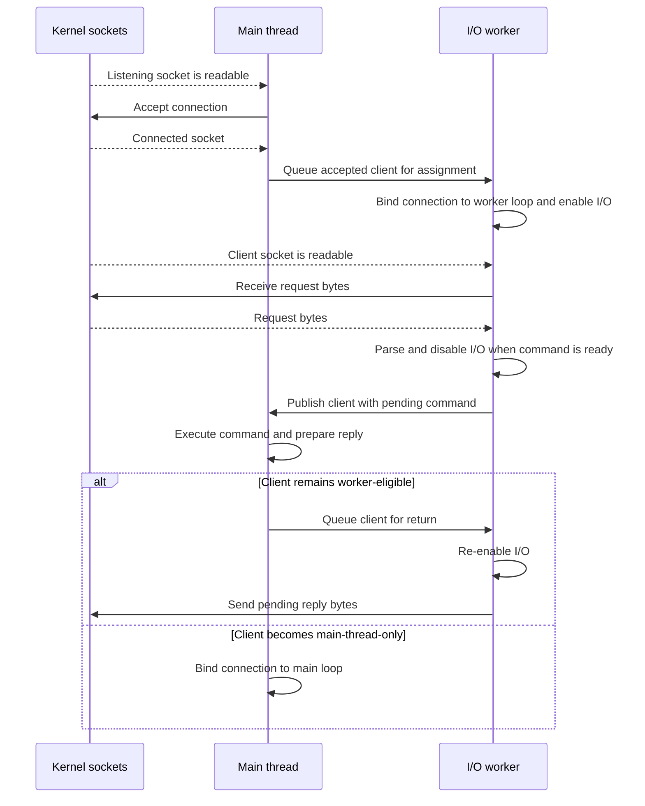

# Redis Internals

Redis Open Source 8.10.2 advances client commands and inter-instance communication through event-loop callbacks and periodic maintenance. These paths share a process and scheduling machinery, but use different connection state and protocols.

## Client connection management

Redis manages many client connections through event loops rather than dedicating a thread to each connection.

Connection handling separates three distinct [application-server concurrency](../../Backend%20Engineering/Concurrency/02%20Application%20Server%20Concurrency.md) dimensions:

- **Connection concurrency:** Many live clients retain independent connection, input, output, and command state across callbacks and handoffs.
- **I/O parallelism:** Multiple threads advance network work when I/O workers are configured.
- **Command execution:** Ordinary commands execute predominantly on the main thread.

The implementation uses a `connection` object for transport operations and a `client` object for Redis-specific state. Each processing thread has an `aeEventLoop`; the connection's event-loop binding determines where its readiness callbacks run, rather than the client owning a separate loop. Client state survives those callbacks because reading, parsing, execution, and writing need not finish together. The logical request-to-reply path is **not** one uninterrupted call stack. The underlying [socket management](../../Operating%20Systems/07%20Socket%20Management.md) supplies listening and connected descriptors and readiness; Redis supplies the client state and callback transitions described below. [Client state](https://github.com/redis/redis/blob/498ecd0d6d007db11ddb3aea9428552598a78622/src/server.h#L1500-L1525) · [Event-loop binding](https://github.com/redis/redis/blob/498ecd0d6d007db11ddb3aea9428552598a78622/src/iothread.c#L776-L817)

### Main event loop

An **event loop** repeatedly waits for events and invokes their registered handlers (**callbacks**). Redis's **main event loop** is this control flow running on the main thread, not a separate thread. Its `ae` event library dispatches two kinds of events:

- **File events:** Socket readiness triggers handlers for listener acceptance or client reads and writes. Polling waits for activity across connections rather than waiting separately on each idle client.
- **Time events:** Due timers trigger scheduled callbacks.

The main loop repeats the following cycle:

1. **Perform pending work.** `beforeSleep()` handles pending work, including client writes and I/O-thread coordination, before polling.
2. **Poll for readiness.** The poll waits when there is no immediate work, with the next due timer constraining the wait.
3. **Run the post-poll hook.** `afterSleep()` runs after polling and before dispatching the resulting file events.
4. **Dispatch events.** Invoke handlers for ready file events, then process due time events.

Ordinary command execution takes place on the main thread as part of this processing and its handoffs; it is not a separate stage that runs exactly once per iteration. [Main-loop setup](https://github.com/redis/redis/blob/498ecd0d6d007db11ddb3aea9428552598a78622/src/server.c#L3214-L3217) · [Event processing](https://github.com/redis/redis/blob/498ecd0d6d007db11ddb3aea9428552598a78622/src/ae.c#L365-L503) · [Before-sleep work](https://github.com/redis/redis/blob/498ecd0d6d007db11ddb3aea9428552598a78622/src/server.c#L1947-L2162)

### Connection-to-command path

#### From listener to client

1. **Initialize listeners.** `initListeners()` configures enabled TCP, TLS, and Unix-domain listeners, calls `connListen()`, and registers a readable accept handler for each listening descriptor. `ae` dispatches that handler when a listener is ready. [Listener setup](https://github.com/redis/redis/blob/498ecd0d6d007db11ddb3aea9428552598a78622/src/server.c#L3250-L3318) · [Event dispatch](https://github.com/redis/redis/blob/498ecd0d6d007db11ddb3aea9428552598a78622/src/ae.c#L365-L473)
2. **Accept a transport connection.** The configured transport-specific handler accepts available connections up to its per-invocation cap, wraps each accepted descriptor in a connection object, and calls `acceptCommonHandler()`. The cap bounds the number accepted in one handler invocation, spreading further acceptance across event-loop iterations; it is not the total client limit. [TCP accept loop](https://github.com/redis/redis/blob/498ecd0d6d007db11ddb3aea9428552598a78622/src/socket.c#L301-L320) · [Unix-domain accept loop](https://github.com/redis/redis/blob/498ecd0d6d007db11ddb3aea9428552598a78622/src/unix.c#L95-L115)
3. **Apply admission and create client state.** `acceptCommonHandler()` checks the number of Redis clients plus cluster connections against `maxclients` *before* client creation and transport-level acceptance. A rejected connection is closed; an error reply is best effort, and a TLS connection rejected before its handshake receives no such reply. On admission, `createClient()` initializes the client, associates it with the connection, and installs `readQueryFromClient` as its read handler. For TCP clients it enables `TCP_NODELAY` and, when configured, keepalive. Failure to register the read event also rejects the connection. [Admission](https://github.com/redis/redis/blob/498ecd0d6d007db11ddb3aea9428552598a78622/src/networking.c#L1666-L1738) · [Client initialization](https://github.com/redis/redis/blob/498ecd0d6d007db11ddb3aea9428552598a78622/src/networking.c#L122-L251)
4. **Finish connection acceptance.** `connAccept()` invokes `clientAcceptHandler()` either immediately or later, depending on the connection type. That callback handles failed acceptance, protected-mode rejection of non-local peers under its password condition, and successful-connection bookkeeping. If I/O workers are configured, it also queues the client for assignment. Code after `connAccept()` therefore cannot assume that the client still exists. [Accept callback and contract](https://github.com/redis/redis/blob/498ecd0d6d007db11ddb3aea9428552598a78622/src/networking.c#L1593-L1738)

The listener remains available for subsequent arrivals while accepted clients maintain independent state.

The configured `maxclients` cap is not a promise of descriptor capacity: the operating system's available file descriptors constrain the effective [connection limit](Connections.md#Transport%20and%20connection%20lifetime). [Descriptor-limit adjustment](https://github.com/redis/redis/blob/498ecd0d6d007db11ddb3aea9428552598a78622/src/config.c#L2780-L2805)

#### From readable bytes to command execution

A readable client connection invokes `readQueryFromClient()`. The callback appends received bytes to `client.querybuf`, applies the applicable query-buffer limit, and calls `processInputBuffer()`. The client's `qb_pos` records how far parsing has advanced; for an ordinary client, consumed bytes are trimmed after processing while incomplete input remains for a later read. A read that cannot presently make progress leaves the connection in place; closure or a fatal connection error schedules cleanup. [Read callback and buffer processing](https://github.com/redis/redis/blob/498ecd0d6d007db11ddb3aea9428552598a78622/src/networking.c#L3690-L3893) · [Read errors and limits](https://github.com/redis/redis/blob/498ecd0d6d007db11ddb3aea9428552598a78622/src/networking.c#L3893-L4046)

`processInputBuffer()` turns the buffered byte stream into requests. It recognizes RESP multibulk requests and the supported inline form, retaining incomplete parsing state in `pending_cmds` until more bytes arrive. The list's `ready_len` counts complete commands ready to process; its total `len` can also include an incomplete command. These fields persist across read callbacks and, with workers, across a handoff to main-thread execution. The [RESP](12%20Redis%20Serialization%20Protocol.md) framing determines where a request ends, while [pipelining](10%20Mass%20Insertion%20of%20Data%20-%20Piping.md) lets several requests arrive without waiting for each reply. [Input processing](https://github.com/redis/redis/blob/498ecd0d6d007db11ddb3aea9428552598a78622/src/networking.c#L3690-L3811) · [Pending-command counts](https://github.com/redis/redis/blob/498ecd0d6d007db11ddb3aea9428552598a78622/src/server.h#L1350-L1362)

`server.lookahead` bounds how many complete commands Redis decodes in one parsing batch when no ready commands are already queued; the resulting batch can be prefetched for main-thread processing. On the main thread, `processInputBuffer()` can execute a ready command and iterate through further buffered batches in the *same invocation*; lookahead is not a cap on that invocation's total command count. A worker instead hands a parsed executable command to the main thread. For a client that still requires authentication, lookahead is one to reduce memory use and prevent parsing later commands under assumptions that `AUTH` could change. [Parsing and execution loop](https://github.com/redis/redis/blob/498ecd0d6d007db11ddb3aea9428552598a78622/src/networking.c#L3690-L3855)

Parsing a complete command does not always make it immediately executable:

- **Worker ownership:** Worker parsing stops at a ready executable command and queues the client for main-thread execution. [Worker parse handoff](https://github.com/redis/redis/blob/498ecd0d6d007db11ddb3aea9428552598a78622/src/networking.c#L3834-L3855)
- **Client state:** Blocking, an already pending command, or a close-after-reply/close-as-soon-as-possible state stops further input processing. Buffered bytes remain associated with a client that later resumes where appropriate. [Processing guards](https://github.com/redis/redis/blob/498ecd0d6d007db11ddb3aea9428552598a78622/src/networking.c#L3704-L3740)
- **Command semantics:** On the main thread, `processCommandAndResetClient()` reaches `processCommand()`; normal execution reaches `call()`. A transaction can instead queue a command and return `QUEUED`, while blocking commands change when the client resumes. [Command path](https://github.com/redis/redis/blob/498ecd0d6d007db11ddb3aea9428552598a78622/src/networking.c#L3555-L3603) · [Execution path](https://github.com/redis/redis/blob/498ecd0d6d007db11ddb3aea9428552598a78622/src/server.c#L4835-L4848)

### Thread topology

Connection acceptance and ordinary command execution share **the same main thread**. Redis does not place a separate acceptor thread in front of a pool of ordinary command-execution workers; its network I/O workers offload socket work instead.

- **Main thread:** Runs the main event loop, accepts new connections, and executes ordinary commands, including reads and changes to the in-memory dataset. A `SET` parsed by a worker, for example, returns to this thread to change the stored value. Main also handles network I/O for clients that are not eligible for worker handling. [Listener setup](https://github.com/redis/redis/blob/498ecd0d6d007db11ddb3aea9428552598a78622/src/server.c#L3250-L3318) · [Command execution](https://github.com/redis/redis/blob/498ecd0d6d007db11ddb3aea9428552598a78622/src/iothread.c#L603-L685)
- **Network I/O workers:** Each runs its own event loop for assigned, already-accepted clients. Workers read socket bytes, parse requests, and write replies to sockets; executable commands are handed to main rather than executed against the dataset by the worker. [Worker event loops](https://github.com/redis/redis/blob/498ecd0d6d007db11ddb3aea9428552598a78622/src/iothread.c#L975-L1057) · [Command handoff](https://github.com/redis/redis/blob/498ecd0d6d007db11ddb3aea9428552598a78622/src/networking.c#L3834-L3855)

With `io-threads=1`, main performs client network I/O as well as command execution. Increasing `io-threads` adds network I/O workers, not parallel ordinary command executors. **Writing a reply to a socket is distinct from modifying the dataset**; neither operation means persisting data to disk.

#### I/O-thread ownership and handoffs

The division between worker I/O and main-thread command execution requires transferring clients between processing contexts without letting both threads advance the same client's mutable state independently. With `io-threads` greater than one, `initThreadedIO()` starts each worker with its own `aeEventLoop` and notification event. [Worker creation](https://github.com/redis/redis/blob/498ecd0d6d007db11ddb3aea9428552598a78622/src/iothread.c#L975-L1057)

Three separate fields describe a client's thread relationship:

- **Assigned I/O thread (`tid`):** Identifies the worker assigned to the client, or main for a main-thread client.
- **Processing context (`running_tid`):** Identifies the thread designated to process the client in the current handoff phase. Redis sets it for the receiving thread before that thread necessarily resumes the queued client; it is not a snapshot of a thread executing at every instant.
- **Event-loop binding (`conn->el`):** Identifies the event loop bound to the connection, separately from assignment and processing context.

These states change at different points in the transfer. The client's `io_flags` also survive callbacks: `CLIENT_IO_READ_ENABLED` and `CLIENT_IO_WRITE_ENABLED` gate socket work, while `CLIENT_IO_PENDING_COMMAND` records a parsed command that needs main-thread execution. [Client thread fields](https://github.com/redis/redis/blob/498ecd0d6d007db11ddb3aea9428552598a78622/src/server.h#L1500-L1508) · [Return handoff](https://github.com/redis/redis/blob/498ecd0d6d007db11ddb3aea9428552598a78622/src/iothread.c#L676-L712) · [I/O flags](https://github.com/redis/redis/blob/498ecd0d6d007db11ddb3aea9428552598a78622/src/server.h#L466-L473)

For an eligible client, queued transfers separate worker socket I/O from main-thread command execution. The kernel lane marks socket readiness and transport operations; thread-to-thread arrows represent queued handoffs across callbacks, not synchronous calls:

The ownership transitions are:

1. **Main-thread assignment.** `createClient()` starts with `tid` and `running_tid` set to main. After successful acceptance, the main thread selects a least-loaded worker, changes `tid`, unbinds the connection from the main event loop, clears its read/write-enable flags, and queues it for transfer. The worker is assigned but is not yet executing the client or monitoring its connection. [Client initialization](https://github.com/redis/redis/blob/498ecd0d6d007db11ddb3aea9428552598a78622/src/networking.c#L122-L191) · [Assignment](https://github.com/redis/redis/blob/498ecd0d6d007db11ddb3aea9428552598a78622/src/iothread.c#L332-L363)
2. **Main-to-worker delivery.** The main thread publishes queued clients to the worker's pending list under its mutex. An early transfer can omit a notifier write if the worker is running or already has pending work; the before-sleep flush path signals the worker. The worker consumes that list, links the client into its managed clients, enables read/write activity, binds `conn->el` to its event loop, and installs `readQueryFromClient`. [Before-sleep delivery](https://github.com/redis/redis/blob/498ecd0d6d007db11ddb3aea9428552598a78622/src/iothread.c#L503-L519) · [Conditional early notification](https://github.com/redis/redis/blob/498ecd0d6d007db11ddb3aea9428552598a78622/src/iothread.c#L565-L590) · [Worker receipt](https://github.com/redis/redis/blob/498ecd0d6d007db11ddb3aea9428552598a78622/src/iothread.c#L757-L845)
3. **Worker read and handoff request.** The worker reads and parses input. When an executable command is ready, it sets `CLIENT_IO_PENDING_COMMAND`; `enqueuePendingClientsToMainThread()` then clears read/write-enable flags and moves the client from the worker's managed list to its local pending-to-main list. The worker no longer advances that client's socket I/O while the main thread processes it. [Parsing handoff](https://github.com/redis/redis/blob/498ecd0d6d007db11ddb3aea9428552598a78622/src/networking.c#L3834-L3855) · [Local queue and I/O disable](https://github.com/redis/redis/blob/498ecd0d6d007db11ddb3aea9428552598a78622/src/iothread.c#L112-L145)
4. **Worker-to-main publication.** The worker merges its local list into the shared main-thread pending list under a mutex. It notifies the main loop when it is sleeping and the shared list was empty; if main is running, `beforeSleep()` will drain the list, while existing pending work can already provide a wakeup. [Publication and conditional notification](https://github.com/redis/redis/blob/498ecd0d6d007db11ddb3aea9428552598a78622/src/iothread.c#L29-L52) · [Main notification handler](https://github.com/redis/redis/blob/498ecd0d6d007db11ddb3aea9428552598a78622/src/iothread.c#L717-L751)
5. **Main-thread command execution.** The main thread drains the shared list, asserts worker read/write activity is disabled, and changes `running_tid` to main while `tid` still identifies the assigned worker. It reconciles worker-updated replication state where applicable, handles read errors or worker close requests, executes the pending command, and prepares its reply. [Main processing and reply decision](https://github.com/redis/redis/blob/498ecd0d6d007db11ddb3aea9428552598a78622/src/iothread.c#L603-L685)
6. **Return or retention.** For a worker-eligible ordinary client, main removes any main-thread pending-write membership, sets `running_tid` back to `tid`, and queues the client for its worker. The worker re-enables I/O, transmits pending replies, and registers a writable callback if output remains. Eligible replicas use a separate before-sleep return path. A client that becomes main-thread-only is instead kept on the main event loop; its assigned thread and connection binding are changed accordingly. [Return decision](https://github.com/redis/redis/blob/498ecd0d6d007db11ddb3aea9428552598a78622/src/iothread.c#L676-L712) · [Main-thread retention](https://github.com/redis/redis/blob/498ecd0d6d007db11ddb3aea9428552598a78622/src/iothread.c#L218-L242) · [Worker resumption](https://github.com/redis/redis/blob/498ecd0d6d007db11ddb3aea9428552598a78622/src/iothread.c#L776-L842)

`beforeSleep()` also scans worker-to-main queues directly, then checks again when preparing to sleep so a concurrent transfer is not missed. `IOThreadBeforeSleep()` similarly consumes main-to-worker deliveries and keeps the worker from sleeping after processing them. An early transfer can therefore avoid a notifier write when the receiver is running or already has pending work; the queued client is still processed. Mutex-protected list publication, disabled client I/O during main processing, and explicit running-thread changes prevent both threads from independently advancing the same client's mutable state. They do not imply that Redis has no other shared state. [Main-loop coordination](https://github.com/redis/redis/blob/498ecd0d6d007db11ddb3aea9428552598a78622/src/server.c#L2076-L2112) · [Worker-loop coordination](https://github.com/redis/redis/blob/498ecd0d6d007db11ddb3aea9428552598a78622/src/iothread.c#L847-L882) · [Conditional worker notification](https://github.com/redis/redis/blob/498ecd0d6d007db11ddb3aea9428552598a78622/src/iothread.c#L565-L590)

Worker eligibility constrains both initial assignment and the return after command execution. Some clients remain on the main thread because other main-thread work can touch their state or write to them directly:

- **Main-thread-only states:** Close-as-soon-as-possible, [Pub/Sub](09%20PublishSubscribe%20Model.md), monitor, blocked/unblocked, tracking, Lua debug, and active slot-migration/import states prevent worker handling. [Eligibility predicate](https://github.com/redis/redis/blob/498ecd0d6d007db11ddb3aea9428552598a78622/src/iothread.c#L280-L301)
- **Replication states:** A master or replica client remains on the main thread during replication states in which worker handling is unsafe. Once the predicate's connected, stream, and reference conditions are met, the relevant replication client is eligible for worker I/O; replicas are **not** universally main-thread-only. [Replication eligibility](https://github.com/redis/redis/blob/498ecd0d6d007db11ddb3aea9428552598a78622/src/iothread.c#L303-L328)

> [!info] Read configuration in Redis 8.10.2
> `io-threads-do-reads` is a deprecated configuration name, not a switch required to enable worker reads. The active `io-threads` setting defaults to one; with multiple threads, the implemented worker path includes reads, parsing, and writes. [Deprecated configuration](https://github.com/redis/redis/blob/498ecd0d6d007db11ddb3aea9428552598a78622/src/config.c#L495-L510) · [Thread-count configuration](https://github.com/redis/redis/blob/498ecd0d6d007db11ddb3aea9428552598a78622/src/config.c#L3507) · [Worker read path](https://github.com/redis/redis/blob/498ecd0d6d007db11ddb3aea9428552598a78622/src/iothread.c#L776-L842)

### Replies and slow clients

Command execution prepares a reply in the client's output buffer and reply list before it reaches the socket. `prepareClientToWrite()` arranges a pending write; `beforeSleep()` attempts main-thread pending writes before waiting, and remaining output gets a writable callback, `sendReplyToClient()`, which calls `writeToClient()`. The client retains its reply blocks and sent-position state across callbacks. With worker ownership, the worker attempts pending output when the client returns from main-thread execution. [Reply preparation](https://github.com/redis/redis/blob/498ecd0d6d007db11ddb3aea9428552598a78622/src/networking.c#L268-L370) · [Reply progress and write path](https://github.com/redis/redis/blob/498ecd0d6d007db11ddb3aea9428552598a78622/src/networking.c#L2594-L2650) · [Pending writes and callback](https://github.com/redis/redis/blob/498ecd0d6d007db11ddb3aea9428552598a78622/src/networking.c#L2948-L2999) · [Worker write resume](https://github.com/redis/redis/blob/498ecd0d6d007db11ddb3aea9428552598a78622/src/iothread.c#L825-L840)

Under socket send-buffer backpressure, Redis retains unsent reply data in its own client output buffers, separate from the kernel's send buffer. `writeToClient()` advances the client's saved position only for bytes accepted by the connection and resumes the remainder on later writable readiness. Continued reply generation can therefore grow Redis-side output memory; closure depends on an applicable output limit or enabled client-memory policy. [Socket write behavior](https://github.com/redis/redis/blob/498ecd0d6d007db11ddb3aea9428552598a78622/src/socket.c#L135-L163) · [Write progress and retry](https://github.com/redis/redis/blob/498ecd0d6d007db11ddb3aea9428552598a78622/src/networking.c#L2847-L2999) · [Logical output size](https://github.com/redis/redis/blob/498ecd0d6d007db11ddb3aea9428552598a78622/src/networking.c#L5261-L5269)

`writeToClient()` also caps bytes sent per invocation for ordinary clients so one writable connection does not monopolize the loop. The cap protects event-loop progress but does not bound pending output; [output-buffer and client-memory limits](Connections.md#Buffered%20replies%20and%20slow%20clients) govern memory exposure and possible client closure. [Write loop](https://github.com/redis/redis/blob/498ecd0d6d007db11ddb3aea9428552598a78622/src/networking.c#L2847-L2944)

### Performance consequences

A client normally remains registered after one reply, so later requests reuse its connection and state; [pipelining](10%20Mass%20Insertion%20of%20Data%20-%20Piping.md) further avoids waiting a round trip between requests. Neither changes the main-thread command-execution constraint. The effects of I/O workers depend on which work dominates:

- **Network-I/O-bound:** Eligible clients' reads, protocol parsing, and writes can run across worker event loops, reducing the main thread's network-work share. Client transfers, queue synchronization, and notifications add coordination cost, so more threads are not an unconditional speedup. [Worker event loops](https://github.com/redis/redis/blob/498ecd0d6d007db11ddb3aea9428552598a78622/src/iothread.c#L975-L1057) · [Handoff queues](https://github.com/redis/redis/blob/498ecd0d6d007db11ddb3aea9428552598a78622/src/iothread.c#L503-L590)
- **Command-CPU-bound:** Ordinary commands still execute predominantly on the main thread; parallel network I/O does not remove that execution bottleneck. [Worker command handoff](https://github.com/redis/redis/blob/498ecd0d6d007db11ddb3aea9428552598a78622/src/networking.c#L3834-L3855) · [Main-thread processing](https://github.com/redis/redis/blob/498ecd0d6d007db11ddb3aea9428552598a78622/src/iothread.c#L603-L674)
- **Slow-client/output-heavy:** [Slow clients](Connections.md#Buffered%20replies%20and%20slow%20clients) leave Redis-managed output queued when replies arrive faster than peers consume them; worker writes do not remove that bottleneck.

### Disconnection and deferred reclamation

On peer closure, fatal I/O errors, resource-limit enforcement, [timeout](Connections.md#Disconnection), or an explicit close-after-reply state, Redis eventually detaches the client and releases its buffers and connection. `freeClient()` must first retrieve a client from worker execution when necessary; it unlinks handlers and connection references as part of cleanup. `freeClientAsync()` instead marks and queues a client for a safe main-thread free. Workers request closure but do not directly free client objects, avoiding destruction while callbacks or other thread work still refer to them. [Direct cleanup](https://github.com/redis/redis/blob/498ecd0d6d007db11ddb3aea9428552598a78622/src/networking.c#L2185-L2315) · [Deferred cleanup](https://github.com/redis/redis/blob/498ecd0d6d007db11ddb3aea9428552598a78622/src/networking.c#L2381-L2468) · [Worker close handoff](https://github.com/redis/redis/blob/498ecd0d6d007db11ddb3aea9428552598a78622/src/iothread.c#L650-L653)

## Inter-instance communication

Redis Open Source Cluster separates **coordination between nodes** from **copying a primary's dataset to its replicas**. Both use network connections, but their protocols, state, and callbacks differ.

> [!info] Implementation scope
> Source references are pinned to Redis Open Source **8.10.2**, commit [`498ecd0d`](https://github.com/redis/redis/tree/498ecd0d6d007db11ddb3aea9428552598a78622). Function names retain source terminology such as `master` and `slave`. These mechanisms do not describe Redis Software's cluster-management architecture.

### Cluster bus and replication paths

The cluster bus connects cluster nodes through a separate bus port using binary messages. Primary-to-replica replication uses the primary's data port rather than carrying the dataset stream inside bus messages. Thus cluster membership and slot ownership are not copies of the dataset: they determine roles and routing, while replication supplies the data a replica needs. [Cluster specification](https://redis.io/docs/latest/operate/oss_and_stack/reference/cluster-spec/) · [Replication](https://redis.io/docs/latest/operate/oss_and_stack/management/replication/)

- **Cluster bus:** Heartbeats, gossip, configuration updates, and failover authorization communicate cluster state. The bus also carries other message types, including Pub/Sub propagation; it is not exclusively a heartbeat channel. [`clusterProcessPacket()`](https://github.com/redis/redis/blob/498ecd0d6d007db11ddb3aea9428552598a78622/src/cluster_legacy.c#L3322-L3389)
- **Replication connection:** A replica connects to its primary, negotiates synchronization, and receives a replication stream. During a negotiated RDB-channel full synchronization, an additional connection transfers the snapshot while the main replication channel carries the stream. “Separate replication connection” therefore distinguishes replication from the bus, not an invariant of exactly one replication socket. [`connectWithMaster()`](https://github.com/redis/redis/blob/498ecd0d6d007db11ddb3aea9428552598a78622/src/replication.c#L3539-L3557) · [RDB-channel design](https://github.com/redis/redis/blob/498ecd0d6d007db11ddb3aea9428552598a78622/src/replication.c#L3798-L3817)

### Bus links and callback progress

A **`clusterLink`** retains the transport connection, receive buffer, outgoing message queue, and send progress across callbacks. A node has distinct inbound and outbound link references; a link is not an ordinary command client's request/reply state. [`freeClusterLink()` and inbound association](https://github.com/redis/redis/blob/498ecd0d6d007db11ddb3aea9428552598a78622/src/cluster_legacy.c#L1197-L1240)

A bus connection advances through these transitions:

1. **Acceptance or connection.** `clusterAcceptHandler()` creates an accepted transport on `server.el`; `clusterConnAcceptHandler()` creates its link and installs `clusterReadHandler()`. The incoming peer's node identity is initially unknown. For outbound links, cron creates a connection to the peer's bus port; `clusterLinkConnectHandler()` installs the read handler and queues `MEET` or `PING` after connection establishment. [Inbound setup](https://github.com/redis/redis/blob/498ecd0d6d007db11ddb3aea9428552598a78622/src/cluster_legacy.c#L1242-L1299) · [Outbound setup](https://github.com/redis/redis/blob/498ecd0d6d007db11ddb3aea9428552598a78622/src/cluster_legacy.c#L3507-L3543) · [Reconnect](https://github.com/redis/redis/blob/498ecd0d6d007db11ddb3aea9428552598a78622/src/cluster_legacy.c#L4760-L4797)
2. **Frame assembly.** TCP supplies bytes, not complete bus messages. `clusterReadHandler()` first accumulates eight bytes to inspect the `RCmb` signature and total length, then accumulates the remaining frame. Only a complete frame reaches `clusterProcessPacket()`; incomplete input stays in the link buffer for later readiness. [Read and framing](https://github.com/redis/redis/blob/498ecd0d6d007db11ddb3aea9428552598a78622/src/cluster_legacy.c#L3548-L3641)
3. **Dispatch.** `clusterProcessPacket()` validates protocol version and message-specific lengths before interpreting the message. Heartbeat, failure, and authorization messages update different parts of cluster state rather than entering ordinary command dispatch. [Validation](https://github.com/redis/redis/blob/498ecd0d6d007db11ddb3aea9428552598a78622/src/cluster_legacy.c#L2817-L2868) · [Message dispatch](https://github.com/redis/redis/blob/498ecd0d6d007db11ddb3aea9428552598a78622/src/cluster_legacy.c#L3322-L3389)
4. **Queued transmission.** `clusterSendMessage()` appends a message block and enables a writable callback when the queue becomes nonempty. `clusterWriteHandler()` retains an offset after a partial write, removes completed messages, and disables the callback when the queue drains. Socket readiness therefore advances queued messages without requiring the entire message to be sent at enqueue time. [Write progress](https://github.com/redis/redis/blob/498ecd0d6d007db11ddb3aea9428552598a78622/src/cluster_legacy.c#L3459-L3505) · [Enqueue](https://github.com/redis/redis/blob/498ecd0d6d007db11ddb3aea9428552598a78622/src/cluster_legacy.c#L3644-L3671)

### Coordination state and failover

Heartbeat exchange carries observations as well as proving direct reachability. `clusterSendPing()` constructs heartbeat gossip; packet processing consumes the received gossip and configuration information. This makes a peer's report distinct from the receiving node's own timeout observation. [Gossip construction](https://github.com/redis/redis/blob/498ecd0d6d007db11ddb3aea9428552598a78622/src/cluster_legacy.c#L3769-L3807) · [Gossip reception](https://github.com/redis/redis/blob/498ecd0d6d007db11ddb3aea9428552598a78622/src/cluster_legacy.c#L3322-L3327)

- **Failure declaration:** Cron marks local timeout suspicion as `PFAIL`. `markNodeAsFailingIfNeeded()` requires local timeout and enough primary failure reports before replacing `PFAIL` with `FAIL` and broadcasting the declaration. Receiving a `FAIL` message from a known sender adopts that declaration without independently rerunning the report-count decision. [Declaration](https://github.com/redis/redis/blob/498ecd0d6d007db11ddb3aea9428552598a78622/src/cluster_legacy.c#L1935-L1962) · [Reception](https://github.com/redis/redis/blob/498ecd0d6d007db11ddb3aea9428552598a78622/src/cluster_legacy.c#L3328-L3349)
- **Failover authorization:** `clusterHandleSlaveFailover()` checks eligibility and schedules an election. It requests votes for an epoch, returns while replies arrive, and checks the accumulated vote count against quorum. Authorization acknowledgements schedule another check rather than synchronously completing the election in the receive callback. [Election](https://github.com/redis/redis/blob/498ecd0d6d007db11ddb3aea9428552598a78622/src/cluster_legacy.c#L4387-L4418) · [Request and quorum](https://github.com/redis/redis/blob/498ecd0d6d007db11ddb3aea9428552598a78622/src/cluster_legacy.c#L4514-L4545) · [Acknowledgements](https://github.com/redis/redis/blob/498ecd0d6d007db11ddb3aea9428552598a78622/src/cluster_legacy.c#L3371-L3389)

Promotion connects coordination to replication: `clusterFailoverReplaceYourMaster()` stops following the old primary, claims its slots, saves configuration, and schedules a broadcast. Conversely, `clusterSetMaster()` changes the local primary relationship and calls `replicationSetMaster()` with the selected node's replication address and port. The bus determines which role and upstream relationship to use; replication implements dataset synchronization for that relationship. [Promotion](https://github.com/redis/redis/blob/498ecd0d6d007db11ddb3aea9428552598a78622/src/cluster_legacy.c#L4342-L4370) · [Upstream change](https://github.com/redis/redis/blob/498ecd0d6d007db11ddb3aea9428552598a78622/src/cluster_legacy.c#L5430-L5446)

### Replication handshake and data progress

`connectWithMaster()` creates a replication transport on `server.el` and starts a connection with `syncWithMaster()` as its callback. The replica's `server.repl_state` records handshake progress across callbacks; connection establishment does not itself mean the replica is synchronized. [Connection](https://github.com/redis/redis/blob/498ecd0d6d007db11ddb3aea9428552598a78622/src/replication.c#L3539-L3557) · [Handshake entry](https://github.com/redis/redis/blob/498ecd0d6d007db11ddb3aea9428552598a78622/src/replication.c#L3144-L3179)

1. **Handshake:** The replica checks responsiveness with `PING`, performs the applicable authentication and capability exchange, then sends `PSYNC` to negotiate synchronization. [Handshake state machine](https://github.com/redis/redis/blob/498ecd0d6d007db11ddb3aea9428552598a78622/src/replication.c#L3144-L3404)
2. **Synchronization choice:** A retained compatible replication history permits partial resynchronization. Otherwise the replica needs a full dataset transfer followed by stream catch-up. With negotiated RDB-channel replication, the snapshot and stream use separate channels and the replica buffers stream data while loading the snapshot. [Synchronization result](https://github.com/redis/redis/blob/498ecd0d6d007db11ddb3aea9428552598a78622/src/replication.c#L3413-L3454) · [RDB-channel sequencing](https://github.com/redis/redis/blob/498ecd0d6d007db11ddb3aea9428552598a78622/src/replication.c#L3798-L3817)
3. **Ongoing stream:** The primary's `replicationFeedSlaves()` prepares replicas for writing and feeds the replication buffer. Replicas apply the resulting stream and report offsets; the bus does not forward each dataset write as a cluster message. [Stream feeding](https://github.com/redis/redis/blob/498ecd0d6d007db11ddb3aea9428552598a78622/src/replication.c#L652-L746) · [Replication protocol](https://redis.io/docs/latest/operate/oss_and_stack/management/replication/)

### Event-loop and cron integration

Readiness callbacks react to available socket work; periodic maintenance makes progress even when no new packet arrives. The main server cron invokes cluster maintenance on a 100-millisecond schedule and replication maintenance normally on a one-second schedule, accelerated during the server's replication failover state. These are scheduled checks, not dedicated per-peer threads or guaranteed wall-clock deadlines. [`serverCron()` scheduling](https://github.com/redis/redis/blob/498ecd0d6d007db11ddb3aea9428552598a78622/src/server.c#L1772-L1789)

- **Cluster maintenance:** `clusterCron()` reconnects missing links, checks send-queue limits, sends heartbeats, evaluates timeout suspicion, and advances failover work. [Link maintenance](https://github.com/redis/redis/blob/498ecd0d6d007db11ddb3aea9428552598a78622/src/cluster_legacy.c#L4800-L4862) · [Timeout and role maintenance](https://github.com/redis/redis/blob/498ecd0d6d007db11ddb3aea9428552598a78622/src/cluster_legacy.c#L4970-L5025)
- **Replication maintenance:** `replicationCron()` detects handshake/transfer timeouts and reconnects when the replica's state requires it. This is a separate state machine from bus-link reconnection. [Replication maintenance](https://github.com/redis/redis/blob/498ecd0d6d007db11ddb3aea9428552598a78622/src/replication.c#L5078-L5108)
- **Before-sleep work:** `clusterDoBeforeSleep()` ORs task flags into `todo_before_sleep`. `clusterBeforeSleep()` consumes those flags for failover checks, state updates, configuration saving, and broadcasts. The server invokes it before handling unblocked clients, so packet-driven cluster-state changes are reconciled at that event-loop boundary rather than waiting solely for cron. [Deferred tasks](https://github.com/redis/redis/blob/498ecd0d6d007db11ddb3aea9428552598a78622/src/cluster_legacy.c#L5031-L5076) · [Server integration](https://github.com/redis/redis/blob/498ecd0d6d007db11ddb3aea9428552598a78622/src/server.c#L1987-L1994)

Separate sockets isolate protocol and connection state, not the CPU budget of the Redis process. Bus callbacks and cluster maintenance use the main event loop; replication handshake setup also begins there. This distinction does not mean every steady-state replication socket remains main-thread-only: eligibility for worker I/O depends on replication state and configuration, independently of the bus protocol. [Replication worker eligibility](https://github.com/redis/redis/blob/498ecd0d6d007db11ddb3aea9428552598a78622/src/iothread.c#L303-L328)
