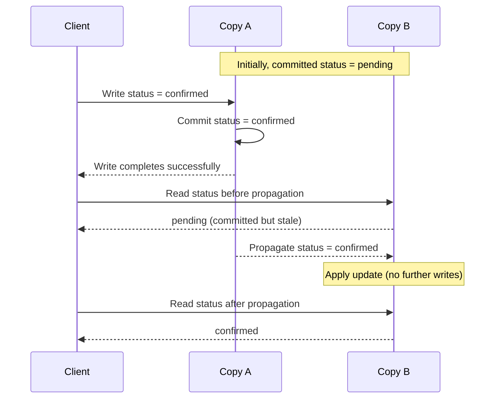

# Read Consistency

**Read consistency** describes which completed writes a read is guaranteed to observe. **Read freshness** asks how current that observation is: after a transaction commits a change, does a new transaction immediately observe it? This is a system-wide visibility question, applicable to both relational and NoSQL databases, not a property determined by the data model.

## Completed Writes and Subsequent Reads

A freshness claim needs an ordering boundary:

- **Subsequent:** A write finishes successfully before a read begins; the read is subsequent to that write.
- **Concurrent:** The write's and read's execution overlaps; the read's start alone does not establish whether it should include the write.

For a single value, what a fresh subsequent read returns depends on whether further writes occur:

- **No intervening writes:** The read returns the completed write's value.
- **Further writes:** Freshness does not mean returning that particular historical value: a newer value might supersede it.

The guarantee must specify which orderings and observations are allowed, rather than merely promise the “latest” data without defining latest relative to what.

**Linearizability** supplies an explicit real-time guarantee: each operation appears to take effect atomically at some point between its invocation and completion, and operations respect real-time order. A read begun after a completed write therefore cannot be ordered before that write. This guarantee applies to the objects and operations covered by the system's contract; it does not automatically make arbitrary multi-object transactions atomic.

## Validity, Isolation, and Freshness

“Consistent” names different guarantees depending on the question:

- **Validity:** [ACID consistency](01%20Transactions.md#Consistency%20and%20Application%20Invariants) concerns preserving application invariants across transactions. A valid earlier state is still older data; preserving its rules does not establish freshness.
- **Transactional visibility:** [Transaction isolation](02%20Transaction%20Isolation.md) governs interactions among transactions and the views their reads observe. Under [snapshot isolation](02%20Transaction%20Isolation.md#Snapshot%20Isolation), a transaction retains its snapshot despite later commits. A coherent view and a continually refreshed view are different requirements.
- **Real-time ordering:** Serializability requires equivalence to some serial transaction order, not necessarily real-time order. By itself, it does not guarantee that a completed transaction precedes a subsequently started transaction in that order. **Strict serializability** adds real-time ordering to serializability.

A **stale read** returns an older committed state despite a newer completed write. A **dirty read** observes another transaction's uncommitted changes. Preventing dirty reads does not, by itself, prevent stale reads: the old value was committed too.

## Propagation and Eventual Consistency

When writes propagate asynchronously between database copies, successful completion at the accepting copy need not mean every read-serving copy already reflects the change. Relational replication has this issue as well as NoSQL systems.

A committed but stale value:

**Eventual consistency** promises convergence: if no new updates occur, reads eventually return the converged value. It does not promise immediate visibility after a successful write.

- **No fixed deadline:** Eventual consistency alone specifies no maximum staleness interval.
- **No immediate global freshness:** During propagation, different readers need not observe the same value.

Returning reads before propagation completes avoids making those reads wait for convergence, but exposes applications to older state. Whether that is acceptable depends on the operation's correctness requirements; the same application decision arises when evaluating [cache staleness](../Cache/Caching.md#Factors%20to%20Consider%20When%20Deciding%20Whether%20to%20Cache%20Data).
