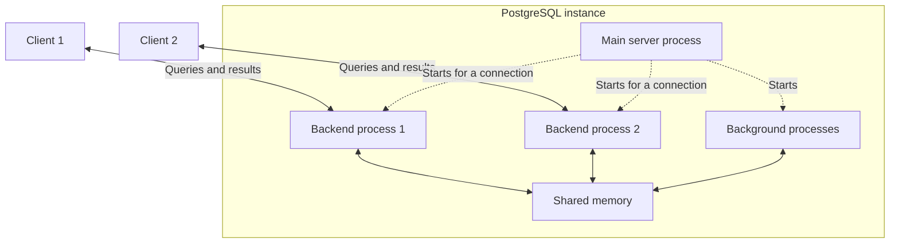

# PostgreSQL

PostgreSQL is a general-purpose relational database management system designed to run as a **database server**. Applications connect to that server, send SQL queries, and receive results; they do not open PostgreSQL's data files directly.

The server owns the persistent state and coordinates access to shared structured data for independent clients, centrally managing transactions, constraints, concurrency control, query planning, and durability.

## Process Architecture

A PostgreSQL instance uses a process-oriented architecture. A main server process accepts incoming connections and each client connection is normally handled by its own backend process. PostgreSQL also runs background processes for responsibilities such as writing dirty buffers, checkpointing, autovacuum, and WAL-related work.

The backend processes have separate virtual address spaces, but they still need to cooperate over common database state. PostgreSQL therefore uses [shared memory](../../Operating%20Systems/03%20Memory%20Management.md#Controlled%20Sharing%20%26%20Concurrency) for structures that must be visible across the instance.



Each backend has its own private address space as well as access to shared memory. Dashed arrows show process creation; solid arrows show client communication or access to shared state, not queries passing through the main server process.

This process model has an important operational consequence: opening thousands of database connections means creating thousands of backend processes and associated per-connection state. Application-side connection pools are therefore commonly used to limit the number of active PostgreSQL sessions.

## Shared Buffers

Database tables and indexes ultimately live in persistent files, but executing queries directly against storage for every access would be far too slow. PostgreSQL maintains a shared cache called **shared buffers**, accessible by its backend processes.

When a backend needs a database page, PostgreSQL checks whether that page is already present in shared buffers. If it is, the backend can work with the in-memory copy. Otherwise PostgreSQL reads the page from the underlying file into a shared buffer. Modified pages become **dirty** and are eventually written back to persistent storage.

Shared buffers are therefore part of PostgreSQL's own buffer-management layer. The operating system may additionally cache the same underlying files in its filesystem page cache, so PostgreSQL intentionally has both database-managed caching and OS-managed caching in the I/O path.

> [!info] Shared memory versus memory-mapped data files
> PostgreSQL supports allocating shared buffers through anonymous `mmap`: this creates shared memory, not a direct mapping of table or index files.
>
> Directly modifying database files through a writable shared mapping would let the OS write dirty pages back independently. PostgreSQL instead controls when modified pages leave shared buffers so it can enforce **write-ahead ordering**: the corresponding WAL records must be durable before the data page reaches persistent storage. Simply replacing shared buffers with file mappings would lose that control and require additional coordination. This is a constraint on a direct replacement, not a claim that databases cannot use `mmap`.

## Asynchronous Data-File I/O

When PostgreSQL needs a page absent from shared buffers, it reads the relevant relation file. Before PostgreSQL 18, a backend could have to wait for one uncached read before initiating later reads. Kernel read-ahead mitigates sequential access, but it does not know the query plan or every page the database will need.

PostgreSQL 18 introduced an asynchronous I/O (AIO) subsystem that lets backends issue multiple eligible page reads before consuming their results. Sequential scans, bitmap heap scans, and VACUUM can use knowledge of upcoming pages to keep reads in flight instead of serializing the latency of each read. A backend still waits when execution needs a page whose read has not completed; AIO enables overlap rather than eliminating storage waits.

### I/O Execution Methods

The `io_method` setting selects how PostgreSQL executes asynchronous-eligible operations:

- **`worker` (PostgreSQL 18 default):** The issuing backend places I/O requests in a shared queue. Dedicated PostgreSQL I/O worker processes perform ordinary blocking file operations and process their completion state. The backend can continue other work or wait for a requested result. `io_workers` controls the shared worker pool (three processes by default), so worker availability bounds how many delegated blocking operations can execute concurrently.
- **`io_uring`:** On supported Linux installations built with `liburing`, the backend submits operations through kernel submission/completion rings and later processes their results. PostgreSQL 18 uses an `io_uring` instance per backend rather than delegating each read to a PostgreSQL I/O worker. This avoids the extra PostgreSQL process handoff, although the kernel may use its own workers for operations that cannot proceed directly.
- **`sync`:** Asynchronous-eligible operations are executed synchronously instead. This provides a comparison and fallback path, but does not offer the same read overlap to the issuing backend.

Both `worker` and `io_uring` expose **completion-oriented behavior to the query backend**: it submits a particular read and later learns its result. With `worker`, another PostgreSQL process uses a blocking system call to carry out that read; with `io_uring`, the kernel-facing interface accepts the submitted operation directly. Asynchronous application behavior therefore does not require every underlying system call to be non-blocking.

The execution method determines how reads are carried out, while separate settings control how aggressively PostgreSQL initiates them:

- **`effective_io_concurrency` and `maintenance_io_concurrency`:** Influence the number of concurrent I/O requests initiated for query and maintenance workloads, respectively.
- **`io_max_concurrency`:** Limits the outstanding I/O operations allowed for an individual PostgreSQL process.
- **`io_workers`:** Sets the size of the shared PostgreSQL I/O worker pool; it has no effect with `io_uring`.
- **`io_method`:** Requires a server restart when changed.

Selecting `io_method` changes eligible data-file I/O execution, not client-socket handling, shared-buffer caching, or the WAL synchronization rules that establish transaction durability.

### Concurrency and Trade-offs

`io_uring` avoids the PostgreSQL worker handoff, but fewer handoffs do not guarantee a faster query. The methods also differ in where read-related CPU work happens and how many processes share that work.

- **CPU-work distribution:** With `worker`, I/O workers perform read-related work, including checksum verification, outside the issuing backend. With `io_uring`, the backend handles completion-side work itself. A small number of backends performing large scans can therefore benefit from workers when that CPU work limits throughput, even if `io_uring` is available.
- **Handoff overhead:** Workers require queue coordination, wakeups, and completion notifications between PostgreSQL processes. `io_uring` avoids that extra PostgreSQL process handoff, reducing scheduling and coordination overhead when those costs are significant, including workloads with many outstanding reads.
- **Shared capacity versus backend concurrency:** All issuing backends compete for the same PostgreSQL I/O worker pool. Too few workers create a bottleneck; increasing their number consumes additional process and CPU resources. With many active backends, `io_uring` already distributes completion-side CPU work across those backends without a shared PostgreSQL worker-pool limit. Storage and per-process concurrency limits still apply.

The benefit of either method depends on cache hits, storage latency, available device parallelism, worker capacity, and submission overhead. A completed file read does not imply physical disk access: the operating system's page cache may have satisfied it. Consequently, compare the methods under representative cache conditions and backend concurrency rather than treating `io_uring` availability as evidence of superior performance.

> [!example] Scan performance in PostgreSQL 18
> Tomas Vondra's benchmarks found `worker` faster than `io_uring` for sequential scans and, with enough workers, bitmap scans. He identifies distributing read-related CPU costs as a likely explanation, not a universal performance guarantee. [Benchmark and trade-off analysis](https://vondra.me/posts/tuning-aio-in-postgresql-18/)

## Storage Files and OS I/O

PostgreSQL ultimately stores relations and other persistent structures in ordinary filesystem files managed by the database server.

### Creating Relation Files

Creating a new database object can eventually require PostgreSQL to create a corresponding filesystem object. PostgreSQL must distinguish between successfully creating the intended new file and accidentally opening an unrelated file that already occupies the pathname. On POSIX-like systems, creation paths can therefore use the same [`O_CREAT | O_EXCL`](../../Operating%20Systems/06%20Storage%20Management.md#File%20Creation) pattern described by `open()`.

## Heap Page Layout and HOT Updates

PostgreSQL's heap table access method stores physical row versions (tuples) in pages with these regions:

- **Page header:** A 24-byte `PageHeaderData` structure holds page metadata, including free-space boundaries.
- **Line pointers:** Each 4-byte `ItemIdData` entry records a tuple's byte offset, length, and state bits.
- **Free space:** The gap between the line-pointer array and tuple data. New pointers grow into it from the front; tuple storage grows backward from the other end.
- **Tuple items:** The physical row versions, whose lengths vary with their contents.
- **Special space:** Access-method-specific data; empty on ordinary heap pages. Index methods use it differently—for example, B-tree pages store sibling links here. It is not restricted to B-tree leaf pages.

A [tuple identifier](../Internals/01%20Tables%2C%20Pages%2C%20and%20Indexes.md#Logical%20keys%20and%20internal%20row%20identifiers), or **CTID**, combines the page number with a line-pointer index, not a tuple byte offset. Compaction moves tuple bytes and adjusts their line pointers without changing those indexes. This stability lasts until the pointer is freed; it does not make CTID a permanent logical row identity. [PostgreSQL page layout](https://www.postgresql.org/docs/current/storage-page-layout.html).

An update creates another heap tuple version with a new tuple identifier. Ordinarily, PostgreSQL adds entries to the table's indexes that locate this new version—even where the indexed values did not change—because an index entry identifies a physical tuple version, not a logical row. Entries for old versions remain until those versions can be reclaimed. **Heap-only tuples (HOT)** avoid this index maintenance.

The optimization applies when both conditions hold:

- The new version fits on the old version's page.
- The update leaves columns referenced by non-summarizing indexes unchanged. Summarizing indexes, such as BRIN, are exempt, but their summaries may still require updates.

HOT links versions into a same-page chain while index entries retain the original version's line-pointer reference. It does **not** simply overwrite that pointer to address the new tuple at update time: older versions remain available to transactions that still need them.

During pruning, PostgreSQL removes versions no transaction needs. After removing the original tuple's data, its line pointer becomes a redirect to the oldest version that might still be visible. Obsolete intermediate versions and their pointers are reclaimed. This preserves index access while shortening the chain, without requiring a separate VACUUM for every such cleanup. [PostgreSQL HOT documentation](https://www.postgresql.org/docs/current/storage-hot.html).

## Transactions and Concurrency

PostgreSQL is designed for many clients to read and modify the same logical data concurrently. It uses **[Multi-Version Concurrency Control (MVCC)](../Fundamentals/02%20Transaction%20Isolation.md#Multi-Version%20Concurrency%20Control)** so readers can often observe a consistent snapshot without blocking writers that are creating newer row versions.

**VACUUM** reclaims storage occupied by obsolete row versions that no transaction still needs. Updates and deletes leave old versions behind to preserve snapshot visibility, so cleanup is part of PostgreSQL's MVCC lifecycle rather than an immediate consequence of deleting a row.

Transactions still require coordination. Locks protect operations and structures where concurrent access cannot safely proceed independently, while [transaction isolation](../Fundamentals/02%20Transaction%20Isolation.md#Isolation%20Levels) determines which changes a transaction is allowed to observe. MVCC reduces contention; it does not eliminate synchronization.

### Snapshot Visibility Across Statements

For ordinary table reads, PostgreSQL 18 distinguishes these snapshot lifetimes:

- **Read Committed:** Each statement obtains a new snapshot. This is the default isolation level.
- **Repeatable Read:** The first query or data-modification statement establishes the transaction's snapshot; `BEGIN` alone does not establish it. Later reads retain that view of other transactions' changes.
- **Serializable:** Uses the same snapshot lifetime as Repeatable Read, with additional read/write dependency checks through **Serializable Snapshot Isolation (SSI)**.

All three levels expose the transaction's own earlier writes. PostgreSQL maps Read Uncommitted to Read Committed; its Repeatable Read also prevents phantom reads, but not all serialization anomalies. These are PostgreSQL-specific semantics, not guarantees inferred solely from isolation-level names. [PostgreSQL 18 isolation documentation](https://www.postgresql.org/docs/18/transaction-iso.html).

> [!example] Another transaction commits between two reads
> Use a disposable database and two independent connections, A and B, with no other writers. Run setup once outside an explicit transaction. Do not use a temporary table: both sessions need the same data.
>
> ```sql
> CREATE TABLE isolation_on_call (
>     doctor text PRIMARY KEY,
>     on_call boolean NOT NULL
> );
> INSERT INTO isolation_on_call VALUES ('Alice', true), ('Bob', true);
> ```
>
> Execute each numbered row in order; a dash means that session performs no operation. Leave A open while B updates and commits:
>
> | Step | Session A | Session B |
> | --- | --- | --- |
> | 1 | `BEGIN ISOLATION LEVEL READ COMMITTED;` | — |
> | 2 | `SELECT on_call FROM isolation_on_call WHERE doctor = 'Bob';` → `true` | — |
> | 3 | — | `BEGIN;` |
> | 4 | — | `UPDATE isolation_on_call SET on_call = false WHERE doctor = 'Bob';` |
> | 5 | — | `COMMIT;` |
> | 6 | Repeat A's `SELECT` → `false` | — |
> | 7 | `COMMIT;` | — |
>
> A's ordinary `SELECT` does not hold a row lock that blocks B's update. At Read Committed, A's second statement sees B's committed version. Reset both rows with `UPDATE isolation_on_call SET on_call = true;` after both transactions end, then repeat with A using `BEGIN ISOLATION LEVEL REPEATABLE READ;`: both reads return `true` because A retains its first snapshot.

### Write Skew and Serializable Retries

PostgreSQL Repeatable Read provides a stable snapshot but still permits [write skew](../Fundamentals/02%20Transaction%20Isolation.md#Write%20Skew); its direct write-conflict protection does not enforce every cross-row rule.

Serializable Snapshot Isolation (SSI) detects incompatible read/write dependencies and rejects a transaction rather than allowing a nonserializable outcome. [PostgreSQL Serializable isolation](https://www.postgresql.org/docs/18/transaction-iso.html#XACT-SERIALIZABLE).

- **Blocking behavior:** Dependency tracking does not itself block the other writer, although ordinary lock conflicts still cause waits.
- **Failure timing and victim:** A serialization failure can occur during a statement or at commit; applications must not depend on a particular victim or failure point.

A serialization failure invalidates the transaction's attempt, so recovery must repeat its decisions, not just its final write. On SQLSTATE `40001` (`serialization_failure`):

1. Roll back any still-open failed transaction.
2. Retry the **whole transaction**, including its reads and application decisions—not just the failed update or commit.

Repeatable Read also requires whole-transaction retries when concurrent updates cause serialization failures. A retry is not guaranteed to succeed under continued contention. [PostgreSQL serialization failure handling](https://www.postgresql.org/docs/18/mvcc-serialization-failure-handling.html).

> [!example] Concurrent departures violate the on-call rule
> Using the `isolation_on_call` table from the preceding example, reset both rows to `true` outside any explicit transaction. The intended rule is that **at least one doctor must remain on call**; each session allows its doctor to leave only if its on-call count exceeds one:
>
> | Step | Session A | Session B |
> | --- | --- | --- |
> | 1 | `BEGIN ISOLATION LEVEL REPEATABLE READ;` | — |
> | 2 | — | `BEGIN ISOLATION LEVEL REPEATABLE READ;` |
> | 3 | `SELECT count(*) FROM isolation_on_call WHERE on_call;` → `2` | — |
> | 4 | — | `SELECT count(*) FROM isolation_on_call WHERE on_call;` → `2` |
> | 5 | `UPDATE isolation_on_call SET on_call = false WHERE doctor = 'Alice';` | — |
> | 6 | — | `UPDATE isolation_on_call SET on_call = false WHERE doctor = 'Bob';` |
> | 7 | `COMMIT;` | — |
> | 8 | — | `COMMIT;` |
>
> Both counts return `2`, so the application issues both updates; the updates themselves do not enforce the rule. Repeatable Read allows both commits, leaving zero doctors on call. Read Committed also permits this schedule because both decisions occur before either commit.
>
> Reset again and repeat with **both** sessions using `BEGIN ISOLATION LEVEL SERIALIZABLE;`. SSI rejects a transaction instead of allowing both departures to commit. After the surviving transaction commits, a fresh count is `1`, so the retry must leave the remaining doctor on call.

## Durability and WAL

PostgreSQL uses [Write-Ahead Logging (WAL)](../Fundamentals/00%20Overview.md#Write-Ahead%20Logging%20%28WAL%29) for durability. Before a change to a database page is considered safely committed, the information required to reproduce that change is written to the WAL and persisted according to the configured durability guarantees.

This avoids having to synchronously flush every modified table or index page at commit time. Dirty data pages can be written later because, after a crash, PostgreSQL can replay WAL records to reconstruct changes that had been committed but had not yet reached their final data files.

### WAL Synchronization Method

PostgreSQL still needs an operating-system mechanism for forcing WAL records from volatile caches to durable storage. The `wal_sync_method` setting chooses which synchronization primitive PostgreSQL uses for that operation; it changes the mechanism used to establish the durability boundary, not the underlying WAL algorithm.

Possible methods include:

- **`open_datasync`:** opens WAL files with [`O_DSYNC`](../../Operating%20Systems/06%20Storage%20Management.md#Synchronous%20Completion), so writes complete with data-synchronization semantics.
- **`fdatasync`:** performs ordinary writes and calls [`fdatasync()`](../../Operating%20Systems/06%20Storage%20Management.md#Writes,%20Writeback,%20and%20Durability) when WAL must be forced durable.
- **`fsync`:** performs ordinary writes and calls [`fsync()`](../../Operating%20Systems/06%20Storage%20Management.md#Writes,%20Writeback,%20and%20Durability) when WAL must be forced durable.
- **`fsync_writethrough`:** uses a platform-specific `fsync()` variant that additionally requests write-through of a device write cache when the platform provides such a mechanism.
- **`open_sync`:** opens WAL files with [`O_SYNC`](../../Operating%20Systems/06%20Storage%20Management.md#Synchronous%20Completion), making each WAL write use synchronized file-I/O semantics.

Not every method is available on every operating system. If PostgreSQL's `fsync` configuration is disabled, `wal_sync_method` is irrelevant because PostgreSQL is no longer requiring WAL updates to be forced to durable storage through these mechanisms.

The synchronization primitive is also separate from **how often** PostgreSQL needs to establish a durability boundary. Multiple transactions that commit close together can participate in **group commit**, allowing one WAL flush to make several transactions durable. This preserves the WAL ordering guarantee while reducing the cost that would result from performing an independent storage synchronization for every transaction.
