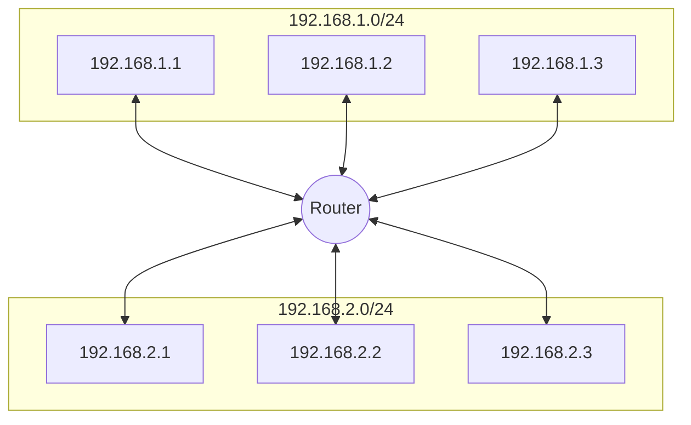

# Internet Protocol

Anything that you do in the Internet will associated with the source IP and the destination IP.

* Here you don't know about ports, HTTP headers, etc.
* The data unit here is **packets**

## The IP building blocks

### IP Address

* Layer 3 property
* Can be set automatically or statically
* Network and Host portion
* 4 bytes in IPv4 - 32 bits

### Network vs Host

* `a.b.c.d/x` where `a`, `b,`, `c`, `d` are integers and `x` is the network bits and remains are host
  * for example `192.168.254.0/24`
    * The first 24 bits (3 bytes) are network the rest 8 for host
      * this means we can have $2^{24} = 16777216$ networking ad each network has $2^8=266$ hosts
    * `192.168.254.0/24` is also called a subnet
      * the subnet has a mask `255.255.255.0`
      * Subnet mask is used to determine whether an IP is in the same subnet
        * it is important to the router, because if the true it uses the MAC address; else the router send it to the gateway.

### Default Gateway

Most networks consists of hosts, and one of them is the Default Gateway

* When host A want to talk to B directly if both are in the same subnet.
* Otherwise A sends it to someone who might know, the gateway.
* The Gateway has a IP Address and each host should know its gateway.
  * a gateway is a host of multiple networks.

### Example

* Host `192.168.1.3` wants to talk to `192.168.1.2`
  1) `192.168.1.3` applies subnet mask to itself and the destination IP `192.168.1.2`
     * `255.255.255.0 & 192.168.1.3 = 192.168.1.0`
     * `255.255.255.0 & 192.168.1.2 = 192.168.1.0`
     * Both equals, so they belongs on the same subnets
  2) Both source and destination are on the same subnet, they communicate thought MAC address.
     * The "router" is also a switch, so these communication will use that switch.
       * switches are a Layer 2 devices

