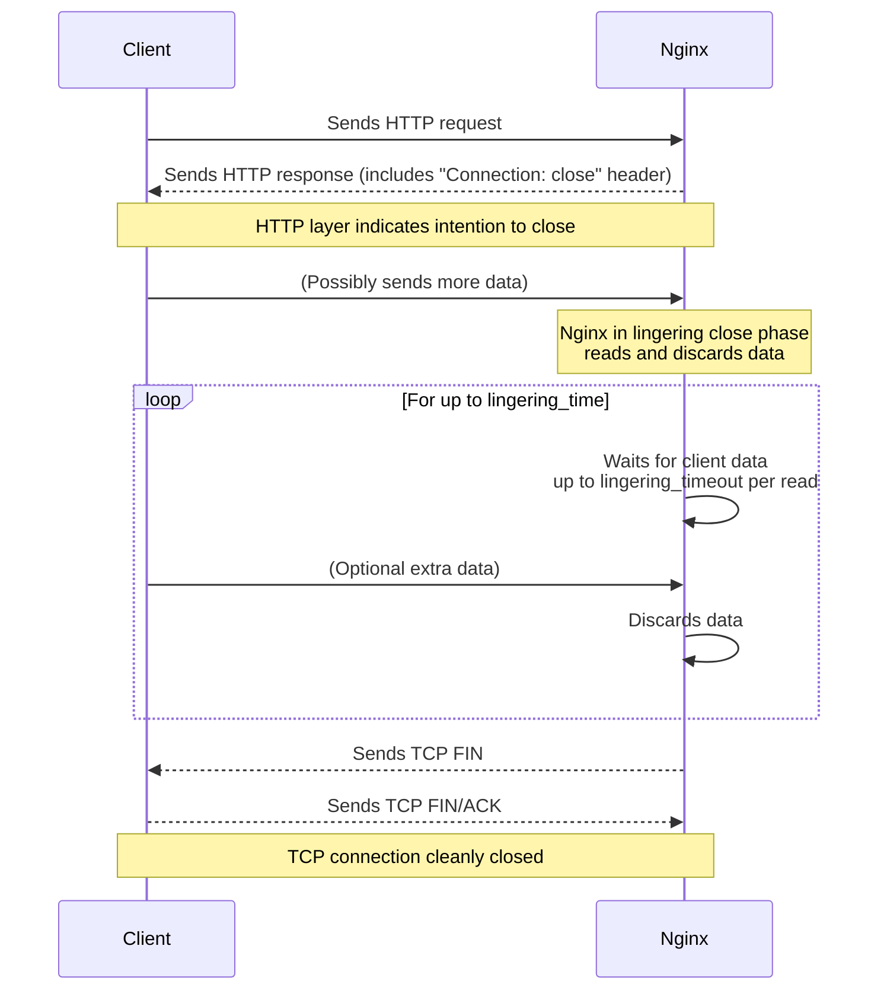
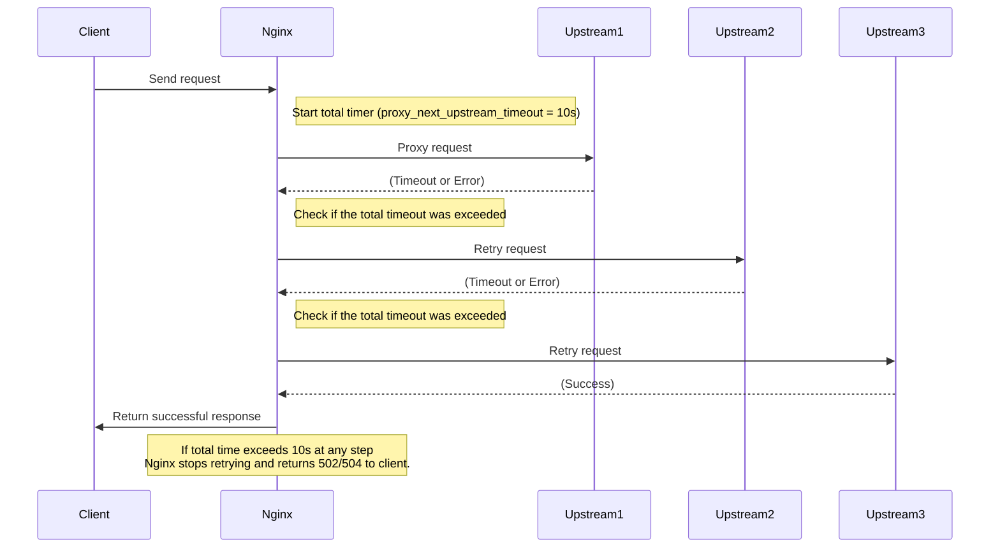

# NGINX Configuration

## Basics

### Nginx as webserver

```nginx
http {
	server {
        listen 8080;
        root my/site/path;
        
        location /images {
            root my/site1; # will search all my/site1/images
        }
        location ~ .jpg$ {
            return 403;
        }
    }
}

events {}
```

* `http` block directive specifies that I want a layer 7 webserver, here I can have many `servers`
* `server`:  block directive that makes nginx listen at a given port.
  * `listen` specifies the port that nginx will read from
  * `root` specifies the path where the nginx will expose as static web server.
  * You can serve different folders, based on the url path, using `location`
    * if can be a path, that will append to the `root` directive
    * if can also be a regex
    * Some url path can match multiple location, so there is a priority:
      1. Exact match (`=`)
         - It first checks for an exact match: `location = /something`.
         - If there is an exact match, Nginx uses it immediately.
         - No further checking is done.
      2. Longest prefix match
          - If there is no exact match, Nginx looks for all prefix matches (like `location /path`).
          - It picks the longest (most specific) matching prefix.
          - This prefix match is considered the "best match" so far.

      3. Regex locations (`~`, `~*`)
          - After finding the best prefix match, Nginx checks all regex locations in the order they appear in the config.
          - If any regex location matches the request URI, it overrides the prefix match.
            - Regex locations are an extra filter applied after prefix matching.
            - So regex locations have higher priority than prefix matches if they match, but they don’t just blindly override all prefix matches.
          - The first matching regex wins.
          - If no regex location matches, the best prefix match is used.

* The `events` block configures how Nginx handles connections at a low level — specifically things related to event-driven concurrency

  * it is is required (syntactically) but it doesn’t have to *contain* anything if you don’t want to change any defaults.

  * it allows as to control things like:
    * **worker_connections** — maximum simultaneous connections per worker.
    * **multi_accept** — whether to accept multiple connections at once.
    * **use** — which event method to use (epoll, kqueue, etc.).


### Nginx as a L7 Proxy

```nginx
http {
    upstream nodebackend {
        ip_hash;
        server nodeapp1:8080;
        server nodeapp2:8080;
        server nodeapp3:8080;
    }

    server {
        listen 8080;
            location / {
                proxy_pass http://nodebackend;
        }
    }
}

events {}
```

* the upstream allows you define many servers
  * you can specify the load balance algorithm:
    * by default it uses Round Robi, that requests are distributed to servers in a cyclical order. The first request goes to `nodeapp1`, the second goes to `nodeapp2`, etc.
    * `ip_hash` The server to which a request is sent is determined from the client IP address.
      * In this case, either the first three octets of the IPv4 address or the whole IPv6 address is used to calculate the hash value.
      * The method guarantees that requests from the same address get to the same server unless it is not available.

We can do reverse proxying to many different servers by a L7 criteria.

```nginx
http {
    upstream app1backend {
        server nodeapp1:8080;
        server nodeapp2:8080;
    }
    
    upstream app2backend {
        server nodeapp3:8080;
        server nodeapp4:8080;
    }

    server {
        listen 8080;
        location api1/ {
            proxy_pass http://app1backend;
        }
        
        location api2/ {
            proxy_pass http://app2backend;
        }
        
        location /admin {
            return 403; # Forbidden
        }
    }
}

events {}
```


<hr>

## Timeouts

Timeouts are very critical to control at any reverse proxy, because you don't want one connection using all your resources.

### Frontend Timeouts

#### client_header_timeout

Defines a timeout for reading client request header.

* If a client does not transmit the entire header within this time, the request is terminated with the 408 (Request Time-out) error. 
* Default 60s.
* It is important, because there is a attack called Slowlorris, it is a denial-of-service attack program which allows an attacker to overwhelm a targeted server by opening and maintaining many simultaneous HTTP connections between the attacker and the target. For instance, many clients send byte-by-byte content.

#### client_body_timeout

Defines a timeout for reading client request body.

* The timeout is set only for a period between two successive read operations, not for the transmission of the whole request body.
* it can be use to improve the security, because if you know that the clients lies on a very large band-width network, we can infer that a slow client is a attacker.

#### send_timeout

Sets a timeout for transmitting a response to the client

* The timeout is set only between two successive write operations, not for the transmission of the whole response.
* If the client does not receive anything within this time, the connection is closes. is set only between two successive write operations, not for the transmission of the whole r
* default 60s
* it prevent malicious, or the request isn't good for the  backend. 

#### keepalive_timeout

The first parameter sets a timeout during which a keep-alive client idle connection will stay open on the server side.

* The zero value disables keep-alive client connection.
* The optional second parameter sets a value in the `Keep-alive: timeout=time` response header field. Two parameters may differ.
  * it is a header that you send to the client.
* default 75 seconds.

#### lingering_timeout

When `ligering_close` is in effect, this directive specifies the maximum waiting time for more client data to arrive.
* it sets a timer for the client gracefully close the connection. 
* If data are not receiving during `lingering_timeout`, the connection is closed. Otherwise, the data are read and ignored, and nginx stats waiting for more data again.
* The "wait-read-ignore" cycle is repeated, but no longer than specified by the `ligering_time`




#### resolver_timeout

sets a timeout for name resolution of backend

* timeout 30 seconds

### Backend Timeouts

#### proxy_connect_timeout

Defines a timeout for establishing a connection with a proxied server.

* It should be noted that this timeout cannot usually exceed 75 seconds.
  * because if the nginx and backend are on the same local network, a connection establishments shouldn't delay.
  * put a too high timeout, the nginx will take too much time and too much resources to ask if a dead backend is alive.
  * put  a too low timeout, the nginx will drop connections unduly, mainly because backend is overwhelmed.

#### proxy_send_timeout

Sets a timeout for transmitting a request to the proxied server.

* The timeout is set only between two successive write operations, not for the transmission of the whole request.
* If the proxied server does not receive anything within this time, the connection is closes.
* it is more important than `send_timeout`, because each second used to this connection could be used to server other clients.

#### proxy_read_timeout

Defines a timeout for reading a response from the proxied server.

* The timeout is set only between two successive read operations, not for the transmission of the whole response.
* If the proxied server does not transmit anything within this time, the connection is closed. 
* `send_timeout` may trigger before or after

#### proxy_next_upstream_timeout

* Limits the time during which a requests can be passed to the next server.
  * The 0 value turns off this limitation. Default 0.
  * Without this limit, in some configurations Nginx could keep retrying across many upstreams, increasing latency for the client request. `proxy_next_upstream_timeout` provides an upper bound on how long these retries are allowed to take.

```nginx
proxy_next_upstream timeout error;
proxy_next_upstream_timeout 10s;
```

* `proxy_next_upstream` tells Nginx to try the next upstream if there is a `timeout` or `error`.
* `proxy_next_upstream_timeout 10s` ensures that even if retries are possible, Nginx will not spend more than 10 seconds *total* on all upstream attempts—including the very first try and any subsequent retries.



#### keepalive_timeout_backend

* sets a timeout during which a idle keep-alive connection to an upstream server will stay open.
* it is good to set something about 60s
  * if your server is busy, the connection won't be idle for 60s

