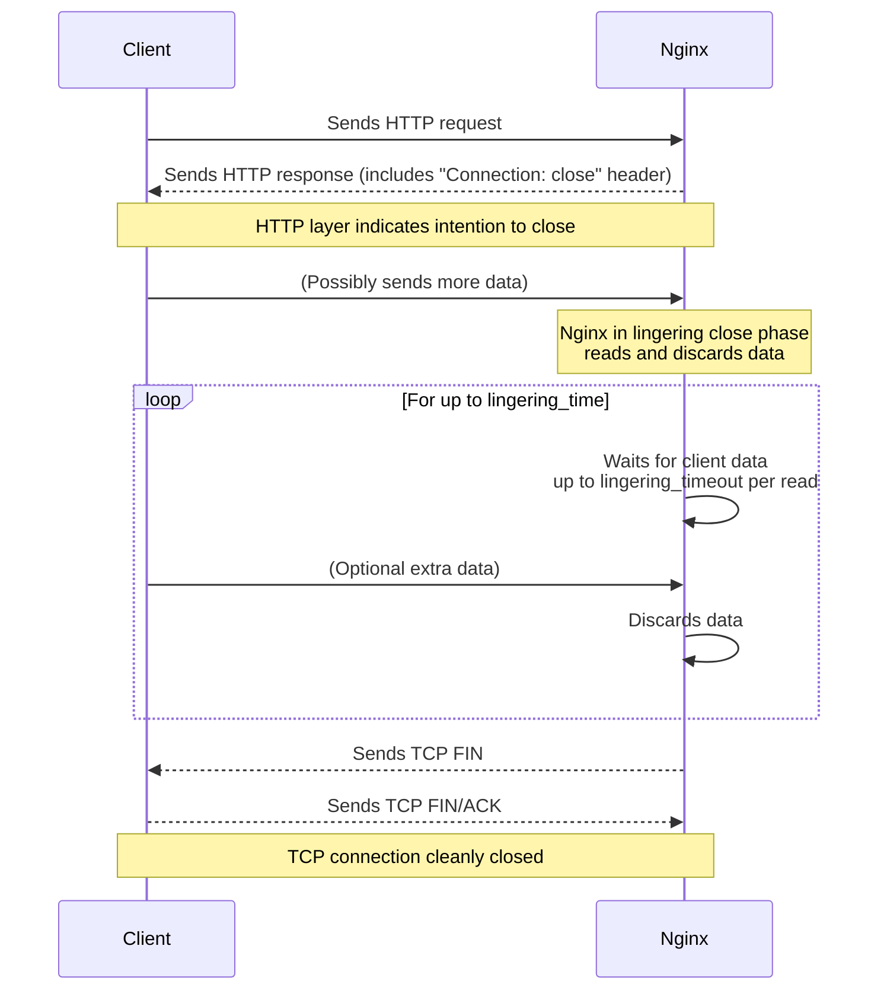
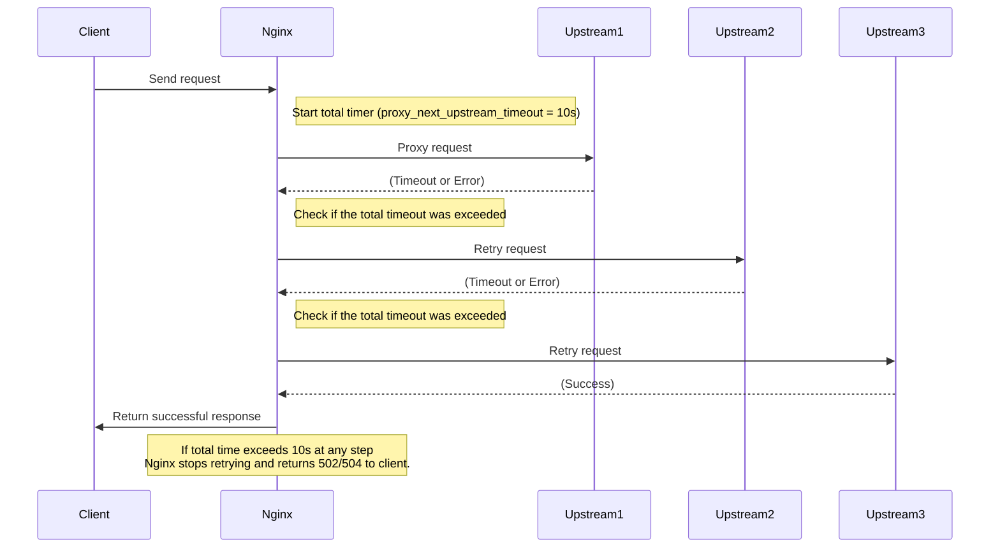

# NGINX timeouts

Timeouts are very critical to control at any reverse proxy, because you don't want one connection using all your resources.

## Frontend Timeouts

### client_header_timeout

Defines a timeout for reading client request header.

* If a client does not transmit the entire header within this time, the request is terminated with the 408 (Request Time-out) error. 
* Default 60s.
* It is important, because there is a attack called Slowlorris, it is a denial-of-service attack program which allows an attacker to overwhelm a targeted server by opening and maintaining many simultaneous HTTP connections between the attacker and the target. For instance, many clients send byte-by-byte content.

### client_body_timeout

Defines a timeout for reading client request body.

* The timeout is set only for a period between two successive read operations, not for the transmission of the whole request body.
* it can be use to improve the security, because if you know that the clients lies on a very large band-width network, we can infer that a slow client is a attacker.

### send_timeout

Sets a timeout for transmitting a response to the client

* The timeout is set only between two successive write operations, not for the transmission of the whole response.
* If the client does not receive anything within this time, the connection is closes. is set only between two successive write operations, not for the transmission of the whole r
* default 60s
* it prevent malicious, or the request isn't good for the  backend. 

### keepalive_timeout

The first parameter sets a timeout during which a keep-alive client idle connection will stay open on the server side.

* The zero value disables keep-alive client connection.
* The optional second parameter sets a value in the `Keep-alive: timeout=time` response header field. Two parameters may differ.
  * it is a header that you send to the client.
* default 75 seconds.

### lingering_timeout

When `ligering_close` is in effect, this directive specifies the maximum waiting time for more client data to arrive.
* it sets a timer for the client gracefully close the connection. 
* If data are not receiving during `lingering_timeout`, the connection is closed. Otherwise, the data are read and ignored, and nginx stats waiting for more data again.
* The "wait-read-ignore" cycle is repeated, but no longer than specified by the `ligering_time`




### resolver_timeout

sets a timeout for name resolution of backend

* timeout 30 seconds

## Backend Timeouts

### proxy_connect_timeout

Defines a timeout for establishing a connection with a proxied server.

* It should be noted that this timeout cannot usually exceed 75 seconds.
  * because if the nginx and backend are on the same local network, a connection establishments shouldn't delay.
  * put a too high timeout, the nginx will take too much time and too much resources to ask if a dead backend is alive.
  * put  a too low timeout, the nginx will drop connections unduly, mainly because backend is overwhelmed.

### proxy_send_timeout

Sets a timeout for transmitting a request to the proxied server.

* The timeout is set only between two successive write operations, not for the transmission of the whole request.
* If the proxied server does not receive anything within this time, the connection is closes.
* it is more important than `send_timeout`, because each second used to this connection could be used to server other clients.

### proxy_read_timeout

Defines a timeout for reading a response from the proxied server.

* The timeout is set only between two successive read operations, not for the transmission of the whole response.
* If the proxied server does not transmit anything within this time, the connection is closed. 
* `send_timeout` may trigger before or after

### proxy_next_upstream_timeout

* Limits the time during which a requests can be passed to the next server.
  * The 0 value turns off this limitation. Default 0.
  * Without this limit, in some configurations Nginx could keep retrying across many upstreams, increasing latency for the client request. `proxy_next_upstream_timeout` provides an upper bound on how long these retries are allowed to take.

```nginx
proxy_next_upstream timeout error;
proxy_next_upstream_timeout 10s;
```

* `proxy_next_upstream` tells Nginx to try the next upstream if there is a `timeout` or `error`.
* `proxy_next_upstream_timeout 10s` ensures that even if retries are possible, Nginx will not spend more than 10 seconds *total* on all upstream attempts—including the very first try and any subsequent retries.



### keepalive_timeout_backend

* sets a timeout during which a idle keep-alive connection to an upstream server will stay open.
* it is good to set something about 60s
  * if your server is busy, the connection won't be idle for 60s