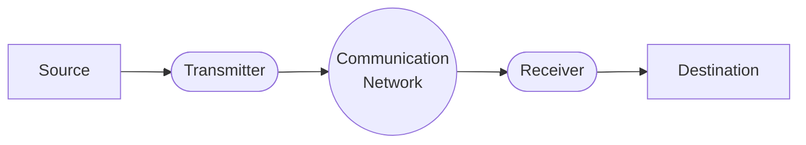
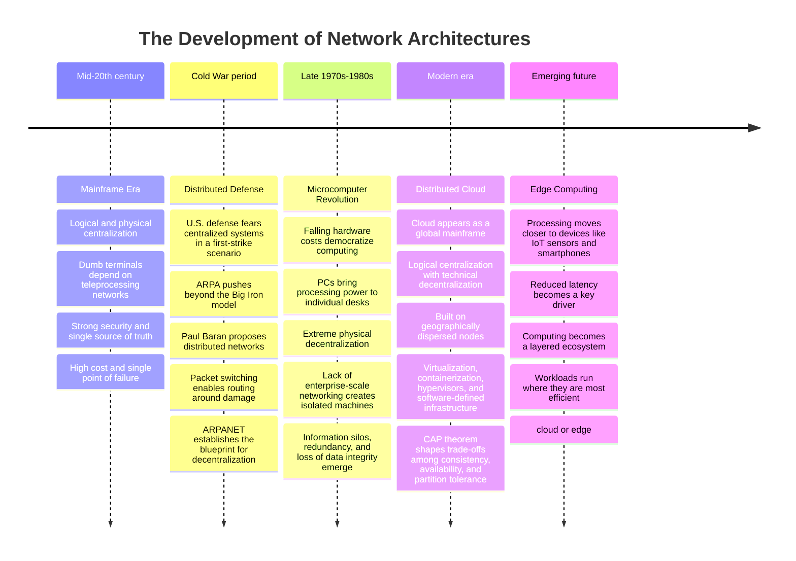
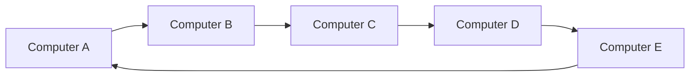
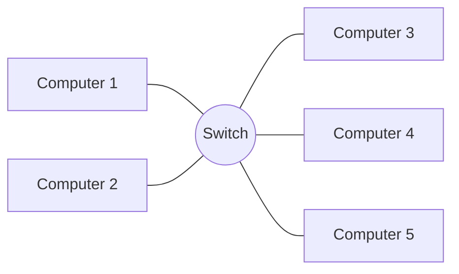
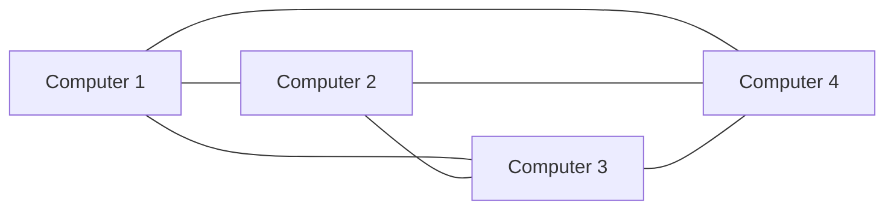

# Introduction

Bereft of the gift of communication, mankind would never have ascended to the technological heights it occupies today. Indeed, the very harmony of our ecosystem would falter were it not for the intricate dialogues that animals and insects weave within their own species.

Broadly speaking, humanity exists in a state of perpetual exchange. In ages past, long before the advent of this digital world, we relied solely upon primitive gestures and the most rudimentary of speech; yet, this process underwent a profound metamorphosis into the written word. Through this new paradigm of writing, we began to employ a tapestry of symbols, meticulously arranged to preserve ideas, thoughts, and messages—marking the true genesis of the global exchange of information."

## Data communication

### The Communication

Thus, we can understand that throughout humanity’s brief history, a global communication format has always existed, regardless of the method used. In this sense, according to Bay and Bluning (2016, p. 04), whenever there is a need to exchange information between two people or two computers, a similar format is used to facilitate the communication process. It is important to emphasize that communication only occurs if the information sent is received and fully understood.

#### The Communication System

Communication, regardless of its format, occurs through several universal components that change form depending on the medium, yet invariably perform the same function. The following figure illustrates the sequence of events and actors within the communication process:



By analyzing Figure 1, we can observe and conclude that there are clearly defined elements: **Source**, **Transmitter**, **Communication Network**, **Receiver**, and finally, the **Destination**. Furthermore, it is established that the flow of information always moves from the source to the destination. A source is responsible for generating the transmitted information and can be a person, a computer, or another device. According to Dantas (2010, cited in Bay and Bluning, 2016, p. 04):

- **The Source:** Prepares the generated information for transmission, ensuring it is compatible with the specific medium used (DANTAS, 2010).
- **The Transmitter:** Converts information into a signal format—via analog modulation or digital encoding—using devices such as modems, codecs, or digital and analog transmitters.
- **The Communication Network:** Transports information-bearing signals from senders to receivers through various architectures, such as LAN, WAN, telephone, cable, or satellite (BAY; BLUNING, 2016).
- **The Receiver:** Reverts the network signal into a readable format through demodulation or decoding, allowing the **destination** to effectively consume the original information.

### Data Transmission: Techniques and Types

In the computational and digital universe, we must understand that information derived from communication is not a static element; thus, it requires media for its transfer, enabling information to travel from the sender's origin to the destination via a communication network.

Within computers and other connected devices, a transmission system exists to perform this function, as the transmitter and receiver are typically located far apart. In this sense, according to **Dantas (2010, p. 45)**, although simplistic, transmission can be defined as the (electrical or optical) transfer of information from one location to another.

Transmission systems primarily operate through two distinct methodologies: **carrier transmission** and **inductive transmission**. Understanding the distinction between them is crucial for grasping how information is physically moved:

- **Carrier Transmission:** This technique involves a high-frequency electromagnetic wave—the **carrier**—which is "loaded" with information. The information signal modifies specific properties of this carrier wave (such as its amplitude, frequency, or phase) through a process called **modulation**. This is the standard for **unguided media**, such as radio, satellite, and television broadcasts, as it allows signals to travel long distances through the atmosphere and facilitates the sharing of the frequency spectrum among different users.
- **Inductive Transmission:** In contrast, inductive transmission (often associated with **baseband signaling**) involves the direct application of electrical or optical pulses into a physical medium without the use of a separate high-frequency carrier wave. It relies on the electromagnetic induction or conduction within the medium itself. This method is the foundation of **guided transmission**, where information is confined within physical conduits like **copper twisted-pair cables** or **optical fibers**. In these systems, the signal is "induced" directly as a voltage change or a light pulse that traverses the physical core from end to end.

Consequently, while carrier transmission excels in wireless environments where multiple signals must coexist in the air, inductive transmission remains the most efficient and reliable method for high-speed data transfer over physical, guided infrastructures (BAY; BLUNING, 2016).

In metallic cables, transmission occurs via electrical current, while in fiber optic cables, transmission is achieved through the propagation of light (optical energy) within the core (**BAY; BLUNING, 2016, p. 07**).

Furthermore, according to the authors, unguided transmission techniques are primarily used when the cost of implementing metallic or optical cable networks is prohibitive. A clear example of this is the application of unguided transmission to reach remote areas far from urban centers. In this mode of transmission, electromagnetic waves are emitted and propagated through the air; this technology is evident in systems such as radio broadcasts, television systems, and wireless networks.

#### Analog vs. Digital Transmission

Another essential concept concerns the distinction between analog and digital transmission:

- **Analog Transmission:** When information is sent as an analog signal, it changes state (e.g., characteristics such as amplitude, frequency, and phase) in a **non-discrete** manner. Typical analog signals include radio waves (AM, FM) and broadcast TV waves. Note that video utilizes amplitude modulation, audio uses frequency modulation, and color employs phase modulation—all of which are analog formats (**BAY; BLUNING, 2016, p. 07**).
- **Digital Transmission:** Generally, digital transmission is a significantly more simplified process. The primary advantage is that transmission is achieved by sending discrete signals (the binary code of zeros and ones), making transmitting and receiving equipment far more flexible than analog hardware. According to **Bay and Bluning (2016, p. 08)**, digital transmission has become much more economical and is currently the standard for telecommunication networks that support computer network infrastructure.

However, digital transmission requires a **synchronization process** between the transmitter and receiver. This ensures that the digital signal levels can be accurately identified and validated. Therefore, we can safely state that transmission modes are responsible for defining which digital synchronization technique must be utilized.

### Data Synchronization and Transmission Modes

In any digital communication system, the raw transmission of bits is useless without **synchronization**. Since data is transmitted as electrical or optical pulses over time, the receiver must know exactly **when** to sample the signal to distinguish between a "1" and a "0". If the transmitter's and receiver's internal clocks are even slightly out of alignment—a phenomenon known as **clock drift**—the receiver will eventually sample the signal at the wrong moment, leading to data corruption.

To solve this "timing problem," two primary modes of transmission are used:

#### 1. Asynchronous Transmission (Character-Level Sync)

In asynchronous mode, data is sent in small, independent packets (usually a single 8-bit character). Because the transmitter and receiver do not share a continuous global clock, they must "re-sync" at the start of every byte.

- **Mechanism:** Each character is framed by a **Start Bit** (which transitions the line from idle to active, "waking up" the receiver's clock) and one or more **Stop Bits** (which return the line to an idle state).
- **Clock Tolerance:** Since clock drift is inherently cumulative, it becomes increasingly dangerous over time; however, by restricting data to just a few bits, the system ensures that this drift remains **negligible**. Any accumulated error is then effectively neutralized as the timing is reset with every new Start Bit.
- **Trade-off:** It is simple and inexpensive to implement but highly inefficient. About **20% to 30%** of the transmitted data is "overhead" (start/stop bits) rather than actual information.

#### 2. Synchronous Transmission (Block-Level Sync)

Synchronous transmission is designed for high-speed, high-volume data. Instead of framing individual characters, it sends large **frames** or blocks of data in a continuous stream.

- **Mechanism:** The transmitter and receiver are locked to the exact same frequency. This is achieved either by a separate **clock line** or, more commonly, by embedding the clock signal within the data itself (using techniques like **Manchester Encoding** or **Phase-Locked Loops - PLL**).
- **Efficiency:** There are no start or stop bits between characters. The only overhead is a small "preamble" at the beginning of the frame to align the clocks. This makes it much faster and more efficient for modern networks like Ethernet.

Modern Ethernet is an example of synchronous transmission: it uses a preamble before the frame so the receiver can synchronize before interpreting the [frame fields](02%20Protocols/02%20Ethernet.md#Anatomy%20of%20the%20Ethernet%20Frame).
### Bandwidth and Transmission Rate

The distinction between **Bandwidth** and **Transmission Rate** is fundamental to understanding network performance. **Bandwidth** represents the theoretical capacity of the physical medium—the "size of the pipe"—often measured by the frequency range (**Hz**) it can support. In contrast, the **Transmission Rate** (or Bit Rate) is the actual speed at which data is successfully pushed through that medium, measured in bits per second (**bps**).

As seen in the table below, while these two values are closely related, they are measured differently depending on whether we are looking at the physical frequency limit or the digital data output.

| **Transmission Media** | **Transmission Rate** | **Bandwidth** |
| ---------------------- | --------------------- | ------------- |
| **Twisted Pair**       | 4 Mbps                | 3 MHz         |
| **Coaxial Cable**      | 550 Mbps              | 350 MHz       |
| **Optical Fiber**      | 2 Gbps                | 2 Gbps        |

- **Units:** Notice that for copper-based media (Twisted Pair and Coaxial), bandwidth is expressed in **MHz** (analog frequency range), while the transmission rate is in **Mbps**.
- **Fiber Optics:** In modern digital documentation, especially for fiber optics, "Bandwidth" is often used synonymously with "Transmission Rate" (both in Gbps), as the potential frequency range of light is so vast that the limit is usually defined by the electronics at either end rather than the glass itself.

## Timeline



### The Zenith of Centralization: The Mainframe Era

In the mid-20th century, computing was defined by the **Mainframe**—a singular, massive "brain" that served as the sole repository for processing and storage. This era was characterized by **Logical and Physical Centralization**. Users interacted with these machines through "dumb terminals," devices that possessed no internal processing power or storage. This setup necessitated a **teleprocessing network**, where the terminal acted strictly as an input/output interface while the mainframe handled every calculation. This model offered unparalleled security and data integrity, as there was only one "version of the truth." However, it created a rigid, expensive infrastructure that represented a massive **single point of failure**; if the mainframe stalled, the entire organization’s digital heartbeat stopped with it.

### The Strategic Catalyst: The Cold War and the Distributed Defense

While the Mainframe offered unparalleled control, it also presented a catastrophic strategic vulnerability. At the height of the Cold War, the primary fear of the U.S. defense establishment was a "First Strike" nuclear scenario. Because the nation’s communication and computing power were **Logically and Physically Centralized**, a single targeted attack on a central hub could decapitate the country’s ability to respond.

To mitigate this, the Advanced Research Projects Agency (**ARPA**) sought a way to move away from the "Big Iron" philosophy. Researchers like **Paul Baran** proposed a radical alternative: the **Distributed Network**. Instead of a single central "brain," this architecture envisioned a web of interconnected nodes where no single point was essential to the whole.

This era introduced the foundational concept of **Packet Switching**—breaking data into small, independent units that could "route around" damaged parts of the network to reach their destination. While this technology was initially confined to elite military and academic circles (the **ARPANET**), it established the blueprint for a world that no longer relied on a single center. However, as this top-tier networking technology was being perfected, a different kind of revolution was about to hit the commercial market: the rise of the independent microcomputer.

### The Fragmented Revolution: Microcomputers and Islands of Information

Despite the groundbreaking work on distributed protocols occurring in military and academic labs, these networking capabilities remained largely sequestered from the average business environment. Instead, the commercial landscape of the late 1970s and 1980s was defined by a different kind of disruption—one that **Ventury (2016)** describes as a drive to democratize computing power. The plummeting cost of hardware birthed the **Microcomputer** (the PC), shifting the pendulum toward extreme **Physical Decentralization**.

For the first time, processing power sat on the individual's desk rather than behind a locked data center door. While this empowered the individual worker, it created a systemic crisis for the enterprise. Because the networking "connective tissue" discussed in the previous era had not yet scaled to the corporate world, these computers operated as **"islands,"** unable to communicate with one another. This fragmentation led to the **"Information Silo"** problem: data was duplicated across different machines, leading to massive redundancies and the loss of data integrity. Without a network to synchronize these islands, the efficiency gained in personal productivity was often lost in the chaos of resource mismanagement and the lack of a "single version of the truth."

### The Synthetic Era: The Rise of the Distributed Cloud

The modern era represents a sophisticated synthesis of these two historical extremes. We have reached a point where the **Cloud** functions as a "Global Mainframe" in terms of its user experience—a concept known as **Logical Centralization**. To the developer or the consumer, the cloud appears as a single, seamless product or pool of resources. However, beneath this abstraction layer, the system is **Technically Decentralized**. It relies on thousands of geographically dispersed nodes, managed through virtualization and containerization.

This duality is governed by the **CAP Theorem**, which dictates the trade-offs between Consistency, Availability, and Partition Tolerance in these distributed environments. By using **Hypervisors** and **Software-Defined Infrastructure**, modern systems achieve the "best of both worlds": the iron-clad control and shared resources of the mainframe era, combined with the resilience, scalability, and local performance of decentralized processing.

### The Future Frontier: Edge Computing

Currently, the pendulum is swinging once more. As we move toward **Edge Computing**, we are pushing processing power even further away from the "central" cloud and onto the devices themselves—such as IoT sensors or smartphones—to reduce **latency**. This suggests that the "Post-Mainframe" world is not one of either/or, but a complex, multi-layered ecosystem where data is processed exactly where it is most efficient to do so, whether that is in a massive data center or on the chip of a localized sensor.

## Conceptualizing the Modern Computer Network

To solve the "Islands of Information" crisis, the industry moved from isolated machines to integrated systems. Based on the frameworks provided by **Ventury (2016)** and **Macedo (2018)**, we can define the modern network through its architecture and its purpose.

### Teleprocessing vs. Computer Networks

The most critical distinction for a postgraduate student is the shift in **where the "thinking" happens.**

- **Teleprocessing Networks:** A relic of the mainframe era. Every "node" is a terminal with zero processing power. All logic is centralized in one machine.
- **Computer Networks:** A decentralized system where every **node** (device) is **autonomous**. Each device can execute tasks independently, even if it is disconnected from the network.

| Feature             | Teleprocessing Network     | Computer Network                      |
| ------------------- | -------------------------- | ------------------------------------- |
| **Node Capability** | "Dumb" (Input/Output only) | **Autonomous** (CPU, RAM, Storage)    |
| **Logic Center**    | Centralized (Mainframe)    | **Distributed** (Spread across nodes) |
| **Relationship**    | Master-Slave               | Peer-to-Peer or Client-Server         |

## Categorizing Networks by Extension

### Local Area Network (LAN - /ˌɛl eɪ ˈɛn/)

A LAN is a private network that connects devices within a strictly defined and restricted geographic area, such as a single room, office, or campus.

- **Objective:** To allow resource sharing (printers, files, servers) among a group of users.
- **Characteristics:**
  - **High Speed:** Known for very fast transmission rates (Gbps).
  - **Low Latency:** Data travels very short distances, resulting in near-instant communication.
  - **Private Ownership:** Usually owned and managed by the organization using it.
  - **Medium:** Can be wired (Ethernet) or wireless (Wi-Fi).

### Metropolitan Area Network (MAN - /ˌɛm eɪ ˈɛn/)

When connectivity needs to cross city or regional boundaries, we move into the MAN tier. This typically covers a city or a large county.

- **Objective:** Designed to provide high-speed access to customers across a city (e.g., cable internet or ADSL provided by ISPs).
- **Characteristics:**
  - **Leased Infrastructure:** Unlike LANs, the equipment and lines are typically rented from telecommunications providers.
  - **Topology:** Frequently uses a **Ring Topology** to ensure redundancy within the city.
  - **Performance:** Historically equal to or slightly slower than LANs, acting as a "bridge" between local and wide-area speeds.

### Wide Area Network (WAN - /ˌdʌbəljuː eɪ ˈɛn/)

The WAN is the "network of networks." It provides the infrastructure to connect various LANs across vast distances—countries, continents, or the entire world.

- **Objective:** To achieve global coverage using long-distance connections like satellite links or undersea fiber-optic cables.
- **Characteristics:**
  - **Vast Scale:** Covers the largest possible geographic areas.
  - **Higher Latency:** Due to the physical distance (e.g., signals traveling to a satellite and back), the "round-trip time" for data is significantly higher.
  - **Higher Error Rates:** Long-distance transmission is more susceptible to signal degradation and interference.
  - **High Cost:** While speeds now reach tens of Gbps, the operational cost of maintaining this infrastructure is extremely high.

## Categorizing Networks by Topology

Before a network can exchange a single byte of data, it must be organized into a specific geometric arrangement known as **Topology**. To understand this concept, one can look at a simple childhood experiment: the "tin can telephone." Two plastic cups connected by a taut string illustrate the most basic form of a network. For communication to be audible, the string must remain straight and the tension constant. This physical requirement—the "rule" of the string—is the essence of topology.

In professional Information Systems, according to **Ventury (2016)**, a network topology is defined as the structural arrangement that interlinks various **nodes** (processing devices) through **physical links** (transmission media) and a specific set of **protocols** (the rules of engagement).

Choosing the right topology is a balancing act between three academic pillars:

1. **Reliability:** How does the system handle a single point of failure?
2. **Performance:** How many simultaneous "conversations" can the medium support?
3. **Cost and Complexity:** How much cabling and specialized hardware (like switches or repeaters) are required?

Depending on the geographical scale (LAN, MAN, or WAN) and the specific needs of the organization, several standard topological models have emerged as the foundation of modern computing. These are categorized as follows:

### Bus Topology

The Bus topology is characterized by a single central cable, known as the **backbone**, to which all network nodes (hosts) are directly connected.

```
[Terminator]====+====+====+====+====[Terminator]
                |    |    |    |
              [PC1][PC2][PC3][PC4]
```

- **Mechanism:** It typically utilizes coaxial cables. When a computer sends a data packet, it travels along the entire backbone.
- **The "Broadcast" Nature:** In this setup, when one machine "talks," every other machine "listens."
- **Critical Vulnerabilities:**
  - **Single Point of Failure:** If the central backbone cable fails or is severed, the entire network is incapacitated.
  - **Data Collision/Overlap:** Since there is only one shared path, if two machines attempt to communicate simultaneously, their signals can overlap, leading to data loss.
- **Status:** While historically significant in corporate environments, it is largely considered a legacy technology today.

### Ring Topology

In a Ring topology, each node is connected to exactly two other nodes, forming a continuous circular path for data.



- **Mechanism:** Messages circulate through the ring via a series of repeaters. It is usually **unidirectional**, meaning data moves in only one direction.
- **Reliability Features:** Modern iterations include relays that can mechanically remove a failing node from the ring to prevent a total network collapse.
- **The IBM Innovation (Token Ring):** A sophisticated concept is the distinction between **Physical and Logical Topology**. IBM’s Token Ring used a *logical* ring (for data passing rules) but a *physical* star (for cabling), combining the performance of a ring with the management ease of a star.
- **Pros & Cons:**
  - **Pros:** Better performance than Bus; handles high-capacity data over longer distances.
  - **Cons:** Conceptually, if one "island" (node) is blocked and lacks a bypass relay, the "postman" (data) cannot reach the next destination.

### Star Topology




This is the most prevalent topology in modern local networks. Every node is connected via a point-to-point link to a central device, such as a **Hub** or a **Switch**.

- **Mechanism:** All information must pass through the central node before reaching its destination.
- **The Switch Advantage:** Unlike a Hub (which broadcasts data to everyone), a **Switch (Layer 2 device)** can manage traffic more intelligently, allowing multiple simultaneous "conversations" without collisions.
- **Characteristics:**
  - **Centralized Management:** The central node handles switching and communication logic, making it easier to detect errors and perform maintenance.
  - **Scalability Limits:** The number of nodes is limited by the physical ports available on the central switch and the physical space for cabling.
- **Vulnerabilities:**
  - If the central switch fails, the entire network goes down.
  - Performance can degrade if the central processor is overwhelmed by too many simultaneous requests.

To complete your architectural survey, we must include the **Mesh Topology**. This is the "gold standard" for reliability and is the spiritual successor to the distributed defense models we discussed in the Cold War section.

Here is the addition for your **Network Topology: The Architecture of Connectivity** section:

### Mesh Topology 
If the Star topology is a hub-and-spoke and the Ring is a circle, the **Mesh** topology is a spiderweb. In this arrangement, nodes are interconnected with multiple redundant paths.



- **Full Mesh vs. Partial Mesh:**
  - **Full Mesh:** Every single node is physically connected to every other node in the network. This offers the highest possible redundancy but is incredibly expensive and complex to wire.
  - **Partial Mesh:** Most nodes are connected to only a few others—specifically those with which they exchange the most data. This provides the "survivability" of a mesh without the astronomical cost of cabling every single device together.
- **Mechanism (The Self-Healing Network):** Because there are multiple paths between any two points, the network is "self-healing." If one link is severed or a node fails, the routing protocols simply redirect the data packets through an alternative path.
- **Characteristics:**
  - **No Single Point of Failure:** Unlike the Bus or Star, there is no central cable or switch that can bring down the entire system.
  - **High Fault Tolerance:** It is the most resilient topology available, which is why it is used for critical infrastructure.
  - **Scalability Challenges:** In wired environments, the number of cables required grows quadratically with each new node ($n(n-1)/2$).
