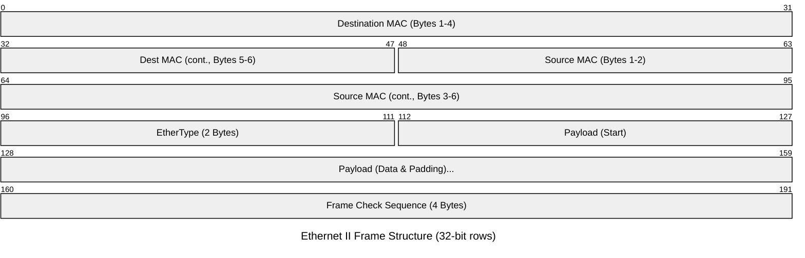
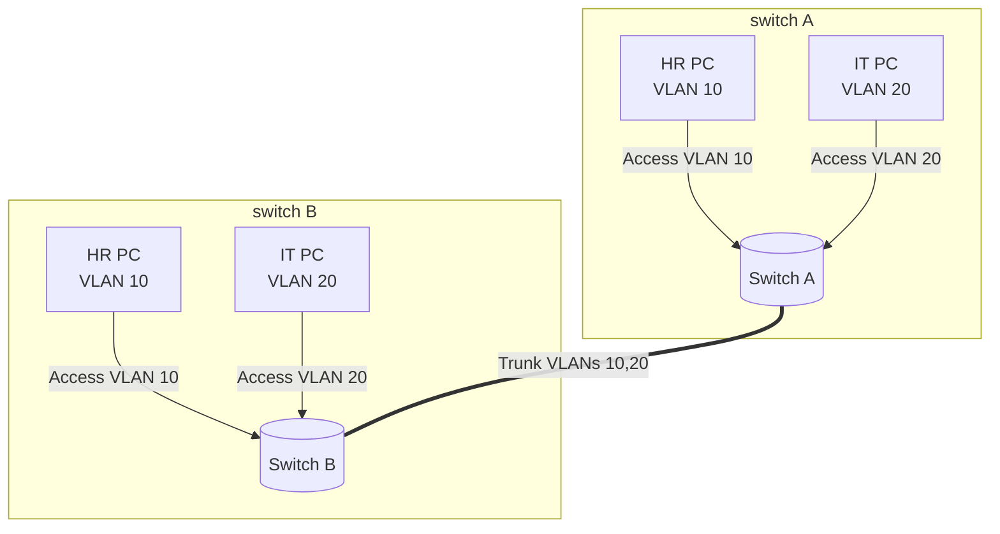
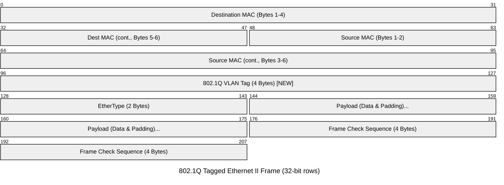

# Ethernet

Ethernet is the dominant Layer 2 technology used in wired LANs. It defines how devices format frames, identify local interfaces, and deliver traffic across the same local network segment.

Ethernet cable categories ("Cat") classify the performance of twisted-pair cabling, not the internet connection itself. The supported link speed also depends on the Ethernet ports at both ends, cable length, and installation quality; these common capabilities assume a properly installed channel within its standard distance limits.

| Category | Typical Ethernet capability | Distance context |
| --- | --- | --- |
| Cat 5 | 100 Mb/s (Fast Ethernet) | Up to 100 m |
| Cat 5e | 1 Gb/s (Gigabit Ethernet) | Up to 100 m |
| Cat 6 | 1 Gb/s up to 100 m; 10 Gb/s on shorter runs | 10 Gb/s reach depends on installation and crosstalk; typically up to 55 m |
| Cat 6A | 10 Gb/s (10GBASE-T) | Up to 100 m |

For ordinary gigabit links, Cat 5e is sufficient; Cat 6A is the usual choice when 10 Gb/s must span the full 100 m. A higher category does not increase the speed beyond what the connected equipment supports.

## Ethernet at Layer 2

Ethernet is the foundational technology of modern Local Area Networks (LANs). While it has specifications that define the physical cables and signals (Layer 1), its logical operations are defined at the [**Data Link Layer (Layer 2)** of the OSI Model](../03%20Network%20Models.md#The%20OSI%20%28Open%20Systems%20Interconnection%29%20Model).

Here is how Ethernet functions and governs the flow of data within a local network:

- **Relationship with the OSI Data Link Layer:** The Data Link layer is responsible for node-to-node data transfer and detecting physical layer errors. Ethernet fulfills this role by defining the exact formatting of the data being transmitted, providing a hardware addressing system (MAC addresses), and implementing error checking (via a mathematical calculation called the Frame Check Sequence, or FCS) to ensure the data was not corrupted as it traveled over the wire.
- **Frames, Not Packets:** In networking, the unit of data changes names depending on the OSI layer (known as the Protocol Data Unit, or PDU). At Layer 3 (Network Layer), data is called a [packet](03%20Internet%20Protocol.md#Anatomy%20of%20the%20IP%20packet) and uses IP addresses. When that packet moves down to Layer 2, Ethernet wraps it in its own structural container called a **Frame**.
- **Local Delivery:** Ethernet is strictly designed for **local delivery**. It uses physical MAC addresses to move frames from one node to another _within the same local network segment_. Ethernet has no concept of the global internet or routing; if a computer needs to send data to a server in another country, Ethernet simply delivers the frame locally to the network's Router (the default gateway), and the Router's Layer 3 IP process takes over to navigate the global path.
- **Switches:** The core device of Layer 2 Ethernet is [the switch](../02%20Network%20Components.md#The%20Switch).
- **Broadcast Domains:** A broadcast domain is the logical boundary of a network where all nodes can reach each other by sending a broadcast message at the Data Link layer. In Ethernet, if a device needs to send a message to everyone (e.g., an ARP request asking "Who has this IP address?"), it sends a frame with a special broadcast MAC address (`FF:FF:FF:FF:FF:FF`). A Layer 2 switch will forward this broadcast frame out of every single port (except the one it came from). Therefore, a switch _extends_ a broadcast domain. To stop broadcasts from flooding everywhere and separate the network into multiple broadcast domains, a Layer 3 device, like a Router, is required
## The History of the Ethernet Frame: The "Frame Wars"

When capturing network traffic today, almost 100% of the frames you will see are designated as **Ethernet II**. This naming convention points back to a period in the 1980s often referred to as the networking "Frame Wars," where two different groups created competing rules for how an Ethernet frame should be structured.

**1. Ethernet II (The DIX Standard)**

- **Origins:** Created in 1982 by a consortium of three tech giants: **D**EC, **I**ntel, and **X**erox (often referred to as the DIX standard). This was the second version of their design, hence "Ethernet II."
- **The Defining Feature:** It utilized the 2-byte field immediately following the MAC addresses as an **EtherType**. This field explicitly identified the _protocol_ of the payload inside (e.g., indicating "This payload is an IPv4 packet").

**2. IEEE 802.3 (The Committee Standard)**

- **Origins:** Shortly after DIX released Ethernet II, the Institute of Electrical and Electronics Engineers (IEEE) created their own official standardization for Ethernet, named 802.3.
- **The Defining Feature:** The IEEE changed that same 2-byte field to act as a **Length** field. Instead of identifying the protocol, it simply stated how many bytes the payload contained. To identify the actual protocol, IEEE 802.3 required additional overhead fields (called LLC and SNAP headers) to be inserted inside the payload area.
### Why Ethernet II Won

As networks expanded and began carrying multiple different protocols simultaneously (such as IPv4, ARP, IPX, and AppleTalk), routers and switches needed a way to instantly identify what was inside the frame.

The **Ethernet II** method of using the **EtherType** field proved to be significantly faster, simpler, and required less processing overhead than the IEEE's complex Length/LLC method. The industry overwhelmingly favored the DIX standard.

#### The Modern Compromise

Eventually, the IEEE formally recognized the industry's preference and updated their 802.3 standard to allow for both formats on the same network. They accomplished this using a clever mathematical rule applied to that specific 2-byte field:

- **Length (IEEE 802.3):** If the decimal value in the field is **1500 or less**, the receiving device reads it as a Length field (since the maximum payload of standard Ethernet is 1500 bytes).
- **EtherType (Ethernet II):** If the decimal value is **1536 or greater**, the device reads it as an EtherType field. For example, the hex value `0x0800` (which identifies IPv4) translates to 2048 in decimal, neatly falling into the EtherType category.
## Anatomy of the Ethernet Frame

While the diagram above shows the logical Layer 2 structure, a complete transmission on the wire actually includes a brief physical layer introduction. Here is the step-by-step breakdown of every piece of the transmission:

**1. Physical Layer Overhead (Not technically part of the Layer 2 frame)**

Ethernet uses synchronous block-level transmission, where the receiver must align its clock before reading the frame, as in [synchronous transmission](../01%20Introduction.md#2.%20Synchronous%20Transmission%20%28Block-Level%20Sync%29).

In Ethernet specifically, this synchronization is implemented with:
- **Preamble (7 bytes):** clock alignment pattern.
- **Start Frame Delimiter / SFD (1 byte):** marks the start of the actual Ethernet frame.

**2. The Ethernet Header (Layer 2)**

- **Destination MAC Address (6 Bytes):** The physical address of the device that is supposed to receive the frame. This can be a unicast (single device), multicast (group of devices), or broadcast (`FF:FF:FF:FF:FF:FF`) address.
- **Source MAC Address (6 Bytes):** The physical address of the device that originally sent the frame.
- **EtherType (2 Bytes):** This field acts as an instruction manual for the receiving device on what to do next. It identifies the Layer 3 protocol encapsulated inside the payload. For example, `0x0800` means the payload contains an IPv4 packet, while `0x86DD` indicates an IPv6 packet. _(Note: In older 802.3 standards, this field was used to define the "Length" of the frame, but EtherType is the standard today)._
    
**3. The Payload**

- **Data & Padding (46 to 1500 Bytes):** This is the actual data being transported (usually an IP packet containing a TCP segment and the application data).
    - **Maximum:** The standard Maximum Transmission Unit (MTU) for an Ethernet payload is 1500 bytes.
    - **Minimum (Padding):** An Ethernet frame must be at least 64 bytes long (excluding the Preamble/SFD). If the payload is smaller than 46 bytes, the transmitting device will add "Padding" (dummy zeros) to artificially inflate it to meet the minimum size requirement.

**4. The Ethernet Trailer**

- **Frame Check Sequence / FCS (4 Bytes):** This is the error-checking mechanism. Before sending the frame, the sender runs a mathematical algorithm called a Cyclic Redundancy Check (CRC) against the frame's contents and puts the resulting value here. When the receiver gets the frame, it runs the exact same calculation. If the receiver's result matches the FCS value, the frame is intact. If it does not match, it means the frame was corrupted during transit (e.g., electrical interference), and the receiver will silently drop it.
## MAC Addressing

MAC stands for **Media Access Control**. A MAC address is the Layer 2 identifier used inside a local network segment so switches and network interface cards can decide where an Ethernet frame should go.

At the [Data Link layer](../03%20Network%20Models.md#The%207%20Layers%20of%20OSI), communication happens with **frames**, not IP packets. This is why Layer 2 devices reason about MAC addresses instead of IP addresses.

 It is a **physical address** in the sense of Layer 2 addressing, even though many systems allow it to be changed in software

### Anatomy of the MAC Address

A MAC (Media Access Control) address is a **48-bit (6-byte)** physical hardware identifier assigned to a Network Interface Card ([NIC](../02%20Network%20Components.md#The%20Network%20Interface%20Card%20%28NIC%29)). Because it is permanently burned into the hardware during manufacturing, it is often referred to as a "Burned-In Address" (BIA).

**1. The Formatting (Hexadecimal)** Because reading 48 binary 1s and 0s is impossible for humans, MAC addresses are written in **hexadecimal**. They are most commonly represented as six octets (pairs of characters) separated by colons or hyphens:

- **Standard Format:** `00:1A:2B:3C:4D:5E` or `00-1A-2B-3C-4D-5E`
- _(Note: Cisco networking equipment often formats them in three groups of four separated by periods, like `001A.2B3C.4D5E`)_.

**2. The 48-Bit Breakdown** The 48 bits are split perfectly down the middle to guarantee that every network card on the planet has a completely unique address:

- **The First 24 Bits (The OUI):** The first three octets (e.g., `00:1A:2B`) form the **Organizationally Unique Identifier (OUI)**. This is essentially the vendor code. The IEEE assigns these specific prefixes to hardware manufacturers (like Apple, Cisco, Intel, or Dell). If you look up a MAC address's OUI online, you can instantly identify who manufactured the device.
- **The Last 24 Bits (The UAA):** The remaining three octets (e.g., `3C:4D:5E`) form the **Universally Administered Address (UAA)** or Device ID. This is basically the serial number uniquely assigned by the manufacturer to that specific card as it rolls off the assembly line.
    
**3. The Special Bits (First Octet)** If you zoom in on the very first byte of the OUI, two specific binary bits act as special flags:

- **The I/G Bit (Least Significant Bit):** As noted earlier, this tells the network if the address is a Unicast (`0`) or Multicast/Broadcast (`1`) destination.
- **The U/L Bit (Second Least Significant Bit):** This tells the network if the address is Universally administered (a factory `0`) or Locally administered (a `1`, meaning a network administrator manually spoofed or changed the MAC address in the software).
### Types of MAC Addresses: Unicast, Multicast, and Broadcast

When an Ethernet frame arrives at a device, its network card (NIC) looks at the Destination MAC Address. The NIC uses this address to confirm: _"Is this frame meant for me, or should I ignore it?"_ There are three different types of destination MAC addresses used to dictate how the data is delivered:

**1. Unicast (One-to-One)**

- **What it is:** A transmission from one specific device directly to another specific device. This makes up the vast majority of normal network traffic (e.g., your computer talking to your local router).
- **How it works:** The destination address is the unique, burned-in MAC address of a single network card. When a switch receives a unicast frame, it looks at its MAC address table and forwards the frame _only_ out of the specific port where that destination device lives.
- **Technical Detail:** A MAC address is recognized as unicast if the **Individual/Group (I/G) bit** (which is the least significant bit of the very first byte) is set to `0`.

**2. Multicast (One-to-Many, but a Specific Group)**

- **What it is:** A transmission from one device to a specific _group_ of devices that have "subscribed" to listen to that traffic. It is highly efficient for things like streaming live video to multiple employees or routers sharing routing table updates.
- **How it works:** Instead of sending 50 separate unicast frames to 50 different computers, the sender transmits a single frame with a special Multicast MAC address. Only the devices that are configured to listen to that specific multicast group will process the frame; all other devices on the network will simply ignore it.
- **Technical Detail:** A MAC address is recognized as multicast if the **I/G bit** is set to `1`. For example, all IPv4 multicast MAC addresses universally start with the prefix `01:00:5E`.

**3. Broadcast (One-to-All)**

- **What it is:** A transmission from one device to _every single device_ on the local network segment (the broadcast domain).
- **How it works:** The sender uses a special, reserved MAC address consisting of all 1s in binary, which translates to exactly **`FF:FF:FF:FF:FF:FF`** in hexadecimal. When a Layer 2 switch receives this frame, it is forced to flood copies of it out of every single active port. Furthermore, every computer that receives it _must_ interrupt its CPU to open the frame and see what it wants.
- **Why we use it:** It is primarily used for network discovery. The most common example is an ARP (Address Resolution Protocol) request. If your computer knows it needs to send data to IP `192.168.1.50` but doesn't know the MAC address, it sends a broadcast yelling to the whole network: _"Hey everyone, whoever has the IP 192.168.1.50, please reply to me with your MAC address!"_
### MAC Spoofing and Randomization

While a MAC address is permanently "burned in" to the physical chip of the network card at the factory (the Burned-In Address, or BIA), the device's operating system has the final say over what address is actually transmitted on the network. The act of changing this address via software is known as **MAC Spoofing**.

**How it Works:** When you change your MAC address via software, you are not physically altering the microchip on your network card. Instead, you are instructing the Operating System's network driver to ignore the hardware's BIA. Whenever the OS builds an Ethernet frame to send out, it simply writes your chosen "spoofed" MAC address into the Source MAC field of the Layer 2 header.

**The U/L Bit in Action:** When a system intentionally spoofs a MAC address, it typically changes a specific flag within the address to play by the rules. The second least significant bit of the first byte is the **Universally/Locally Administered (U/L) bit**.

- When software generates a new MAC address, it mathematically flips this U/L bit to a **`1`**.
- This politely announces to the local network: _"This is a Locally Administered Address created by software, not a factory hardware address."_

#### Common Use Cases

- **Privacy and Tracking Prevention (MAC Randomization):** This is the most common, legitimate use case today. When you walk through a public space with Wi-Fi enabled, routers can track your physical movements by logging your device's constant MAC address. Modern mobile operating systems (iOS and Android) automatically use **MAC Randomization** to generate and broadcast a fake MAC address for every new public Wi-Fi network you connect to, preventing location tracking.
- **Bypassing Network Restrictions:** Many hotel or airport Wi-Fi networks (Captive Portals) grant temporary internet access tied to a device's MAC address. By spoofing a new MAC address, a user makes their computer look like a brand-new device, resetting the time limit.
- **Security Testing / Penetration Testing:** In corporate networks, administrators often use "MAC Filtering" or "Port Security" to only allow specific, known corporate devices to connect to the switches. Ethical hackers will spoof their MAC address to perfectly match the address of an authorized device (like an office printer or a CEO's laptop) to bypass these Layer 2 security controls.

## VLAN Tagging

### VLAN Tagging (IEEE 802.1Q)

To understand VLAN tagging, we first have to understand the problem it solves.

A **VLAN (Virtual Local Area Network)** allows network administrators to take one physical physical switch and logically slice it into multiple, isolated broadcast domains. For example, ports 1-10 belong to HR (VLAN 10), and ports 11-20 belong to IT (VLAN 20). Devices in HR cannot talk to devices in IT without going through a router.

**The Problem: Trunk Links**

If you only have one switch, VLANs are easy—the switch just remembers which port belongs to which VLAN. But what happens if you connect _Switch A_ to _Switch B_ using a single cable, and both switches have HR and IT computers on them?

When a frame from an HR computer travels across that shared cable, how does the receiving switch know it belongs to the HR VLAN and not the IT VLAN?

**The Solution: 802.1Q Tagging**

The solution is defined by the IEEE **802.1Q** standard. When an Ethernet frame leaves a switch to travel across a shared cable (called a **Trunk Link**), the switch physically modifies the Ethernet frame by injecting a 4-byte "Tag" right into the middle of the Layer 2 header.

#### The Tagged Ethernet Frame

The switch literally slices the frame open, inserts the 4-byte 802.1Q tag immediately after the Source MAC address, and recalculates the FCS at the end so the frame isn't considered corrupted.

#### Anatomy of the 4-Byte Tag

The 4-byte (32-bit) tag is broken down into two main sections:

**1. Tag Protocol Identifier (TPID - 2 Bytes)**

- Because the tag pushes the old `EtherType` field further down the frame, the receiving switch needs a warning. The TPID is always set to the hex value **`0x8100`**.
- When a switch reads `0x8100` where the `EtherType` usually is, it immediately knows: _"Stop! This isn't an IP packet yet; this is a tagged frame. The next two bytes are VLAN information."_

**2. Tag Control Information (TCI - 2 Bytes)**

This section holds the actual VLAN data and is split into three pieces:

- **Priority Code Point (PCP - 3 bits):** Used for Quality of Service (QoS). It allows the switch to prioritize certain frames (like voice or video traffic) over others (like file downloads) across the trunk link.
- **Drop Eligible Indicator (DEI - 1 bit):** Used to indicate frames that can be dropped if the network is congested.
- **VLAN Identifier (VID - 12 bits):** This is the core of the tag. It is the actual number of the VLAN (e.g., VLAN 10).
    - _Technical Limit:_ Because the VID is exactly 12 bits long, the mathematical maximum number of VLANs you can create on a standard network is **4,096** ($2^{12}$). VLANs 0 and 4095 are reserved, leaving 1 through 4094 available for use.

### Class of Service (CoS)

CoS is the primary mechanism used for **Quality of Service (QoS) at Layer 2**.

When a network gets congested, a switch needs a way to decide which frames are urgent and which can wait. For example, a live VoIP phone call will start stuttering and failing if its packets are delayed, whereas an email downloading in the background won't be affected if it takes an extra 200 milliseconds to arrive.

#### Where CoS Lives in the Frame

CoS does not exist in a standard, untagged Ethernet frame. It explicitly relies on the **Priority Code Point (PCP)** field found inside an 802.1Q VLAN tag.

Because the PCP field is exactly **3 bits** long, there are exactly 8 possible mathematical combinations ($2^3 = 8$). The IEEE 802.1p standard defines how these 8 values (0 through 7) map to different traffic priorities. Here is the standard industry mapping for these values:

- **CoS 0 (Best Effort):** The default marking for all standard, unclassified network traffic (e.g., regular web browsing, emails). If the network is busy, this traffic simply waits in line.    
- **CoS 1 (Background):** Lowest priority traffic (e.g., bulk data backups occurring overnight).
- **CoS 2 (Excellent Effort):** Slightly more important than Best Effort (sometimes used for important corporate data applications).
- **CoS 3 (Critical Applications):** High-priority business applications (e.g., database queries, SAP, or server management traffic).
- **CoS 4 (Video):** Reserved for streaming video and video conferencing. Video requires high bandwidth and low delay.
- **CoS 5 (Voice):** Reserved for live VoIP traffic. Voice requires the absolute strictest latency and jitter requirements. A switch will almost always forward CoS 5 frames before anything else in the standard data queues.
- **CoS 6 & 7 (Network Control):** The highest absolute priorities, reserved strictly for the network hardware itself (e.g., routing protocols like OSPF, or Spanning Tree Protocol keepalives). If switches drop these frames during congestion, the entire network topology could collapse.

## CoS (Layer 2) to DSCP (Layer 3) Mapping

The most critical limitation of CoS is that it is strictly a **Layer 2 (Data Link) mechanism**.

Because the CoS value lives exclusively inside the 802.1Q VLAN tag, it only survives as long as the frame stays on the local switched network. When that frame hits a **Router** to leave the network, the router's job is to strip off the entire Layer 2 Ethernet header (destroying the VLAN tag and its CoS priority value) before sending the IP packet out over the WAN or internet.

If nothing is done, that high-priority voice packet suddenly becomes standard, unprioritized traffic the moment it hits the router.

**The Solution: Mapping to DSCP** To ensure that Quality of Service (QoS) survives the jump across routers, network administrators use a technique called **Trust and Mapping** to link Layer 2 CoS with Layer 3 **DSCP (Differentiated Services Code Point)**.

Because DSCP lives inside the [Layer 3 IP Header](03%20Internet%20Protocol.md#Anatomy%20of%20the%20IP%20packet), it travels with the packet all the way to its final destination.

- **The Process:** As the priority frame enters the router, the router reads the Layer 2 CoS value (e.g., CoS 5 for Voice). Before it destroys the Ethernet header, it translates that value into the corresponding Layer 3 DSCP value (e.g., DSCP EF - Expedited Forwarding) and stamps it into the IP header.
- **The Result:** The packet is routed across the internet with its high-priority status intact. When it arrives at a switch on the destination network, that switch reads the IP header's DSCP value, maps it _back_ to a Layer 2 CoS tag, and delivers it locally with the proper priority.

