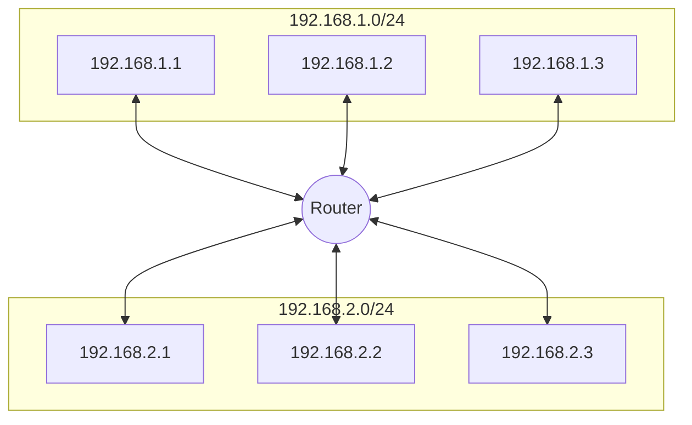
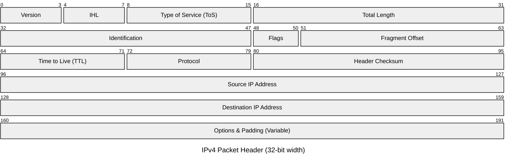

# Internet Protocol

Anything that you do in the Internet will associated with the source IP and the destination IP.

* Here you don't know about ports, HTTP headers, etc.
* The data unit here is **packets**
* IP is a **best-effort** protocol
    * it is connectionless
    * it is unreliable by itself
    * it does not guarantee delivery
    * it does not guarantee order
    * it does not provide application-level confirmation that the packet arrived intact

This means that each IP packet is processed independently and can take a different route to the same destination.

* Packets sent by the same sender can arrive out of order
* Packets can be lost, corrupted, or delayed
* If you need reliability and integrity, IP is usually combined with a higher-quality transport such as TCP

## Anatomy of the IP

### IP Address

* Layer 3 property
* Can be set automatically or statically
* Network and Host portion
* 4 bytes in IPv4 - 32 bits
* IPv4 addresses are commonly written in **dotted decimal notation**
    * for example `193.32.216.9`
    * in binary that is `11000001 00100000 11011000 00001001`

### Network vs Host

* `a.b.c.d/x` where `a`, `b,`, `c`, `d` are integers and `x` is the network bits and remains are host
    * for example `192.168.254.0/24`
        * The first 24 bits (3 bytes) are network the rest 8 for host
            * this means we can have $2^{24} = 16777216$ networking ad each network has $2^8=266$ hosts
        * `192.168.254.0/24` is also called a subnet
            * the subnet has a mask `255.255.255.0`
            * Subnet mask is used to determine whether an IP is in the same subnet
                * it is important to the router, because if the true it uses the MAC address; else the router send it to the gateway.

IP addressing is hierarchical:

* the high-order bits identify the network
* the low-order bits identify the host
* the shared block is usually described by its **prefix**
    * the prefix is commonly represented by the lowest IP in the block plus the prefix length
    * example: `192.168.254.0/24`
* routers mainly care about the network prefix
    * the host portion is not important for the routing decision itself

### Default Gateway

Most networks consists of hosts, and one of them is the Default Gateway

* When host A want to talk to B directly if boths
* are in the same subnet.
* Otherwise A sends it to someone who might know, the gateway.
* The Gateway has a IP Address and each host should know its gateway.
    * a gateway is a host of multiple networks.

### Example

* Host `192.168.1.3` wants to talk to `192.168.1.2`
  1) `192.168.1.3` applies subnet mask to itself and the destination IP `192.168.1.2`
     * `255.255.255.0 & 192.168.1.3 = 192.168.1.0`
     * `255.255.255.0 & 192.168.1.2 = 192.168.1.0`
     * Both equals, so they belongs on the same subnets
  2) When the source and destination are on the same subnet, they communicate through the [switch](../02%20Network%20Components.md#The%20Switch) using MAC addresses.
* Host `192.168.1.3` wants to talk to `192.168.2.2`
  1) `192.168.1.3` applies subnet mask to itself and the destination IP `192.168.2.2`
     * `255.255.255.0 & 192.168.1.3 = 192.168.1.0`
     * `255.255.255.0 & 192.168.2.2 = 192.168.2.0`
     * They are different
  2) The packet is sent to the default gateway `192.168.1.100` through MAC address, that also is `192.168.2.100`, from where the packed is sent as the first scenario.

### Warnings

This knowledge is critical, because:

* if your application and your database are in different databases, IP packets is going thought the router, that can delay the traffic, or even worse, the router can be congested.

## Anycast Routing

Anycast assigns the same IP address to service endpoints in multiple network locations. The networks serving those locations advertise routes covering that address, and routers forward a client's packets through the route selected by their routing information and policies.

The client therefore uses one destination address without discovering every location that serves it. The selected destination is the routing system's preferred path; it is not necessarily the geographically closest or lowest-latency location.

## IPv4 and IPv6

Currently the two most important versions of IP are IPv4 and IPv6.

### IPv4

* IPv4 is the historically dominant version
* It uses 32-bit addresses
* It became widespread across nearly all Internet-connected hosts

The main long-term problem is address exhaustion:

* the Internet kept growing
* more and more hosts needed addresses
* IPv4 eventually became too limited for indefinite growth

### IPv6

IPv6 was created to solve the address growth problem.

* It offers a vastly larger address space
* It is intended to support long-term Internet growth

### Transition from IPv4 to IPv6

The migration from IPv4 to IPv6 is gradual.

* not all services on the Internet run on IPv6 yet
* for a long period, both versions coexist
* this often appears as a **dual-stack** environment, where systems support both IPv4 and IPv6

## Subnetting

A subnet is a network that has been divided into smaller logical networks.

Why subnet?

* to avoid wasting IP addresses
* to separate parts of the network logically
* to scale the network according to the number of hosts actually needed
* to isolate traffic between groups of machines

Important points:

* subnetting usually does not require external approval if you are subdividing your own allocated block internally
* the overall address block stays the same from the outside
* the main effects are local to your own network design and routing

### Subnet masks and prefixes

Subnetting is described either by:

* a dotted-decimal subnet mask such as `255.255.252.0`
* a prefix length such as `/22`

These are two ways of expressing the same boundary between network bits and host bits.

### Example: splitting `192.168.1.0/24`

Suppose you start with:

* `192.168.1.0/24`
* this gives 256 total addresses
* usually 254 are usable for hosts, since one is the network address and one is the broadcast address

Now suppose you want 6 subnetworks with about 30 hosts each.

Each new subnet needs:

* 30 host addresses
* 1 network address
* 1 broadcast address

So each subnet needs 32 total addresses.

That means the subnet size must advance in blocks of 32:  `0`,  `32`, `64`, `96`, `128`, `160`, `192` and `224`

To get blocks of 32 addresses, you borrow 3 bits from the host portion:

* original mask: `/24`
* new mask: `/27`
* dotted-decimal mask: `255.255.255.224`
    * because `224 = 128 + 64 + 32`

With `/27`, the network becomes 8 subnetworks of 32 addresses each. For examples:

* `192.168.1.0/27`
* `192.168.1.32/27`
* `192.168.1.64/27`
* `192.168.1.96/27`
* `192.168.1.128/27`
* `192.168.1.160/27`
* `192.168.1.192/27`
* `192.168.1.224/27`

And for each subnet:

* the first address is the network address
* the last address is the broadcast address
* the addresses in between are usable hosts

## Anatomy of the IP packet

* The IP Packet has headers and data sections
    * The headers is 20 bytes (can go up to 60 bytes if options are enabled.)
    * Data section can go up to 65536 bytes
        * but it is not common, because anything above the hardwares have the Maximum Transport Unit, that normally is about 5500 bytes, suffers fragmentation
            * Maximum Transport Unit is the maximum size of a data frame (layer 2)
            * The router can send a ICMP message to the receiver saying that there was a error, or fragment it.
            * Fragmentation is:
                * costly
                * dangerous because mischiefs can pretend fragmentations
                * one fragment could fail, and resend just a part is difficult.

The IP packet is basically the source IP address, the data, and the destination IP address. Here some more details:
* There is three headers for fragmentation: Identification, Flags (whether the packet should be fragmented or not) and Fragment Offset
* There is a header for time to live, it is important because the packet can be found in a situation of infinite loop between routes.
    * the time to live is a counter that is decreased by one on each router
    * the router that decreases it to 0 drop it and send back a ICMP message saying that the packet was timeouted.
        * traceroute works in that way: send a very small time to live, and increment it everytime, so it receive a ICMP message from each router in the way.
            * may don't work because some routers turn the ICMP messages off, or some firewall in the way may block it.
            * different ICMP can take differents ways, so the traceroutes isn't always right.
        * some routes turns the ICMP message off
* There is a header of protocol, that can be used to block decisions (without reading the data).
* `ToS`: It is an 8-bit field designed to tell routers how to handle a specific packet—essentially acting as a "priority" or "special handling" tag for network traffic.
    * The ToS field is how the packet tells the router, "Hey, I'm a voice call, don't let me lag," or "I'm a background file backup, I can wait in line."
    * Originally, the field was split into two main parts:
        * **IP Precedence (3 bits):** Ranked traffic from 0 (Routine) to 7 (Network Control).
        * **ToS Flags (4 bits):** Requested specific optimizations like **Low Delay**, **High Throughput**, or **High Reliability**.
        * **Reserved (1 bit):** Set to zero.
    * Because the original ToS was a bit too simple for today's complex networks, it was redefined as the **Differentiated Services (DiffServ)** field. It is now broken down into:
        * **DSCP (Differentiated Services Code Point - 6 bits):** This allows for 64 different levels of priority. It’s what modern routers use to decide which packets get sent first during congestion.
        * **ECN (Explicit Congestion Notification - 2 bits):** These bits allow routers to signal that the network is getting crowded without having to actually drop the packet.
            * that is set from a upper layer (TCP) by the router.
            * When the route is overwhelmed, it starts to store the packets on buffers, when it is fulled, the incoming packets starts to be drooped.
                * it is a waste because makes the client wait for a long timeout
                * When the router buffer it about to be fulled, it starts to set the ECN to true, and process the packet normally.
                    * the receiver will be notified about the congestion by that bit, and will response the client with the same bit, so the client also will be notified.
* Finally, there are one header for source IP address, and another destination IP address
    * you can change the your source IP, but your Internet Provider can block your packets because it. The provider knows you IP because they assigned it.

## ICMP

* Stands for Internet Control Message Protocol
* Lives on layer 3, so it don't uses ports.
* Designed for information messages
    * Host unreachable, port unreachable, fragmentation needed
    * Packet expired (infinite loop in routers)
* Uses IP directly
* PING and traceroute use it
* Doesn't require listeners or ports to be opened
* Some firewalls block ICMP for security reasons
    * bad persons can use ICMP to flood the server in, or to discover opened ports
* Disabling ICMP also can cause real damage with connection establishment
    * TCP black hole: the connection is open by the handshake, you turned the fragmentation off, and the packet is bigger than the Maximum Transport Unit of the router.
        * the router will send you a ICMP saying that you need to fragment, but these message will be block by the firewall
        * so you established a connection, but your data is vanished
