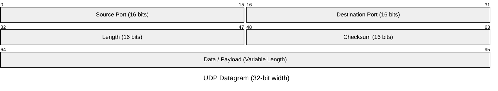

# User Datagram Protocol

UDP (User Datagram Protocol) is a Layer 4 transport protocol that sends discrete messages called **datagrams**. Unlike [TCP](05%20TCP.md), UDP does not establish a transport connection before application data is sent and does not provide reliability, ordering, flow control, or congestion control by itself.

The operating system normally exposes UDP through a [datagram socket](../../Operating%20Systems/07%20Socket%20Management.md#Datagram%20Sockets). Socket creation and binding establish the local endpoint, the kernel demultiplexes incoming datagrams to that socket, and kernel buffers plus blocking or non-blocking I/O determine when the application can send or receive them.

## Core Properties

UDP has a deliberately small transport contract:

- **Message-Oriented Transport:** Each application send corresponds to one UDP datagram, and the receiver observes datagram boundaries.
- **Connectionless Operation:** No TCP-style handshake is required before sending a datagram.
- **Best-Effort Delivery:** UDP does not acknowledge delivery or retransmit lost datagrams.
- **No Ordering Guarantee:** Datagrams may arrive in a different order from the one in which they were sent.
- **No Built-In Flow Control:** UDP does not make a sender slow down because the receiving application is consuming data slowly.
- **No Built-In Congestion Control:** Applications or higher-level protocols must provide appropriate congestion behavior when necessary.
- **Small Header:** The UDP header is 8 bytes.
- **Transport State Meaning:** Calling UDP "stateless" refers to the absence of TCP-style per-connection transport state.
  - The operating system still maintains a UDP socket object, queues received datagrams, and tracks binding information.
  - Applications can also maintain arbitrary peer or session state above UDP.

## Ports and Demultiplexing

[IP](03%20Internet%20Protocol.md#Internet%20Protocol) routes packets between network endpoints, while UDP adds 16-bit source and destination ports.

- **Port Width:** UDP source and destination ports are 16-bit values ranging from `0` to `65535`.
- **Kernel Demultiplexing:** The receiving kernel uses the protocol and local addressing information to [demultiplex](../../Operating%20Systems/07%20Socket%20Management.md#Addressing,%20Ports,%20and%20Demultiplexing) an incoming datagram to an appropriate UDP socket.
- **No Hard Peer Limit from Port Count:** The 65,536 possible port values are **not** a hard limit on the number of remote peers a UDP server can communicate with.
  - One bound UDP socket can receive datagrams from many different source IP/port pairs because UDP does not create a new accepted socket for each peer.
- **Source Port:** The source port gives the receiver an address to which it can direct a response.
- **Application Correlation:** Application protocols commonly add their own identifiers when they need to match requests with responses.
  - DNS, for example, includes a transaction ID because multiple queries can be in flight independently.

> [!note] UDP `connect()` Does Not Create a Transport Connection
> A UDP application can call [`connect()`](../../Operating%20Systems/07%20Socket%20Management.md#Establishing%20Outbound%20Connections) to record a default peer and restrict which peer is accepted by the socket API. No TCP-style handshake occurs, and UDP does not gain TCP-style per-connection transport state.

## UDP Datagram

A UDP header contains four 16-bit fields:



- **Source Port:** Identifies the sender's transport endpoint; it may be zero in cases where no response port is supplied.
- **Destination Port:** Identifies the target UDP endpoint on the destination host.
- **Length:** Stores the total UDP datagram length, including the 8-byte header.
- **Checksum:** Provides an integrity check over the UDP datagram plus information from the IP layer.

> [!note] UDP Datagram Boundaries vs. IP Packets
> The UDP datagram becomes payload for IP, but one datagram does **not** necessarily correspond to exactly one IP packet.
>
> - **IPv4 Fragmentation:** A sufficiently large datagram can be split through IP fragmentation.
> - **IPv6 Fragmentation:** IPv6 relies on endpoint fragmentation rather than router fragmentation.
> - **Operational Consequence:** Applications generally avoid depending on fragmentation because losing one fragment prevents reconstruction of the complete datagram.

## Reliability Above UDP

UDP deliberately leaves several transport guarantees to higher layers.

- **Not Provided by UDP:** Packet-loss recovery, duplication handling, reordering, retransmission, session establishment, and congestion control are not built into the protocol.
- **Application Responsibility:** An application that needs any of those properties must implement them itself or use a protocol built above UDP.
- **Workload-Specific Guarantees:** This does not mean every UDP application should recreate TCP.
  - Real-time media may prefer to discard late data rather than retransmit it.
  - [QUIC](10%20HTTP3.md#HTTP%2F3) builds reliable multiplexed streams, congestion control, and cryptographic connection state above UDP because it needs substantially stronger semantics.

## Use Cases

### DNS

- **Common Transport:** Classic DNS commonly uses UDP for requests that fit its transport requirements.
- **Response Matching:** A client uses the DNS transaction ID together with endpoint information to match a response with its query.
- **Alternative Transports:** DNS can also use TCP when required, and modern encrypted DNS transports introduce additional protocol layers.

### Real-Time Media

- **Timeliness Priority:** Interactive voice and video frequently prefer timeliness over perfect retransmission.
- **Late Data:** A packet arriving too late may be less useful than a missing packet.
- **Higher-Level Mechanisms:** Protocols built for real-time media can use UDP while implementing their own loss handling, jitter buffering, pacing, and congestion behavior.

### VPNs and Tunnels

- **TCP-over-TCP Risk:** Many VPN transports use UDP because tunneling TCP inside another TCP connection can produce interacting reliability and congestion-control loops known as **TCP-over-TCP meltdown**.
- **UDP Tunnel:** A UDP-based tunnel can preserve the inner transport's behavior while the tunnel implements the security, replay protection, path management, or reliability properties it actually needs.
- **Direct IP Tunneling:** Some tunneling protocols encapsulate IP directly rather than using TCP or UDP.
- **NAT and Firewall Behavior:** NATs and stateful firewalls often handle port-based TCP/UDP traffic more naturally because ports provide convenient session-identification information.

## Advantages and Trade-offs

UDP's simplicity reduces transport overhead and avoids connection-establishment latency, but the missing mechanisms become the application's responsibility when they are required.

### Advantages

- **No Transport Handshake:** Data can be sent without first establishing a transport connection.
- **Small Header:** The transport header has a fixed 8-byte size.
- **Preserved Message Boundaries:** The receiver observes discrete datagrams rather than a byte stream.
- **Application Control:** Applications can choose their own reliability and timing trade-offs.
- **Protocol Foundation:** UDP is useful as a base for protocols such as DNS, real-time media transports, and QUIC.

### Trade-offs

- **Delivery:** No delivery guarantee.
- **Ordering:** No ordering guarantee.
- **Retransmission:** No built-in retransmission.
- **Flow Control:** No transport-level flow control.
- **Congestion Control:** No transport-level congestion control.
- **Source Spoofing:** Source addresses are easier to spoof than in protocols that require a bidirectional handshake before meaningful state is established.

## Demo

A local loopback exchange makes UDP's message-oriented behavior concrete: a process binds one datagram socket, another process sends a datagram to that endpoint, and the receiver obtains both the message and the sender's address.

### JavaScript

Node.js exposes UDP through its `dgram` module:

```javascript
import dgram from "dgram";

const socket = dgram.createSocket("udp4");

socket.on("message", (msg, info) => {
    console.log(`got datagram "${msg}" from ${info.address}:${info.port}`);
    socket.close();
});

socket.bind(5500, "127.0.0.1", () => {
    console.log("listening on 127.0.0.1:5500");
});
```

Run the program, then send a datagram from another terminal:

```bash
nc -u 127.0.0.1 5500
```

Text entered into `nc` is sent to the bound UDP endpoint. The `message` event receives one discrete datagram together with the source IP address and port selected for the sender.

### C

The same exchange can be expressed directly through the POSIX socket interface:

```c
#include <arpa/inet.h>
#include <stdio.h>
#include <sys/socket.h>
#include <unistd.h>

int main(void) {
    int sockfd = socket(AF_INET, SOCK_DGRAM, 0);
    if (sockfd == -1) {
        perror("socket");
        return 1;
    }

    struct sockaddr_in local = {0};
    local.sin_family = AF_INET;
    local.sin_port = htons(5501);

    if (inet_pton(AF_INET, "127.0.0.1", &local.sin_addr) != 1) {
        fprintf(stderr, "invalid local address\n");
        close(sockfd);
        return 1;
    }

    if (bind(sockfd, (struct sockaddr *)&local, sizeof(local)) == -1) {
        perror("bind");
        close(sockfd);
        return 1;
    }

    char buffer[1024];
    struct sockaddr_in remote = {0};
    socklen_t remote_size = sizeof(remote);

    ssize_t n = recvfrom(
        sockfd,
        buffer,
        sizeof(buffer) - 1,
        0,
        (struct sockaddr *)&remote,
        &remote_size
    );

    if (n == -1) {
        perror("recvfrom");
        close(sockfd);
        return 1;
    }

    buffer[n] = '\0';

    char remote_ip[INET_ADDRSTRLEN];
    if (inet_ntop(AF_INET, &remote.sin_addr, remote_ip, sizeof(remote_ip)) == NULL) {
        perror("inet_ntop");
        close(sockfd);
        return 1;
    }

    printf(
        "got %zd bytes from %s:%u: %s\n",
        n,
        remote_ip,
        ntohs(remote.sin_port),
        buffer
    );

    close(sockfd);
    return 0;
}
```

Compile and run it:

```bash
cc udp_server.c -o udp_server
./udp_server
```

Then send a datagram from another terminal:

```bash
nc -u 127.0.0.1 5501
```

The program combines UDP's datagram semantics with the [POSIX socket lifecycle](../../Operating%20Systems/07%20Socket%20Management.md#POSIX%20Socket%20Interface):

- **Socket Creation:** [`socket(AF_INET, SOCK_DGRAM, 0)`](../../Operating%20Systems/07%20Socket%20Management.md#Creating%20a%20Socket) creates an IPv4 datagram socket and returns its file descriptor.
  - **`AF_INET`:** Selects the IPv4 address family. IPv6 uses `AF_INET6`.
  - **`SOCK_DGRAM`:** Selects message-oriented datagram semantics. With the Internet address family and protocol `0`, the normal protocol selection is UDP.
  - **Protocol `0`:** Requests the default protocol associated with the chosen family and socket type rather than naming UDP explicitly.
- **Local Address Structure:** `struct sockaddr_in` stores an IPv4 socket address: address family, port, and IPv4 address.
  - Initializing it with `{0}` gives every field and padding byte a known zero value before the relevant fields are assigned.
- **Network Byte Order:** `htons(5501)` converts the 16-bit port from host byte order to network byte order; `ntohs()` performs the reverse conversion when printing the sender's port.
  - Internet protocol fields use network byte order, which is big-endian, regardless of the host CPU's native byte order.
- **IP Address Representation:** `inet_pton()` converts the presentation form `"127.0.0.1"` into the binary IPv4 representation stored in `sin_addr`. `inet_ntop()` performs the reverse conversion for display.
- **Binding:** [`bind()`](../../Operating%20Systems/07%20Socket%20Management.md#Binding%20and%20Local%20Endpoints) associates the socket with `127.0.0.1:5501`, giving incoming datagrams a local endpoint to target.
- **Generic Address Interface:** `bind()` and `recvfrom()` accept `struct sockaddr *` so the same API can work with different address families. The cast adapts the IPv4-specific `struct sockaddr_in *` to that generic pointer type; the address family tells the kernel how to interpret the structure.
- **Datagram Receive:** `recvfrom()` consumes one received datagram and copies its payload into `buffer`.
  - A later `recvfrom()` receives a later datagram rather than continuing the previous one as if UDP were a byte stream.
  - If the supplied buffer is too small, the datagram is truncated rather than continued by the next receive operation.
- **Sender Address:** `remote` is filled with the source endpoint associated with the received datagram. One bound UDP socket can therefore receive successive datagrams from different remote IP/port pairs without calling `accept()`.
- **Address-Length Parameter:** `remote_size` initially tells the kernel how much address storage is available. After `recvfrom()`, it contains the size of the address actually written.
- **Buffer Length:** `recvfrom()` returns the number of payload bytes copied. The code reserves one extra byte and appends `\0` only so the received bytes can safely be printed as a C string; UDP itself does not add a string terminator.
- **Descriptor Lifetime:** [`close(sockfd)`](../../Operating%20Systems/07%20Socket%20Management.md#Socket%20Lifetime%20and%20Closure) releases the process's descriptor reference when the program finishes with the socket.
