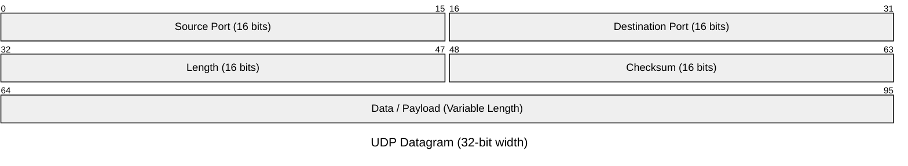

# User Datagram Protocol

UDP (User Datagram Protocol) is a Layer 4 transport protocol that sends discrete messages called **datagrams**. Unlike [TCP](05%20TCP.md), UDP does not establish a transport connection before application data is sent and does not provide reliability, ordering, flow control, or congestion control by itself.

The operating system normally exposes UDP through a [datagram socket](../../Operating%20Systems/07%20Socket%20Management.md#Datagram%20Sockets). This note focuses on the protocol behavior; socket creation, binding, port demultiplexing, kernel buffers, and blocking/non-blocking I/O belong to the OS abstraction.

## Core Properties

UDP has a deliberately small transport contract:

- **Message-oriented:** each application send corresponds to one UDP datagram, and the receiver observes datagram boundaries.
- **Connectionless:** no TCP-style handshake is required before sending a datagram.
- **Best effort:** UDP does not acknowledge delivery or retransmit lost datagrams.
- **Unordered:** datagrams may arrive in a different order from the one in which they were sent.
- **No built-in flow control:** the protocol does not make a sender slow down because the receiving application is consuming data slowly.
- **No built-in congestion control:** applications or higher-level protocols must provide appropriate congestion behavior when necessary.
- **Small header:** the UDP header is 8 bytes.

Calling UDP "stateless" refers to the absence of TCP-style per-connection transport state. The operating system still maintains a UDP socket object, queues received datagrams, and tracks binding information; applications can also maintain arbitrary peer/session state above UDP.

## Ports and Demultiplexing

IP routes packets between network endpoints, while UDP adds 16-bit source and destination ports. The receiving kernel uses the protocol and local addressing information to [demultiplex](../../Operating%20Systems/07%20Socket%20Management.md#Addressing,%20Ports,%20and%20Demultiplexing) an incoming datagram to an appropriate UDP socket.

Ports range from `0` to `65535`, but this is **not** a hard limit on the number of remote peers a UDP server can communicate with. One bound UDP socket can receive datagrams from many different source IP/port pairs because UDP does not create a new accepted socket for each peer.

The source port gives the receiver an address to which it can direct a response. Application protocols commonly add their own identifiers when they need to match requests with responses; DNS, for example, includes a transaction ID because multiple queries can be in flight independently.

## UDP Datagram

A UDP header contains four 16-bit fields:



The fields are:

- **Source Port:** identifies the sender's transport endpoint; it may be zero in cases where no response port is supplied.
- **Destination Port:** identifies the target UDP endpoint on the destination host.
- **Length:** total UDP datagram length, including the 8-byte header.
- **Checksum:** integrity check over the UDP datagram plus information from the IP layer.

The UDP datagram becomes payload for IP. A datagram does **not** necessarily correspond to exactly one IP packet: IPv4 fragmentation can split a sufficiently large datagram, while IPv6 relies on endpoint fragmentation rather than router fragmentation. Applications generally avoid depending on fragmentation because losing one fragment prevents reconstruction of the complete datagram.

## Reliability Belongs Above UDP

UDP deliberately does not solve packet loss, duplication, reordering, retransmission, session establishment, or congestion control. An application that needs any of those properties must implement them itself or use a protocol built above UDP.

This does not mean every UDP application should recreate TCP. Different applications need different guarantees. Real-time media may prefer to discard late data rather than retransmit it, while QUIC builds reliable multiplexed streams, congestion control, and cryptographic connection state above UDP because it needs substantially stronger semantics.

## Use Cases

### DNS

Classic DNS commonly uses UDP for requests that fit its transport requirements. A client sends a query to a DNS server and uses the DNS transaction ID together with endpoint information to match the response. DNS can also use TCP when required, and modern encrypted DNS transports introduce additional protocol layers.

### Real-Time Media

Interactive voice and video frequently prefer timeliness over perfect retransmission. A packet arriving too late may be less useful than a missing packet, so protocols built for real-time media can use UDP and implement their own loss handling, jitter buffering, pacing, and congestion behavior.

### VPNs and Tunnels

Many VPN transports use UDP because tunneling TCP inside another TCP connection can produce interacting reliability and congestion-control loops known as **TCP-over-TCP meltdown**. A UDP-based tunnel can instead preserve the inner transport's behavior while the tunnel implements the security, replay protection, path management, or reliability properties it actually needs.

Some tunneling protocols encapsulate IP directly rather than using TCP or UDP. NATs and stateful firewalls often handle port-based TCP/UDP traffic more naturally because ports provide convenient session-identification information.

## Advantages and Trade-offs

UDP's simplicity reduces transport overhead and avoids connection-establishment latency, but the missing mechanisms become the application's responsibility when they are required.

**Advantages:**

- no transport handshake before sending data;
- small fixed header;
- message boundaries are preserved;
- applications can choose their own reliability and timing trade-offs;
- useful foundation for protocols such as DNS, real-time media transports, and QUIC.

**Trade-offs:**

- no delivery guarantee;
- no ordering guarantee;
- no retransmission;
- no transport-level flow control;
- no transport-level congestion control;
- source addresses are easier to spoof than in protocols that require a bidirectional handshake before meaningful state is established.

## Socket API Example

The protocol itself is independent of a particular programming API, but a Unix-like C program can expose the relationship between UDP and the OS socket abstraction:

```c
#include <stdio.h>
#include <string.h>
#include <sys/socket.h>
#include <netinet/in.h>
#include <arpa/inet.h>

int main(void) {
    int sockfd = socket(AF_INET, SOCK_DGRAM, 0);

    struct sockaddr_in local = {0};
    local.sin_family = AF_INET;
    local.sin_port = htons(5501);
    local.sin_addr.s_addr = inet_addr("127.0.0.1");

    bind(sockfd, (struct sockaddr *)&local, sizeof(local));

    char buffer[1024];
    struct sockaddr_in remote = {0};
    socklen_t remote_size = sizeof(remote);

    ssize_t n = recvfrom(
        sockfd,
        buffer,
        sizeof(buffer),
        0,
        (struct sockaddr *)&remote,
        &remote_size
    );

    printf("received %zd bytes\n", n);
    return 0;
}
```

`socket(AF_INET, SOCK_DGRAM, 0)` asks the kernel for an IPv4 datagram socket and returns a descriptor. `bind()` associates that socket with the local address `127.0.0.1:5501`. `recvfrom()` consumes one received datagram and also returns the sender's address, reflecting the fact that one UDP socket can communicate with many peers without calling `accept()`.

The descriptor, binding, receive queue, blocking behavior, and lifetime are [socket-management](../../Operating%20Systems/07%20Socket%20Management.md) concerns; UDP defines what the transport datagram means on the network.
