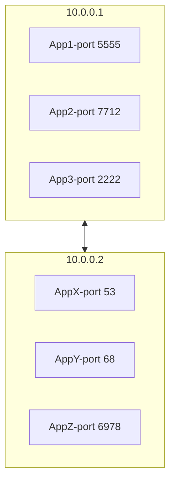
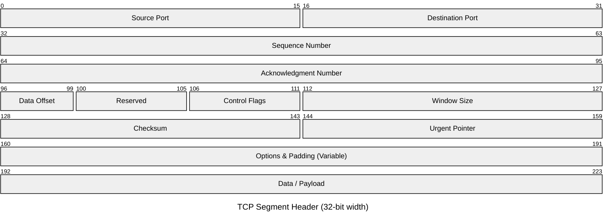

# TCP

* TCP stands for Transmission Control Protocol.
* It is a Layer 4 transport protocol.
* TCP presents data as a byte stream, while the kernel splits that stream into TCP segments and IP packets.
* TCP is stateful: both ends keep connection state instead of treating every message independently.
* TCP uses ports so one host can serve many processes at the same time.
* A TCP header is 20 bytes minimum and can grow to 60 bytes with options.

For server-side socket lifecycle details such as `bind()`, `listen()`, `accept()`, SYN queues, and accept queues, see [How Connections are Established](../03%20Connections/01%20How%20Connections%20are%20Established.md). For send buffers, receive buffers, blocking I/O, and `TCP_NODELAY`, see [Reading and Sending Data](../03%20Connections/02%20Reading%20and%20Sending%20Data.md).

## Why TCP exists

* TCP is built for reliable bidirectional communication.
* It preserves byte order from sender to receiver.
* It detects loss and retransmits missing data.
* It uses acknowledgments, flow control, and congestion control to regulate transmission.
* Unlike [UDP](04%20UDP.md), TCP requires connection state before application data can flow.

## Use cases

* Remote shells such as SSH
* Database connections
* Web traffic such as HTTP/1.1 and HTTP/2 over TLS
* Any application where ordered delivery and retransmission matter

## Core properties

### Connection-oriented transport

* A TCP connection is identified by the 4-tuple:
	* source IP
	* source port
	* destination IP
	* destination port
* Opening a connection requires a three-way handshake:
	* `SYN`
	* `SYN-ACK`
	* `ACK`
* Closing a connection usually uses `FIN` and `ACK` exchanges on both sides.

### Reliability and ordering

* Every byte in the stream is sequenced.
* Receivers acknowledge what they have processed so far.
* Lost segments are retransmitted.
* Later segments can arrive before earlier ones, but the application still reads an ordered byte stream after TCP reassembles the data.

### Flow control and congestion control

* Flow control protects the receiver from being overwhelmed.
* The receiver advertises a window that tells the sender how much more data it can accept.
* Congestion control protects the network path, not just the endpoint.
* These are separate concerns:
  * flow control is receiver capacity
  * congestion control is network capacity

## Multiplexing and demultiplexing

* IP delivers traffic to hosts.
* TCP ports deliver traffic to the correct process on that host.
* Senders multiplex many application streams into TCP segments.
* Receivers demultiplex incoming segments based on the connection 4-tuple.

## Segment anatomy

* The TCP segment header is 20 bytes and can grow to 60 bytes with options.
* A TCP segment becomes the payload of an IP packet.
* Ports are 16-bit numbers, so they range from `0` to `65535`.
* The header carries sequencing, acknowledgments, flow control, and flags.

The headers are:

* Bits 0–15: Source Port
* Bits 16–31: Destination Port
* Bits 32–63: Sequence number
  * Sequence numbers wrap around after the maximum value.
* Bits 63-95: Acknowledgment number (if `ACK` is set)
  * A segment can carry both new data and an acknowledgment for prior data.
* Bits 96-100: Data offset
* Bits 101-104: Reserved (000)
* Bit 105-107: Congestion-control-related flags
  * Bit 105: NS
  * Bit 106: CWR
  * Bit 107: ECE
* Bit 108: URG
  * Urgent pointer is meaningful
* Bit 109: ACK
  * Acknowledgment field is meaningful
* Bit 110: PSH
  * Push buffered data to the application promptly
* Bit 111: RST
  * Reset the connection
* Bit 112: SYN
  * Start connection establishment
* Bit 113: FIN
  * Start connection teardown
* Bit 114-127: Window Size
  * Advertises how much data the receiver can currently accept
* Bit 128-144: Checksum
* Bit 145-159: Urgent pointer (if URG is set)
* Bit 160-480: Options (if data offset > 5. Padded at the end with "0" bits if necessary.) 

### Maximum Segment Size

* Segment size depends on the path MTU.
* On Ethernet with MTU `1500`, the common TCP MSS is `1460`.
* Jumbo frames raise the MTU and can raise the MSS as well.
* MSS affects efficiency and interacts with buffering and algorithms such as Nagle.
