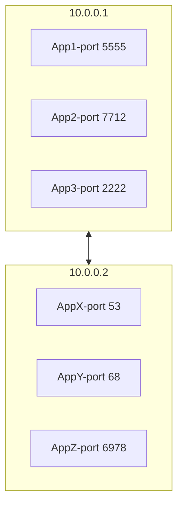
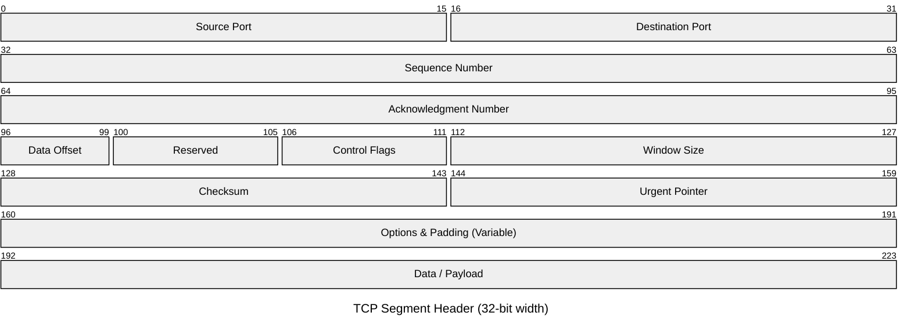
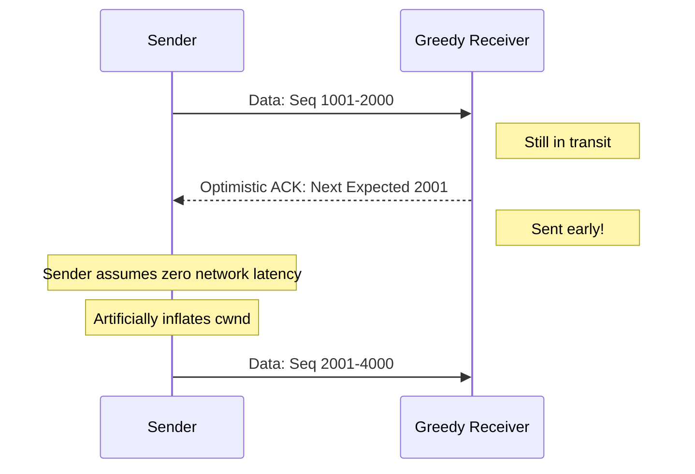

# TCP

* TCP stands for Transmission Control Protocol.
* It is a Layer 4 transport protocol.
* TCP presents data as a byte stream, while the kernel splits that stream into TCP segments and IP packets.
* TCP is stateful: both ends keep connection state instead of treating every message independently.
* TCP uses ports so one host can serve many processes at the same time.
* A TCP header is 20 bytes minimum and can grow to 60 bytes with options.

## Why TCP exists

* TCP is built for reliable bidirectional communication.
* It preserves byte order from sender to receiver.
* It detects loss and retransmits missing data.
* It uses acknowledgments, flow control, and congestion control to regulate transmission.
* Unlike [UDP](04%20UDP.md), TCP requires connection state before application data can flow.

## Use cases

* Remote shells such as SSH
* Database connections
* Web traffic such as HTTP/1.1 and HTTP/2 over TLS
* Any application where ordered delivery and retransmission matter

## Core properties

### Connection-oriented transport

* A TCP connection is identified by the 4-tuple:
    * source IP
    * source port
    * destination IP
    * destination port
* Opening a connection requires a [three-way handshake](01%20How%20Connections%20are%20Established.md).
* The connection teardown is Handled via a cooperative exchange of `FIN` and `ACK` segments from both endpoints, allowing each side to close its half of the bidirectional pipe independently.

### Reliability and ordering

* Every byte in the stream is sequenced.
* Receivers acknowledge what they have processed so far.
* Lost segments are retransmitted.
* Later segments can arrive before earlier ones, but the application still reads an ordered byte stream after TCP reassembles the data.

### Flow Control and Congestion Control

While both mechanisms prevent data loss by slowing down the sender, they operate at entirely different scopes. Flow control is a **peer-to-peer** constraint (protecting the endpoint device), whereas congestion control is an **end-to-network** constraint (protecting routers and switches).

Together, they dictate the maximum amount of unacknowledged data a sender can have in flight at any given moment. This boundary is defined by the **Transmission Window (W)**:

$$W = \min(\text{rwnd}, \text{cwnd})$$

* **rwnd (Receive Window):** The constraint related to **Flow Control**. It represents the amount of buffer space available on the receiver's side.
* **cwnd (Congestion Window):** The constraint related to **Congestion Control**. It represents the maximum amount of data the sender estimates the network path can handle without collapsing.

#### 1. Flow Control (Receiver-Driven)

Flow control protects a fast sender from completely overwhelming a slow receiver's application buffer.

* **The Mechanism:** The receiver allocates a dedicated memory buffer for incoming data. As the local application reads data out of this buffer, the receiver constantly calculates its remaining capacity.
* **The Receive Window (rwnd):** The receiver explicitly advertises this remaining capacity (in bytes) inside the **Window Size** field of every single TCP header it sends back to the sender.
* **Zero Window Deadlock Prevention:** If the receiver's buffer fills up completely, it advertises an `rwnd` of 0, forcing the sender to halt transmissions. To prevent a permanent deadlock if a later window update packet is lost, the sender periodically transmits a 1-byte **Window Probe** to force the receiver to reply with its current buffer status.

#### 2. Congestion Control (Network-Driven)

Congestion control prevents a sender from overwhelming the intermediate network infrastructure. Unlike `rwnd`, which is explicitly shared by the peer, the **Congestion Window (cwnd)** is an estimate calculated entirely by the sender's local kernel.

The strategy the kernel uses to adjust `cwnd` shifts dynamically based on a threshold metric called the **Slow Start Threshold (ssthresh)**.

##### Phase A: Slow Start

* **Objective:** Discover the available network bandwidth quickly on a brand-new connection or after a severe timeout.
* **The ssthresh Initialization:** Because the kernel has zero historical data about the network path's capacity on startup, `ssthresh` is initialized to an arbitrarily large, near-infinite value (such as 64KB or the maximum system buffer limit). This keeps the safety ceiling out of the way so the connection can ramp up speed instantly.
* **Behavior:** `cwnd` starts low (typically 10 segments). For every individual standard ACK received, `cwnd` increases additively by 1 [MSS](#Maximum%20Segment%20Size%20(MSS)).
* **Exponential Growth:** Even though the kernel applies a simple additive rule per ACK, the window size effectively doubles every Round Trip Time (RTT). This happens because the total number of ACKs generated in the current round matches the current window size, injecting exactly enough new capacity to double the window for the next flight of packets. This aggressive doubling continues until `cwnd` reaches or exceeds `ssthresh`.

##### Phase B: Congestion Avoidance

* **Objective:** Safely probe for extra bandwidth once approaching known or estimated network capacity limits.
* **The ssthresh Boundary:** Triggered the exact moment `cwnd` crosses the `ssthresh` line. This boundary tells the kernel, _"We are entering dangerous territory where the network might collapse if we keep doubling."_
* **Linear Growth:** Instead of doubling every RTT, `cwnd` switches to a cautious, linear expansion. The window increases by roughly 1 MSS per RTT, regardless of how many individual ACKs pour in during that round (Additive Increase).

##### Phase C: Fast Retransmit & Fast Recovery

* **Objective:** Mitigate severe throughput drops when minor, isolated packet loss occurs.
* **Trigger:** If a single packet is dropped but subsequent packets arrive safely, the receiver sends identical ACKs for the missing sequence number. Upon receiving **3 duplicate ACKs**, the sender assumes packet loss without waiting for a heavy retransmission timeout.
* **The ssthresh Recalculation:** The kernel realizes it has overshot the network's capacity and immediately recalculates a new, realistic safety ceiling:

$$\text{ssthresh} = \max\left(2 \times \text{MSS}, \; \frac{\text{FlightSize}}{2}\right)$$

* **FlightSize:** This represents the number of bytes sent but not yet acknowledged. Because the sender is actively trying to maximize the pipe, this is virtually identical to `cwnd` at the moment the packet drop is detected.
* **Behavior:** The sender retransmits the missing segment (**Fast Retransmit**), drops its active `cwnd` directly down to match the new `ssthresh` (**Fast Recovery**), and immediately transitions back into Phase B (Congestion Avoidance). This allows the data pipeline to keep moving at half-speed rather than stalling out completely.

### Why Congestion Control Doesn't Starve the Connection

It might seem like cutting `ssthresh` in half during Phase C would eventually grind the connection down to zero over time, but two features prevent this starvation:

* **The Core Balance (AIMD):** TCP runs on _Additive Increase, Multiplicative Decrease_. While the window is cut in half on loss, it continuously climbs linearly (+1 MSS per RTT) during stable periods. When the next drop happens, it is cutting half of that _new, higher_ window.
* **The Safety Floor:** As seen in the recalculation formula, `ssthresh` is mathematically locked to a minimum floor of **2 × MSS** (roughly 2 packets). It can never shrink to zero.

Together, the linear climb and the halving drops establish a stable, cyclical equilibrium known as the **TCP Sawtooth Waveform**.

## Multiplexing and demultiplexing

While the Internet Protocol (IP) is responsible for routing packets between _hosts_, TCP utilizes **ports** ($0$ to $65535$) to route that data to the specific _processes_ running on those hosts.

* **Multiplexing:** The sender's network stack gathers data from multiple application processes, wraps it with TCP headers specifying distinct source ports, and passes it down to the IP layer.
* **Demultiplexing:** The receiver's network stack inspects the incoming segment's 4-tuple to accurately direct the payload to the specific socket listening for that traffic.



## Segment anatomy

A standard TCP header has a **minimum size of 20 bytes** and can scale up to **60 bytes** when optional configuration fields are appended.



The headers are:

* **Bits 0–15 (16 bits): Source Port** – The port identifier of the sending process.
* **Bits 16–31 (16 bits): Destination Port** – The port identifier of the target process.
* **Bits 32–63 (32 bits): Sequence Number** – The sequence number of the first data byte in this segment. If `SYN` is present, this is the Initial Sequence Number (ISN). _Note: Wraps around to 0 after reaching $2^{32}-1$._
* **Bits 64–95 (32 bits): Acknowledgment Number** – If the `ACK` flag is set, this contains the next sequence number the receiver expects to get.
* **Bits 96–99 (4 bits): Data Offset (Header Length)** – Specifies the size of the TCP header in 32-bit words (4-byte units). This dictates where the header ends and the payload data begins.
* **Bits 100–102 (3 bits): Reserved** – Set to zero for future standardizations.
* **Bits 103–111 (9 bits): Control Flags** – Used to manage connection states and stream properties

### Control flags

| **Flag Bit** | **Name**                            | **Description**                                                                                                |
| ------------ | ----------------------------------- | -------------------------------------------------------------------------------------------------------------- |
| **103**      | **NS** (Nonce Sum)                  | Experimental concealment protection mechanism ([RFC 3540](#Mitigations)).                                      |
| **104**      | **CWR** (Congestion Window Reduced) | Set by the sender to indicate it received a segment with the ECE flag set.                                     |
| **105**      | **ECE** (ECN-Echo)                  | Indicates the network path is experiencing congestion if ECN is enabled.                                       |
| **106**      | **URG**                             | Indicates that the _Urgent Pointer_ field contains meaningful data.                                            |
| **107**      | **ACK**                             | Validates the Acknowledgment field. Virtually all packets after the initial `SYN` have this set.               |
| **108**      | **PSH** (Push)                      | Requests the receiver to instantly push buffered data to the application instead of waiting for a full buffer. |
| **109**      | **RST** (Reset)                     | Abruptly aborts a corrupted or invalid connection.                                                             |
| **110**      | **SYN** (Synchronize)               | Synchronizes sequence numbers during the connection establishment phase.                                       |
| **111**      | **FIN** (Finish)                    | Signals that the sender has no more data to transmit.                                                          |

### Maximum Segment Size (MSS)

The **Maximum Segment Size (MSS)** represents the largest amount of application data (in bytes) that TCP can handle in a single, unfragmented piece.

$$\text{MSS} = \text{Path MTU} - \text{IP Header Size (typically 20B)} - \text{TCP Header Size (typically 20B)}$$

* **Standard Ethernet:** Features a Maximum Transmission Unit (MTU) of `1500` bytes. Accounting for the standard IP (20 bytes) and TCP (20 bytes) headers, the typical default MSS is **`1460` bytes**.
* **Jumbo Frames:** Network fabrics configured with Jumbo Frames raise the MTU (commonly to `9000` bytes), which drastically raises the permissible MSS. This increases protocol efficiency by decreasing processing overhead for big data payloads.
* **Algorithm Dynamics:** The configured MSS dictates packetization bounds and directly influences packet-batching logic like [Nagle's Algorithm](02%20Reading%20and%20Sending%20Data.md#Nagle's%20Algorithm), which holds back small segments until an MSS-sized frame can be filled or an outstanding ACK is received.

## Optimistic ACKing

**Optimistic ACKing** (also known as an _Optimistic Acknowledgement Attack_) is an exploitation technique where a receiver acknowledges TCP segments **before** they actually arrive at its network interface.

By abusing the TCP feedback loop, a greedy or malicious receiver explicitly targets the sender's [congestion Control](#2.%20Congestion%20Control%20(Network-Driven)) mechanics, forcing the sender to bypass its calculated network safety boundaries.

### The Core Mechanism

As detailed in the [congestion Control](#2.%20Congestion%20Control%20(Network-Driven)) section, a standard TCP sender is restricted by the Transmission Window ($W = \min(rwnd, cwnd)$). In a normal connection, the sender transmits a batch of data up to its current $cwnd$, then experiences an idle period bounded by the network's Round Trip Time (RTT) while waiting for the receiver's `ACK`s to unlock further transmission space.

In an optimistic ACK scenario, the receiver eliminates this RTT latency constraint. It predicts the sequence numbers of the data currently in flight and aggressively fires back fabricated `ACK`s prematurely.



#### Blinding the Safety Mechanics

The true danger of this attack lies in how it completely blinds the kernel's [congestion control](#2.%20Congestion%20Control%20(Network-Driven)) engine:

* **Perpetual Initial $ssthresh$:** Because the receiver continuously sends flawless, rapid ACKs, the sender's kernel never detects a single packet loss event. This means the **Fast Recovery phase is never triggered, and $ssthresh$ is never cut in half.** It remains stuck at its virtually infinite initial startup value (e.g., 64KB+).
* **Uncapped Slow Start:** Trapped beneath a permanent, artificial $ssthresh$ ceiling, the sender remains locked in **Phase A (Slow Start)** indefinitely.
* **Hyper-Speed Compounding:** Because the fake ACKs arrive continuously without the natural physical delay of the network's RTT, the exponential doubling math occurs in microseconds rather than milliseconds.

The sender is tricked into assuming the path has infinite bandwidth and zero latency, pumping data into the wire at the absolute physical limit of its local Network Interface Card (NIC).

### Motivations

* **Greedy Throughput Maximization:** A single client attempts to hog an unfair share of network bottleneck bandwidth, downloading files faster than standard, cooperative TCP congestion control algorithms would allow.
* **Denial of Service (DoS):** A malicious client requests a large file and utilizes optimistic ACKs to force the server's network stack into a hyper-aggressive sending state, completely saturating the server's outbound link and starving other legitimate users.

### The Downside: Irreparable Data Loss

Optimistic ACKing is highly risky for standard data transfers. Because the receiver acknowledges data it hasn't actually processed, it permanently breaks TCP's error recovery engine:

* **No Error Recovery:** If an intermediate router drops a packet due to true network congestion, the sender will never know. It has already processed a forged `ACK` stating that the receiver got the data successfully.
* **Buffer Purging:** The sender discards data from its local send buffer as soon as it receives an `ACK`. When data is lost in transit, the sender cannot execute a **Fast Retransmit**, because the original data no longer exists in memory. This results in missing fragments and corrupted application-layer payloads.

### Mitigations

Modern operating systems and kernel network stacks employ several defenses to detect and stop this behavior:

* **ACK Pacing and RTT Sanity Checks:** The kernel tracks the connection's historic Round Trip Time (RTT). If an `ACK` arrives within a timeframe that is physically impossible given baseline network constraints (e.g., faster than a packet could travel to the client and back), the stack flags the connection as anomalous.
* **Sequential Byte Boundary Verification:** Advanced traffic shapers inside the network stack enforce strict pacing. If `ACK`s arrive perfectly aligned with sequence boundaries that have not yet cleared the local outbound network interface queue, the connection is throttled or dropped.
* **TCP Nonces (Historical / RFC 3540):** The sender includes a random, short bit-string (a nonce) in the flags of each transmitted segment. The receiver must echo a cumulative sum of these nonces in its response. Because the receiver cannot guess the random nonces of packets still in transit, it cannot successfully forge an optimistic `ACK`.

## Demo

A local loopback exchange exposes TCP as one connection with two endpoints. The following C fragments use the [POSIX socket interface](../../Operating%20Systems/07%20Socket%20Management.md#POSIX%20Socket%20Interface) and show one blocking connection. Error handling and headers are omitted so that each fragment centers the TCP state transition it causes.

### IPv4 Endpoint Representation

The C socket interface represents the endpoint separately from the socket descriptor. Both programs construct the same IPv4 destination, `127.0.0.1:5501`, before passing it to a socket operation.

* **`AF_INET`:** Places the socket in the IPv4 [socket family](../../Operating%20Systems/07%20Socket%20Management.md#Socket%20Families), so its endpoints use IPv4 addresses and TCP ports. `AF_INET6` provides the corresponding IPv6 family.
* **`SOCK_STREAM`:** Selects an ordered byte-stream socket. With `AF_INET`, protocol `0` selects the normal protocol for that family/type combination: TCP.
* **`struct sockaddr_in`:** Stores an IPv4 socket address. `{0}` initializes every field to zero before the required fields are set.
    * **`sin_family`:** Must name the same address family as the socket.
    * **`sin_port`:** Stores the transport port in network byte order.
    * **`sin_addr`:** Stores the IPv4 address in binary form.
* **`htons(5501)`:** Converts the 16-bit port from the host's byte order to network byte order, which uses big-endian byte order. `ntohs()` performs the reverse conversion when displaying a received port.
* **`inet_pton(AF_INET, "127.0.0.1", &server.sin_addr)`:** Converts an IPv4 address from presentation text into the binary form required by `sin_addr`. It returns `1` on success, `0` when the text is not a valid address for that family, and `-1` for an unsupported family.
* **`(struct sockaddr *)&server` and `sizeof(server)`:** `bind()` and `connect()` accept the generic `struct sockaddr` interface because they support several address families. The cast presents the IPv4-specific structure through that interface, and the size tells the kernel how many bytes the actual address structure occupies.

### Server Creates a Passive Endpoint

The server chooses the stable destination `127.0.0.1:5501`. `bind()` associates that endpoint with `listen_fd`, and `listen()` changes the socket into a passive listener; neither call creates a connection to a specific client.

```c
int listen_fd = socket(AF_INET, SOCK_STREAM, 0);

struct sockaddr_in server = {0};
server.sin_family = AF_INET;
server.sin_port = htons(5501);
inet_pton(AF_INET, "127.0.0.1", &server.sin_addr);

bind(listen_fd, (struct sockaddr *)&server, sizeof(server));
listen(listen_fd, 16);
```

### Client Initiates Connection Establishment

The client names only the remote endpoint. When `connect()` begins, the kernel selects a suitable local address and ephemeral port unless the application has already called `bind()`. The kernel then exchanges the `SYN`, `SYN-ACK`, and final `ACK`; on a blocking socket, successful return from `connect()` means this [three-way handshake](../03%20Connections/01%20How%20Connections%20are%20Established.md#TCP%20Three-Way%20Handshake) completed.

```c
int client_fd = socket(AF_INET, SOCK_STREAM, 0);

struct sockaddr_in server = {0};
server.sin_family = AF_INET;
server.sin_port = htons(5501);
inet_pton(AF_INET, "127.0.0.1", &server.sin_addr);

connect(client_fd, (struct sockaddr *)&server, sizeof(server));
```

### Server Claims Its Connected Endpoint

After the handshake completes, the kernel makes the server side of the connection available through the listener. `accept()` returns `server_fd`, a new descriptor for this client connection; `listen_fd` remains available for later attempts. The two `NULL` arguments tell `accept()` not to return the client's address. A program that needs that address supplies storage for a `struct sockaddr` and a length variable instead.

```c
int server_fd = accept(listen_fd, NULL, NULL);
```

At this point, `client_fd` and `server_fd` are the two connected endpoints of the same TCP byte stream. They have independent descriptors and kernel socket state, but TCP identifies their connection by their local and remote addresses and ports.

### Stream Bytes in Both Directions

Each endpoint can send and receive independently. A single `send()` may be partial even on a blocking socket, so this helper repeats it until the local kernel has accepted every byte or an operation cannot make progress.

```c
static int send_all(int fd, const char *buffer, size_t remaining) {
    while (remaining > 0) {
        ssize_t sent = send(fd, buffer, remaining, 0);
        if (sent <= 0) {
            return -1;
        }

        buffer += sent;
        remaining -= (size_t)sent;
    }
    return 0;
}
```

`sent` is the number of bytes accepted by one `send()` call. Advancing `buffer` skips those bytes, and reducing `remaining` makes the next call submit only the unsent suffix. The helper returns `-1` when `send()` reports an error or stops making progress; its caller must stop or otherwise handle the failed connection. `strlen()` supplies the byte count of each string without its terminating `\0` byte.

```c
if (send_all(client_fd, "hello from client", strlen("hello from client")) == -1) {
    handle_send_error(client_fd);
}

char request[256];
ssize_t request_bytes = recv(server_fd, request, sizeof(request), 0);

if (send_all(server_fd, "hello from server", strlen("hello from server")) == -1) {
    handle_send_error(server_fd);
}

char reply[256];
ssize_t reply_bytes = recv(client_fd, reply, sizeof(reply), 0);
```

`request` and `reply` are user-space byte buffers. `recv()` returns an `ssize_t` byte count; it does not append a string terminator, so code that treats received bytes as C text must reserve space and append `\0` itself. A return of `-1` reports an error, while `0` reports TCP end-of-stream after any earlier buffered bytes have been consumed.

`recv()` returns the bytes currently available, not one application message. A receive can contain fewer bytes than one peer write or bytes from several writes, so an application protocol needs [message framing](../03%20Connections/02%20Reading%20and%20Sending%20Data.md#Receiving%20Data%20over%20TCP). Likewise, a successful `send()` means only that the local kernel accepted bytes for transmission, not that the peer application received or processed them.

### Closure

Each process closes its own connected descriptor when it has finished using the stream. The server also closes its listener when it will not accept future connections.

```c
close(client_fd);  // client process

close(server_fd);  // server process
close(listen_fd);  // server process
```

Closing the connected descriptors initiates each endpoint's TCP closure behavior. The [socket lifetime and closure](../../Operating%20Systems/07%20Socket%20Management.md#Socket%20Lifetime%20and%20Closure) details distinguish descriptor release from changes to communication state.
