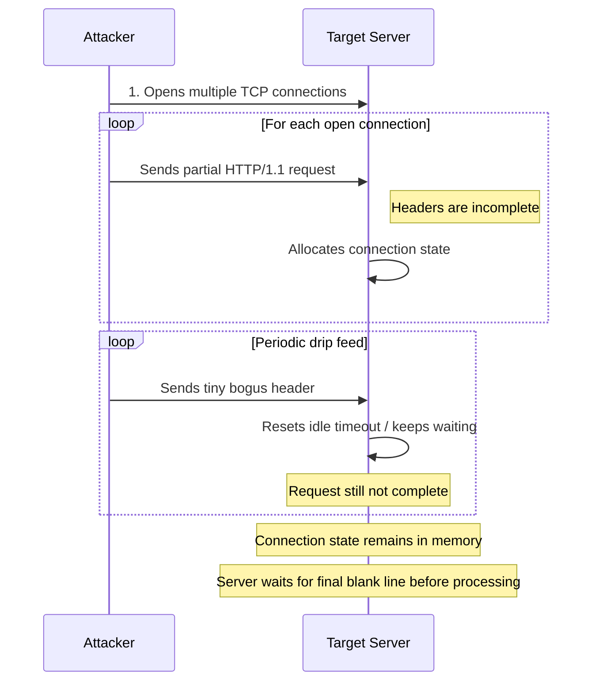

# HTTP/1.1

## Client and Server

- **Client:** Any application that makes an HTTP request. This includes web browsers, mobile apps, or backend scripts (e.g., a Python or Node.js application fetching data).
- **Server:** Software that listens for and responds to HTTP requests. This includes web servers (like NGINX, Apache, IIS) and application servers (like Tomcat or Node.js).

## The HTTP Request

An HTTP request consists of five primary components:

- **Method:** The action to be performed (e.g., `GET`, `POST`, `DELETE`).
- **Path:** The specific resource URI being requested (e.g., `/about`). Web servers usually impose limits on the length of the URI (in characters or bytes) to prevent malicious buffer overflow or Denial-of-Service (DoS) attacks.
- **Protocol Version:** The version the client is speaking (e.g., `HTTP/1.1`).
- **Headers:** Key-value pairs containing request metadata. In HTTP/1.1, the `Host` header is mandatory. For instance, requesting `http://husseinnasser.com/about` sends a `Host: husseinnasser.com` header. This allows a single physical server (with one IP address) to route traffic to multiple different websites (Virtual Hosting).
- **Body:** The actual data payload (optional, typically used with `POST` or `PUT`).

## The HTTP Response

An HTTP response mirrors the request structure:

- **Protocol Version:** (e.g., `HTTP/1.1`).
- **Status Code:** A 3-digit number indicating the result (e.g., `200`, `404`, `500`).
- **Status Text (Reason Phrase):** A human-readable description of the code (e.g., `OK`, `Not Found`, `Internal Server Error`). 
	- Because this is technically redundant, it was completely removed in HTTP/2 to save bandwidth.
- **Headers:** Metadata sent back by the server (e.g., `Content-Type`, `Set-Cookie`).
- **Body:** The requested data (e.g., the HTML document, JSON payload, or image).
## The Predecessor: HTTP/1.0

HTTP/1.0 was designed in an era where keeping a TCP connection open consumed a prohibitive amount of server memory (due to file descriptor limits). Therefore, it used a **short-lived connection** model.

- **High Overhead:** Every single request required opening a brand new TCP connection and closing it immediately after the response. The constant 3-way handshakes caused high latency and high CPU usage.
- **No Chunking:** Responses could not be streamed; the server had to calculate and send the entire payload at once.
- **No Virtual Hosting:** The `Host` header was not strictly required, making it nearly impossible to host multiple domain names on a single server IP address.

## The Standard: HTTP/1.1

HTTP/1.1 introduced massive performance upgrades, primarily by allowing the reuse of TCP connections.

- **Persistent Connections (`Keep-Alive`):** By default, a single TCP connection is kept open to handle multiple sequential requests and responses. This drastically reduces CPU overhead and network latency by eliminating repeated TCP handshakes.
- **Chunked Transfer Encoding:** Allows the server to stream data to the client in pieces (chunks) as it becomes available, rather than waiting to generate the entire response first.
- **Mandatory Host Header:** Enabled multi-homed websites and modern cloud infrastructure.

### HTTP Pipelining (The Failed Feature)

HTTP/1.1 introduced **Pipelining** to speed up persistent connections, allowing a client to fire off multiple requests sequentially without waiting for the first response to arrive. However, it is disabled by default in modern browsers and largely considered a failed experiment due to several fatal flaws:

- **HTTP Head-of-Line (HoL) Blocking:** The HTTP/1.1 specification demanded that the server return the responses in the _exact same order_ the requests were received. If the first request was a database query that took 5 seconds to process, the server had to hold back the responses for all subsequent requests, completely bottlenecking the connection.
- **Proxy Corruption:** Intermediate proxies along the network path often failed to maintain the strict order of requests and responses, leading to clients receiving the wrong data for their requests.
- **The Solution:** Because HTTP/1.1 lacks a native "Request ID" system to map out-of-order responses back to their original requests, the industry eventually abandoned pipelining and invented **HTTP/2 Multiplexing** to solve the problem properly.

## The Slowloris Attack

**Slowloris** is a highly efficient, application-layer Denial-of-Service (DoS) attack. Unlike traditional brute-force DDoS attacks that rely on overwhelming a server with massive amounts of network traffic, Slowloris is a "low-bandwidth" attack.

It weaponizes HTTP/1.1 mechanics to target the concurrency limits and resource bottlenecks of a backend server.

> [!NOTE] The Origin of the Name
> The Slowloris attack was invented in 2009 by security researcher Robert "RSnake" Hansen. He named the exploit after the **slow loris**, a small, nocturnal primate native to Southeast Asia famous for its exceptionally slow, deliberate, and stealthy movements.
> 
> The name is a perfect analogy for how the attack operates. Before Slowloris, taking down a web server usually required massive botnets generating deafening, high-speed volumetric floods (traditional DDoS). In contrast, this attack requires very little bandwidth and works by moving _as slowly as possible_—quietly creeping in, establishing connections, and dripping data just slowly enough to paralyze the server without setting off traditional rate-limit alarms.

### How the Attack Works (The HTTP/1.1 Trick)

In HTTP/1.1, the server knows that a request header block is complete only when it receives a double carriage-return and line-feed (a blank line: `\r\n\r\n`).

1. **The Partial Request:** The attacker opens multiple TCP connections and starts sending HTTP/1.1 requests, but intentionally leaves them incomplete (e.g., `GET / HTTP/1.1\r\nHost: target.com\r\n` without the final blank line).
2. **The Drip Feed:** To prevent the server's idle-timeout from closing the connection, the attacker sends a bogus, tiny header (like `X-Keep-Alive: 1\r\n`) every 10 or 15 seconds.
3. **The Trap:** The server must keep the connection open and the state in memory, waiting for the headers to finish so it can finally process the request.

### The Vulnerability

Because backends handle connections [differently](02%20Execution%20Patterns.md#Architecture), Slowloris impacts them in different ways. The attack aims for two distinct types of resource exhaustion:

#### Thread Exhaustion

This specifically targets backends using a [Multiple threads, single shared socket](02%20Execution%20Patterns.md#3.%20Multiple%20Threads,%20Single%20Shared%20Socket) execution pattern (like traditional Apache). 
- **The Lockout:** In this model, every active connection is assigned a dedicated worker thread, and there is a hard cap on the total number of threads (e.g., 500).
- By opening 500 dripping connections, the attacker successfully traps all 500 worker threads. Because every worker is stuck waiting for `\r\n\r\n`, no thread is available to call `accept()` on the socket. Legitimate users are completely blocked from accessing the site.

#### File Descriptor Exhaustion

This targets backends using a [Single listener, single worker thread](02%20Execution%20Patterns.md#1.%20Single%20Listener,%20Single%20Worker%20Thread) pattern (like Node.js) or modern event-driven proxies. 

- **Thread Immunity:** Because Node.js uses non-blocking I/O and an Event Loop, a slow HTTP request does _not_ block the worker thread. The single thread simply registers the connection and instantly moves on to serve other users. Slowloris cannot exhaust Node.js threads.
- **The OS Bottleneck:** However, every open TCP connection consumes a **File Descriptor** (socket) and dedicated buffer memory at the operating system level. If the attacker scales the attack to open thousands of connections, they will hit the operating system's hard limit (e.g., the `ulimit` on Linux). Once all file descriptors are exhausted, the OS itself refuses new network connections, taking the backend offline.
### Modern Mitigations

Modern web infrastructure uses several techniques to render this attack ineffective:

- **Buffering Reverse Proxies:** Event-driven load balancers and proxies (like HAProxy or NGINX using multiple listeners) sit in front of the application. They buffer incoming traffic and will not even initiate a connection to the backend `worker` until the client has transmitted the complete `\r\n\r\n` sequence.
- **Aggressive Header Timeouts:** Servers now enforce strict time limits specifically for _completing the request headers_ (e.g., Node.js has a built-in `server.headersTimeout` defaulting to 60 seconds). If a client drips data for longer than the timeout, the connection is forcefully closed.
- **Connection Rate Limiting:** Firewalls strictly limit the maximum number of concurrent connections allowed from a single IP address.
### Multi-Vector "Low-and-Slow" Combinations

Advanced attackers frequently launch **[Sockstress](02%20Reading%20and%20Sending%20Data.md#Sockstress)** (Layer 4) and **Slowloris** (Layer 7) concurrently in a multi-vector asymmetric attack. 

* **The Pipeline Crush:** Slowloris exhausts the front-end application layer by holding worker threads hostage with incomplete requests, while Sockstress suffocates the back-end kernel layer by trapping response payloads in system memory using artificial Window Stalls.
* **Mitigation Challenge:** This dual-vector approach complicates standard remediation; 
	* **The Security Dilemma:** To defend against Slowloris, an administrator might configure their web server to aggressively flush out idle connections or hand off responses as fast as possible to clear thread pools. However, if those responses are handed off to a **Sockstress** vector, they immediately get trapped in the kernel's Layer 4 send buffers anyway, shifting the crisis from application threads to system memory exhaustion.
	* **Firewall Blindness:** Because both vectors utilize perfectly valid, standard TCP handshakes and maintain tiny traffic volumes, automated firewall rules checking for packet floods or bandwidth spikes remain completely silent.
	* **United forces**: True defense requires to be unified, behavioral rate-limiting at both the transport and application layers simultaneously via reverse proxies or intelligent [Web Application Firewalls (WAF)](Web%20Application%20Security.md#Web%20Application%20Firewalls%20(WAF)).