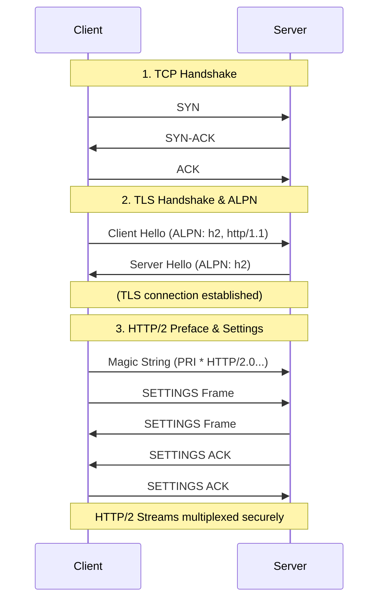
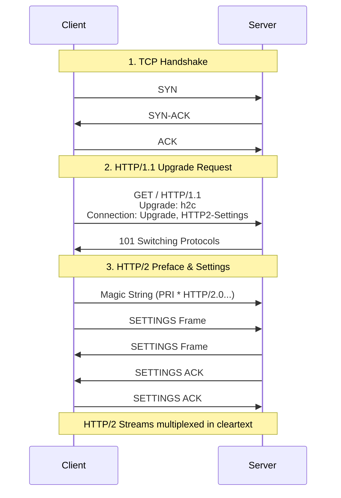

# HTTP/2

In HTTP/1.1, a connection can typically handle only one request at a time because HTTP pipelining is rarely supported and prone to issues.

- To execute multiple requests in parallel under HTTP/1.1, the client must open multiple TCP connections.    

In contrast, **HTTP/2** allows a single connection to handle multiple requests and responses in parallel through a feature called **multiplexing**. Each active request/response pair is called a **stream**.

- Every request is tagged with a unique Stream ID.
- The client initiates streams using odd numbers (e.g., `Stream 1`, `Stream 3`), while the server initiates streams using even numbers.
- The server can process these streams concurrently and send back the responses in any order, completely eliminating HTTP head-of-line blocking.

## HTTP/2 Server Push (Deprecated)

_Note: This feature is largely considered deprecated and has been removed from modern browsers like Chrome._

Originally, Server Push allowed a server to proactively send resources to the client. If a client requested `GET /index.html`, the server could assume the client would also need `main.css`, `main.js`, and `img.jpg`, and send them alongside the HTML without waiting for the client to ask.

- **Why it failed:** Many clients struggled to handle it efficiently. It often wasted bandwidth because servers would push resources that the client already had stored in its local cache.

### The Architecture: The Two Layers of HTTP/2

To understand how HTTP/2 works under the hood, it is helpful to think of the protocol as being split into two distinct layers:

- **1. The HTTP Semantics Layer (The "What")**
    
    - This layer remains virtually identical to HTTP/1.1. It defines the application logic of the web.
    - It includes HTTP verbs (`GET`, `POST`), URLs, standard headers (`User-Agent`, `Content-Type`), and standard HTTP Status Codes (`200 OK`, `404 Not Found`, `500 Server Error`).
    - When your application code (like a Node.js or Python backend) runs, it mostly interacts with this layer.
    
- **2. The Binary Framing Layer (The "How")**
    
    - This is the massive architectural shift introduced in HTTP/2. It dictates how the semantic data is packaged, compressed, and transported over the TCP connection.
    - Instead of sending plain text, this layer breaks everything down into binary **Frames** (e.g., `HEADERS` frames, `DATA` frames). 
    - It is responsible for managing streams, multiplexing, [HPACK Compression](#Header%20Compression%20(HPACK)), and protocol-level errors. If something breaks down here, the server uses Framing Error Codes (sent via `RST_STREAM` or `GOAWAY` frames) to kill the connection without ever returning a standard HTTP status code.

## How an HTTP/2 Connection is Established

Because HTTP/2 uses a completely different binary framing structure than HTTP/1.1, the client and server must explicitly agree to use it before sending any HTTP/2 frames.

In practice, there are two primary ways to establish an HTTP/2 connection: **ALPN over TLS** (the standard for the modern web) and **HTTP Upgrade** (used mostly for internal, unencrypted communication).

### The Standard Way: ALPN over TLS (h2)

Because all major web browsers mandate HTTPS for HTTP/2, almost all HTTP/2 connections are established over a secure TLS connection. To avoid the penalty of an extra round-trip just to negotiate the HTTP version, it uses an extension called **ALPN (Application-Layer Protocol Negotiation)**.

1. **TCP Handshake:** The client and server establish a standard TCP connection.
2. **TLS Handshake + ALPN:** During the TLS handshake, the client sends a "Client Hello" and includes an ALPN extension saying, _"I support HTTP/2 (h2) and HTTP/1.1."_
3. *Server Agreement:** The server replies with a "Server Hello," picking HTTP/2 from the client's list.
4. **Connection Preface:** Immediately after the secure connection is established, the client sends a "Magic String" (`PRI * HTTP/2.0\r\n\r\nSM\r\n\r\n`) to confirm the protocol, followed by a `SETTINGS` frame. The server responds with its own `SETTINGS` frame.
5. **The SETTINGS Frame Exchange:**
    - Immediately following the Magic String, the client must send a `SETTINGS` frame. This frame dictates the initial rules of engagement for the connection. It contains key-value parameters such as `SETTINGS_MAX_CONCURRENT_STREAMS` (limiting how many streams the other side can open) or `SETTINGS_INITIAL_WINDOW_SIZE` (which dictates flow control limits).
    - The server also sends its own `SETTINGS` frame to the client, outlining its specific limits and configuration preferences.
- **The SETTINGS ACK (Acknowledgment):**
    - HTTP/2 requires both sides to agree on and strictly follow these limits. Therefore, when a peer receives a `SETTINGS` frame, it must formally acknowledge it.
    - The client responds to the server's settings with a `SETTINGS ACK` (an empty `SETTINGS` frame where the `ACK` flag is set to `1`).
    - The server does the exact same thing, sending a `SETTINGS ACK` for the client's settings. Once acknowledged, the connection parameters are locked in, and the multiplexing of data streams can safely proceed.

### The Cleartext Way: HTTP/1.1 Upgrade (h2c)

When encryption is not used (which is rare on the public web but occasionally used in internal microservices), the client starts by speaking HTTP/1.1 and asks the server to upgrade. This is known as **h2c** (HTTP/2 Cleartext).

1. **The Upgrade Request:** After a standard TCP handshake, the client sends a regular HTTP/1.1 request. To initiate the switch, it includes specific headers (`Connection: Upgrade, HTTP2-Settings` and `Upgrade: h2c`). Because the standard HTTP/2 initialization hasn't happened yet, the client also includes a Base64-encoded version of its initial `SETTINGS` payload directly inside the `HTTP2-Settings` header.
- **101 Switching Protocols:** If the server supports HTTP/2, it agrees to the switch by responding with an HTTP `101 Switching Protocols` status code.
- **Standard Initialization:** Immediately following the `101` response, the connection transitions to binary HTTP/2. The client sends the Magic String, and both parties seamlessly complete the `SETTINGS` and `SETTINGS ACK` exchange detailed in the ALPN method above to finalize the connection.

## Header Compression (HPACK)

In HTTP/1.1, headers are sent as plain text with every single request and response. Because modern web pages make dozens of requests to the same server, sending repetitive headers (like cookies, user agents, and accept types) over and over creates massive, unnecessary bandwidth overhead.

HTTP/2 solves this using **HPACK** (`/ˈeɪtʃ pæk/`), a compression format specifically designed for HTTP headers. It was created not just to reduce data usage, but also to remain secure against compression-based security vulnerabilities (like the CRIME attack) that plagued earlier attempts to compress web headers using standard algorithms like Gzip.

HPACK achieves high compression rates by relying on three core mechanisms:

- **The Static Table:** A hardcoded dictionary built into every HTTP/2 client and server. It contains 61 of the most common HTTP headers and values. For example, index `2` universally means `:method: GET`. Instead of sending the full text string, the client simply sends the number `2`.
- **The Dynamic Table:** An expanding, session-specific dictionary that the client and server build together as the connection progresses. If you send a large, unique cookie, it gets added to this table. For all subsequent requests on that connection, you only need to send a newly assigned index number instead of repeating the massive cookie string.
- **Huffman Coding:** When a custom header or unique value isn't in either table and must be transmitted for the first time, HPACK compresses the string using a pre-defined Huffman code. This algorithm assigns much shorter binary codes to frequently used characters (like lowercase letters and numbers), significantly shrinking the size of the text before it goes over the wire.

### The HPACK Bomb

An HPACK bomb is a Denial-of-Service (DoS) attack. It is the HTTP/2 equivalent of a "Zip bomb"—a malicious, tiny file that, when decompressed, expands to an astronomical size, entirely consuming the server's CPU and memory until it crashes.

Here is how an attacker weaponizes the dynamic table:
- **Step 1: Poisoning the Table:** The attacker establishes an HTTP/2 connection and sends a request with a massive custom header (e.g., `X-Attack: AAAA...` padded out to 4 Kilobytes, which is often the default maximum size of the dynamic table). The server obediently stores this massive string in its dynamic table at, say, Index `62`.
- **Step 2: The Detonation:** The attacker sends a new HTTP/2 `HEADERS` frame. However, instead of sending new text, the attacker fills the entire frame with thousands of repetitions of Index `62`.
- **Step 3: The Decompression:** A standard HTTP/2 frame can be up to 16 Kilobytes in size. Because the reference to Index `62` is so small, an attacker can fit roughly 16,000 of these references into a single frame. When the server receives this frame, it attempts to decompress it.
- **Step 4: The Crash:** The server dutifully looks up Index `62` 16,000 times, expanding that single 16KB packet into **64 Megabytes** of text in its RAM.

If the attacker opens multiple streams and sends these dense, heavily compressed frames continuously, the server's CPU spikes to 100% trying to decompress everything, and its memory rapidly fills up until the web server crashes, taking the application offline for legitimate users.
#### How Modern Servers Mitigate It

When this vulnerability was discovered in the mid-2010s, it caused widespread panic because almost all initial HTTP/2 implementations (including Apache, Nginx, and Node.js) were vulnerable out of the box.

Today, modern web servers use several strict mitigations to prevent HPACK bombs from detonating:

- **`SETTINGS_MAX_HEADER_LIST_SIZE`:** Servers now strictly enforce a limit on the total uncompressed size of a header list they are willing to accept. If an attacker tries to expand a header block beyond a reasonable limit (like 8KB or 16KB total), the server instantly rejects the request at the binary framing layer. It issues a framing layer error code—such as `ENHANCE_YOUR_CALM` (Error Code 11) or `PROTOCOL_ERROR`—and abruptly closes the connection.
- **Tracking Compression Ratios:** Some advanced firewalls and HTTP/2 implementations actively monitor the compression ratio of incoming connections. Legitimate web traffic rarely achieves compression ratios higher than 3:1 or 4:1. If a server sees a request achieving a 4000:1 compression ratio, it recognizes the signature of a decompression bomb and terminates the attacker's connection.

### The HPACK Bookkeeping Bomb

When servers successfully mitigated the original HPACK Bomb by limiting the total _uncompressed size_ of headers (using `SETTINGS_MAX_HEADER_LIST_SIZE`), attackers evolved their methods. They realized that while they could no longer force a server to expand a massive string, they could attack the server's internal memory management instead.

This led to the **Bookkeeping Bomb**.

#### How the Attack Works

Instead of trying to expand a single huge header, the Bookkeeping Bomb forces the server to process thousands of microscopic ones.

- **The Loophole:** The attacker sends an HTTP/2 request filled with thousands of references to a nearly empty, 1-byte header stored in the dynamic table.
- **Bypassing the Shields:** Because the decompressed header is virtually empty, the total uncompressed size of the request remains tiny. The standard `MAX_HEADER_LIST_SIZE` defense never triggers, and the server accepts the payload.
- **The Bookkeeping Exhaustion:** Even though the header data itself is small, the underlying HTTP/2 software (like NGINX, Apache, or Envoy) must allocate internal system memory to track every single incoming header. It creates pointers, metadata structures, and lists—what developers call "bookkeeping."
- **The Result:** For every 1 byte the attacker sends, the server might be forced to allocate 4,000 to 5,000 bytes of memory just to organize the empty data. The server's RAM rapidly fills up with useless structural metadata until it crashes.

#### The "Slowloris" Chain

To make this attack utterly devastating, attackers often combine it with an HTTP/2 flow-control stall (a modern twist on the classic "Slowloris" attack):

1. The attacker hits the server with the bookkeeping bomb, forcing massive memory allocations.
2. The attacker immediately advertises a **0-byte flow-control window**. This HTTP/2 feature effectively tells the server: _"I am too busy right now, do not send me the response yet."_
3. Because the server is waiting for permission to reply, it cannot close the connection and cannot free up the RAM.
4. The attacker sends a tiny 1-byte ping every few seconds to keep the connection alive, pinning gigabytes of the server's memory indefinitely.

#### How Modern Servers Mitigate It

To defeat this, servers had to add new layers of defense beyond just checking the total size of the headers:

- **Strict Header Count Limits:** Servers introduced hard caps on the absolute _number_ of headers they will accept per request (e.g., NGINX's `max_headers` directive), instantly killing streams that send thousands of empty headers.
- **Cookie "Crumb" Accounting:** Attackers historically bypassed count limits by splitting a single standard `Cookie` header into thousands of tiny fragments (called crumbs), which is allowed by the HTTP/2 specification. Modern servers are now patched to strictly count these fragments toward the total header limit.
- **Aggressive Timeouts:** Load balancers and reverse proxies now aggressively monitor streams that consume memory but refuse to accept responses (the 0-byte window hold), terminating them to free up resources.

## Pros and Cons

### Pros

- **Multiplexing over a Single Connection:** Saves network resources and reduces latency by eliminating the need to open multiple TCP connections.
- **[Header Compression (HPACK)](#Header%20Compression%20(HPACK)):** Compresses HTTP headers to significantly reduce overhead. 
- **Secure by Default:** While the HTTP/2 specification doesn't strictly require encryption, all major web browsers require TLS (HTTPS) to use HTTP/2.

### Cons

- **TCP Head-of-Line (HoL) Blocking:** Because all requests are multiplexed over a single TCP connection, if a single packet is lost at the network level, the entire TCP connection halts until that packet is retransmitted. This delays _all_ multiplexed HTTP requests, not just the one missing the packet.
- **Server Push Never Picked Up:** [As mentioned](#HTTP/2%20Server%20Push%20(Deprecated)), the push feature proved inefficient in practice and is mostly abandoned. 
- **Higher CPU Usage:** HTTP/2 uses a binary framing layer instead of the plain-text format used in HTTP/1.1. The server and client must do more work to encode, decode, compress headers, and manage the interleaving of multiple streams on a single connection.

## When to Use HTTP/2

- HTTP/2 has slightly higher processing overhead but handles multiple parallel requests vastly better than HTTP/1.1.
- It is specifically designed for modern web scenarios where a client needs to fetch dozens of assets (images, scripts, stylesheets) simultaneously.
- If your application only makes infrequent, isolated requests—or if you have optimized your assets to require very few requests (e.g., heavy bundling)—the benefits of HTTP/2 are less pronounced, though it remains the modern web standard.