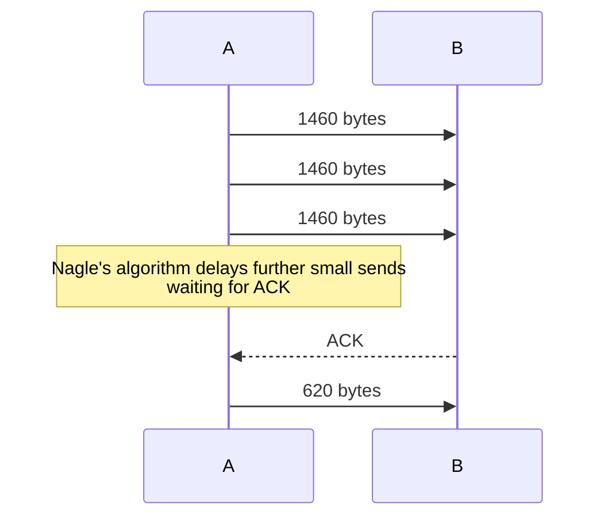

# Reading and sending data

Once the connection is established, how to read and send data?

Once a connection is established, the OS creates two separate memory buffers: one for sending data and one for receiving data. The receive buffer specifically handles incoming client data, while the send buffer handles server data.
## Receiving data

Here is the exact lifecycle of how incoming data moves from the network into your application:

1. **Data Arrival:** The client transmits data over the established connection.
2. **Kernel Interception:** The Kernel automatically receives the data and places it directly into the OS receive buffer. This happens autonomously in the background, entirely without the backend application asking for it.
3. **ACKs and Flow Control:** The Kernel is responsible for acknowledging the received data to the client.
    - To prevent the severe overhead of sending an ACK for every single bit, these acknowledgements are usually delayed and triggered by time intervals or specific data volume thresholds.
    - During this step, the Kernel updates the TCP window, letting the client know exactly how much free space remains in the receive buffer, so the client does not overflow it.
4. **The User-Space Copy:** The backend application must call a function to copy the data out of the Kernel's buffer and into its own memory space. Because crossing the user/kernel boundary requires memory copying, this operation is computationally expensive.
    - The process can use `read()` (a general-purpose system call for any file descriptor, including sockets) or `recv()` (a socket-specific call that provides extra options).
    - **Blocking Mode:** By default, sockets are blocking, meaning `read()` or `recv()` will completely pause the process until data physically arrives.
    - **Non-Blocking Mode:** If configured differently, both calls return immediately. If there is no data in the buffer, they throw an error like `EAGAIN` or `EWOULDBLOCK`.
    - **Event Polling:** To efficiently manage multiple connections, applications use functions like `epoll_wait()`, which allows the process to wait until the Kernel explicitly notifies it that data is available on one of its monitored connections.
5. **Buffer Cleanup:** Once the data is successfully copied to the application's memory, the Kernel actively discards that duplicated data from the receive buffer to free up space for new traffic.
6. **Application Processing:** The backend process now has the raw data safely in User Space and can proceed to decrypt, parse, and process the payload.
## Send buffers

1. **The `send()` Call:** The backend process initiates the outbound transfer by calling `send()`. This action copies the payload data from the application's memory directly into the Kernel's send buffer.
- **Kernel Dispatch & Efficiency:** Once the data is in the send buffer, the Kernel does not always transmit it immediately; it may wait until it has accumulated enough information to dispatch it efficiently to the client. For example, [Nagle's algorithm](03%20Nagle's%20algorithm.md) intentionally delays transmission until the data reaches the maximum segment size to optimize network efficiency.
- **Transmission and ACKs:** The Kernel begins transmitting the data across the network. As long as the client continues to acknowledge (ACK) the receipt of the data, the Kernel will proceed to send the rest of the data from the buffer to the client.

## Nagle's Algorithm

- **The Problem It Solves:** In the early days of the internet (such as the Telnet era), sending a single byte of data per packet was incredibly inefficient. Every TCP/IP packet requires a 40-byte header (20 bytes for IP + 20 bytes for TCP). Sending 1 byte of payload meant transmitting 41 bytes total—a massive waste of bandwidth.
- **The Solution:** Nagle's algorithm was introduced to combine small segments of data and send them together in a single packet, preventing this overhead waste.
### How It Works

- The algorithm dictates that if a process has small chunks of data to send, the Kernel must hold that data in the send buffer until one of two conditions is met:
    1. The accumulated data reaches the Maximum Segment Size (MSS) (e.g., 1460 bytes).
    2. There is no unacknowledged data in flight (i.e., if the client has already ACKed all previous packets, the new data will be sent immediately, regardless of size).
- **Example:** If the MSS is 1460 bytes and the application sends 500 bytes, the algorithm holds it. If the application then sends another 1000 bytes, the buffer hits 1500 bytes. The Kernel immediately sends out one full 1460-byte segment and holds the remaining 40 bytes.

### The Problem (Non-Deterministic Tail Delays)

- While Nagle's algorithm saves bandwidth, it introduces non-deterministic delays.
- **The Tail-End Delay:** This delay is especially noticeable when sending large amounts of data that do not perfectly divide into the MSS.
- **Example:** If an application wants to send 5000 bytes over a connection with a 1440-byte MSS:
    - The Kernel immediately sends 3 full segments (1440 bytes × 3 = 4320 bytes).
    - The 4th segment contains the remaining 680 bytes. Because it is not a full segment, and the previous segments have not yet been ACKed, Nagle's algorithm pauses and refuses to send the 4th segment until the ACK for the earlier data arrives.

### Disabling Nagle's Algorithm

- **Prioritizing Latency over Bandwidth:** Because modern applications (like APIs, gaming, and real-time systems) prioritize fast response times over saving a few bytes of network capacity, most clients and servers explicitly disable Nagle's algorithm.
- **`TCP_NODELAY`:** This is the socket option used to disable the algorithm, instructing the Kernel to send data immediately, regardless of segment size.
- **The cURL Example:** The popular `curl` utility disabled Nagle's algorithm by default back in 2016 because the artificial delays were severely slowing down TLS handshakes.

> After a few wasted hours hunting down the reason for slowness during a TLS handshake that turned out to be because of `TCP_NODELAY` not being set, I think we have enough motivation to toggle the default for this option. We now enable `TCP_NODELAY` by default and allow applications to switch it off.
> 
> This also makes `--tcp-nodelay` unnecessary, but `--no-tcp-nodelay` can be used to disable it.
> 
> Thanks-to: Tim Rühsen
> 
> Bug: [https://curl.haxx.se/mail/lib-2016-06/0143.html](https://curl.haxx.se/mail/lib-2016-06/0143.html)