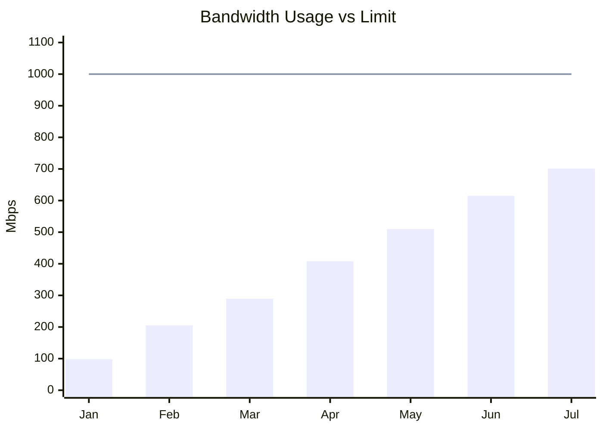
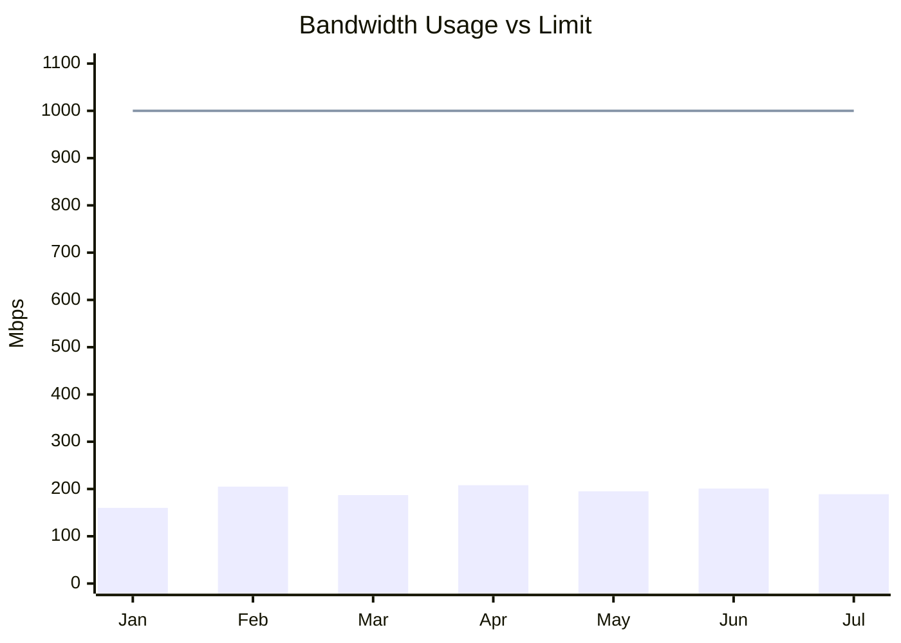

# Network Monitoring

> You cannot manage what you do not measure, you cannot measure what you do not define, you cannot define what you do not understand, and there is no success in what you do not manage. **W. Edwards Deming (1950)**

Monitoring is the active process of watching, verifying, and following a system, operation, or machine to achieve a specific goal. Monitoring is the foundational first step required to control any environment. You cannot effectively manage a network without first observing it.

Network monitoring is a subset of [Network Management](05%20Network%20Management.md). Its job is to collect and interpret signals about availability, performance, faults, traffic, and suspicious behavior.

At a practical level, network monitoring exists to protect three core outcomes:

- **Availability:** confirming that links, devices, and services remain reachable and operational.
- **Performance:** verifying that latency, packet loss, throughput, and resource usage stay within acceptable limits.
- **Security:** detecting abnormal behavior, policy violations, intrusion attempts, and other indicators of compromise.

## Objectives of Network Monitoring

### Trend Analysis

When monitoring a network, the collected data is utilized to verify trends and predict future infrastructure needs.

**Capacity Planning**
When monitoring a network, the collected data is utilized to verify usage trends and predict future infrastructure needs, allowing administrators to proactively arrange upgrades and avoid problems caused by a lack of bandwidth.

For example, look at this diagram:

- **Scenario:** A company has a contracted internet link of 1 Gbps (1000 Mbps).
- **The Trend:** Plotting the monthly peak bandwidth consumption reveals a consistent growth trend of approximately 100 Mbps per month.
- **Proactive Action:** By extrapolating this trend, administrators can accurately predict that the 1 Gbps limit will be exceeded by October. Through trend analysis, we can increase the bandwidth limit before it becomes a problem, avoiding outages or network degradation.

**Resource Optimization (Cost Reduction)**

When monitoring a network, the collected data is also utilized to identify underutilized resources and eliminate unnecessary expenses.

For example, look at this diagram:


- **Scenario:** A company has a contracted internet link of 1000 Mbps (1 Gbps).
- **The Trend:** Plotting the monthly peak bandwidth consumption reveals that usage consistently hovers around 200 Mbps (peaking at 208 Mbps in April).
- **Proactive Action:** The monitoring data proves that the company is wasting money and resources on excess capacity. Through resource optimization, we can reduce the contracted link to 400 Mbps or 500 Mbps. This significantly reduces costs while guaranteeing that all company activities will still be executed perfectly.


### Threat Detection

When monitoring a network, the collected data is utilized to detect malicious activities and unauthorized access attempts in real-time, allowing administrators to secure the environment before a breach occurs.

- **Scenario:** A system log shows a rapid succession of "login failure" messages on a router. Two external IP addresses (`183.245.35.35` and `143.0.87.107`) are repeatedly attempting to connect via Telnet, cycling through default usernames like `root`, `enable`, and `shell`.
- **The Threat:** This is a classic brute-force attack. If left unchecked, this attack will eventually succeed because, given enough time, the attackers will guess a valid username and password combination.
- **Proactive Action:** Because the network is actively monitored, administrators can see this attack happening and take immediate action, such as blocking the hackers' IPs at the firewall. Conversely, an unmonitored network is completely blind to this activity and will inevitably be compromised; it is only a matter of time.

### Performance Protection

Monitoring is also essential for maintaining application quality, especially for latency-sensitive workloads such as voice and video.

- **Scenario:** A company uses IP telephony across several offices. Users begin reporting delayed audio, interruptions, and overlapping speech during calls.
- **The Risk:** Voice traffic is highly sensitive to latency, jitter, and packet loss. According to `ITU-T G.114`, one-way latency should generally remain below `150 ms` for acceptable voice quality.
- **Proactive Action:** By monitoring delay and related quality indicators, administrators can identify where the degradation occurs and apply corrective measures such as traffic prioritization through QoS, path optimization, or congestion reduction.

This is a good example of why monitoring should not focus only on link status. A network can be technically "up" while still delivering poor user experience.

### Operational Efficiency

Monitoring also improves the efficiency of the IT team itself.

- Repeated alerts and recurring operational patterns reveal which activities consume time unnecessarily.
- Once these repetitive tasks are visible, teams can automate them through scripts, alert rules, remediation workflows, or configuration templates.
- This reduces manual effort, lowers the risk of human error, and frees administrators to focus on higher-value work such as architecture, security, and capacity planning.

### Availability Monitoring

While trend analysis helps plan for the future, **availability monitoring** focuses on the absolute present, answering the most fundamental question in network operations: _Is it online and accessible?_ This objective involves the continuous, real-time verification of websites, physical hardware, and critical network services to ensure uninterrupted uptime.

- **Scenario:** An e-commerce company relies on an API gateway to process customer transactions. Suddenly, a database misconfiguration causes the gateway service to crash.
- **The Risk:** In an unmonitored environment, this failure might go unnoticed until frustrated customers inundate support channels with complaints, leading to immediate revenue loss and reputational damage.
- **Proactive Action:** By implementing automated availability checks (such as HTTP/HTTPS status inquiries or [ICMP](02%20Protocols/03%20Internet%20Protocol.md#ICMP) pings), the monitoring system instantly detects the failure the moment the service stops responding. It triggers an immediate, high-priority alert to the engineering team, allowing them to restart the service or roll back the configuration before a widespread outage impacts the user base.

Availability monitoring is the bedrock of any Service Level Agreement (SLA). It shifts an organization from a _reactive_ stance (waiting for human reports of an outage) to a _proactive_ stance (detecting and isolating a failure seconds after it occurs).
## How to Monitor: Active vs. Passive Methods

Here is a breakdown of the advantages and disadvantages of both monitoring methods to add to your notes. Understanding these trade-offs helps in designing a robust, hybrid monitoring strategy.

### Active Monitoring (Polling/Synthetic)

In active monitoring, the system acts as an investigator, periodically knocking on the doors of your devices to ask, "Are you still there? How are you performing?"

**Advantages:**

- **Predictability:** Because the monitoring server dictates the schedule, the network overhead is predictable and controlled.
- **Proactive Problem Detection:** By simulating user traffic (synthetic monitoring) or pinging devices, you can discover that a service is down or slow _before_ real users actually complain about it.
- **End-to-End Visibility:** It allows you to test the complete path of a service (e.g., automatically logging into a website every 5 minutes to ensure the database and web server are communicating).

**Disadvantages:**

- **Blind Spots Between Intervals:** If you poll a device every 5 minutes, an issue could occur and resolve itself within that 5-minute window, leaving you completely blind to the event.
- **Artificial Network Load:** Active monitoring generates its own traffic. In highly constrained networks, excessive polling can consume valuable bandwidth and CPU cycles on the target devices.

**Common Protocols and Interfaces**
In active monitoring, the central server initiates the communication and polls the target on a schedule.

- **[ICMP](02%20Protocols/03%20Internet%20Protocol.md#ICMP):** Best for low-cost reachability checks and round-trip time measurement. It is commonly used for `ping`-style up/down monitoring and basic latency tracking.
- **[SNMP](02%20Protocols/14%20SNMP.md) GET requests:** Best for periodic polling of device counters and health metrics such as interface utilization, CPU, memory, temperature, and error counters.
- **[SSH](02%20Protocols/15%20SSH.md):** Best for scripted checks on servers and appliances when you need to run commands and parse output, especially for metrics that are not exposed through SNMP or another telemetry interface.

### Passive Monitoring (Event-Driven/Flow Analysis)

In passive monitoring, the system acts as a listener. It waits for devices to report their own status (via Syslog or SNMP Traps) or listens to the actual user traffic flowing through the network (via NetFlow or Port Mirroring).

**Advantages:**

- **Real-Time Visibility:** Devices push alerts the exact moment a threshold is crossed or an error occurs, eliminating the "blind spots" of polling intervals
- **Actual User Context:** Passive monitoring captures real user traffic and behavior, providing an accurate picture of what is actually happening on the network, rather than a simulated test.
- **Zero Artificial Traffic:** Listening to existing traffic or waiting for traps does not add artificial polling requests to the network links.

**Disadvantages:**

- **Reactive Nature:** You often only find out about a problem _after_ it has already impacted a user or a device has failed.
- **Alert Fatigue:** If a major switch goes down, every device connected to it might send an alert simultaneously. Without proper tuning and correlation, passive monitoring can flood administrators with thousands of redundant notifications.
- **High Storage Requirements:** Capturing real-time logs and network flows requires significant storage capacity and processing power to analyze effectively.

**Common Protocols and Collection Approaches**

In passive monitoring, the central server acts as a listener, waiting for devices or collectors to push data or alerts.

- **[SNMP](02%20Protocols/14%20SNMP.md) traps/informs:** Best for immediate fault notification. Devices can push events such as link failures, power supply alarms, or threshold crossings without waiting for the next polling cycle.
- **Syslog:** Best for operational and security event streams generated by network devices, operating systems, and services.
- **Agent-based monitoring:** This is a collection approach rather than a protocol. Agents are installed on hosts to gather internal metrics and push them outward, often over HTTPS or a vendor-specific transport. It is useful when you need deep host visibility and want to avoid opening inbound firewall ports.

## Protocol Analysis and Packet Capture

When metrics and alerts are not enough, monitoring often moves one layer deeper into packet and flow analysis.

* A **protocol analyzer** observes traffic on the network and decodes packets into a format that humans can inspect.
* This helps verify what is actually traversing the wire, not just what devices report through counters or logs.
* It is especially useful for troubleshooting latency, retransmissions, handshake failures, malformed traffic, unexpected destinations, and bandwidth-heavy flows.

Common operational points:

* the analyzer must be able to see the traffic, either by running on the host itself, attaching to the same segment, using port mirroring, or reading capture files
* captured traffic is often stored in `pcap` format for later inspection
* packet capture gives high-fidelity visibility, but it can consume storage and processing resources quickly

## Common Analysis Tools

#### Wireshark

* A graphical protocol analyzer widely used across Windows, macOS, Linux, and Unix.
* It can decode traffic across multiple layers of the TCP/IP stack and inspect captures interactively.
* It is useful when you need to inspect sessions, follow streams, apply filters, and understand protocol behavior in detail.

#### Tcpdump

* A command-line packet capture tool commonly used on Unix-like systems.
* It is useful for collecting captures on servers, appliances, and remote systems where a GUI is not available.
* Example:

```bash
tcpdump -i ens33 -c 200 -nn "tcp or udp" -w capture.pcap
```

Use `-w capture.pcap` to write raw packet data. Redirecting terminal output with `>` only saves the text view, not a reusable capture file.

#### IPTraf

* A traffic-monitoring tool focused on observing IP traffic and flow characteristics.
* It is useful for identifying heavy talkers, traffic distribution, and broad flow behavior when you want a summarized operational view rather than full packet-by-packet inspection.

## Common Monitoring Platforms

In addition to packet analyzers, organizations often use full monitoring platforms to centralize metrics, alerts, dashboards, and historical trend analysis.

#### Zabbix

* An open-source monitoring platform widely used for networks, servers, and applications.
* It supports active and passive checks, alerting, graphing, agent-based collection, and SNMP-based device monitoring.

#### Nagios

* A traditional monitoring platform known for host and service checks.
* It is commonly used for availability monitoring and alert-based operations, especially in environments that rely on plugins and custom checks.

#### The Dude

* A MikroTik monitoring tool aimed primarily at network discovery, topology visualization, and device supervision.
* It is useful in smaller or MikroTik-heavy environments where administrators want an integrated operational view.

#### Cacti

* A monitoring and graphing tool strongly associated with long-term visualization of SNMP-polled metrics.
* It is useful when historical charts and capacity trends are more important than deep event correlation.

#### PRTG

* A commercial monitoring platform that supports networks, systems, applications, and environmental sensors through a broad set of built-in probes.
* It is known for ease of deployment and an all-in-one approach, although licensing limits may apply depending on scale.

## Common Mistakes in Network Monitoring

To maintain a healthy and secure infrastructure, network administrators must actively avoid several common pitfalls:

- **Being Reactive to Security Threats:** It is not enough to simply react to a threat after it has already breached the perimeter. Monitoring should be used proactively to prevent the problem from occurring in the first place.
- **Ignoring Devices or Applications:** Some administrators monitor only the physical hardware devices, while others focus exclusively on the software applications. The correct and secure approach is to comprehensively monitor both.
- **Failing to Collect and Analyze Logs:** Systems constantly generate logs detailing all executed actions. However, due to the sheer volume of data, many organizations simply ignore, fail to collect, or fail to analyze this critical information.
- **Neglecting Network Updates:** New vulnerabilities are discovered daily, and software patches are constantly released to fix them. Many administrators still neglect this reality and fail to apply updates regularly, leaving known vulnerabilities exposed.
	- For the broader operational discipline, see [Patch Management and Security Updates](../Security/05%20Architecture%20and%20Infrastructure%20Security/Patch%20Management%20and%20Security%20Updates.md).
- **Ignoring Digital Hygiene Practices for Users:** Network management teams must regularly promote "digital hygiene" among the staff. This involves informing and training employees on smart password creation, the use of security codes, and the proper protocols for safe network access.
- **Failing to Reinforce User Training Regularly:** Good monitoring is not only technical. Organizations should repeatedly train users on password hygiene, phishing awareness, and safe access habits so that human behavior does not become the weakest point in the environment.
