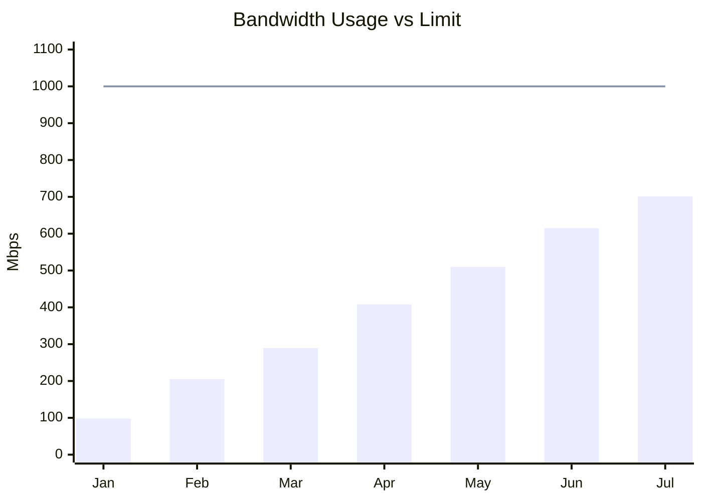
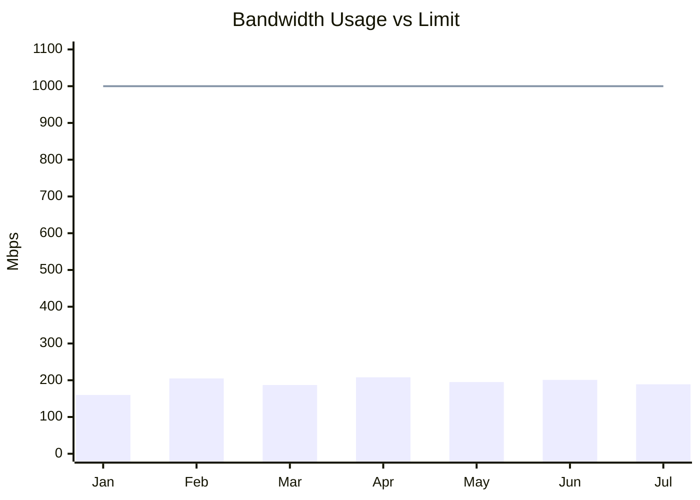

# Network Monitoring

> You cannot manage what you do not measure, you cannot measure what you do not define, you cannot define what you do not understand, and there is no success in what you do not manage. **W. Edwards Deming (1950)**

Monitoring is the active process of watching, verifying, and following a system, operation, or machine to achieve a specific goal. Monitoring is the foundational first step required to control any environment. You cannot effectively manage a network without first observing it.

## Objectives of Network Monitoring

### Trend Analysis

When monitoring a network, the collected data is utilized to verify trends and predict future infrastructure needs.

**Capacity Planning**
When monitoring a network, the collected data is utilized to verify usage trends and predict future infrastructure needs, allowing administrators to proactively arrange upgrades and avoid problems caused by a lack of bandwidth.

For example, look at this diagram:

- **Scenario:** A company has a contracted internet link of 1 Gbps (1000 Mbps).
- **The Trend:** Plotting the monthly peak bandwidth consumption reveals a consistent growth trend of approximately 100 Mbps per month.
- **Proactive Action:** By extrapolating this trend, administrators can accurately predict that the 1 Gbps limit will be exceeded by October. Through trend analysis, we can increase the bandwidth limit before it becomes a problem, avoiding outages or network degradation.

**Resource Optimization (Cost Reduction)**

When monitoring a network, the collected data is also utilized to identify underutilized resources and eliminate unnecessary expenses.

For example, look at this diagram:

- **Scenario:** A company has a contracted internet link of 1000 Mbps (1 Gbps).
- **The Trend:** Plotting the monthly peak bandwidth consumption reveals that usage consistently hovers around 200 Mbps (peaking at 208 Mbps in April).
- **Proactive Action:** The monitoring data proves that the company is wasting money and resources on excess capacity. Through resource optimization, we can reduce the contracted link to 400 Mbps or 500 Mbps. This significantly reduces costs while guaranteeing that all company activities will still be executed perfectly.

### Threat Detection

When monitoring a network, the collected data is utilized to detect malicious activities and unauthorized access attempts in real-time, allowing administrators to secure the environment before a breach occurs.

- **Scenario:** A system log shows a rapid succession of "login failure" messages on a router. Two external IP addresses (`183.245.35.35` and `143.0.87.107`) are repeatedly attempting to connect via Telnet, cycling through default usernames like `root`, `enable`, and `shell`.
    
- **The Threat:** This is a classic brute-force attack. If left unchecked, this attack will eventually succeed because, given enough time, the attackers will guess a valid username and password combination.
    
- **Proactive Action:** Because the network is actively monitored, administrators can see this attack happening and take immediate action, such as blocking the hackers' IPs at the firewall. Conversely, an unmonitored network is completely blind to this activity and will inevitably be compromised; it is only a matter of time.

### How to Monitor: Active vs. Passive Methods

Here is a breakdown of the advantages and disadvantages of both monitoring methods to add to your notes. Understanding these trade-offs helps in designing a robust, hybrid monitoring strategy.

#### Active Monitoring (Polling/Synthetic)

In active monitoring, the system acts as an investigator, periodically knocking on the doors of your devices to ask, "Are you still there? How are you performing?"

**Advantages:**

- **Predictability:** Because the monitoring server dictates the schedule, the network overhead is predictable and controlled.
- **Proactive Problem Detection:** By simulating user traffic (synthetic monitoring) or pinging devices, you can discover that a service is down or slow _before_ real users actually complain about it.
- **End-to-End Visibility:** It allows you to test the complete path of a service (e.g., automatically logging into a website every 5 minutes to ensure the database and web server are communicating).

**Disadvantages:**

- **Blind Spots Between Intervals:** If you poll a device every 5 minutes, an issue could occur and resolve itself within that 5-minute window, leaving you completely blind to the event.
- **Artificial Network Load:** Active monitoring generates its own traffic. In highly constrained networks, excessive polling can consume valuable bandwidth and CPU cycles on the target devices.

**Protocols**
In active monitoring, the central server initiates the communication, reaching out to the devices to gather information.

- **ICMP (Internet Control Message Protocol):** * **How it works:** This is the foundation of the classic `ping` command. The monitoring server sends an ICMP Echo Request to a device and waits for an Echo Reply.
    
    - **Use Case:** It is primarily used for basic up/down availability checks and measuring network latency (Round Trip Time). If a device stops responding to ICMP, the monitor flags it as offline.
        
- **SNMP (Simple Network Management Protocol) - GET Requests:**
    
    - **How it works:** SNMP is the industry standard for managing network equipment (routers, switches, firewalls). In active mode, the monitoring server sends an "SNMP GET" request to query specific data points (called OIDs) on the device.
        
    - **Use Case:** Used to actively fetch detailed metrics like CPU utilization, interface bandwidth usage, temperature, and memory consumption at regular intervals (e.g., every 5 minutes).
        
- **SSH (Secure Shell):**
    
    - **How it works:** The monitoring server establishes a secure, encrypted command-line session with the target device (usually a Linux server or a network switch).
        
    - **Use Case:** The monitor executes scripts or commands (like `df -h` to check disk space or `show interfaces` on a switch) and parses the text output to collect custom metrics that might not be available via SNMP.

#### Passive Monitoring (Event-Driven/Flow Analysis)

In passive monitoring, the system acts as a listener. It waits for devices to report their own status (via Syslog or SNMP Traps) or listens to the actual user traffic flowing through the network (via NetFlow or Port Mirroring).

**Advantages:**

- **Real-Time Visibility:** Devices push alerts the exact moment a threshold is crossed or an error occurs, eliminating the "blind spots" of polling intervals
- **Actual User Context:** Passive monitoring captures real user traffic and behavior, providing an accurate picture of what is actually happening on the network, rather than a simulated test.
- **Zero Artificial Traffic:** Listening to existing traffic or waiting for traps does not add artificial polling requests to the network links.

**Disadvantages:**

- **Reactive Nature:** You often only find out about a problem _after_ it has already impacted a user or a device has failed.
- **Alert Fatigue:** If a major switch goes down, every device connected to it might send an alert simultaneously. Without proper tuning and correlation, passive monitoring can flood administrators with thousands of redundant notifications.
- **High Storage Requirements:** Capturing real-time logs and network flows requires significant storage capacity and processing power to analyze effectively.

**Protocols**

In passive monitoring, the central server acts as a listener, waiting for the devices themselves to push data or alerts.

- **SNMP Traps:**
    
    - **How it works:** While SNMP GET is active, an "SNMP Trap" is completely passive. The network device is pre-configured to send an asynchronous alert (the Trap) to the monitoring server the exact moment a specific condition is met.
        
    - **Use Case:** Used for immediate fault detection. For example, if a power supply fails or a critical network port goes down, the switch instantly fires an SNMP Trap to the monitor, bypassing the usual 5-minute polling interval.
        
- **Agent-Based Monitoring:**
    
    - **How it works:** A small, lightweight software program (the "Agent") is installed directly onto the target device's operating system (common with tools like Zabbix, PRTG, or Datadog).
        
    - **Use Case:** The agent gathers deep system-level metrics from the inside and pushes that data out to the monitoring server. This is highly secure and firewall-friendly, as the agent usually initiates an outbound connection over HTTPS to deliver the data, meaning you do not have to open inbound ports on the server's firewall.

### Common Mistakes in Network Monitoring

To maintain a healthy and secure infrastructure, network administrators must actively avoid several common pitfalls:

- **Being Reactive to Security Threats:** It is not enough to simply react to a threat after it has already breached the perimeter. Monitoring should be used proactively to prevent the problem from occurring in the first place.
- **Ignoring Devices or Applications:** Some administrators monitor only the physical hardware devices, while others focus exclusively on the software applications. The correct and secure approach is to comprehensively monitor both.
- **Failing to Collect and Analyze Logs:** Systems constantly generate logs detailing all executed actions. However, due to the sheer volume of data, many organizations simply ignore, fail to collect, or fail to analyze this critical information.
- **Neglecting Network Updates:** New vulnerabilities are discovered daily, and software patches are constantly released to fix them. Many administrators still neglect this reality and fail to apply updates regularly, leaving known vulnerabilities exposed.
- **Ignoring Digital Hygiene Practices for Users:** Network management teams must regularly promote "digital hygiene" among the staff. This involves informing and training employees on smart password creation, the use of security codes, and the proper protocols for safe network access.