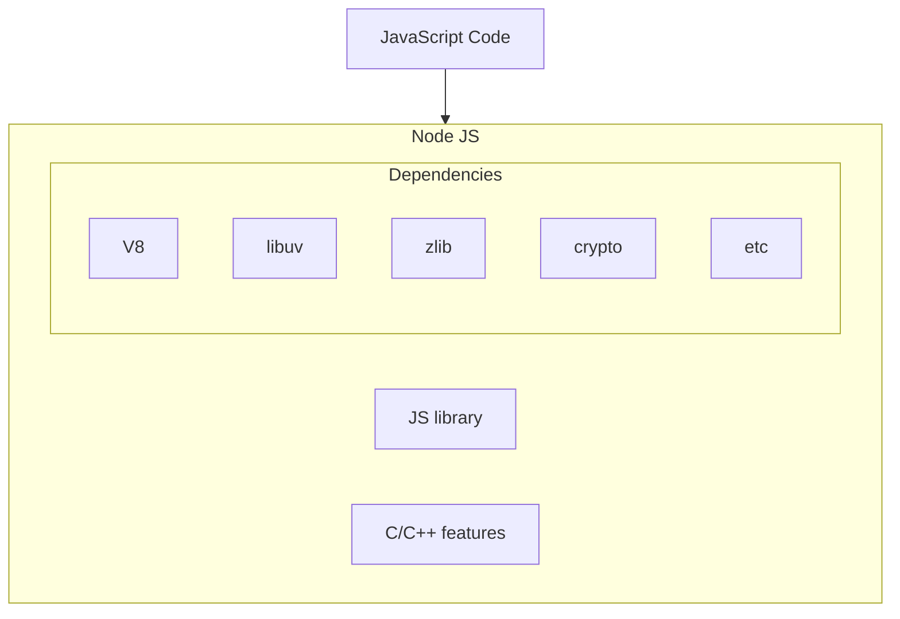

## Terms and Concepts

## ECMAScript

ECMAScript is the standardized language specification, while JavaScript is the practical implementation that builds on top of ECMAScript. However, "ECMAScript" and "JavaScript" are used virtually always interchangeably.

To understand it, here some history:

* In 1993, the first web browser with a user interface called Mosaic was released
* In 1994, the lead developers of Mosaic founded a company called Netscape and released a more polished browser called Netscape Navigator
  * Web pages could only be static and there was no interactivity after a page was loaded
* In 1995, Netscape created a new scripting language called JavaScript
  * The name was purely for marketing purpose as Java was the hot new language back then

* In 1995, Microsoft debuted their browser Internet Explorer
  * Microsoft realized that JavaScript fundamentally changed the user experience of the web and wanted the same for Internet explorer
    * But there was no specification for them to follow
* In 1996, Microsoft reverse-engineered the Navigator interpreter to create its own scripting language called JScript
  * JScript was Microsoft's implementation of JavaScript, designed to be compatible with Netscape's version but with its own differences. These differences often caused websites to behave differently in Internet Explorer compared to Netscape, making cross-browser development challenging.
  * “Best viewed in Netscape” and “Best viewed in Internet Explorer” badges became common
* In Nov 1996, Netscape submitted JavaScript to Ecma International
  * It is an industry association dedicated to the standardization of information and communication systems
  * Netscape wanted a standard specification that all browser vendors could conform to as it would help keep other implementations consistent across browsers
  * For each new specification ECMA provides a standard specification and a committee
  * In case of JavaScript, the standard is called ECMA-262 and the committee that works on ECMA-262 is called Technical Committee 39 (TC39)
    * Ecma however decided to use the term "ECMAScript" to talk about the official language
    * The reason for this is because Oracle (who acquired Microsystems) owns the trademark for the term “JavaScript”
    * ECMAScript refers to the standard language whereas JavaScript is what we use in practice and builds on top of ECMAScript

Nowadays we have many ECMAScript versions:

* 1997 – ECMAScript 1
* 1998 – ECMAScript 2
* 1999 – ECMAScript 3
* ECMAScript 4 never released
* 2009 – ECMAScript 5
* 2015 – ECMAScript 2015 (ES6)
  * the version that provides what we call modern JavaScript features. 
* One version every year since 2015

## JavaScript Engine

A JavaScript Engine is a JavaScript interpreter, that transforms it into machine language and executes it.

* JavaScript engines are typically developed by web browser vendor.
  * **V8** – Open-source JavaScript Engine developed by Google for Chrome
  * **SpiderMonkey** – The JavaScript Engine powering Mozilla Firefox
  * **JavaScriptCore** – Open-source JavaScript Engine developed by Apple for Safari
  * **Chakra** – A JavaScript Engine for the original Microsoft Edge (The latest version of edge uses V8)

## Chrome's V8

Open-source JavaScript Engine developed by Google for Chrome
* V8 implements ECMAScript as specified in ECMA-262.
* V8 is written in C++ and is used in Google Chrome, the open source browser from Google.
* V8 can run standalone, or can be embedded into any C++ application.

## JavaScript Runtime

JavaScript Runtime is an environment which provides all the necessary components in order to use and run a JavaScript program.

* A JavaScript Engine is one component in the JavaScript Runtime
* For example, Chrome Brower is a JavaScript Runtime, that contains
  * V8 engine
  * web browser APIs
    * DOM
    * Storage
    * Timers
  * Microtask Queue
  * Callback/Task queue
  * Event Loop

## Node.JS

Node.JS is an open-source, cross-platform JavaScript runtime environment
* It is not a language, it is not a framework
* Capable of executing JavaScript code outside a browser
* It can execute not only the standard ECMAScript language but also new features that are made available through C++ bindings using the V8 engine
* It consists of C++ files which form the core features and JavaScript files which expose common utilities and some of the C++ features for easier consumption

